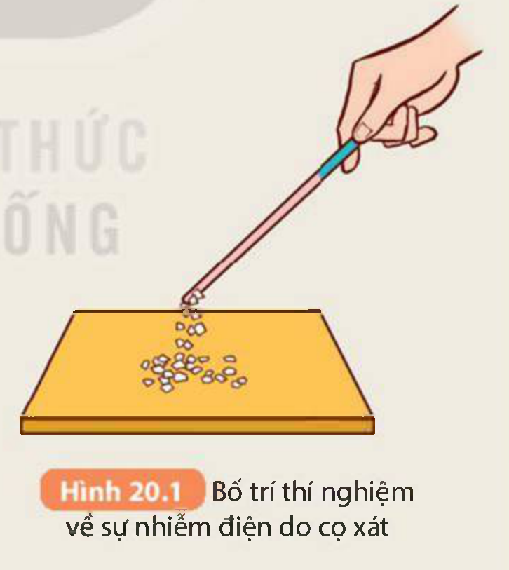
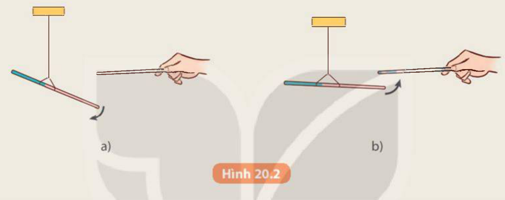
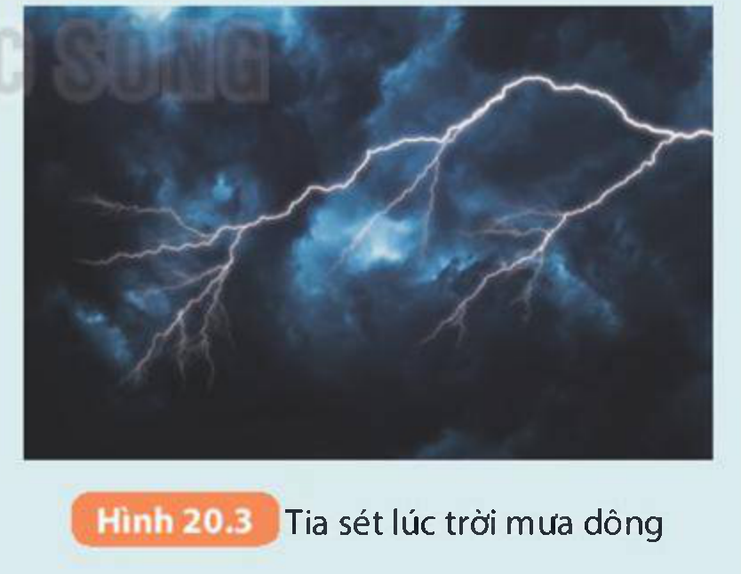
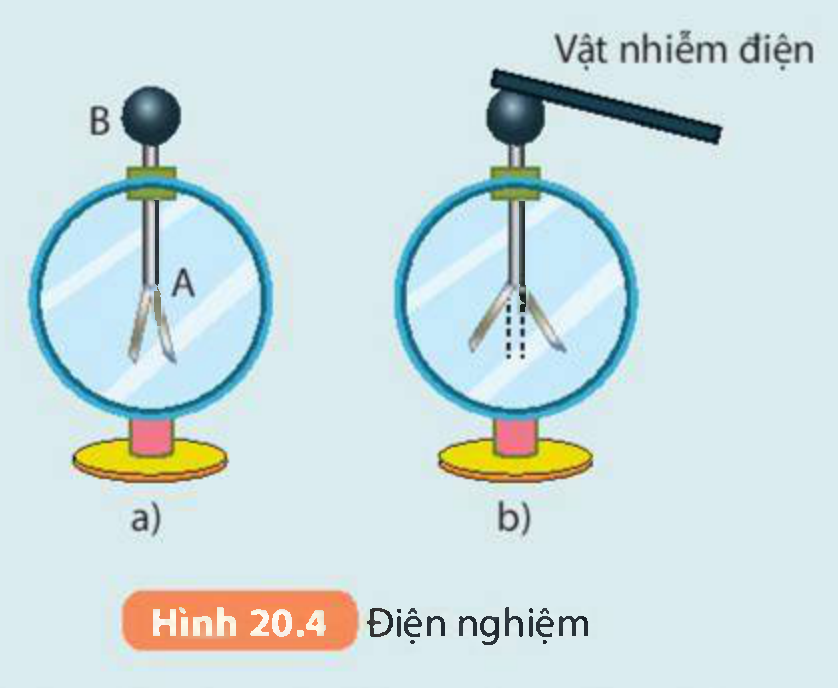

<!-- pdf:86 -->
<!-- CHƯƠNG V - ĐIỆN -->

# BÀI 20: HIỆN TƯỢNG NHIỄM ĐIỆN DO CỌ XÁT

## 🎯 Mục tiêu

- Giải thích được sơ lược nguyên nhân một vật cách điện nhiễm điện do cọ xát.
- Giải thích được một vài hiện tượng thực tế liên quan đến sự nhiễm điện do cọ xát.

## 🔴 Mở đầu

> Vì sao vào những ngày hanh khô, khi chải tóc bằng lược nhựa thì nhiều sợi tóc bị lược nhựa hút kéo thẳng ra?

## I. Vật nhiễm điện

> ✋ *Thí nghiệm 1*
>
> *Chuẩn bị:*
> - Một chiếc đũa bằng nhựa, một chiếc đũa bằng thuỷ tinh.
> - Một mảnh vải len (hoặc dạ) và một mảnh vải lụa.
> - Một số mẩu giấy vụn.
>
> *Tiến hành:*
> - Đưa chiếc đũa nhựa lại gần các mẩu giấy (Hình 20.1), có hiện tượng gì xảy ra không?
> - Cọ chiếc đũa nhựa vào mảnh vải len (hoặc dạ) sau đó đưa lại gần các mẩu giấy vụn, quan sát hiện tượng xảy ra.
> - Làm thí nghiệm tương tự, thay đũa nhựa bằng đũa thuỷ tinh được cọ xát vào mảnh vải lụa, quan sát hiện tượng xảy ra.
> - Mô tả hiện tượng xảy ra và rút ra nhận xét.
>
> 
>
> Hình 20.1. Bố trí thí nghiệm về sự nhiễm điện do cọ xát

Các vật sau khi bị cọ xát có tính chất hút được các vật khác (mẩu giấy vụn) được gọi là **vật nhiễm điện** hay **vật mang điện tích**.

<!-- pdf:87 -->

> ✋ *Thí nghiệm 2*
>
> *Chuẩn bị:*
> - Hai đũa nhựa và một đũa thuỷ tinh.
> - Mảnh vải len (hoặc dạ) và mảnh vải lụa.
> - Giá thí nghiệm và dây treo.
>
> *Tiến hành:*
> - Lấy một đũa nhựa cọ vào mảnh vải len, sau đó treo lên giá thí nghiệm. Lấy chiếc đũa nhựa thứ hai cọ vào mảnh vải len rồi đưa lại gần đầu đũa nhựa kia (Hình 20.2a). Quan sát hiện tượng xảy ra.
> - Thay đũa nhựa bằng đũa thuỷ tinh đã cọ vào mảnh vải lụa, rồi đưa lại gần đũa nhựa (Hình 20.2b). Quan sát hiện tượng xảy ra.
>
> 
>
> Hình 20.2

> ❓ 1. Từ các kết quả thí nghiệm, rút ra nhận xét gì? Điện tích trên đũa thuỷ tinh có cùng loại với điện tích trên đũa nhựa không?
> 2. Các điện tích cùng loại và khác loại tác dụng với nhau như thế nào?

<!-- term: Hai loại điện tích -->
Đũa nhựa nhiễm điện khi cọ xát vào mảnh vải len; đũa thuỷ tinh nhiễm điện khi cọ xát vào mảnh vải lụa. Điện tích trên đũa nhựa và trên đũa thuỷ tinh là hai loại khác nhau.

<!-- term: Hai loại điện tích -->
Người ta quy ước điện tích xuất hiện trên đũa thuỷ tinh sau khi cọ xát vào mảnh vải lụa là **điện tích dương** ($+$); điện tích xuất hiện trên đũa nhựa sau khi cọ xát vào mảnh vải len là **điện tích âm** ($-$). Hai vật nhiễm điện cùng dấu thì đẩy nhau, nhiễm điện khác dấu thì hút nhau.

> ❓ Trả lời câu hỏi ở phần mở đầu.

<!-- pdf:88 -->

## II. Giải thích sơ lược về sự nhiễm điện do cọ xát
<!-- ocr-ok: OCR bỏ sót tiêu đề mục II in màu cam trên trang 86 (pdf:88), đã đối chiếu ảnh gốc -->

Vì sao một số vật cách điện có thể nhiễm điện khi cọ xát vào vải len, lụa? Để trả lời câu hỏi này ta cần ôn lại kiến thức cấu tạo của nguyên tử trong sách Khoa học tự nhiên lớp 7.

> ✋ Hãy thảo luận để trả lời các câu hỏi dưới đây:
> 1. Nguyên tử có cấu tạo như thế nào? Hãy vẽ hình mô tả cấu tạo nguyên tử.
> 2. Electron trong nguyên tử có thể dịch chuyển như thế nào?

<!-- term: Sự nhiễm điện do cọ xát -->
Vận dụng kiến thức về cấu tạo nguyên tử giải thích sự nhiễm điện dương của đũa thuỷ tinh khi bị cọ xát vào vải lụa hoặc sự nhiễm điện âm của đũa nhựa khi bị cọ xát vào vải len:
- Khi đũa thuỷ tinh cọ xát vào lụa thì các electron từ đũa thuỷ tinh dịch chuyển sang vải lụa. Đũa thuỷ tinh mất bớt electron nên nhiễm điện dương, mảnh vải lụa nhận thêm electron nên nhiễm điện âm.
- Khi cọ xát đũa nhựa vào vải len, các electron từ vải len dịch chuyển sang đũa nhựa. Đũa nhựa nhận thêm electron nên nhiễm điện âm, mảnh vải len mất bớt electron nên nhiễm điện dương.

> ❓ 1. Giải thích tại sao bụi lại bám nhiều ở cánh quạt điện sau một thời gian sử dụng.
> 2. Vì sao vào những ngày thời tiết khô ráo, khi lau chùi gương soi, kính cửa sổ hay màn hình ti vi bằng khăn bông khô thì vẫn thấy có bụi bông bám vào?

> 🔍 Em có biết?
>
> *1. Hiện tượng sấm sét lúc trời mưa dông*
>
> Một hiện tượng thiên nhiên đặc biệt phổ biến xảy ra ở khắp mọi nơi trên Trái Đất của chúng ta, đó là sấm sét (Hình 20.3). Sự cọ xát mạnh giữa những giọt nước trong luồng không khí bốc lên cao là một trong những nguyên nhân tạo thành các đám mây dông bị nhiễm điện. Khi hai đám mây tích điện trái dấu lại gần nhau, giữa chúng có hiện tượng phóng tia lửa điện, phát ra ánh sáng chói loà, gọi là **sét**. Do nhiệt độ cao của tia lửa điện, không khí dãn nở đột ngột, phát ra tiếng nổ gọi là **sấm**.
>
> 
>
> Hình 20.3. Tia sét lúc trời mưa dông
>
> Cách phòng tránh sét đánh lúc trời mưa dông:
> - Khi ở trong nhà nên đứng xa cửa sổ, cửa ra vào, các đồ dùng điện, tránh các chỗ ẩm ướt như buồng tắm, bể nước, vòi nước, không nên dùng điện thoại; nên rút phích cắm các thiết bị điện trước lúc có dông gần xảy ra.
> - Nếu ở ngoài trời, tuyệt đối không trú mưa dưới tán cây cao, tránh các khu vực cao hơn xung quanh, tránh xa các vật dụng kim loại như xe đạp, xe máy, hàng rào sắt.

<!-- pdf:89 -->

> *2. Điện nghiệm*
>
> **Điện nghiệm** là dụng cụ dùng để phát hiện một vật có nhiễm điện hay không.
> - Cấu tạo:
>   Điện nghiệm có cấu tạo như Hình 20.4a. Bộ phận cơ bản là thanh kim loại A, đầu trên của thanh gắn với quả cầu bằng kim loại B, đầu dưới của thanh gắn với hai lá kim loại mỏng, có thể xoè ra, cụp vào. Tất cả được đặt trong hộp kín, có mặt kính để quan sát.
>
> 
>
> Hình 20.4. Điện nghiệm
>
> - Nguyên tắc hoạt động:
>   Khi thanh A nhiễm điện thì hai lá kim loại cũng nhiễm điện và nhiễm điện cùng dấu nên chúng đẩy nhau (xoè ra). Để kiểm tra một vật có nhiễm điện hay không, người ta đưa vật chạm vào quả cầu B, nếu hai lá kim loại xoè ra thì chứng tỏ vật có nhiễm điện; góc xoè của hai lá kim loại càng lớn thì vật nhiễm điện càng mạnh (Hình 20.4b).

## 📌 Em đã học

<!-- term: Sự nhiễm điện do cọ xát -->
- Có thể làm nhiễm điện nhiều vật cách điện bằng cọ xát; vật bị nhiễm điện có khả năng hút các vật khác.
- Các vật nhiễm điện cùng dấu thì đẩy nhau, khác dấu thì hút nhau.

## 🚀 Em có thể

Giải thích được một số hiện tượng liên quan đến sự nhiễm điện do cọ xát trong thực tế.

## 📷 Danh sách hình trong bài

| Mã hình | Trang PDF | Vị trí trong bài | Chú thích gốc |
| --- | :---: | --- | --- |
| H8-khoa_hoc_tu_nhien-b20-01 | 86 | Mục I, Thí nghiệm 1 | Hình 20.1. Bố trí thí nghiệm về sự nhiễm điện do cọ xát |
| H8-khoa_hoc_tu_nhien-b20-02 | 87 | Mục I, Thí nghiệm 2 | Hình 20.2 |
| H8-khoa_hoc_tu_nhien-b20-03 | 88 | Mục II, Em có biết? (1) | Hình 20.3. Tia sét lúc trời mưa dông |
| H8-khoa_hoc_tu_nhien-b20-04 | 89 | Mục II, Em có biết? (2) | Hình 20.4. Điện nghiệm |
