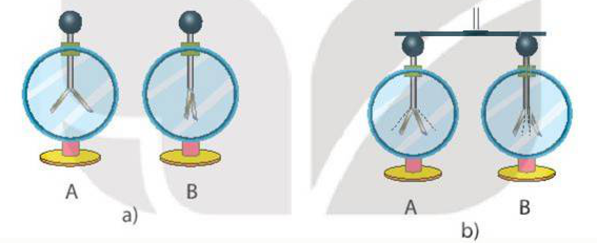
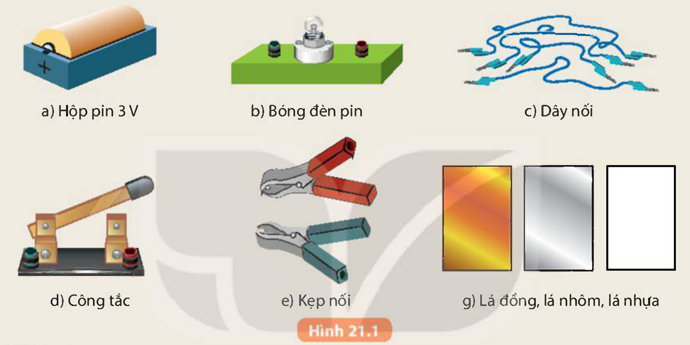
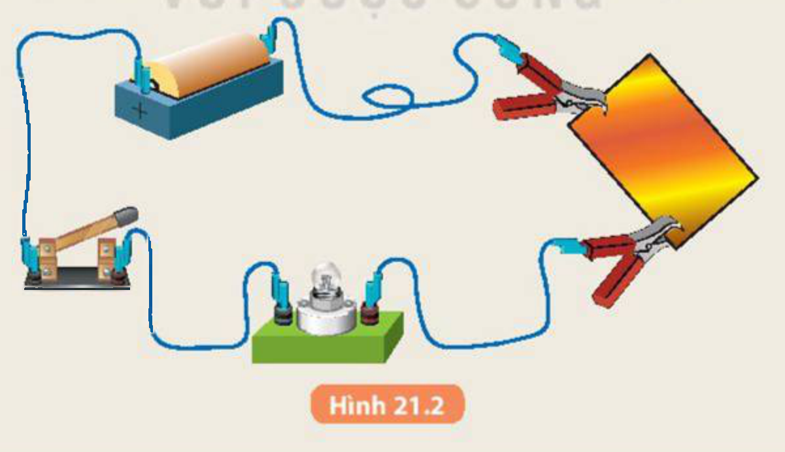
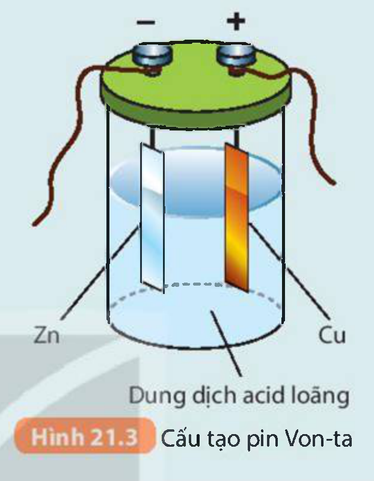

<!-- pdf:90 -->

# BÀI 21: DÒNG ĐIỆN, NGUỒN ĐIỆN

## 🎯 Mục tiêu

- Nêu được định nghĩa dòng điện là dòng chuyển dời có hướng của các hạt mang điện; phân loại được vật dẫn điện, vật không dẫn điện.
- Nêu được nguồn điện có khả năng cung cấp năng lượng điện và liệt kê được một số nguồn điện thông dụng trong đời sống.

## 🔴 Mở đầu

> Quan sát thí nghiệm sau:
>
> Có hai điện nghiệm, điện nghiệm A được tích điện nên hai lá kim loại xoè ra; điện nghiệm B không tích điện nên hai lá kim loại cụp lại (Hình a). Nối hai quả cầu của hai điện nghiệm, hiện tượng xảy ra: hai lá kim loại của điện nghiệm A giảm độ xoè, hai lá kim loại của điện nghiệm B xoè ra (Hình b). Kết quả thí nghiệm chứng tỏ điều gì?
>
> 

## I. Dòng điện và nguồn điện

### 1. Dòng điện

Kết quả thí nghiệm trên chứng tỏ các hạt mang điện ở điện nghiệm A đã chuyển dịch qua thanh kim loại sang điện nghiệm B. Người ta nói, qua thanh kim loại đã có dòng điện. **Dòng điện** là dòng chuyển dời có hướng của các hạt mang điện.

### 2. Nguồn điện

Muốn duy trì dòng điện trong các thiết bị tiêu thụ điện phải có **nguồn điện**. Nguồn điện có khả năng cung cấp năng lượng điện để các dụng cụ điện hoạt động.

Những nguồn điện thường dùng là pin, acquy,... Pin, acquy có hai cực: cực dương ($+$) và cực âm ($-$).

> ❓ Hãy kể tên các nguồn điện khác mà em biết.

<!-- pdf:91 -->

## II. Vật dẫn điện và vật không dẫn điện

> ✋ *Thí nghiệm*
>
> *Chuẩn bị* (Hình 21.1):
> - Nguồn điện $3\text{ V}$.
> - Bóng đèn pin $2,5\text{ V}$.
> - Các dây nối – Công tắc.
> - Hai chiếc kẹp bằng kim loại dùng để kẹp nối vào hai đầu của vật cần nghiên cứu.
> - Lá đồng, lá nhôm, lá nhựa.
>
> 
>
> Hình 21.1. a) Hộp pin $3\text{ V}$; b) Bóng đèn pin; c) Dây nối; d) Công tắc; e) Kẹp nối; g) Lá đồng, lá nhôm, lá nhựa
>
> *Tiến hành:*
> - Bố trí thí nghiệm như Hình 21.2. Đóng công tắc, quan sát hiện tượng.
> - Lần lượt thay lá đồng bằng lá nhôm và lá nhựa. Đóng công tắc, quan sát hiện tượng.
>
> Từ kết quả thí nghiệm, rút ra nhận xét về sự dẫn điện của lá đồng, lá nhôm, lá nhựa.
>
> 
>
> Hình 21.2

**Vật dẫn điện** là vật cho dòng điện chạy qua, ví dụ, các vật làm bằng kim loại.

**Vật không dẫn điện** (**vật cách điện**) là vật không cho dòng điện chạy qua, ví dụ như vật làm bằng nhựa, gỗ, thuỷ tinh, sứ,...

<!-- pdf:92 -->

> ❓ 1. Trong những vật sau đây: thanh gỗ khô, ruột bút chì, dây nhựa, thanh thuỷ tinh, đoạn dây nhôm. Vật nào là vật dẫn điện, vật nào là vật cách điện?
> 2. Kể tên những vật liệu cách điện trong các dụng cụ và thiết bị điện thường dùng mà em biết.

> 🔍 Em có biết?
>
> Năm 1800, Von-ta (Alessandro Volta) chế tạo pin điện đầu tiên trên thế giới, gọi là **pin Von-ta**, có khả năng tạo ra dòng điện một chiều ổn định. Sáng chế của ông đã đặt nền móng cho việc nghiên cứu các ứng dụng của điện sau này.
>
> Pin Von-ta có cấu tạo gồm hai bản kim loại đồng và kẽm nhúng trong bình đựng dung dịch acid loãng (Hình 21.3). Do tác dụng của dung dịch acid với hai bản kim loại, bản đồng trở thành cực dương, bản kẽm trở thành cực âm. Nếu nối hai cực bằng dây dẫn, trong dây dẫn có dòng điện.
>
> 
>
> Hình 21.3. Cấu tạo pin Von-ta

## 📌 Em đã học

- Dòng điện là dòng chuyển dời có hướng của các hạt mang điện.
- Nguồn điện có khả năng cung cấp năng lượng điện cho các dụng cụ điện hoạt động. Pin, acquy là những nguồn điện có hai cực, một cực là cực dương (kí hiệu $+$), một cực là cực âm (kí hiệu $-$).
- Vật dẫn điện là vật cho dòng điện chạy qua, vật không dẫn điện (vật cách điện) là vật không cho dòng điện chạy qua. Vật dẫn điện thường gặp là những vật làm bằng kim loại, vật cách điện thường gặp là những vật làm bằng sứ, nhựa, cao su,...

## 🚀 Em có thể

- Nhận biết được các nguồn điện đơn giản như pin, acquy.
- Làm được pin Von-ta đơn giản bằng vật liệu dễ tìm kiếm: nửa quả chanh, hai điện cực bằng đồng và bằng kẽm.
- Lựa chọn được vật cách điện, vật dẫn điện.

## 📷 Danh sách hình trong bài

| Mã hình | Trang PDF | Vị trí trong bài | Chú thích gốc |
| --- | :---: | --- | --- |
| H8-khoa_hoc_tu_nhien-b21-01 | 90 | Mở đầu | Hình a, b (thí nghiệm nối hai điện nghiệm) |
| H8-khoa_hoc_tu_nhien-b21-02 | 91 | Mục II | Hình 21.1 |
| H8-khoa_hoc_tu_nhien-b21-03 | 91 | Mục II | Hình 21.2 |
| H8-khoa_hoc_tu_nhien-b21-04 | 92 | Mục II, Em có biết? | Hình 21.3. Cấu tạo pin Von-ta |
