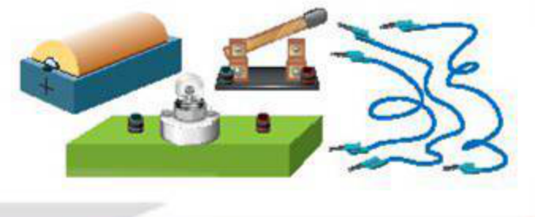
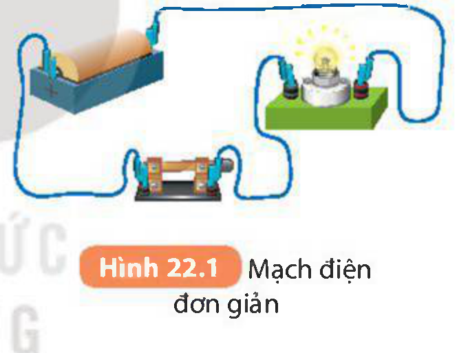
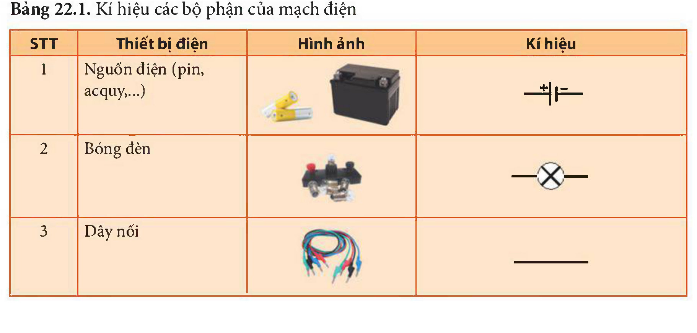
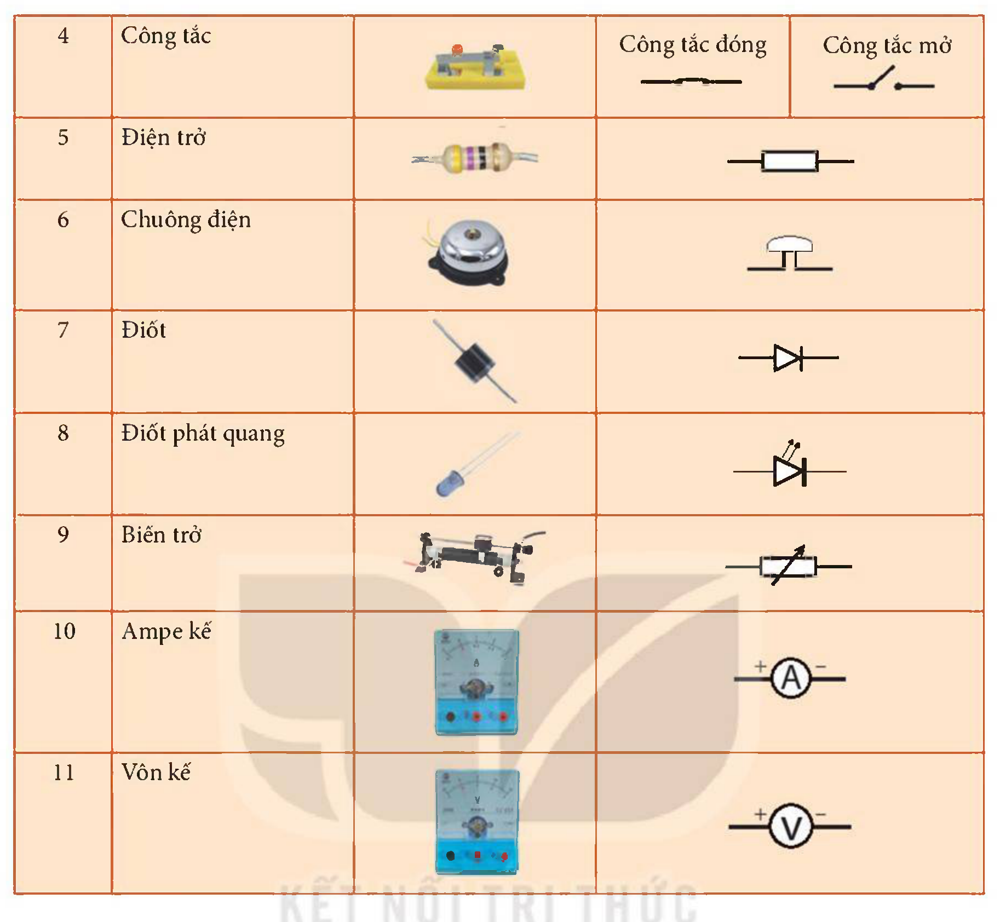
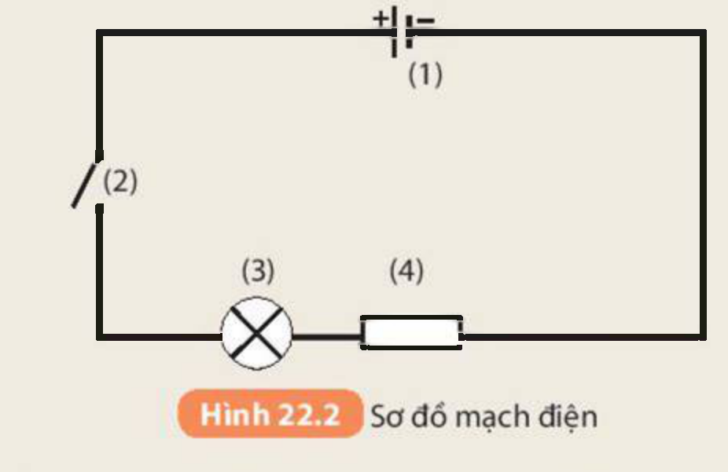
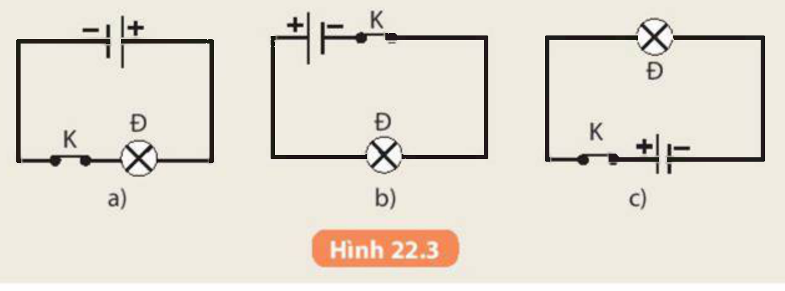
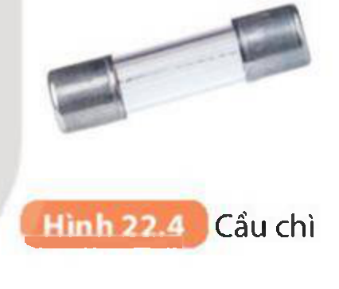
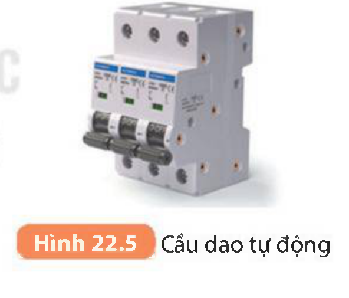
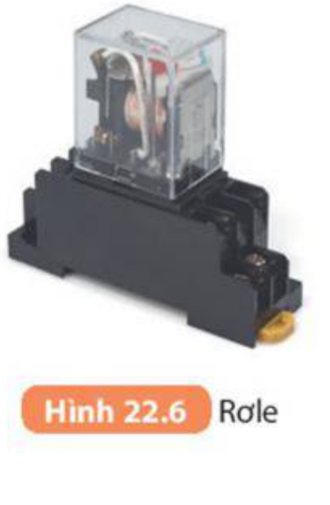
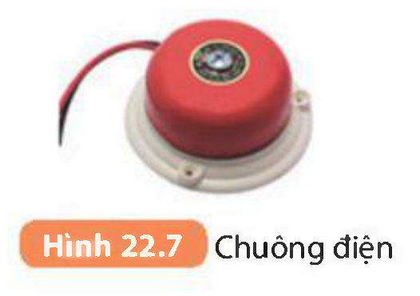

<!-- pdf:93 -->

# BÀI 22: MẠCH ĐIỆN ĐƠN GIẢN

## 🎯 Mục tiêu

- Vẽ được sơ đồ mạch điện với các kí hiệu mô tả: điện trở, biến trở, chuông điện, ampe kế, vôn kế, điốt và điốt phát quang.
- Mắc được mạch điện đơn giản với: pin, công tắc, dây nối, bóng đèn.
- Mô tả được sơ lược công dụng của cầu chì, rơle, cầu dao tự động, chuông điện.

## 🔴 Mở đầu

> Có một pin, một bóng đèn pin, một công tắc, các đoạn dây nối (hình bên).
> Làm cách nào để bóng đèn pin phát sáng?
>
> 

## I. Mạch điện và các bộ phận của mạch điện

Với các dụng cụ: pin, bóng đèn, dây nối, công tắc, để bóng đèn phát sáng ta phải nối chúng lại với nhau theo Hình 22.1 thành một mạch kín, gọi là **mạch điện**.

Bất cứ mạch điện nào cũng gồm các bộ phận: nguồn điện, dây nối và các thiết bị tiêu thụ năng lượng điện (bóng đèn, động cơ điện, bếp điện, quạt điện, ti vi,...).

Hình 22.1. Mạch điện đơn giản

<!-- term: Sơ đồ mạch điện -->
Nhằm mô tả đơn giản một mạch điện và lắp mạch điện đúng yêu cầu, người ta sử dụng kí hiệu biểu thị các bộ phận của mạch điện như Bảng 22.1 để vẽ sơ đồ mạch điện.

Bảng 22.1. Kí hiệu các bộ phận của mạch điện

| STT | Thiết bị điện | Hình ảnh | Kí hiệu |
| :---: | --- | :---: | :---: |
| 1 | Nguồn điện (pin, acquy,...) | — | $\text{—}\!\!|^{+}\!\shortmid^{-}\!\!\text{—}$ |
| 2 | Bóng đèn | — | $\text{—}\otimes\text{—}$ |
| 3 | Dây nối | — | $\text{———}$ |

<!-- pdf:94 -->

| STT | Thiết bị điện | Hình ảnh | Kí hiệu |
| :---: | --- | :---: | :---: |
| 4 | Công tắc | — | Công tắc đóng: $\text{—}\bullet\!\!\text{—}\!\!\bullet\text{—}$ / Công tắc mở: $\text{—}\bullet\!\!/\;\bullet\text{—}$ |
| 5 | Điện trở | — | $\text{—}\square\text{—}$ |
| 6 | Chuông điện | — | $\cap$ (gắn trên hai cực nối dây) |
| 7 | Điốt | — | $\text{—}\triangleright\!\!|\text{—}$ |
| 8 | Điốt phát quang | — | $\text{—}\triangleright^{\!\!\nearrow\nearrow}\!\!|\text{—}$ |
| 9 | Biến trở | — | $\text{—}\!\not\!\square\text{—}$ |
| 10 | Ampe kế | — | $\text{—}{}^{+}\!\text{(A)}\!{}^{-}\text{—}$ |
| 11 | Vôn kế | — | $\text{—}{}^{+}\!\text{(V)}\!{}^{-}\text{—}$ |

<!-- ocr-ok: bảng kí hiệu sơ đồ mạch điện Bảng 22.1 trang 92 (pdf:94), đã đối chiếu ảnh gốc -->

> ✋ 1. Vẽ sơ đồ của mạch điện trong Hình 22.1.
> 2. Gọi tên các thiết bị được đánh số từ (1) đến (4) ở sơ đồ mạch điện Hình 22.2.
>
> 
>
> Hình 22.2. Sơ đồ mạch điện
>
> 3. Mắc mạch điện gồm pin, bóng đèn, công tắc, dây nối. Tiến hành kiểm tra và đóng công tắc để đảm bảo mạch điện kín và đèn sáng. Nếu đèn không sáng, tìm nguyên nhân.

<!-- pdf:95 -->

> 4. Dòng điện cung cấp bởi pin hoặc acquy có chiều không đổi gọi là **dòng điện một chiều**. Người ta quy ước **chiều dòng điện** trong mạch điện là chiều từ cực dương của nguồn điện qua dây nối và các dụng cụ tiêu thụ điện tới cực âm của nguồn điện.
> Vẽ mũi tên chỉ chiều dòng điện trong các sơ đồ mạch điện ở Hình 22.3.
>
> 
>
> Hình 22.3

## II. Công dụng của cầu chì, cầu dao tự động, rơle, chuông điện

Trong mạch điện, ngoài các thiết bị cung cấp và tiêu thụ điện, còn có các thiết bị như cầu chì, cầu dao tự động, rơle, chuông điện,... để bảo vệ mạch điện và cảnh báo sự cố xảy ra.

<!-- term: Cầu chì -->
Hình 22.4 là hình ảnh một loại cầu chì. Bộ phận cơ bản của cầu chì là một đoạn dây chì nóng chảy ở nhiệt độ thấp so với các kim loại khác. Vì một lí do nào đó, dòng điện trong mạch đột ngột tăng quá mức, lúc đó dây chì nóng chảy, mạch điện bị ngắt.

Hình 22.4. Cầu chì

> ❓ Trong mạng điện gia đình em có sử dụng cầu chì không? Nếu có thì cầu chì được mắc ở vị trí nào? Có công dụng gì?

**Cầu dao tự động** được mắc trong mạch điện cũng có tác dụng ngắt mạch như cầu chì (Hình 22.5). Khi dòng điện đột ngột tăng quá mức thì cầu dao sẽ tự động ngắt mạch điện để các thiết bị điện không bị hỏng. Sau khi kiểm tra, sửa chữa xong, cầu dao được đóng lại để mạch điện hoạt động.

Hình 22.5. Cầu dao tự động

> ❓ Trong mạng điện nhà em có sử dụng cầu dao tự động không? Nó được đặt ở vị trí nào? Có công dụng gì?

**Rơle** là dụng cụ được mắc trong mạch điện có tác dụng điều khiển đóng, ngắt mạch điện tự động (Hình 22.6).

Khác với các công tắc thông thường cần đến sự tác động trực tiếp của con người, rơle được sử dụng phổ biến ở các mạch điều khiển tự động, chuyên dụng để đóng, ngắt những dòng điện lớn mà những hệ thống mạch điều khiển không thể trực tiếp can thiệp được.

Hình 22.6. Rơle

<!-- pdf:96 -->

> ❓ Trong gia đình em có thiết bị điện nào dùng rơle? Rơle trong các thiết bị đó có công dụng gì?

**Chuông điện** là thiết bị điện ứng dụng hoạt động của nam châm điện (Hình 22.7). Chuông điện phát ra âm thanh khi có dòng điện chạy qua.

Hình 22.7. Chuông điện

> ❓ Nhà em có lắp chuông điện không? Chuông điện thường được đặt ở vị trí nào trong nhà? Nó có công dụng gì?

## 📌 Em đã học

- Mạch điện đơn giản gồm có nguồn điện, dây nối, công tắc và các thiết bị điện tiêu thụ năng lượng điện.
- Quy ước chiều dòng điện trong mạch điện là chiều từ cực dương của nguồn điện qua dây nối và các dụng cụ tiêu thụ năng lượng điện tới cực âm của nguồn điện.
- Cầu chì, cầu dao tự động, rơle có tác dụng bảo vệ mạch điện, chuông điện có tác dụng phát tín hiệu bằng âm thanh.

## 🚀 Em có thể

- Nhận biết được các thiết bị bảo vệ mạng điện trong gia đình.
- Tìm hiểu cấu tạo và hoạt động của chiếc đèn pin thường dùng, vẽ sơ đồ mạch điện của đèn pin.
- Mắc được mạch điện đơn giản để trang trí, gồm pin, dây nối, bóng đèn, công tắc.

## 📷 Danh sách hình trong bài

| Mã hình | Trang PDF | Vị trí trong bài | Chú thích gốc |
| --- | :---: | --- | --- |
| H8-khoa_hoc_tu_nhien-b22-01 | 93 | Mở đầu | Hình minh hoạ mở đầu (pin, bóng đèn pin, công tắc, dây nối) |
| H8-khoa_hoc_tu_nhien-b22-02 | 93 | Mục I | Hình 22.1. Mạch điện đơn giản |
| H8-khoa_hoc_tu_nhien-b22-03 | 93 | Mục I | Bảng 22.1. Kí hiệu các bộ phận của mạch điện (mục 1–3) |
| H8-khoa_hoc_tu_nhien-b22-04 | 94 | Mục I | Bảng 22.1. Kí hiệu các bộ phận của mạch điện (mục 4–11) |
| H8-khoa_hoc_tu_nhien-b22-05 | 94 | Mục I | Hình 22.2. Sơ đồ mạch điện |
| H8-khoa_hoc_tu_nhien-b22-06 | 95 | Mục I | Hình 22.3 |
| H8-khoa_hoc_tu_nhien-b22-07 | 95 | Mục II | Hình 22.4. Cầu chì |
| H8-khoa_hoc_tu_nhien-b22-08 | 95 | Mục II | Hình 22.5. Cầu dao tự động |
| H8-khoa_hoc_tu_nhien-b22-09 | 95 | Mục II | Hình 22.6. Rơle |
| H8-khoa_hoc_tu_nhien-b22-10 | 96 | Mục II | Hình 22.7. Chuông điện |
