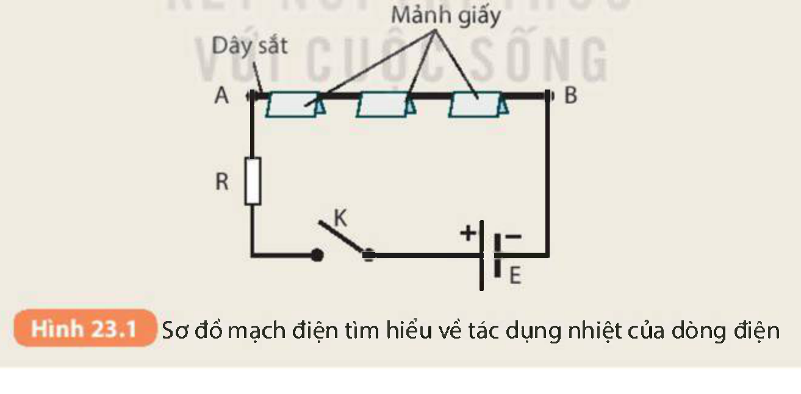
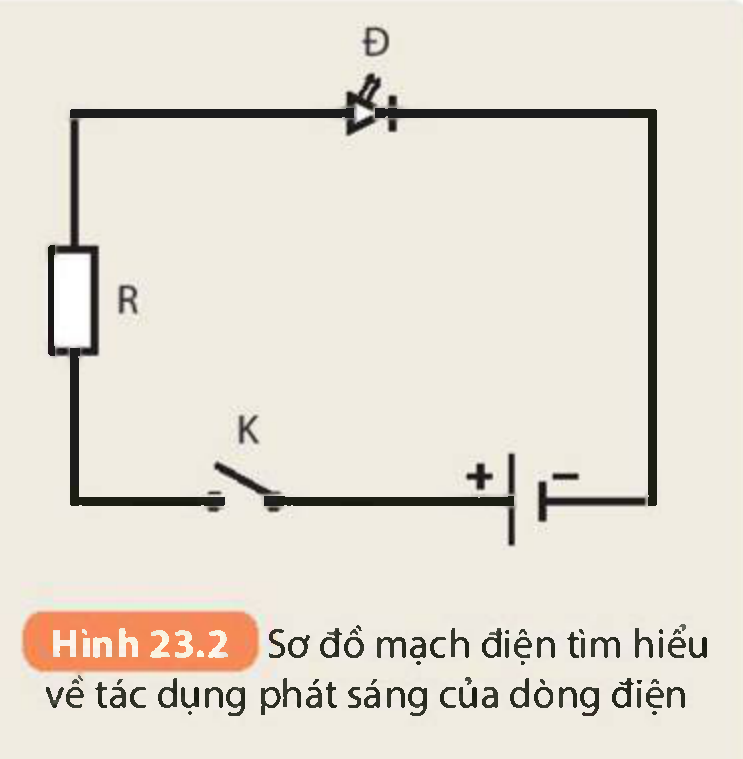
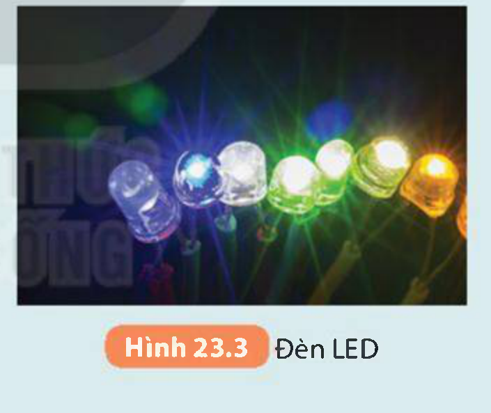
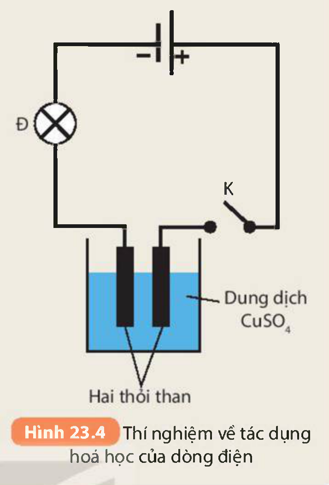
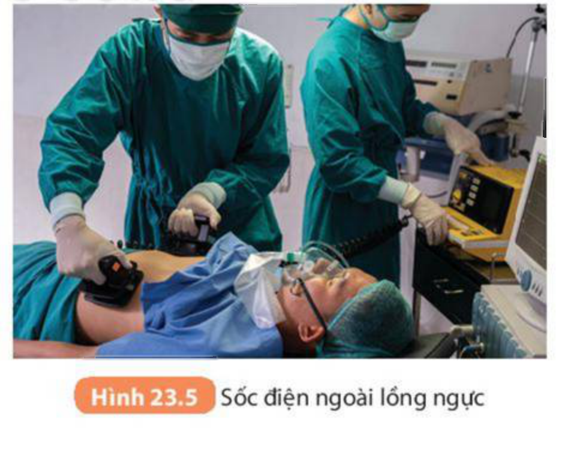

<!-- pdf:97 -->

# BÀI 23: TÁC DỤNG CỦA DÒNG ĐIỆN

## 🎯 Mục tiêu

Thực hiện thí nghiệm để minh hoạ được các tác dụng cơ bản của dòng điện: nhiệt, phát sáng, hoá học, sinh lí.

## 🔴 Mở đầu

> Khi có dòng điện trong mạch, ta không nhìn thấy các hạt mang điện dịch chuyển, nhưng ta có thể nhận biết sự tồn tại của dòng điện qua các tác dụng của nó.
> Em có thể kể ra dòng điện có những tác dụng gì?

## I. Tác dụng nhiệt

Vật dẫn nóng lên khi có dòng điện chạy qua, người ta nói đó là **tác dụng nhiệt của dòng điện**.

> ✋ *Thí nghiệm*
>
> *Chuẩn bị:* nguồn điện $9\text{ V}$, dây nối, công tắc K, sợi dây sắt AB, vài mảnh giấy, điện trở R có giá trị nhỏ.
>
> *Tiến hành:*
> - Lắp mạch điện như Hình 23.1.
> - Đóng công tắc K. Quan sát hiện tượng xảy ra với các mảnh giấy. Hiện tượng đó chứng tỏ điều gì?
>
> 
>
> Hình 23.1. Sơ đồ mạch điện tìm hiểu về tác dụng nhiệt của dòng điện

> ❓ Nêu một số ví dụ trong đời sống ứng dụng tác dụng nhiệt của dòng điện.

## II. Tác dụng phát sáng

Dòng điện không chỉ có tác dụng nhiệt mà còn có tác dụng phát sáng. Để kiểm chứng tác dụng phát sáng của dòng điện, ta làm thí nghiệm sau.

<!-- pdf:98 -->

> ✋ *Thí nghiệm*
>
> *Dụng cụ:*
> - Nguồn điện $3\text{ V}$.
> - Đèn điốt phát quang Đ (đèn LED).
> - Điện trở R (có tác dụng bảo vệ đèn LED không bị hỏng).
> - Công tắc K.
>
> *Tiến hành:*
> - Lắp mạch điện theo sơ đồ Hình 23.2.
> - Đóng công tắc K. Quan sát đèn LED.
> - Đảo ngược hai đầu dây đèn LED, đóng công tắc K. Đèn LED có sáng không?
>
> 
>
> Hình 23.2. Sơ đồ mạch điện tìm hiểu về tác dụng phát sáng của dòng điện

> ❓ Qua thí nghiệm, rút ra kết luận gì về tác dụng của dòng điện.

> 🔍 Em có biết?
>
> **Đèn LED** là một **điốt phát quang**. Cho dòng điện chạy qua đèn LED đúng chiều (cực dương của đèn nối với cực dương của nguồn điện, cực âm của đèn nối với cực âm nguồn điện) thì đèn phát sáng.
>
> Dùng đèn LED vào mục đích chiếu sáng rất tiết kiệm điện năng so với đèn sợi đốt vì nhiệt toả ra trên đèn LED không đáng kể và tuổi thọ rất lớn (có thể đến $100\ 000$ giờ). Đèn LED còn được ứng dụng trong y học. Ví dụ, dùng đèn LED với ánh sáng thích hợp có tác dụng làm trẻ hoá da, trị mụn trứng cá trên da, trị bệnh vàng da sơ sinh.
>
> 
>
> Hình 23.3. Đèn LED

## III. Tác dụng hoá học

> ✋ *Thí nghiệm*
>
> *Chuẩn bị:*
> - Nguồn điện $6\text{ V}$.
> - Bóng đèn pin Đ.
> - Công tắc K.
> - Bình đựng dung dịch muối copper (II) sulfate ($\ce{CuSO4}$).
> - Hai thỏi than được nối với hai cực của nguồn điện.

<!-- pdf:99 -->

> *Tiến hành:*
> - Lắp mạch điện như Hình 23.4.
> - Đóng công tắc K, quan sát hiện tượng xảy ra.
>
> Đèn Đ có sáng không? Sau vài phút, nhấc thỏi than nối với cực âm của nguồn điện ra ngoài, thỏi than có màu gì?
>
> 
>
> Hình 23.4. Thí nghiệm về tác dụng hoá học của dòng điện

Lớp màu bám trên thỏi than được xác định là kim loại đồng. Hiện tượng kim loại đồng tách khỏi dung dịch muối copper (II) sulfate và bám vào điện cực (thỏi than) khi có dòng điện chạy qua chứng tỏ dòng điện có tác dụng hoá học.

## IV. Tác dụng sinh lí

Trong đời sống, có nhiều hiện tượng chứng tỏ tác dụng sinh lí của dòng điện.

Thực tế cho thấy dòng điện có thể chạy qua cơ thể sống. Trong cơ thể chứa nhiều nước là những hợp chất dẫn điện tốt. Nếu sơ ý để cho dòng điện đi qua cơ thể người thì dòng điện sẽ làm các cơ co giật, có thể làm tim ngừng đập, ngạt thở và thần kinh bị tê liệt. Tác dụng đó đều là **tác dụng sinh lí của dòng điện**.

Dòng điện có thể gây nguy hiểm tới tính mạng con người. Phải hết sức thận trọng khi dùng điện, nhất là với mạng điện ở gia đình. Tuyệt đối không lại gần các trạm biến thế điện, những trạm điện có cảnh báo “Nguy hiểm chết người”.

Tuy vậy, trong y học, để cấp cứu trường hợp tim ngừng đập, người ta dùng phương pháp sốc điện ngoài lồng ngực. Đây là phương pháp sử dụng điện thế lớn trong thời gian rất ngắn (khoảng từ $0,03\text{ s}$ đến $0,1\text{ s}$) phóng qua tim để khôi phục lại nhịp tim bình thường (Hình 23.5). Người ta có thể ứng dụng tác dụng sinh lí của dòng điện thích hợp để chữa một số bệnh.

Hình 23.5. Sốc điện ngoài lồng ngực

<!-- pdf:100 -->

> ❓ 1. Nêu ví dụ ứng dụng tác dụng phát sáng của dòng điện trong thực tế.
> 2. Vì sao khi trời mưa gió, không được lại gần dây điện rơi xuống mặt đường?

> 🔍 Em có biết?
>
> **Mạ điện** là một trong các ứng dụng tác dụng hoá học của dòng điện. Thông qua mạ điện, một lớp kim loại mạ phủ lên bề mặt vật cần mạ. Trong quá trình mạ điện, vật cần mạ được gắn với cực âm, kim loại mạ gắn với cực dương của nguồn điện, tất cả được nhúng trong dung dịch điện phân thích hợp. Ví dụ, để mạ nickel (mạ kền) một vỏ đèn pin bằng kim loại, cần phải nối vỏ đèn với cực âm, nối tấm nickel với cực dương của nguồn điện, rồi nhúng vỏ đèn và tấm nickel vào dung dịch muối nickel. Sau đó cho dòng điện chạy qua dung dịch một thời gian, sẽ có một lớp nickel phủ lên vỏ đèn pin.

## 📌 Em đã học

- Vật dẫn điện nóng lên khi có dòng điện chạy qua, đó là tác dụng nhiệt của dòng điện.
- Dòng điện có thể làm đèn điện phát sáng, đó là **tác dụng phát sáng của dòng điện**.
- Dòng điện chạy qua dung dịch điện phân có thể làm làm tách các chất khỏi dung dịch, đó là **tác dụng hoá học của dòng điện**.
- Dòng điện có tác dụng sinh lí khi đi qua cơ thể người và động vật.

## 🚀 Em có thể

- Giải thích được vì sao nên sử dụng đèn LED thay thế cho các đèn sợi đốt.
- Đưa ra giải pháp để tránh nguy hiểm cho bản thân khi sử dụng các dụng cụ tiêu thụ điện ở gia đình như: bàn là, bếp điện, quạt điện, ti vi, máy tính, tủ lạnh,...

## 📷 Danh sách hình trong bài

| Mã hình | Trang PDF | Vị trí trong bài | Chú thích gốc |
| --- | :---: | --- | --- |
| H8-khoa_hoc_tu_nhien-b23-01 | 97 | Mục I | Hình 23.1. Sơ đồ mạch điện tìm hiểu về tác dụng nhiệt của dòng điện |
| H8-khoa_hoc_tu_nhien-b23-02 | 98 | Mục II | Hình 23.2. Sơ đồ mạch điện tìm hiểu về tác dụng phát sáng của dòng điện |
| H8-khoa_hoc_tu_nhien-b23-03 | 98 | Mục II, Em có biết? | Hình 23.3. Đèn LED |
| H8-khoa_hoc_tu_nhien-b23-04 | 99 | Mục III | Hình 23.4. Thí nghiệm về tác dụng hoá học của dòng điện |
| H8-khoa_hoc_tu_nhien-b23-05 | 99 | Mục IV | Hình 23.5. Sốc điện ngoài lồng ngực |
