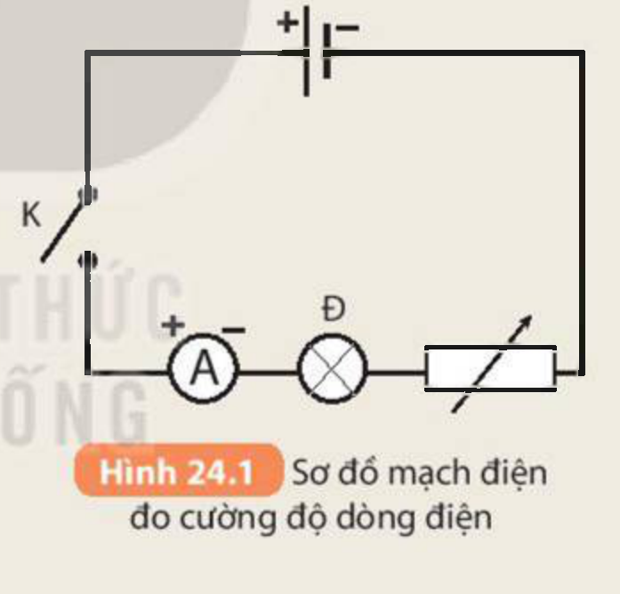
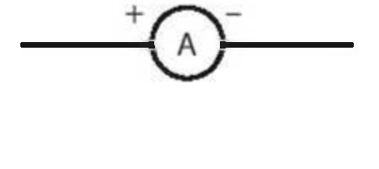
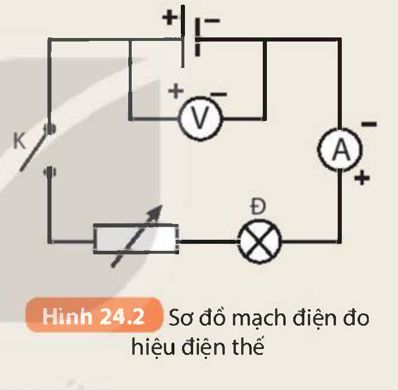
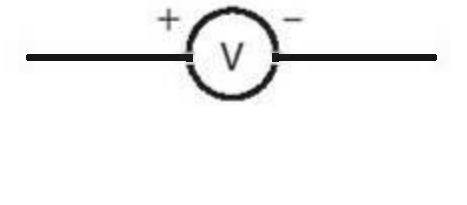

<!-- pdf:101 -->

# BÀI 24: CƯỜNG ĐỘ DÒNG ĐIỆN VÀ HIỆU ĐIỆN THẾ

## 🎯 Mục tiêu

- Thực hiện thí nghiệm để nêu được số chỉ của ampe kế là giá trị của cường độ dòng điện.
- Thực hiện thí nghiệm để nêu được khả năng sinh ra dòng điện của pin (hay acquy) được đo bằng hiệu điện thế (còn gọi là điện áp) giữa hai cực của nó.
- Nêu được đơn vị đo cường độ dòng điện và đơn vị đo hiệu điện thế.

## 🔴 Mở đầu

> Ta đã biết ampe kế dùng để đo cường độ dòng điện, vôn kế dùng để đo hiệu điện thế. Vậy, số chỉ của ampe kế và vôn kế cho ta biết điều gì?

## I. Cường độ dòng điện

### 1. Thí nghiệm

> ✋ *Chuẩn bị:* Nguồn điện (pin) $3\text{ V}$, biến trở, ampe kế, bóng đèn $1,5\text{ V}$, công tắc và dây nối.
>
> *Tiến hành:*
> - Lắp mạch điện như sơ đồ Hình 24.1.
> - Đóng công tắc và dịch chuyển con chạy trên biến trở đến ba vị trí khác nhau, quan sát độ sáng của bóng đèn và đọc số chỉ trên ampe kế ở từng vị trí của con chạy.
> - Rút ra nhận xét về mối quan hệ giữa độ sáng của bóng đèn, số chỉ trên ampe kế và mức độ mạnh yếu của dòng điện.
>
> 
>
> Hình 24.1. Sơ đồ mạch điện đo cường độ dòng điện

### 2. Cường độ dòng điện

Số chỉ của ampe kế là giá trị của **cường độ dòng điện**, cho biết mức độ mạnh, yếu của dòng điện.

Cường độ dòng điện được kí hiệu bằng chữ $I$.

Đơn vị đo cường độ dòng điện là **ampe** ($\text{A}$). Đơn vị khác của cường độ dòng điện là **miliampe** ($\text{mA}$):

$1\text{ A} = 1000\text{ mA}$

Ampe kế là dụng cụ dùng để đo cường độ dòng điện. Trong sơ đồ mạch điện, ampe kế được kí hiệu là:

<!-- pdf:102 -->

> ❓ Quan sát Hình 1.6 (trang 9):
> Khi sử dụng ampe kế để đo cường độ dòng điện, cần mắc ampe kế vào mạch điện như thế nào?

> ⚠️ *Lưu ý:* Không được mắc hai chốt của ampe kế trực tiếp vào hai cực của nguồn điện để tránh làm hỏng ampe kế và nguồn điện.

## II. Hiệu điện thế

### 1. Thí nghiệm

Quan sát một số nguồn điện thông dụng (như pin, acquy), trên mỗi nguồn điện có ghi giá trị $1,5\text{ V}$; $4,5\text{ V}$; $9\text{ V}$;... Những giá trị này là hiệu điện thế giữa hai cực của nguồn điện.

> ✋ *Chuẩn bị:* một số nguồn điện (pin) $1,5\text{ V}$; $3\text{ V}$; $4,5\text{ V}$; biến trở; ampe kế; vôn kế; bóng đèn $1,5\text{ V}$; công tắc và dây nối.
>
> *Tiến hành:*
> - Lắp mạch điện như Hình 24.2, đóng công tắc, giữ nguyên vị trí con chạy của biến trở.
> - Lần lượt thay các nguồn điện có ghi các giá trị hiệu điện thế khác nhau ($1,5\text{ V}$; $3\text{ V}$; $4,5\text{ V}$).
> - Đọc giá trị hiệu điện thế trên vôn kế.
> - Quan sát và ghi số chỉ trên ampe kế.
> - So sánh số chỉ trên ampe kế khi lần lượt lắp các nguồn điện $1,5\text{ V}$; $3\text{ V}$; $4,5\text{ V}$ vào mạch điện. Từ đó rút ra nhận xét về khả năng sinh ra dòng điện của từng nguồn điện nêu trên.
>
> 
>
> Hình 24.2. Sơ đồ mạch điện đo hiệu điện thế

> ❓ Số chỉ trên vôn kế có bằng giá trị ghi trên nguồn điện không? Tại sao?

### 2. Hiệu điện thế

Khả năng sinh ra dòng điện của pin (hay acquy) được đo bằng **hiệu điện thế** (còn gọi là **điện áp**) giữa hai cực của nó.

Hiệu điện thế được kí hiệu bằng chữ $U$. Đơn vị đo hiệu điện thế là **vôn** ($\text{V}$). Người ta còn dùng đơn vị **milivôn** ($\text{mV}$) hoặc **kilôvôn** ($\text{kV}$):

$1\text{ mV} = 0,001\text{ V}$

$1\text{ kV} = 1000\text{ V}$

Vôn kế là dụng cụ dùng để đo hiệu điện thế.

Trong sơ đồ mạch điện, vôn kế được kí hiệu như sau:

<!-- pdf:103 -->

> 🔍 Em có biết?
>
> *An toàn điện:* Các nguồn điện được sử dụng trong thí nghiệm cần có hiệu điện thế nhỏ hơn $40\text{ V}$. Khi tiếp xúc với các nguồn điện có hiệu điện thế trên $40\text{ V}$, dòng điện chạy qua cơ thể có thể lên tới trên $70\text{ mA}$; đây là giá trị có thể gây hại tới cơ thể.
>
> Hiệu điện thế mạng điện đang sử dụng trong gia đình em là $220\text{ V}$, do đó không được để cơ thể tiếp xúc trực tiếp với các vật mang điện như ổ điện, dây điện không được bọc kín, vì nguy hiểm đến tính mạng.

## 📌 Em đã học

- Cường độ dòng điện đặc trưng cho tác dụng mạnh, yếu của dòng điện.
- Cường độ dòng điện được đo bằng ampe kế, có đơn vị là ampe ($\text{A}$), miliampe ($\text{mA}$).
- Khả năng sinh ra dòng điện của pin (hay acquy) được đo bằng hiệu điện thế giữa hai cực của nó.
- Hiệu điện thế được đo bằng vôn kế, có đơn vị là vôn ($\text{V}$), milivôn ($\text{mV}$), kilôvôn ($\text{kV}$).

## 🚀 Em có thể

- Sử dụng được ampe kế để đo cường độ dòng điện trong mạch điện.
- Sử dụng được vôn kế để đo hiệu điện thế của nguồn điện.
- Lựa chọn được nguồn điện an toàn trong khi tiến hành các thí nghiệm.

## 📷 Danh sách hình trong bài

| Mã hình | Trang PDF | Vị trí trong bài | Chú thích gốc |
| --- | :---: | --- | --- |
| H8-khoa_hoc_tu_nhien-b24-01 | 101 | Mục I.1 | Hình 24.1. Sơ đồ mạch điện đo cường độ dòng điện |
| H8-khoa_hoc_tu_nhien-b24-02 | 101 | Mục I.2 | Kí hiệu ampe kế trong sơ đồ mạch điện |
| H8-khoa_hoc_tu_nhien-b24-03 | 102 | Mục II.1 | Hình 24.2. Sơ đồ mạch điện đo hiệu điện thế |
| H8-khoa_hoc_tu_nhien-b24-04 | 102 | Mục II.2 | Kí hiệu vôn kế trong sơ đồ mạch điện |
