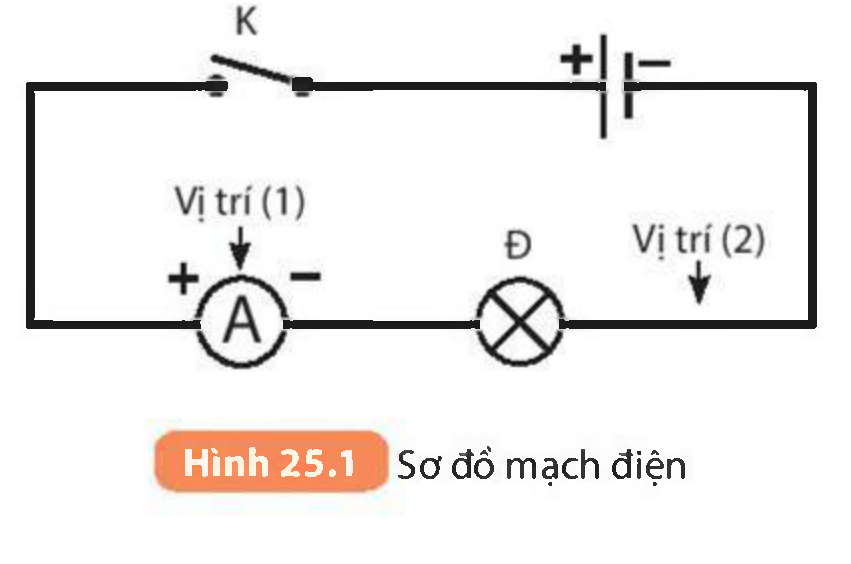
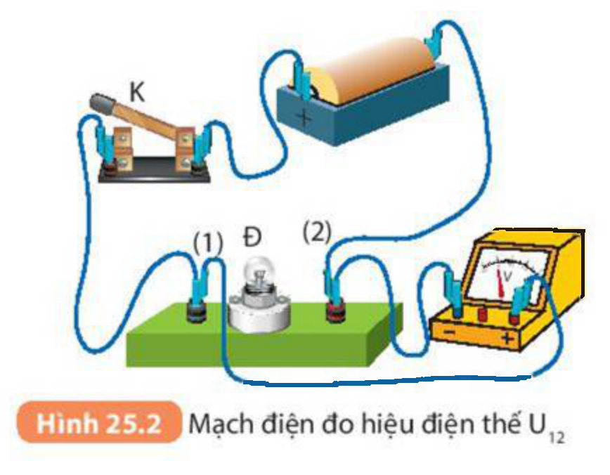
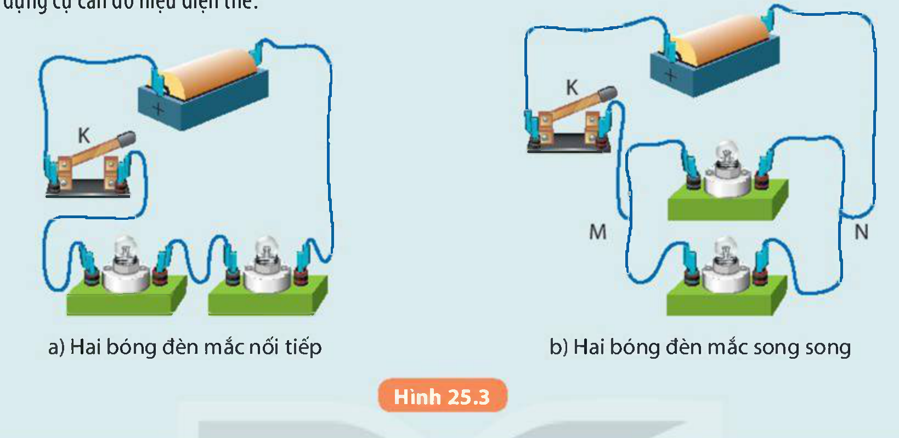

<!-- pdf:104 -->

# BÀI 25: THỰC HÀNH ĐO CƯỜNG ĐỘ DÒNG ĐIỆN VÀ HIỆU ĐIỆN THẾ

## 🎯 Mục tiêu

- Đo được cường độ dòng điện và hiệu điện thế bằng dụng cụ thực hành.
- Vẽ được sơ đồ mạch điện với các kí hiệu mô tả ampe kế và vôn kế.

## 🔴 Mở đầu

> Một học sinh cho rằng: “Bóng đèn tiêu thụ dòng điện, do đó cường độ dòng điện sẽ giảm sau khi đi qua bóng đèn”. Em có đồng ý với bạn học sinh đó không? Làm thế nào để kiểm tra ý kiến của mình?

## I. Chuẩn bị

- Ba nguồn điện: $1,5\text{ V}$, $3\text{ V}$, $6\text{ V}$.
- Bóng đèn pin $6\text{ V} - 0,5\text{ A}$.
- Một ampe kế có giới hạn đo từ $0,5\text{ A}$ trở lên và có độ chia nhỏ nhất là $0,01\text{ A}$.
- Một vôn kế có giới hạn đo là $6\text{ V}$ và có độ chia nhỏ nhất là $0,1\text{ V}$.
- Một công tắc.
- Dây nối.
- Chuẩn bị báo cáo theo mẫu gợi ý ở cuối bài.

## II. Cách tiến hành

### 1. Đo cường độ dòng điện

- Mắc mạch điện với nguồn điện là pin $1,5\text{ V}$ theo sơ đồ Hình 25.1. Khi đó công tắc đang ngắt, mạch hở.
- Đóng công tắc và đo giá trị cường độ dòng điện $I_1$ chạy qua mạch ở vị trí (1) và ghi vào vở theo mẫu Bảng 25.1.
- Lặp lại thí nghiệm để đo cường độ dòng điện $I_2$ tại vị trí (2) và ghi vào vở theo mẫu Bảng 25.1.
- Tiến hành lại thí nghiệm với nguồn điện là pin $3\text{ V}$ và pin $6\text{ V}$.

Hình 25.1. Sơ đồ mạch điện

<!-- pdf:105 -->

### 2. Đo hiệu điện thế

- Đo giá trị hiệu điện thế của pin $1,5\text{ V}$ và ghi vào vở theo mẫu Bảng 25.2.
- Mắc vôn kế để đo hiệu điện thế hai đầu bóng đèn trong mạch điện theo Hình 25.2. Giá trị này chính là hiệu điện thế giữa hai vị trí (1) và (2) (Hình 25.2). Công tắc bị ngắt và mạch hở. Khi mắc mạch cần lưu ý nối chốt ($+$) của vôn kế với chốt có dòng điện đi vào bóng đèn; chốt ($-$) của vôn kế với chốt có dòng điện đi ra khỏi bóng đèn.

Hình 25.2. Mạch điện đo hiệu điện thế $U_{12}$

- Đóng công tắc, đọc giá trị hiệu điện thế giữa hai đầu bóng đèn $U$ và ghi vào vở theo mẫu Bảng 25.2.
- Thay pin $1,5\text{ V}$ bằng pin $3\text{ V}$ và lặp lại thí nghiệm.
- Vẽ sơ đồ mạch điện cho thí nghiệm trên.

> *BÁO CÁO THỰC HÀNH*
>
> Họ và tên: ... Lớp: ...
>
> *1. Mục đích thí nghiệm*
>
> Đo cường độ dòng điện và hiệu điện thế trong mạch điện đơn giản.
>
> *2. Chuẩn bị*
>
> - Dụng cụ thí nghiệm: ...
>
> *3. Các bước tiến hành*
>
> Mô tả các bước tiến hành: ...
>
> *4. Kết quả thí nghiệm*
>
> Bảng 25.1. Bảng số liệu đo cường độ dòng điện
>
> | Lần đo | $I_1\text{ (A)}$ Vị trí 1 | $I_2\text{ (A)}$ Vị trí 2 |
> | :---: | :---: | :---: |
> | Pin $1,5\text{ V}$ | ? | ? |
> | Pin $3\text{ V}$ | ? | ? |
> | Pin $6\text{ V}$ | ? | ? |
>
> Bảng 25.2. Bảng số liệu đo hiệu điện thế
>
> | Lần đo | $U_{\text{nguồn}}\text{ (V)}$ | $U\text{ (V)}$ |
> | :---: | :---: | :---: |
> | Pin $1,5\text{ V}$ | ? | ? |
> | Pin $3\text{ V}$ | ? | ? |
>
> Nhận xét:
> 1. Em có nhận xét gì về giá trị cường độ dòng điện tại các vị trí 1, 2?
> 2. Em có nhận xét gì về các giá trị của hiệu điện thế hai đầu bóng đèn và giá trị hiệu điện thế của nguồn?
> 3. So sánh kết quả thí nghiệm giữa các nhóm, lí giải sự khác biệt về kết quả thí nghiệm giữa các nhóm.

<!-- pdf:106 -->

<!-- term: Mắc nối tiếp -->
<!-- term: Mắc song song -->
> 🔍 Em có biết?
>
> Tuỳ theo cách mắc các dụng cụ điện với nhau mà ta có cách mắc nối tiếp (Hình 25.3a), cách mắc song song (Hình 25.3b). Ampe kế được mắc nối tiếp với dụng cụ cần đo cường độ dòng điện. Vôn kế được mắc song song với dụng cụ cần đo hiệu điện thế.
>
> 
>
> Hình 25.3. a) Hai bóng đèn mắc nối tiếp; b) Hai bóng đèn mắc song song

## 📌 Em đã học

- Để đo cường độ dòng điện cần mắc ampe kế vào mạch sao cho dòng điện đi vào chốt dương và đi ra từ chốt âm của ampe kế.
- Để đo hiệu điện thế, cần nối hai chốt vôn kế với hai cực của nguồn hoặc hai đầu của một thiết bị điện.
- Cần lựa chọn thang đo phù hợp khi sử dụng ampe kế và vôn kế.

## 🚀 Em có thể

- Đo được cường độ dòng điện trong mạch điện bằng ampe kế. Từ đó xác định được mạch điện là kín hay hở.
- Đo được hiệu điện thế bằng vôn kế. Sử dụng được vôn kế để xác định được pin cũ hay mới.

## 📷 Danh sách hình trong bài

| Mã hình | Trang PDF | Vị trí trong bài | Chú thích gốc |
| --- | :---: | --- | --- |
| H8-khoa_hoc_tu_nhien-b25-01 | 104 | Mục II.1 | Hình 25.1. Sơ đồ mạch điện |
| H8-khoa_hoc_tu_nhien-b25-02 | 105 | Mục II.2 | Hình 25.2. Mạch điện đo hiệu điện thế $U_{12}$ |
| H8-khoa_hoc_tu_nhien-b25-03 | 106 | Mục II.2, Em có biết? (allow_edge_ink: dòng chữ cuối đoạn văn phía trên bên trái thấp hơn đỉnh dây nối Hình 25.3b bên phải) | Hình 25.3. a) Hai bóng đèn mắc nối tiếp; b) Hai bóng đèn mắc song song |
