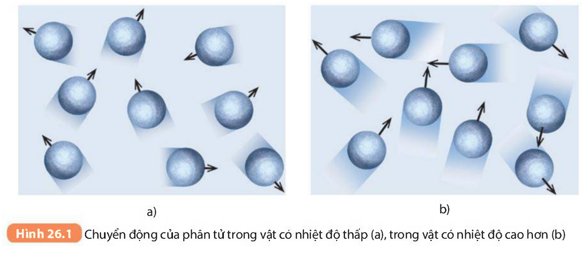
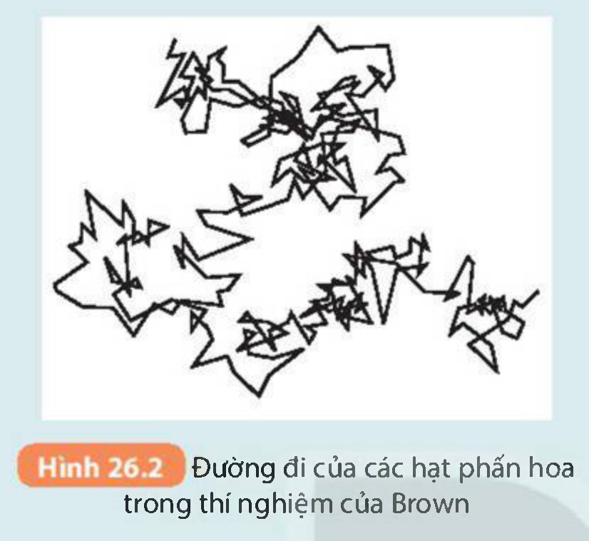
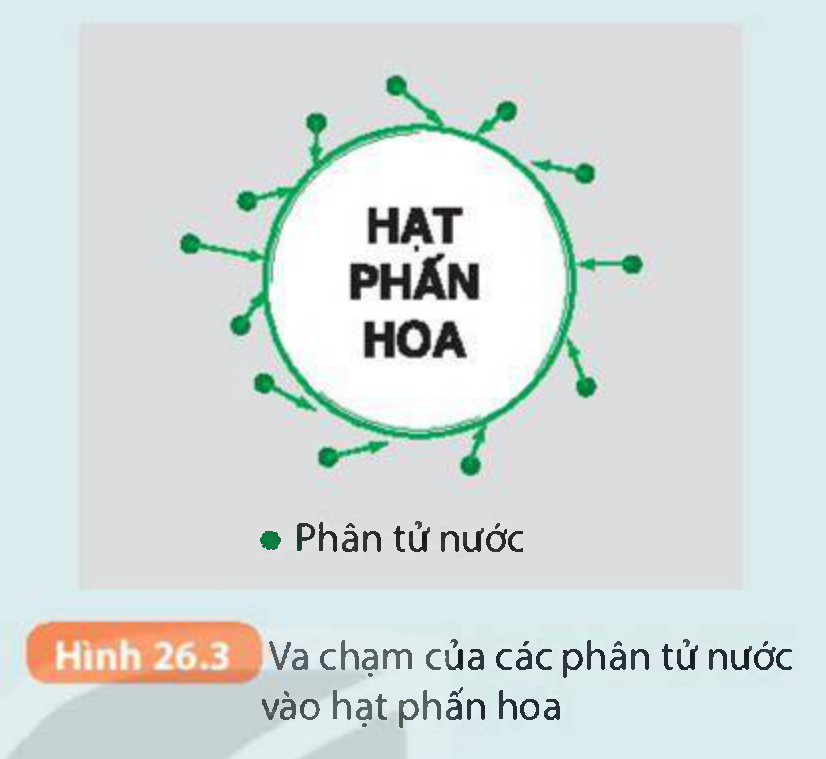
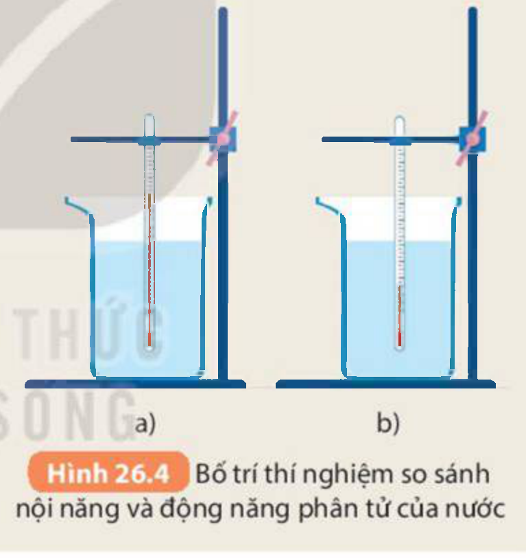
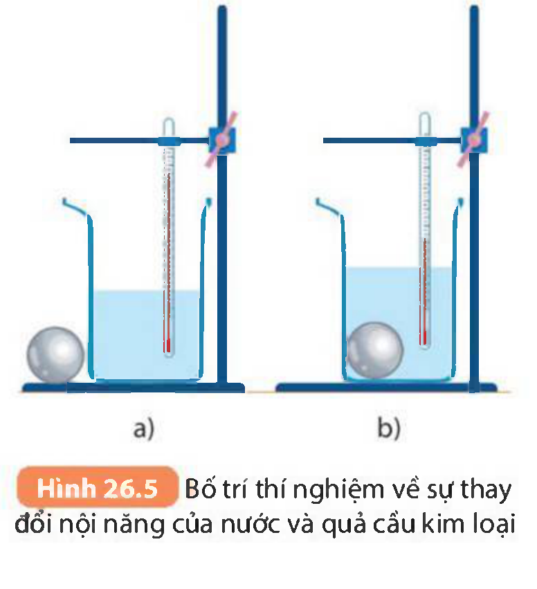
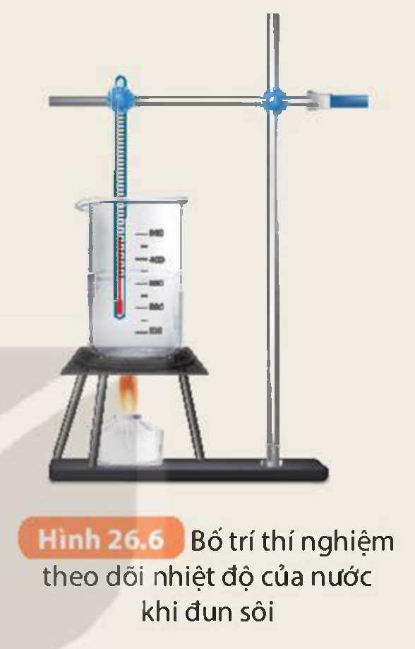

<!-- pdf:107 -->
<!-- CHƯƠNG VI - NHIỆT -->

# BÀI 26: NĂNG LƯỢNG NHIỆT VÀ NỘI NĂNG

## 🎯 Mục tiêu

- Nêu được khái niệm năng lượng nhiệt; khái niệm nội năng.
- Nêu được: Khi một vật được làm nóng, các phân tử của vật chuyển động nhanh lên và nội năng của vật tăng.

## 🔴 Mở đầu

> Ngay từ lớp 6, các em đã được làm quen với năng lượng nhiệt. Theo em, năng lượng nhiệt là gì và tại sao mọi vật đều luôn có năng lượng này?

## I. Một số tính chất của phân tử, nguyên tử

Để nhận biết được dạng năng lượng trong câu hỏi trên, cần biết một số tính chất cơ bản của phân tử, nguyên tử.

Vào những năm cuối thế kỉ thứ XIX, các nhà khoa học đã xác định được hai tính chất cơ bản sau đây của phân tử, nguyên tử:
1. Nhiệt độ của vật càng cao, chuyển động hỗn loạn của các phân tử, nguyên tử cấu tạo nên vật càng nhanh.
2. Giữa các phân tử, nguyên tử có lực hút và lực đẩy, gọi là **lực tương tác phân tử, nguyên tử**.

Hình 26.1. Chuyển động của phân tử trong vật có nhiệt độ thấp (a), trong vật có nhiệt độ cao hơn (b)

<!-- pdf:108 -->

<!-- term: Chuyển động Brown -->
> 🔍 Em có biết?
>
> Năm 1827, nhà khoa học người Anh Robert Brown (Rô-bớt Brao, 1773 – 1858) khi quan sát bằng kính hiển vi các hạt phấn hoa trong nước đã thấy chúng chuyển động không ngừng về mọi hướng. Nguyên nhân gây ra chuyển động này là do các phân tử nước chuyển động hỗn loạn va chạm vào các hạt phấn hoa làm cho các hạt này chuyển động theo mọi hướng.
>
> 
>
> Hình 26.2. Đường đi của các hạt phấn hoa trong thí nghiệm của Brown
>
> 
>
> Hình 26.3. Va chạm của các phân tử nước vào hạt phấn hoa
>
> Thí nghiệm của Brown còn cho thấy khi nhiệt độ của nước càng cao thì các hạt phấn hoa chuyển động càng nhanh, chứng tỏ các phân tử nước chuyển động càng nhanh thì va chạm vào các hạt phấn hoa càng mạnh.

> ❓ Ở nhiệt độ trong phòng, các phân tử trong không khí có thể chuyển động với tốc độ từ hàng trăm tới hàng nghìn $\text{m/s}$. Tại sao khi mở một lọ nước hoa ở đầu lớp thì phải một lúc sau, người ở cuối lớp mới ngửi thấy mùi thơm?

## II. Khái niệm năng lượng nhiệt
<!-- ocr-ok: OCR bỏ sót tiêu đề mục II in màu cam trên trang 106 (pdf:108), đã đối chiếu ảnh gốc -->

Vì nhiệt độ của vật càng cao, chuyển động hỗn loạn của các phân tử, nguyên tử cấu tạo nên vật càng nhanh nên chuyển động này của các phân tử, nguyên tử được gọi là **chuyển động nhiệt**. Năng lượng mà vật có được nhờ chuyển động nhiệt được gọi là **năng lượng nhiệt** (gọi tắt là **nhiệt năng**).

Do mọi vật đều được cấu tạo từ các phân tử, nguyên tử chuyển động hỗn loạn không ngừng nên mọi vật đều có nhiệt năng. Khi làm tăng nhiệt độ của vật thì nhiệt năng của vật tăng và ngược lại.

> ✋ 1. Mô tả, giải thích và thực hiện hai cách khác nhau để làm tăng năng lượng nhiệt của hai bàn tay mình.
> 2. Tìm ví dụ thực tế về sự chuyển hoá từ nhiệt năng sang các dạng năng lượng khác và ngược lại.

<!-- pdf:109 -->

## III. Khái niệm nội năng
<!-- ocr-ok: OCR bỏ sót tiêu đề mục III in màu cam trên trang 107 (pdf:109), đã đối chiếu ảnh gốc -->

### 1. Động năng và thế năng của phân tử, nguyên tử

**a) Động năng**

<!-- term: Động năng của phân tử, nguyên tử -->
Do phân tử, nguyên tử chuyển động hỗn loạn không ngừng nên chúng có động năng. Phân tử, nguyên tử chuyển động càng nhanh thì động năng càng lớn.

**b) Thế năng**

Thế năng là năng lượng mà vật có được nhờ tương tác với các vật khác. Ví dụ, mọi vật ở quanh Trái Đất đều tương tác với Trái Đất thông qua lực hấp dẫn nên đều có thế năng, gọi là thế năng hấp dẫn. Độ lớn của thế năng này phụ thuộc khoảng cách giữa vật và mặt đất.

Tương tự như trên, các phân tử, nguyên tử tương tác với nhau thông qua lực tương tác phân tử, nguyên tử nên chúng cũng có thế năng, gọi là **thế năng tương tác phân tử, nguyên tử** (gọi tắt là **thế năng phân tử, nguyên tử**). Thế năng phân tử, nguyên tử có độ lớn phụ thuộc vào khoảng cách giữa các phân tử, nguyên tử.

### 2. Nội năng

**Nội năng** của một vật là tổng động năng và thế năng của các nguyên tử, phân tử cấu tạo nên vật.

> ❓ 1. So sánh động năng của phân tử nước ở Hình 26.4a với động năng của phân tử nước ở Hình 26.4b.
> 2. So sánh nội năng của nước trong hai cốc ở Hình 26.4.
>
> 
>
> Hình 26.4. Bố trí thí nghiệm so sánh nội năng và động năng phân tử của nước

### 3. Sự tăng, giảm nội năng

Thả một quả cầu kim loại ở nhiệt độ trong phòng vào một cốc nước nóng (Hình 26.5) thì nhiệt độ của quả cầu tăng lên còn nhiệt độ của nước giảm đi. Nhiệt độ của quả cầu tăng lên vì đã nhận thêm được nhiệt năng từ nước nóng, còn nhiệt độ của nước nóng giảm đi do đã truyền bớt nhiệt năng cho quả cầu.

Hình 26.5. Bố trí thí nghiệm về sự thay đổi nội năng của nước và quả cầu kim loại

<!-- pdf:110 -->

> ❓ Trong quá trình trên, động năng của phân tử nước và nguyên tử kim loại; nội năng của nước và của quả cầu trong bình thay đổi như thế nào?

Khi vật được làm nóng, các phân tử, nguyên tử của vật chuyển động nhanh lên, nội năng của vật tăng.

> ✋ Theo dõi thí nghiệm đun nước (Hình 26.6), có người khẳng định:
> - Từ khi bắt đầu đun nước tới khi nước bắt đầu sôi thì nhiệt độ của nước tăng dần.
> - Khi nước đã sôi thì nhiệt độ của nước không tăng dù vẫn tiếp tục đun.
>
> Hãy thảo luận để trả lời các câu hỏi sau:
> 1. Tại sao từ khi bắt đầu đun tới khi nước bắt đầu sôi thì nhiệt độ của nước tăng dần?
> 2. Khi nước đã sôi, nhiệt độ của nước không tăng dù vẫn tiếp tục đun thì nhiệt năng mà nước nhận được từ đèn cồn đã chuyển hoá thành dạng năng lượng nào?
>
> 
>
> Hình 26.6. Bố trí thí nghiệm theo dõi nhiệt độ của nước khi đun sôi

## 📌 Em đã học

- Năng lượng nhiệt là năng lượng vật có được do chuyển động nhiệt.
- Nội năng của một vật là tổng động năng và thế năng của các phân tử, nguyên tử cấu tạo nên vật.
- Khi một vật được làm nóng, các phân tử, nguyên tử của vật chuyển động nhanh lên và nội năng của vật tăng.

## 🚀 Em có thể

Giải thích được các hiện tượng đơn giản trong đời sống có liên quan đến nhiệt năng và nội năng. Ví dụ, tại sao xoa hai tay vào nhau thì tay nóng lên.

## 📷 Danh sách hình trong bài

| Mã hình | Trang PDF | Vị trí trong bài | Chú thích gốc |
| --- | :---: | --- | --- |
| H8-khoa_hoc_tu_nhien-b26-01 | 107 | Mục I | Hình 26.1. Chuyển động của phân tử trong vật có nhiệt độ thấp (a), trong vật có nhiệt độ cao hơn (b) |
| H8-khoa_hoc_tu_nhien-b26-02 | 108 | Mục I, Em có biết? | Hình 26.2. Đường đi của các hạt phấn hoa trong thí nghiệm của Brown |
| H8-khoa_hoc_tu_nhien-b26-03 | 108 | Mục I, Em có biết? | Hình 26.3. Va chạm của các phân tử nước vào hạt phấn hoa |
| H8-khoa_hoc_tu_nhien-b26-04 | 109 | Mục III.2 | Hình 26.4. Bố trí thí nghiệm so sánh nội năng và động năng phân tử của nước |
| H8-khoa_hoc_tu_nhien-b26-05 | 109 | Mục III.3 | Hình 26.5. Bố trí thí nghiệm về sự thay đổi nội năng của nước và quả cầu kim loại |
| H8-khoa_hoc_tu_nhien-b26-06 | 110 | Mục III.3 | Hình 26.6. Bố trí thí nghiệm theo dõi nhiệt độ của nước khi đun sôi |
