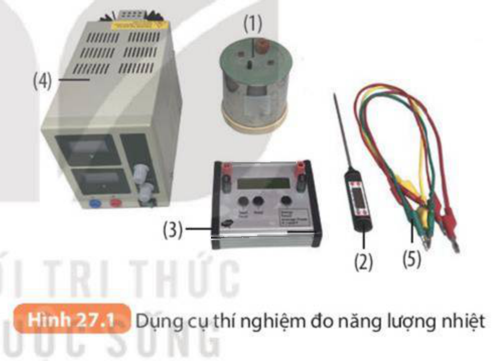
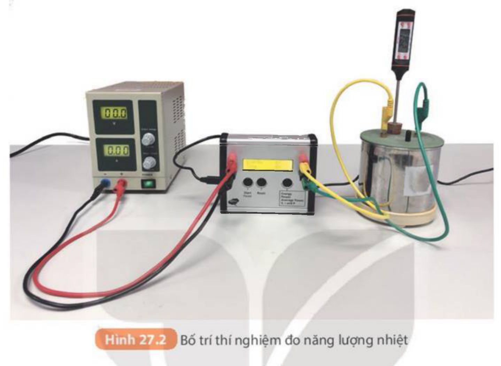
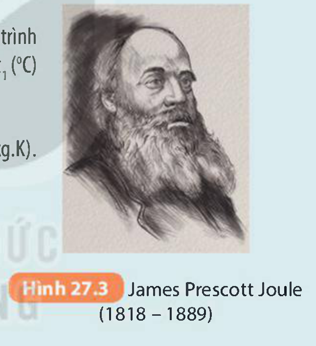

<!-- pdf:111 -->

# BÀI 27: THỰC HÀNH ĐO NĂNG LƯỢNG NHIỆT BẰNG JOULEMETER

## 🎯 Mục tiêu

Đo được năng lượng nhiệt mà vật nhận được khi bị đun nóng.

## 🔴 Mở đầu

> Khi muốn đun sôi một lượng nước xác định cần cung cấp bao nhiêu năng lượng nhiệt? Làm thế nào để đo được năng lượng nhiệt đó?

<!-- term: Bình nhiệt lượng kế -->
Trong các bài học trước ta đã biết dòng điện có tác dụng nhiệt. Ở bài này, chúng ta sử dụng nguồn nhiệt là dây đốt được đặt trong bình nhiệt lượng kế. Khi dòng điện chạy qua dây đốt đặt trong bình nhiệt lượng kế, năng lượng điện sẽ chuyển hoá thành năng lượng nhiệt để đun nóng nước.

## I. Chuẩn bị

- Bình nhiệt lượng kế (1) có dây đốt, que khuấy.
- Nhiệt kế (2).
- Dụng cụ đo năng lượng điện do nguồn điện cung cấp: joulemeter (3).
- Nguồn điện $12\text{ V}$ (4).
- Bốn dây nối (5).
- Một lượng nước sạch.

Hình 27.1. Dụng cụ thí nghiệm đo năng lượng nhiệt

## II. Cách tiến hành

- Đổ một lượng nước xác định vào bình nhiệt lượng kế sao cho nước ngập dây đốt và đầu đo của nhiệt kế.
- Bố trí thí nghiệm như Hình 27.2. Lưu ý mắc chính xác hai dây từ nguồn điện vào joulemeter và hai dây nối từ joulemeter vào dây đốt bên trong bình nhiệt lượng kế.
- Lựa chọn cài đặt trên joulemeter đại lượng cần đo là năng lượng.
- Khuấy liên tục nước trong bình và đọc giá trị nhiệt độ ban đầu $t_0$ của nước.
- Bật công tắc nguồn điện để nguồn hoạt động, đồng thời khuấy nhẹ nước trong bình đến khi nhiệt độ tăng $3\text{ }^\circ\text{C}$ so với giá trị ban đầu, đọc giá trị năng lượng điện trên joulemeter và ghi vào vở theo mẫu bảng số liệu trong báo cáo thực hành.
- Tiếp tục khuấy nước trong nhiệt lượng kế và đọc giá trị trên joulemeter khi nước trong bình tăng nhiệt độ lần lượt là $6\text{ }^\circ\text{C}$, $9\text{ }^\circ\text{C}$ so với nhiệt độ ban đầu và ghi vào vở theo mẫu bảng số liệu trong báo cáo thực hành.

<!-- pdf:112 -->

- Tắt công tắc nguồn điện.

Lặp lại thí nghiệm với lượng nước trong bình nhiều hơn lượng nước trong thí nghiệm lần 1.

Hình 27.2. Bố trí thí nghiệm đo năng lượng nhiệt
<!-- ocr-ok: OCR bỏ sót nhãn màu cam Hình 27.2 trên trang 110 (pdf:112), đã đối chiếu ảnh gốc -->

> *BÁO CÁO THỰC HÀNH*
>
> Họ và tên: ... Lớp ...
>
> *1. Mục đích thí nghiệm*
>
> Đo năng lượng nhiệt mà nước trong nhiệt lượng kế nhận được thông qua đo năng lượng điện của dòng điện bằng joulemeter.
>
> *2. Chuẩn bị*
>
> Dụng cụ thí nghiệm: ...
>
> *3. Các bước tiến hành*
>
> Mô tả các bước tiến hành: ...

<!-- pdf:113 -->

> *4. Kết quả thí nghiệm*
>
> Bảng 27.1. Bảng số liệu đo năng lượng nhiệt lần 1
>
> | Lần đo | $t\text{ (}^\circ\text{C)}$ | Năng lượng nhiệt |
> | :---: | :---: | :---: |
> | Bắt đầu đo | ? | ? |
> | Tăng $3\text{ }^\circ\text{C}$ | ? | ? |
> | Tăng $6\text{ }^\circ\text{C}$ | ? | ? |
> | Tăng $9\text{ }^\circ\text{C}$ | ? | ? |
>
> Bảng 27.2. Bảng số liệu đo năng lượng nhiệt lần 2 với lượng nước nhiều hơn
>
> | Lần đo | $t\text{ (}^\circ\text{C)}$ | Năng lượng nhiệt |
> | :---: | :---: | :---: |
> | Bắt đầu đo | ? | ? |
> | Tăng $3\text{ }^\circ\text{C}$ | ? | ? |
> | Tăng $6\text{ }^\circ\text{C}$ | ? | ? |
> | Tăng $9\text{ }^\circ\text{C}$ | ? | ? |
>
> Nhận xét:
> 1. Từ kết quả thí nghiệm, nhận xét về năng lượng nhiệt cần thiết để đun nóng nước.
> 2. Ước tính năng lượng nhiệt cần thiết để đun lượng nước trong nhiệt lượng kế tới sôi ở $100\text{ }^\circ\text{C}$ được không? Giải thích câu trả lời của em.

> 🔍 Em có biết?
>
> **Nhiệt lượng** là phần nhiệt năng mà vật nhận được hay mất đi trong quá trình truyền nhiệt. Nhiệt lượng cần cung cấp cho $m\text{ (kg)}$ nước tăng từ nhiệt độ $t_1\text{ (}^\circ\text{C)}$ đến nhiệt độ $t_2\text{ (}^\circ\text{C)}$ được tính bằng công thức:
>
> $Q = mc(t_2 - t_1).$
>
> Trong đó $c$ gọi là **nhiệt dung riêng** của nước có giá trị bằng $4180\text{ (J/kg.K)}$. Người đầu tiên đo giá trị này là nhà bác học James Prescott Joule.
>
> 
>
> Hình 27.3. James Prescott Joule (1818 – 1889)

## 📌 Em đã học

Cách đo năng lượng nhiệt mà vật nhận được khi bị đun nóng bằng cách sử dụng joulemeter.

## 🚀 Em có thể

- Tính được năng lượng nhiệt mà nước trong nhiệt lượng kế nhận được khi bị đun nóng bằng cách sử dụng joulemeter.
- Tính được năng lượng nhiệt để đun sôi một lượng nước xác định.

## 📷 Danh sách hình trong bài

| Mã hình | Trang PDF | Vị trí trong bài | Chú thích gốc |
| --- | :---: | --- | --- |
| H8-khoa_hoc_tu_nhien-b27-01 | 111 | Mục I | Hình 27.1. Dụng cụ thí nghiệm đo năng lượng nhiệt |
| H8-khoa_hoc_tu_nhien-b27-02 | 112 | Mục II | Hình 27.2. Bố trí thí nghiệm đo năng lượng nhiệt |
| H8-khoa_hoc_tu_nhien-b27-03 | 113 | Mục II, Em có biết? (allow_edge_ink: cuối dòng công thức '(J/kg.K).' bên trái nhô sang phải hơn mép trái nhãn Hình 27.3 phía dưới) | Hình 27.3. James Prescott Joule (1818 – 1889) |
