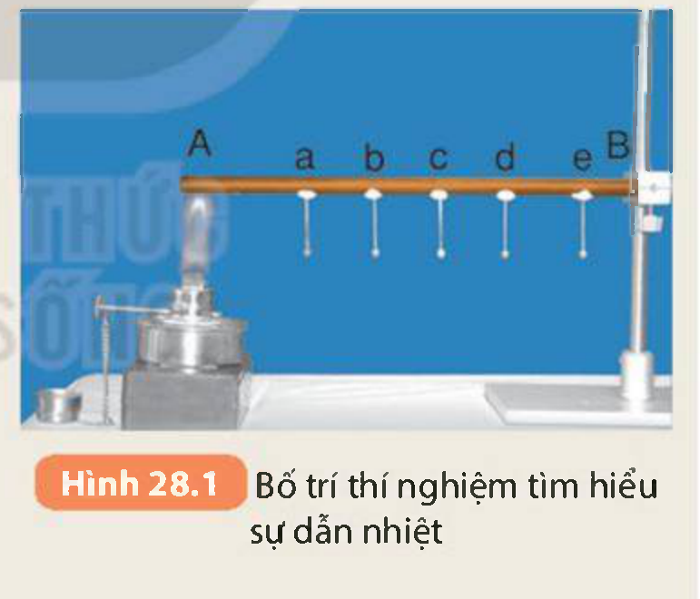
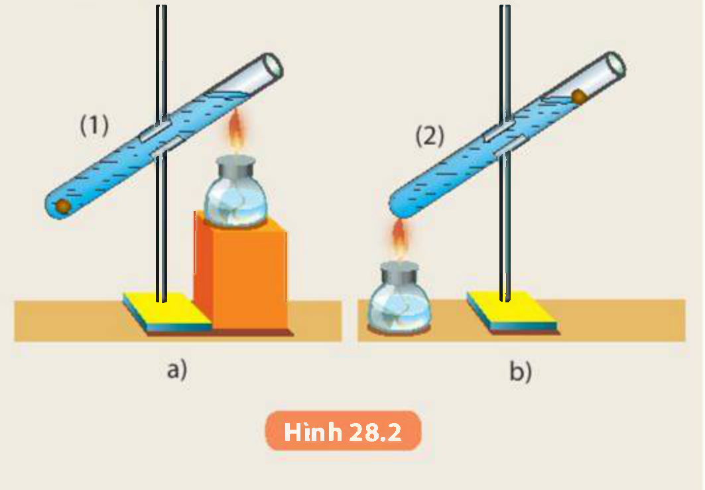
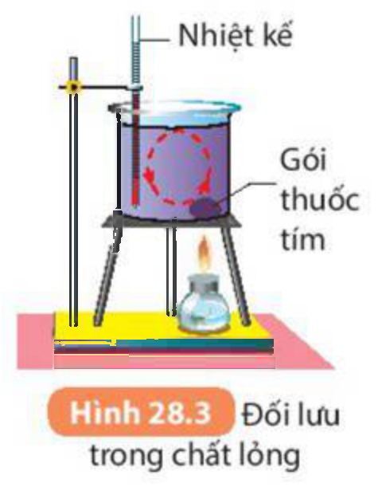
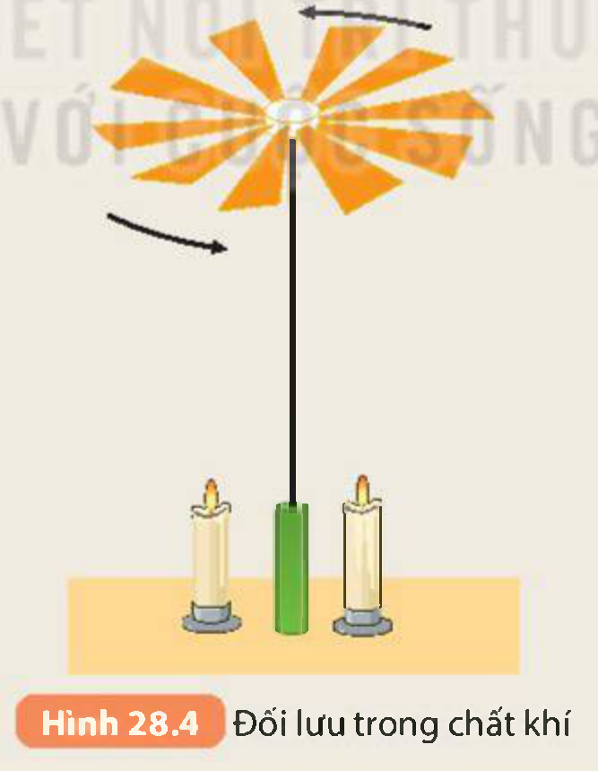
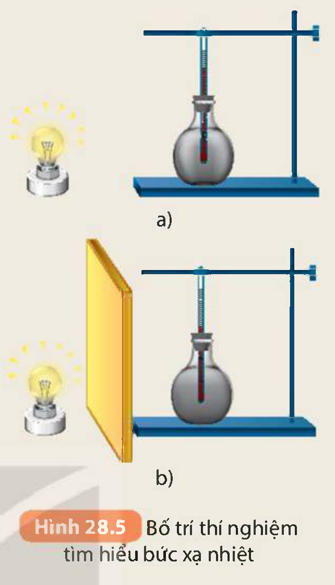
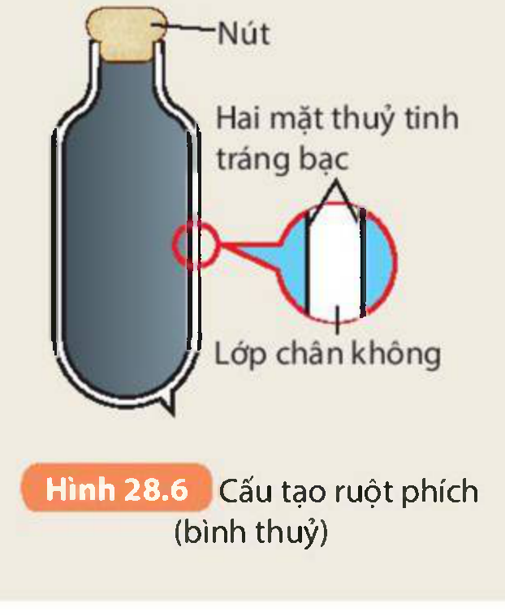
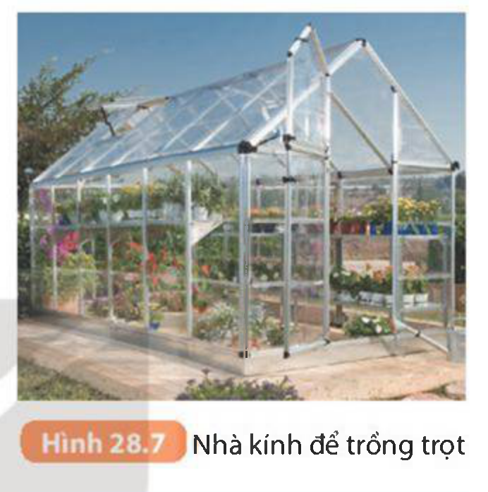
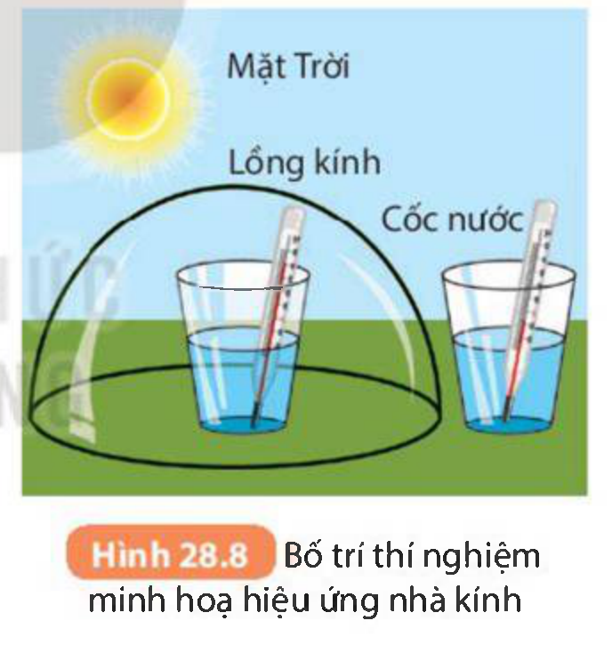
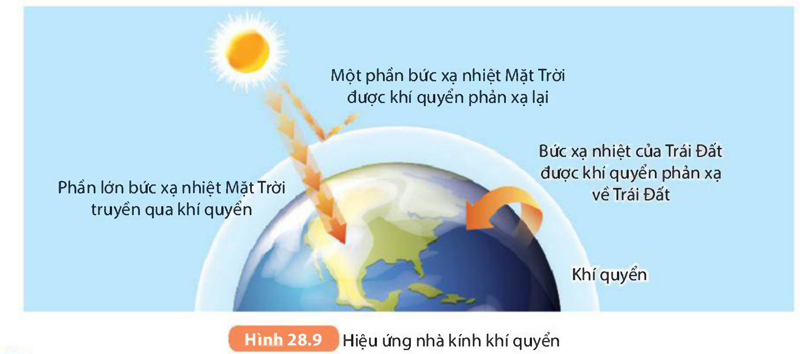

<!-- pdf:114 -->

# BÀI 28: SỰ TRUYỀN NHIỆT

## 🎯 Mục tiêu

- Lấy được ví dụ về hiện tượng dẫn nhiệt, đối lưu, bức xạ nhiệt và mô tả sơ lược sự truyền năng lượng trong mỗi hiện tượng đó.
- Phân tích được một số ví dụ về công dụng của vật dẫn nhiệt tốt, công dụng của vật cách nhiệt tốt.
- Mô tả được sự truyền năng lượng trong hiệu ứng nhà kính.
- Vận dụng kiến thức về sự truyền nhiệt giải thích một số hiện tượng đơn giản thường gặp.

## 🔴 Mở đầu

> Theo em, năng lượng nhiệt có thể truyền được trong các môi trường nào sau đây: chất rắn, chất lỏng, chất khí, chân không? Hãy tìm hiện tượng trong thực tế để minh hoạ cho ý kiến của mình.

## I. Dẫn nhiệt

### 1. Hiện tượng dẫn nhiệt

> ✋ *Thí nghiệm*
>
> *Chuẩn bị* (Hình 28.1):
> - Thanh đồng AB mắc vào giá thí nghiệm.
> - Các đinh a, b, c, d, e, gắn bằng sáp vào thanh đồng.
> - Đèn cồn đặt dưới đầu A của thanh đồng.
>
> *Tiến hành:* Dùng đèn cồn đốt nóng đầu A của thanh đồng, quan sát hiện tượng xảy ra đối với các đinh a, b, c, d, e.
> 1. Mô tả hiện tượng xảy ra đối với các đinh.
> 2. Đinh rơi xuống chứng tỏ điều gì?
> 3. Đinh lần lượt rơi xuống theo thứ tự nào?
>
> 
>
> Hình 28.1. Bố trí thí nghiệm tìm hiểu sự dẫn nhiệt

Hiện tượng truyền năng lượng như trong thí nghiệm trên gọi là *hiện tượng dẫn nhiệt*.

Khi đầu A được đốt nóng, các nguyên tử đồng ở đầu A chuyển động nhanh lên, động năng của chúng tăng. Khi va chạm với các nguyên tử bên cạnh có động năng nhỏ hơn, các nguyên tử ở đầu A truyền bớt động năng cho các nguyên tử này làm cho động năng của chúng tăng. Cứ thế, thông qua va chạm các nguyên tử truyền năng lượng từ đầu A đến đầu B.

Trong vật rắn được cấu tạo từ các phân tử thì sự truyền năng lượng là do va chạm giữa các phân tử.

Như vậy, **dẫn nhiệt** là sự truyền năng lượng trực tiếp từ các nguyên tử, phân tử có động năng lớn hơn sang các nguyên tử, phân tử có động năng nhỏ hơn thông qua va chạm.

<!-- pdf:115 -->

### 2. Vật dẫn nhiệt tốt, vật cách nhiệt tốt

Vật được cấu tạo từ những chất, vật liệu, có thể dẫn nhiệt tốt được gọi là **vật dẫn nhiệt tốt**; vật được cấu tạo từ những chất, vật liệu có thể cản trở tốt sự dẫn nhiệt gọi là **vật cách nhiệt tốt**.

Nếu coi khả năng dẫn nhiệt của không khí là $1$ thì khả năng dẫn nhiệt của một số chất và vật liệu có giá trị gần đúng như sau:

Bảng 28.1. Khả năng dẫn nhiệt của các chất/vật liệu khác nhau so với không khí

| Chất /vật liệu | Khả năng dẫn nhiệt | Chất /vật liệu | Khả năng dẫn nhiệt |
| :---: | :---: | :---: | :---: |
| Len | $2$ | Đất | $65$ |
| Gỗ | $7$ | Thép | $2\ 860$ |
| Nước | $25$ | Nhôm | $8\ 770$ |
| Thuỷ tinh | $44$ | Đồng | $17\ 370$ |
<!-- ocr-ok: OCR dính chữ 'Khảnăng' và đọc nhầm 'Thuỷ tỉnh' ở Bảng 28.1 trang 113 (pdf:115), đã đối chiếu ảnh gốc -->

> ✋ Hãy thảo luận về các câu hỏi dưới đây dựa trên việc phân tích công dụng của vật dẫn nhiệt tốt và vật cách nhiệt tốt:
> 1. Tại sao chảo được làm bằng kim loại còn cán chảo được làm bằng gỗ hoặc nhựa?
> 2. Tại sao nhà mái ngói thì mùa hè mát hơn, mùa đông ấm hơn nhà mái tôn?
> 3. Phân tích công dụng dẫn nhiệt tốt, cách nhiệt tốt của từng bộ phận trong một số dụng cụ thường dùng trong gia đình.

## II. Đối lưu

### 1. Thí nghiệm

> ✋ *Chuẩn bị:*
> - Hai ống nghiệm đựng nước: ống (1) có gắn viên sáp ở đáy, ống (2) có gắn viên sáp ở miệng ống.
> - Đèn cồn và các giá đỡ.
>
> *Tiến hành:*
> - Đun nóng nước ở gần miệng ống nghiệm (1), quan sát xem viên sáp có bị nóng chảy hay không (Hình 28.2a).
> - Đun nóng đáy ống nghiệm (2) một thời gian dài gần bằng thời gian đun nóng ống nghiệm (1), quan sát xem viên sáp có bị nóng chảy hay không (Hình 28.2b).
>
> 
>
> Hình 28.2

<!-- pdf:116 -->

> ❓ Hãy giải thích hiện tượng xảy ra trong thí nghiệm trên.

### 2. Truyền nhiệt bằng đối lưu

Chất lỏng và chất khí (gọi chung là **chất lưu**) dẫn nhiệt kém. Tuy nhiên, khi đun nóng đáy ống nghiệm thì chỉ sau một thời gian ngắn, tất cả nước trong ống nghiệm đều nóng lên.

Hiện tượng này chứng tỏ chất lưu tuy dẫn nhiệt kém nhưng vẫn có thể truyền nhiệt tốt. Vậy, chất lưu truyền nhiệt bằng cách nào?

Thí nghiệm mô tả ở Hình 28.3 giúp chúng ta hiểu về sự truyền nhiệt trong chất lỏng.

Hình 28.3. Đối lưu trong chất lỏng

Đặt một gói nhỏ đựng các hạt thuốc tím vào đáy một bình thuỷ tinh đựng nước rồi dùng đèn cồn đun nóng đáy bình ở vị trí gần gói thuốc tím. Nước ở gần ngọn lửa đèn cồn nhận được năng lượng, nóng lên, di chuyển thành dòng nước nóng đi lên trên, đồng thời nước lạnh ở trên cũng di chuyển thành dòng đi xuống dưới và nhận năng lượng từ ngọn lửa đèn cồn. Các dòng nước nóng, lạnh di chuyển ngược chiều như trên được gọi là **dòng đối lưu**.

Hiện tượng truyền nhiệt nhờ dòng đối lưu gọi là *sự đối lưu*.

> ❓ 1. Tại sao khi đốt nến thì cánh quạt trong hình Hình 28.4 lại quay?
> 2. Tìm thêm ví dụ về sự đối lưu trong thực tế.
>
> 
>
> Hình 28.4. Đối lưu trong chất khí

## III. Bức xạ nhiệt

Ngoài lớp khí quyển bao quanh Trái Đất, khoảng không gian còn lại giữa Mặt Trời và Trái Đất là chân không. Tuy nhiên, hằng ngày Mặt Trời vẫn không ngừng truyền năng lượng tới Trái Đất. Vậy năng lượng được truyền từ Mặt Trời tới Trái Đất bằng cách nào?

<!-- pdf:117 -->

### 1. Thí nghiệm

> ✋ *Chuẩn bị:*
> - Một bình thuỷ tinh đã phủ đen, bên trong có đặt một nhiệt kế.
> - Đèn điện dây tóc.
> - Tấm gỗ dày.
>
> *Tiến hành:*
> - Bố trí thí nghiệm như Hình 28.5.
> - Bật đèn, theo dõi sự thay đổi nhiệt độ của nhiệt kế khi chưa đặt tấm gỗ (Hình 28.5a).
> - Đặt tấm gỗ vào giữa đèn và bình thuỷ tinh (Hình 28.5b), theo dõi sự thay đổi nhiệt độ của nhiệt kế.
> 1. Tại sao trong thí nghiệm ở Hình 28.5a thì nhiệt độ trong bình thủy tinh tăng dần còn trong thí nghiệm ở Hình 28.5b thì nhiệt độ trong bình thuỷ tinh lại giảm dần về nhiệt độ cũ?
> 2. Có phải sự truyền nhiệt từ đèn đến bình thuỷ tinh là dẫn nhiệt và đối lưu không? Tại sao?
>
> 
>
> Hình 28.5. Bố trí thí nghiệm tìm hiểu bức xạ nhiệt

### 2. Sự truyền nhiệt bằng bức xạ nhiệt

Thí nghiệm trên chứng tỏ năng lượng nhiệt đã được truyền bằng các tia gọi là **tia nhiệt**. Tia nhiệt có một số tính chất giống tia sáng như mang năng lượng, truyền thẳng, phản xạ, không truyền qua các vật chắn sáng,... Vật nhận được tia nhiệt thì nóng lên. Hình thức truyền nhiệt này được gọi là **bức xạ nhiệt**.

Mặt Trời truyền được năng lượng tới Trái Đất là nhờ bức xạ nhiệt, vì các tia nhiệt có thể truyền ngay cả trong chân không.

Khả năng hấp thụ và phản xạ tia nhiệt của một vật phụ thuộc tính chất mặt ngoài của nó. Mặt ngoài của vật càng xù xì và càng sẫm màu thì vật hấp thụ tia nhiệt càng mạnh; mặt ngoài của vật càng nhẵn và càng sáng màu thì vật phản xạ tia nhiệt càng mạnh.

> ❓ 1. Đứng gần một bếp lửa, ta cảm thấy nóng. Nhiệt năng mà cơ thể nhận được từ bếp chủ yếu là do dẫn nhiệt, đối lưu hay bức xạ? Tại sao?
> 2. Tại sao mùa hè người ta thường mặc áo màu trắng, ít mặc áo màu đen?
> 3. Phích (bình thuỷ) là dụng cụ dùng để giữ nước nóng, có hai lớp thuỷ tinh. Giữa hai lớp thuỷ tinh là chân không. Hai mặt đối diện của hai lớp thuỷ tinh thường được tráng bạc. Phích có nút đậy kín. Hãy phân tích tác dụng của các bộ phận sau đây của phích: lớp chân không; hai mặt thuỷ tinh tráng bạc; nút.
>
> 
>
> Hình 28.6. Cấu tạo ruột phích (bình thuỷ)

<!-- pdf:118 -->

> 🔍 Em có biết?
>
> Cơ thể người luôn truyền nhiệt ra môi trường bên ngoài nhưng vẫn giữ nhiệt độ không đổi vào khoảng $37\text{ }^\circ\text{C}$. Nếu không truyền nhiệt ra bên ngoài thì chỉ sau $1$ giờ là nhiệt độ cơ thể người có thể tăng thêm $3\text{ }^\circ\text{C}$.
>
> Trung bình $60\%$ nhiệt do con người truyền ra bên ngoài dưới dạng bức xạ, $15\%$ dưới dạng đối lưu, chỉ có $5\%$ dưới dạng dẫn nhiệt, còn lại do các nguyên nhân khác.

### 3. Hiệu ứng nhà kính

**a) Bức xạ nhiệt của Mặt Trời và bức xạ nhiệt của Trái Đất**

Nhiệt độ trung bình của bề mặt Mặt Trời khoảng $6000\text{ }^\circ\text{C}$ nên bức xạ nhiệt của Mặt Trời là những bức xạ mạnh có thể dễ dàng truyền qua lớp khí quyển Trái Đất và các chất rắn trong suốt khác. Nhiệt độ trung bình của bề mặt Trái Đất chỉ khoảng $18\text{ }^\circ\text{C}$ nên bức xạ nhiệt của Trái Đất là những bức xạ yếu, không vượt qua được lớp khí quyển bao quanh Trái Đất, không vượt qua được ngay cả các lớp kính trong suốt.

Người ta đã dựa vào sự khác nhau của hai loại bức xạ này để làm nhà lợp kính trồng cây nhằm giữ lại nhiều năng lượng mặt trời hơn, giúp cây trồng trong nhà lợp kính phát triển mạnh mẽ hơn. Tác dụng giữ bức xạ nhiệt này của nhà lợp kính được gọi là *hiệu ứng nhà kính*.

Hình 28.7. Nhà kính để trồng trọt

> ❓ Tại sao trong thí nghiệm Hình 28.8, nhiệt độ của cốc nước đặt trong lồng kính lại cao hơn nhiệt độ của cốc nước đặt ngoài lồng kính?
>
> 
>
> Hình 28.8. Bố trí thí nghiệm minh hoạ hiệu ứng nhà kính

**b) Hiệu ứng nhà kính khí quyển**

Hằng ngày Mặt Trời truyền về Trái Đất dưới hình thức bức xạ nhiệt một lượng năng lượng khổng lồ, lớn gấp khoảng $20\ 000$ lần tổng năng lượng mà con người sử dụng. Trái Đất hấp thụ một phần năng lượng này, đồng thời phản xạ lại một phần dưới hình thức bức xạ nhiệt của Trái Đất.

Bầu khí quyển bao quanh Trái Đất có tác dụng giống như một nhà lợp kính, giữ lại bức xạ nhiệt của Trái Đất làm cho bề mặt của Trái Đất và không khí bao quanh nóng lên. Do sự tương tự đó mà hiệu ứng này của bầu khí quyển được gọi là **hiệu ứng nhà kính khí quyển**, thường được gọi tắt là **hiệu ứng nhà kính**. Trong khí quyển thì khí carbon dioxide ($\ce{CO2}$) đóng vai trò quan trọng nhất trong việc gây ra hiệu ứng nhà kính.

<!-- pdf:119 -->

Hình 28.9. Hiệu ứng nhà kính khí quyển
<!-- ocr-ok: OCR bỏ sót nhãn màu cam Hình 28.9 trên trang 117 (pdf:119), đã đối chiếu ảnh gốc -->

> ✋ Hãy thảo luận về những vấn đề sau đây:
> 1. Mô tả sự truyền năng lượng trong hiệu ứng nhà kính khí quyển.
> 2. Những nguyên nhân nào làm tăng nhanh hàm lượng $\ce{CO2}$ trong khí quyển và những biện pháp nào có thể làm giảm sự tăng hàm lượng $\ce{CO2}$ trong khí quyển?
> 3. Em và các bạn có thể làm gì để góp phần cụ thể vào việc làm giảm hiệu ứng nhà kính để góp phần ổn định nhiệt độ bề mặt Trái Đất?

## 📌 Em đã học

- Dẫn nhiệt là sự truyền năng lượng trực tiếp từ các phân tử có động năng lớn hơn sang các phân tử có động năng nhỏ hơn qua va chạm. Chất rắn dẫn nhiệt tốt, chất lỏng và chất khí dẫn nhiệt kém.
- **Đối lưu** là sự truyền năng lượng bằng các dòng chất lưu di chuyển từ vùng nóng hơn lên vùng lạnh hơn trong chất lưu.
- Bức xạ nhiệt là sự truyền năng lượng thông qua tia nhiệt. Tia nhiệt có thể truyền trong chân không.
- Sự truyền năng lượng trong hiệu ứng nhà kính.

## 🚀 Em có thể

- Biết lựa chọn vật liệu dẫn nhiệt, vật liệu cách nhiệt thích hợp cho các đồ dùng trong nhà, loại và màu vải thích hợp cho trang phục theo các điều kiện thời tiết khác nhau.
- Sử dụng năng lượng nhiệt một cách khoa học, tiết kiệm.
- Vận động người khác sử dụng năng lượng nhiệt một cách khoa học, tiết kiệm.
- Đề xuất được biện pháp cụ thể để làm giảm tác hại của hiệu ứng nhà kính.

## 📷 Danh sách hình trong bài

| Mã hình | Trang PDF | Vị trí trong bài | Chú thích gốc |
| --- | :---: | --- | --- |
| H8-khoa_hoc_tu_nhien-b28-01 | 114 | Mục I.1 | Hình 28.1. Bố trí thí nghiệm tìm hiểu sự dẫn nhiệt |
| H8-khoa_hoc_tu_nhien-b28-02 | 115 | Mục II.1 | Hình 28.2 |
| H8-khoa_hoc_tu_nhien-b28-03 | 116 | Mục II.2 | Hình 28.3. Đối lưu trong chất lỏng |
| H8-khoa_hoc_tu_nhien-b28-04 | 116 | Mục II.2 | Hình 28.4. Đối lưu trong chất khí |
| H8-khoa_hoc_tu_nhien-b28-05 | 117 | Mục III.1 | Hình 28.5. Bố trí thí nghiệm tìm hiểu bức xạ nhiệt |
| H8-khoa_hoc_tu_nhien-b28-06 | 117 | Mục III.2 | Hình 28.6. Cấu tạo ruột phích (bình thuỷ) |
| H8-khoa_hoc_tu_nhien-b28-07 | 118 | Mục III.3.a | Hình 28.7. Nhà kính để trồng trọt |
| H8-khoa_hoc_tu_nhien-b28-08 | 118 | Mục III.3.a | Hình 28.8. Bố trí thí nghiệm minh hoạ hiệu ứng nhà kính |
| H8-khoa_hoc_tu_nhien-b28-09 | 119 | Mục III.3.b | Hình 28.9. Hiệu ứng nhà kính khí quyển |
