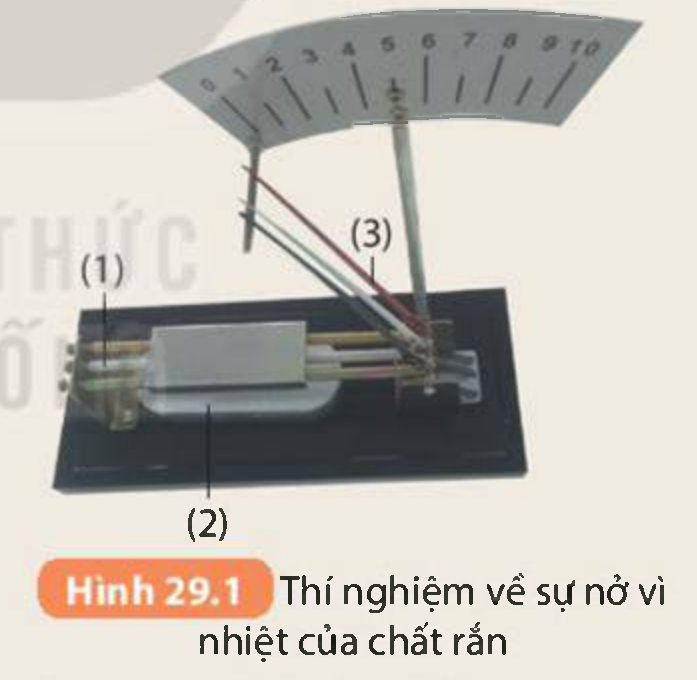
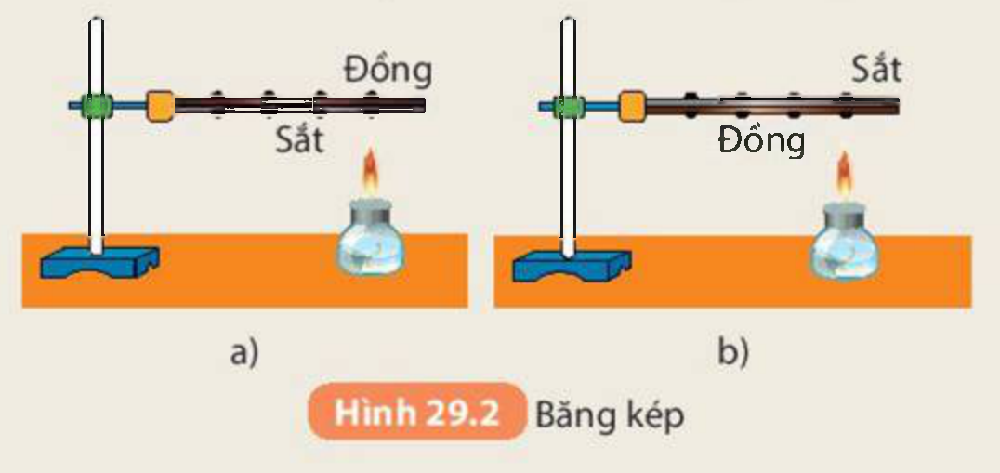
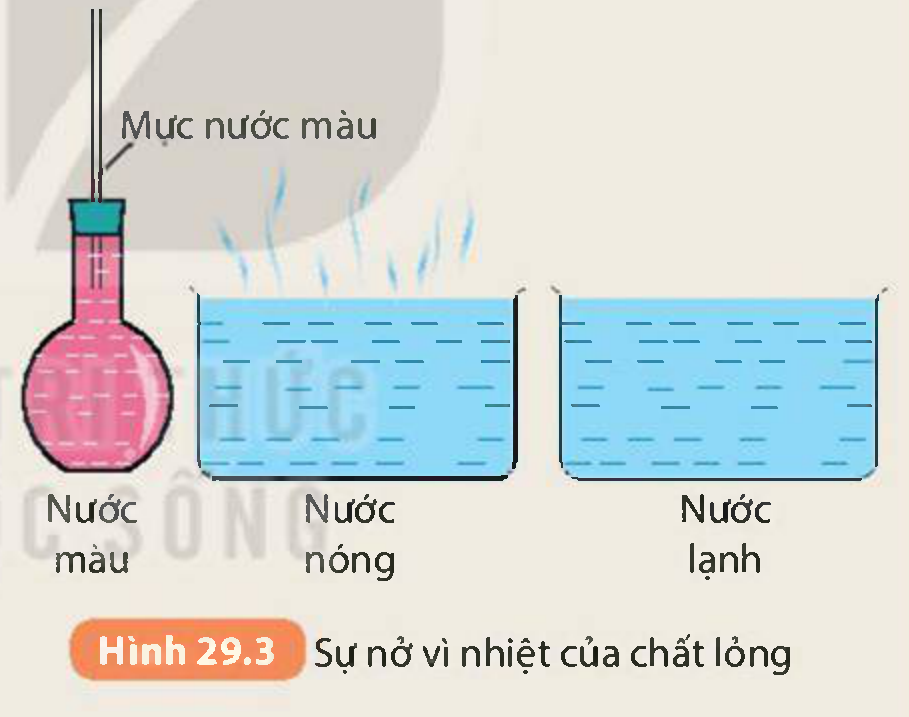
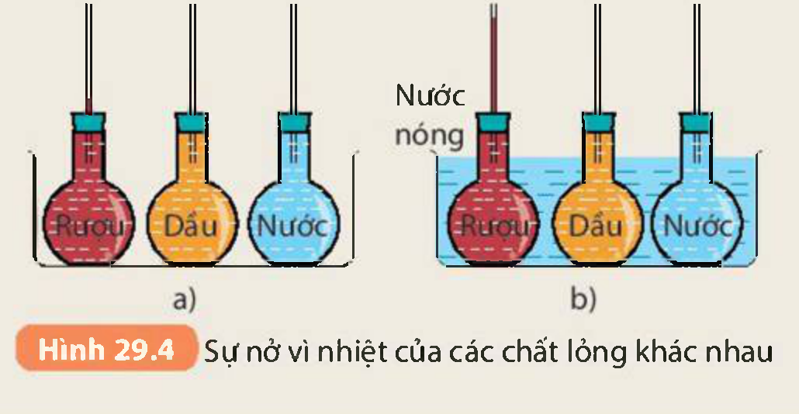
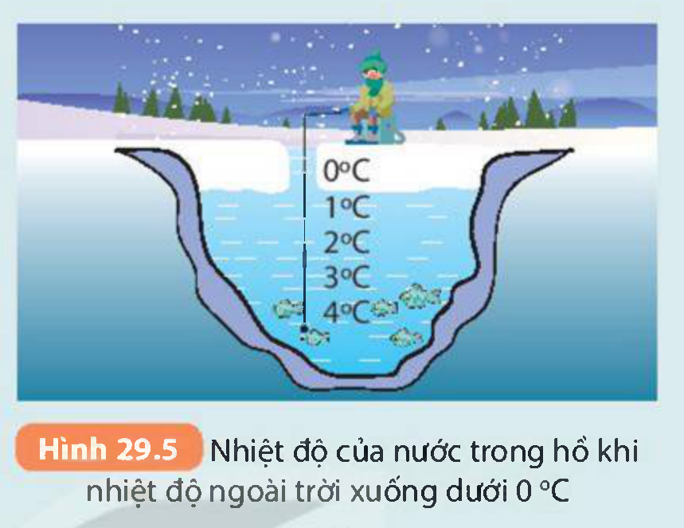
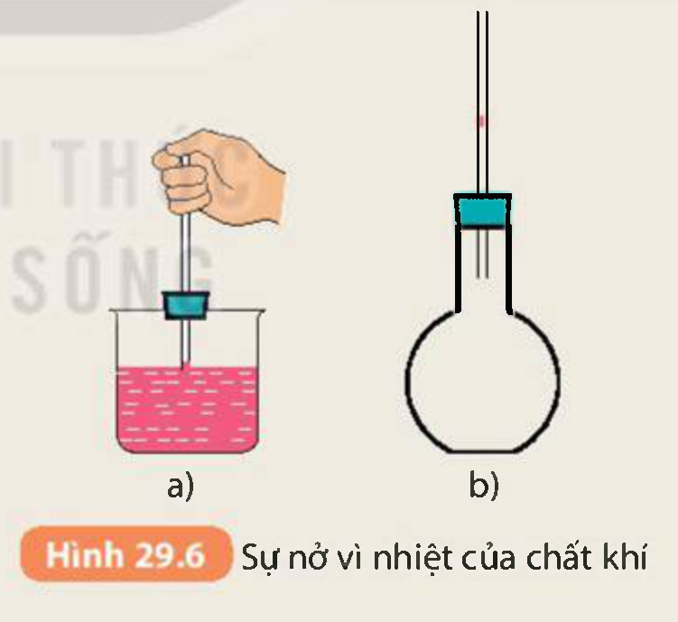
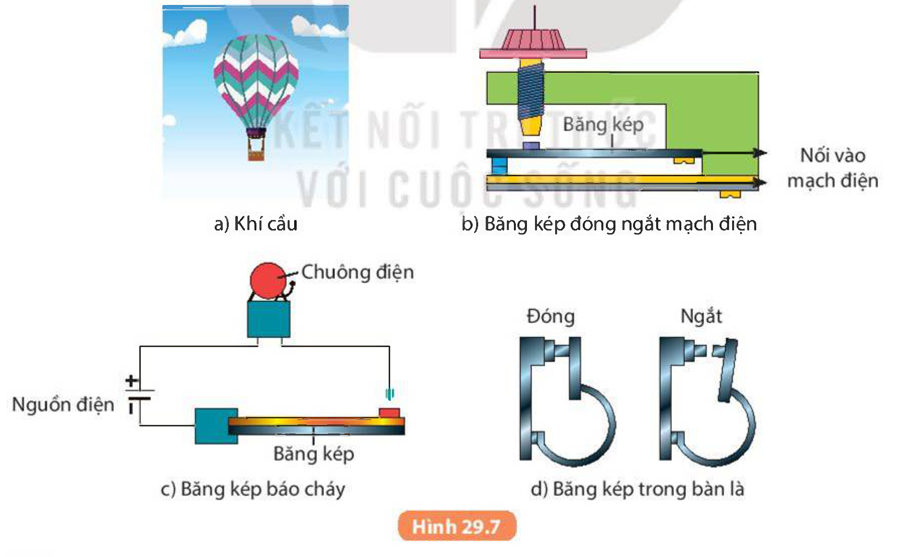
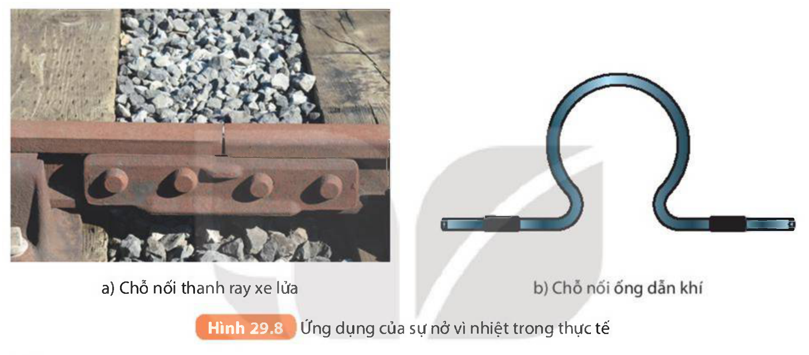

<!-- pdf:120 -->

# BÀI 29: SỰ NỞ VÌ NHIỆT

## 🎯 Mục tiêu

- Thực hiện thí nghiệm để chứng tỏ được các chất khác nhau nở vì nhiệt khác nhau.
- Lấy được một số ví dụ về công dụng và tác hại của sự nở vì nhiệt.
- Vận dụng kiến thức về sự nở vì nhiệt, giải thích một số hiện tượng đơn giản thường gặp trong thực tế.

## 🔴 Mở đầu

> 
>
> Tháp Eiffel bằng thép cao $324\text{ m}$ ở thủ đô Paris nước Pháp là tháp bằng thép nổi tiếng thế giới. Các phép đo chiều cao của tháp vào ngày 01/01/1890 và ngày 01/07/1890 cho thấy trong vòng 6 tháng tháp cao hơn thêm $10\text{ cm}$. Chẳng lẽ một cái tháp bằng thép lại có thể “lớn lên” được? Em có thể giải thích được hiện tượng này không?

## I. Sự nở vì nhiệt của chất rắn

> ✋ *Thí nghiệm*
>
> Người ta dùng thí nghiệm mô tả ở Hình 29.1 để tìm hiểu sự nở vì nhiệt của các chất rắn khác nhau (Hình 29.1).
> - Ba thanh nhôm, đồng, sắt (1).
> - Khay đựng cồn và tấm chắn đậy khay đựng cồn để đảm bảo các thanh tăng nhiệt độ giống nhau (2).
> - Bộ phận ghi độ dãn nở của các thanh, mặt ghi vạch và kim chỉ thị (3).
> - Khi đốt cồn trong khay, đậy nắp chắn lên khay, thì thấy các kim chỉ thị quay. Kim ứng với thanh nhôm quay nhiều nhất, kim ứng với thanh sắt quay ít nhất.
> - Khi tắt đèn cồn các kim chỉ thị lại dần quay về vị trí cũ.
>
> Nhận xét về sự nở vì nhiệt của các chất rắn khác nhau.
>
> 
>
> Hình 29.1. Thí nghiệm về sự nở vì nhiệt của chất rắn

> ✋ Từ thí nghiệm trên hãy rút ra nhận xét về sự nở vì nhiệt của các chất nhôm, đồng, sắt.

<!-- term: Sự nở vì nhiệt của chất rắn -->
*Kết luận:*
- Các chất rắn nở ra khi nóng lên, co lại khi lạnh đi.
- Các chất rắn khác nhau nở vì nhiệt khác nhau.

<!-- pdf:121 -->

> ❓ Hai thanh kim loại đồng, sắt được ghép chặt vào nhau tạo thành một băng kép. Hãy cho biết hình dạng của băng kép sẽ thay đổi như thế nào khi:
> a) Quay thanh kim loại cho mặt sắt ở dưới và hơ nóng bằng đèn cồn (Hình 29.2a).
> b) Quay thanh kim loại cho mặt đồng ở dưới và hơ nóng bằng đèn cồn (Hình 29.2b).
>
> 
>
> Hình 29.2. Băng kép

## II. Sự nở vì nhiệt của chất lỏng

> ✋ *Thí nghiệm*
>
> *Chuẩn bị:* Một bình thủy tinh đựng nước màu có ống thuỷ tinh xuyên qua nút (Hình 29.3); một chậu thuỷ tinh đựng nước nóng và một chậu thuỷ tinh đựng nước lạnh.
>
> *Tiến hành:*
> 1. Đặt bình thủy tinh vào chậu nước nóng. Quan sát và giải thích hiện tượng xảy ra với nước màu trong ống thuỷ tinh.
> 2. Lấy bình thuỷ tinh từ chậu nước nóng ra đặt vào chậu nước lạnh. Quan sát và giải thích hiện tượng xảy ra với nước màu trong ống thuỷ tinh.
>
> 
>
> Hình 29.3. Sự nở vì nhiệt của chất lỏng

> ❓ 1. Hình 29.4 mô tả thí nghiệm về sự nở vì nhiệt của các chất lỏng khác nhau. Hãy mô tả thí nghiệm và rút ra nhận xét về sự nở vì nhiệt của các chất lỏng khác nhau.
> 2. Tìm thêm ví dụ về sự nở vì nhiệt của chất lỏng.
>
> 
>
> Hình 29.4. Sự nở vì nhiệt của các chất lỏng khác nhau

<!-- pdf:122 -->

<!-- term: Sự nở vì nhiệt của chất lỏng -->
*Kết luận:*
- Các chất lỏng nở ra khi nóng lên, co lại khi lạnh đi.
- Các chất lỏng khác nhau nở vì nhiệt khác nhau.

<!-- term: Sự nở vì nhiệt đặc biệt của nước -->
> 🔍 Em có biết?
>
> Sự nở vì nhiệt đặc biệt của nước:
> - Khi nhiệt độ tăng từ $0\text{ }^\circ\text{C}$ đến $4\text{ }^\circ\text{C}$ thì khối lượng riêng của nước tăng tức thể tích của nước giảm.
> - Khi nhiệt độ tăng từ $4\text{ }^\circ\text{C}$ đến $8\text{ }^\circ\text{C}$ thì khối lượng riêng của nước giảm tức thể tích của nước tăng.
> - Do có sự nở vì nhiệt đặc biệt như trên nên nước ở $4\text{ }^\circ\text{C}$ có khối lượng riêng lớn nhất, nghĩa là nước ở $4\text{ }^\circ\text{C}$ nặng nhất so với nước ở các nhiệt độ khác.
>
> Tính chất đặc biệt này của nước giúp chúng ta hiểu được sự phân bố nhiệt độ của các lớp nước khi nhiệt độ ngoài trời xuống dưới $0\text{ }^\circ\text{C}$: Lớp nước ở đáy hồ có nhiệt độ $4\text{ }^\circ\text{C}$, các lớp nước ở trên có nhiệt độ thấp hơn (Hình 29.5). Nhờ đó các loài thuỷ sản có thể sống được dù nhiệt độ ngoài trời xuống dưới $0\text{ }^\circ\text{C}$.
>
> 
>
> Hình 29.5. Nhiệt độ của nước trong hồ khi nhiệt độ ngoài trời xuống dưới $0\text{ }^\circ\text{C}$

## III. Sự nở vì nhiệt của chất khí

> ✋ *Thí nghiệm*
>
> *Chuẩn bị:*
> - Bình cầu với nút cao su có ống thuỷ tinh xuyên qua.
> - Cốc nước màu.
>
> *Tiến hành:*
> - Nhúng đầu ống thuỷ tinh xuyên qua nút cao su vào nước màu.
> - Dùng ngón tay cái bịt chặt đầu còn lại của ống rồi rút ống ra khỏi nước sao cho trong ống còn giữ lại một giọt nước màu (Hình 29.6a).
> - Lắp nút cao su có gắn ống thuỷ tinh trên vào bình cầu.
> - Quan sát, mô tả và giải thích hiện tượng xảy ra đối với giọt nước màu trong ống thuỷ tinh khi chỉ cần xoa hai tay vào nhau rồi áp vào bình cầu.
>
> 
>
> Hình 29.6. Sự nở vì nhiệt của chất khí

> ❓ 1. Tại sao từ thí nghiệm trên ta có thể nói chất khí nở vì nhiệt nhiều hơn chất lỏng?
> 2. Tìm ví dụ về sự nở vì nhiệt của chất khí.

<!-- pdf:123 -->

> 3. Dựa vào Bảng 29.1 rút ra nhận xét về sự nở vì nhiệt của các chất khác nhau: rắn, lỏng và khí.
>
> Bảng 29.1. Độ tăng thể tích của $1\ 000\text{ cm}^3$ các chất khác nhau khi nhiệt độ tăng thêm $50\text{ }^\circ\text{C}$.
>
> | Chất khí | Thể tích tăng thêm | Chất lỏng | Thể tích tăng thêm | Chất rắn | Thể tích tăng thêm |
> | --- | --- | --- | --- | --- | --- |
> | Không khí | $183\text{ cm}^3$ | Rượu | $58\text{ cm}^3$ | Nhôm | $3,45\text{ cm}^3$ |
> | Hơi nước | $183\text{ cm}^3$ | Dầu hoả | $55\text{ cm}^3$ | Đồng | $2,55\text{ cm}^3$ |
> | Khí oxygen | $183\text{ cm}^3$ | Thuỷ ngân | $9\text{ cm}^3$ | Sắt | $1,80\text{ cm}^3$ |

## IV. Công dụng và tác hại của sự nở vì nhiệt

### 1. Công dụng

Sự nở vì nhiệt của các chất có nhiều công dụng. Sau đây là một số ví dụ:

- Sự nở vì nhiệt của chất lỏng, chất khí được dùng vào việc chế tạo các loại nhiệt kế khác nhau.

- Sự nở vì nhiệt của chất khí được dùng vào việc chế tạo các loại khí cầu (Hình 29.7a).

<!-- term: Băng kép -->
- Sự nở vì nhiệt của các chất rắn khác nhau được sử dụng trong việc chế tạo các băng kép dùng trong việc đóng ngắt tự động các dụng cụ dùng điện.

Hình 29.7. a) Khí cầu; b) Băng kép đóng ngắt mạch điện; c) Băng kép báo cháy; d) Băng kép trong bàn là

> ❓ 1. Mô tả hoạt động của các loại băng kép trong Hình 29.7 b, c, d.
> 2. Tìm thêm ví dụ về công dụng của sự nở vì nhiệt.

<!-- pdf:124 -->

### 2. Tác hại

Sự nở vì nhiệt cũng có thể có tác hại với thiên nhiên và cuộc sống của con người. Sau đây là một số ví dụ:
- Sự nở vì nhiệt là một trong những nguyên nhân làm cho mực nước biển dâng lên, dẫn đến thu hẹp đất ở những vùng ven biển, tăng sự xâm nhập mặn vào những vùng đất còn lại,... ảnh hưởng không những đến thiên nhiên mà đến cả cuộc sống của con người. Các nhà khoa học đã cảnh báo nếu không có các biện pháp phòng ngừa thích hợp thì chỉ khoảng 60 năm nữa có thể có trên $1/2$ diện tích Đồng bằng sông Cửu Long sẽ có thể chìm trong nước biển.
- Sự nở vì nhiệt của chất rắn có thể tạo ra lực có cường độ cực mạnh đủ sức làm biến dạng đường sắt, đường ống dẫn nước, dẫn khí,... có thể gây ra tai nạn nguy hiểm.

Hình 29.8. Ứng dụng của sự nở vì nhiệt trong thực tế

> ❓ 1. Tại sao chỗ nối tiếp hai đầu thanh ray xe lửa, hai đầu ống dẫn khí lại được cấu tạo như Hình 29.8?
> 2. Tìm thêm ví dụ về tác hại của sự nở vì nhiệt.

## 📌 Em đã học

<!-- term: Sự nở vì nhiệt của chất khí -->
- Các chất nở ra khi nóng lên, co lại khi lạnh đi.
- Các chất rắn, lỏng khác nhau nở vì nhiệt khác nhau. Các chất khí khác nhau nở vì nhiệt giống nhau.
- Chất khí nở vì nhiệt nhiều hơn chất lỏng, chất lỏng nở vì nhiệt nhiều hơn chất rắn.
- Sự nở vì nhiệt có thể có ích nhưng cũng có thể có hại.

## 🚀 Em có thể

- Giới thiệu được hoạt động và công dụng của băng kép trong các thiết bị tự động.
- Giải thích được một số hiện tượng đơn giản có liên quan đến sự nở vì nhiệt.

## 📷 Danh sách hình trong bài

| Mã hình | Trang PDF | Vị trí trong bài | Chú thích gốc |
| --- | :---: | --- | --- |
| H8-khoa_hoc_tu_nhien-b29-01 | 120 | Mở đầu | Hình minh hoạ mở đầu (Tháp Eiffel) |
| H8-khoa_hoc_tu_nhien-b29-02 | 120 | Mục I | Hình 29.1. Thí nghiệm về sự nở vì nhiệt của chất rắn |
| H8-khoa_hoc_tu_nhien-b29-03 | 121 | Mục I | Hình 29.2. Băng kép |
| H8-khoa_hoc_tu_nhien-b29-04 | 121 | Mục II | Hình 29.3. Sự nở vì nhiệt của chất lỏng |
| H8-khoa_hoc_tu_nhien-b29-05 | 121 | Mục II | Hình 29.4. Sự nở vì nhiệt của các chất lỏng khác nhau |
| H8-khoa_hoc_tu_nhien-b29-06 | 122 | Mục II, Em có biết? | Hình 29.5. Nhiệt độ của nước trong hồ khi nhiệt độ ngoài trời xuống dưới $0\text{ }^\circ\text{C}$ |
| H8-khoa_hoc_tu_nhien-b29-07 | 122 | Mục III | Hình 29.6. Sự nở vì nhiệt của chất khí |
| H8-khoa_hoc_tu_nhien-b29-08 | 123 | Mục IV.1 | Hình 29.7. a) Khí cầu; b) Băng kép đóng ngắt mạch điện; c) Băng kép báo cháy; d) Băng kép trong bàn là |
| H8-khoa_hoc_tu_nhien-b29-09 | 124 | Mục IV.2 | Hình 29.8. Ứng dụng của sự nở vì nhiệt trong thực tế |
