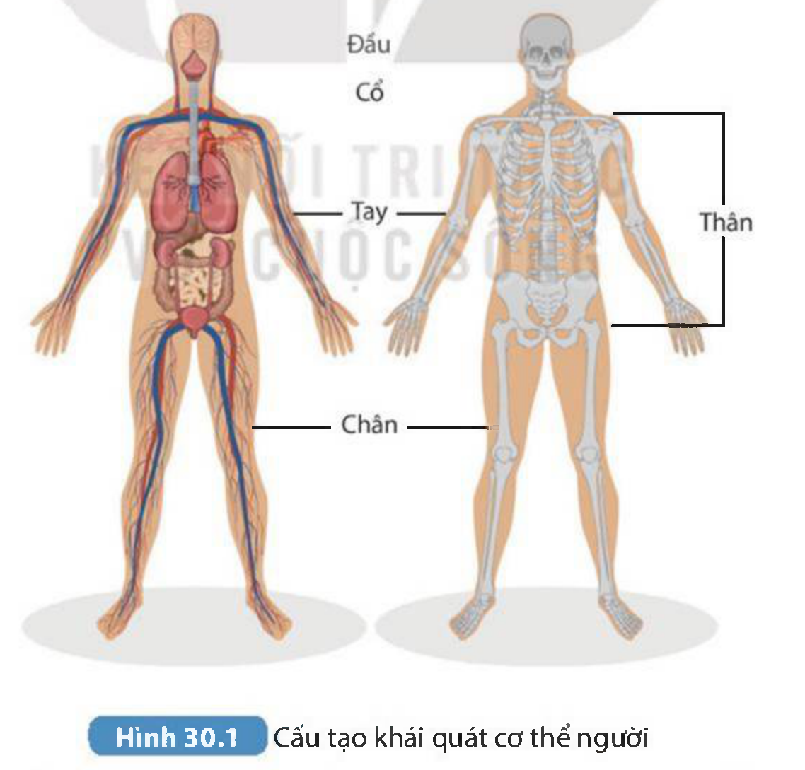

<!-- pdf:125 -->

# BÀI 30: KHÁI QUÁT VỀ CƠ THỂ NGƯỜI

## 🎯 Mục tiêu

- Nêu được tên và vai trò chính của các cơ quan, hệ cơ quan trong cơ thể người.

## 🔴 Mở đầu

Mỗi người đều có những đặc điểm riêng để phân biệt với người khác như màu da, chiều cao, nhóm máu,... Ngoài sự khác nhau đó, cấu tạo cơ thể người có những đặc điểm chung nào?

## I. Khát quát về cơ thể người

Cơ thể người bao gồm các phần: đầu, cổ, thân, hai tay và hai chân. Toàn bộ cơ thể được bao bọc bên ngoài bởi một lớp da, dưới da là lớp mỡ, dưới lớp mỡ là cơ và xương. <!-- term: Cơ thể người -->

Hình 30.1. Cấu tạo khái quát cơ thể người

## II. Vai trò của các cơ quan và hệ cơ quan trong cơ thể người

Các hệ cơ quan trong cơ thể người gồm hệ vận động, hệ tuần hoàn, hệ hô hấp, hệ tiêu hoá, hệ bài tiết, hệ thần kinh và các giác quan, hệ nội tiết, hệ sinh dục. <!-- term: Hệ cơ quan trong cơ thể người -->

<!-- pdf:126 -->

Bảng 30.1. Vai trò chính của các cơ quan và hệ cơ quan trong cơ thể người

| Cơ quan/Hệ cơ quan | Các cơ quan trong từng hệ cơ quan | Vai trò chính trong cơ thể |
| --- | --- | --- |
| Hệ vận động | Cơ, xương, khớp | Định hình cơ thể, bảo vệ nội quan, giúp cơ thể cử động và di chuyển |
| Hệ tuần hoàn | Tim và mạch máu | Vận chuyển chất dinh dưỡng, oxygen, hormone,... đến các tế bào và vận chuyển chất thải từ tế bào đến các cơ quan bài tiết để thải ra ngoài |
| Hệ hô hấp | Đường dẫn khí (mũi, họng, thanh quản, khí quản, phế quản) và hai lá phổi | Giúp cơ thể lấy khí oxygen từ môi trường và thải khí carbon dioxide ra khỏi cơ thể |
| Hệ tiêu hoá | Ống tiêu hoá (miệng, thực quản, dạ dày, ruột non, ruột già, hậu môn) và các tuyến tiêu hoá | Biến đổi thức ăn thành các chất dinh dưỡng mà cơ thể hấp thụ được và loại chất thải ra khỏi cơ thể |
| Hệ bài tiết | Phổi, thận, da | Lọc các chất thải có hại cho cơ thể từ máu và thải ra môi trường |
| Hệ thần kinh | Não, tuỷ sống, dây thần kinh, hạch thần kinh | Thu nhận các kích thích từ môi trường, điều khiển, điều hoà hoạt động của các cơ quan, giúp cho cơ thể thích nghi với môi trường |
| Các giác quan | Thị giác, thính giác,... | Giúp cơ thể nhận biết được các vật và thu nhận âm thanh |
| Hệ nội tiết | Tuyến yên, tuyến giáp, tuyến tuỵ, tuyến trên thận, tuyến sinh dục,... | Điều hoà hoạt động của các cơ quan trong cơ thể thông qua việc tiết một số loại hormone tác động đến cơ quan nhất định |
| Hệ sinh dục | Ở nam: tinh hoàn, ống dẫn tinh, túi tinh, dương vật,... Ở nữ: buồng trứng, ống dẫn trứng, tử cung, âm đạo,... | Giúp cơ thể sinh sản, duy trì nòi giống |

> ✋ Đọc thông tin trong Bảng 30.1 và thảo luận để trả lời câu hỏi ở phần khởi động.

> 🔍 Khi chúng ta ngủ, túi mật, gan và phổi hoạt động mạnh nhất để loại bỏ độc tố ra khỏi cơ thể. Trong khi đó, tim, ruột non và bóng đái sẽ hoạt động ở mức thấp nhất. Mỗi cơ quan trong cơ thể sẽ làm việc với “công suất” lớn nhất vào một khoảng thời gian nhất định và có một khung giờ khác để nghỉ ngơi. Do đó, cần có kế hoạch làm việc, ăn uống và nghỉ ngơi khoa học để có một cơ thể khoẻ mạnh.

## 📌 Em đã học

- Cơ thể người gồm các phần: đầu, cổ, thân, tay và chân.
- Các hệ cơ quan trong cơ thể người gồm hệ vận động, hệ tuần hoàn, hệ hô hấp, hệ tiêu hoá, hệ bài tiết, hệ thần kinh và các giác quan, hệ nội tiết, hệ sinh dục.
- Mỗi cơ quan, hệ cơ quan có một vai trò nhất định và có mối liên quan chặt chẽ với các cơ quan, hệ cơ quan khác. <!-- term: Hệ cơ quan trong cơ thể người -->

## 🚀 Em có thể

- Kể tên và nêu được vai trò chính của các cơ quan và hệ cơ quan trong cơ thể mình.

## 📷 Danh sách hình trong bài

| Mã hình | Trang PDF | Trang sách | Chú thích |
| --- | --- | --- | --- |
| H8-khoa_hoc_tu_nhien-b30-01 | 125 | 123 | Hình 30.1. Cấu tạo khái quát cơ thể người |
