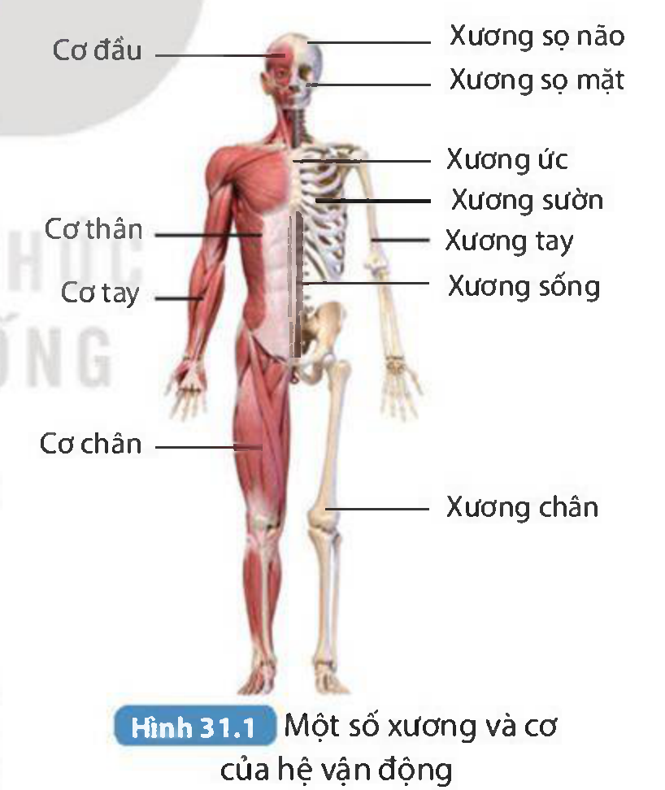
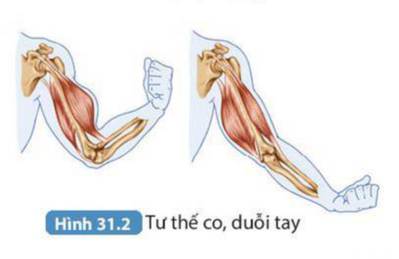
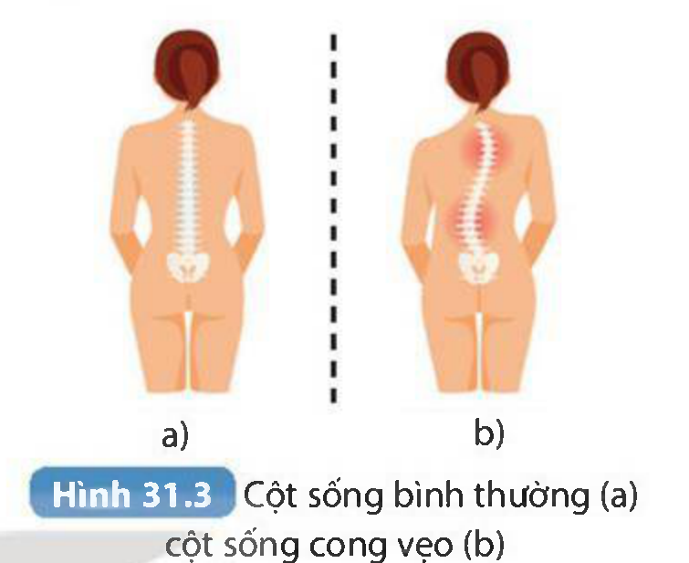
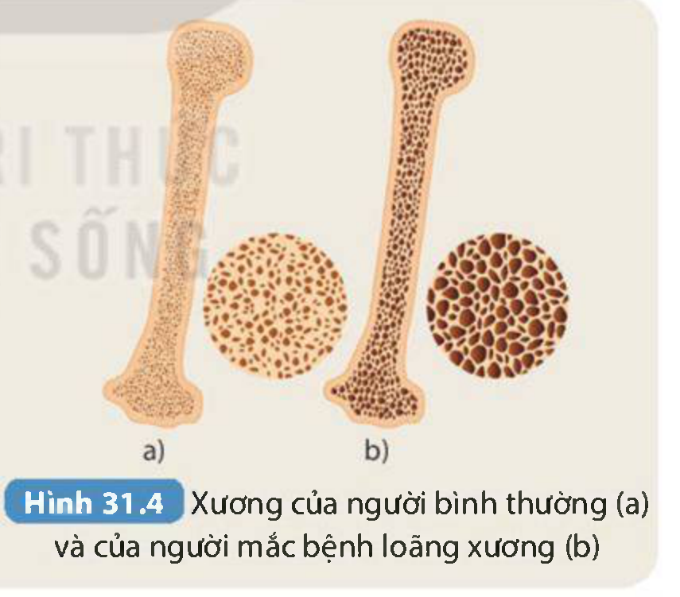
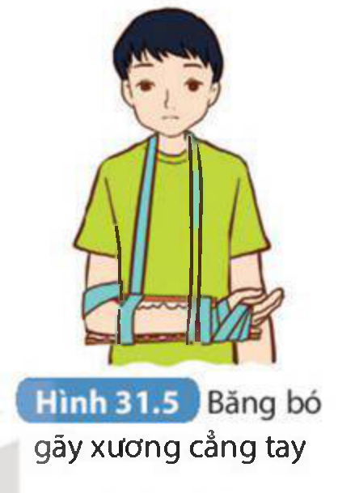
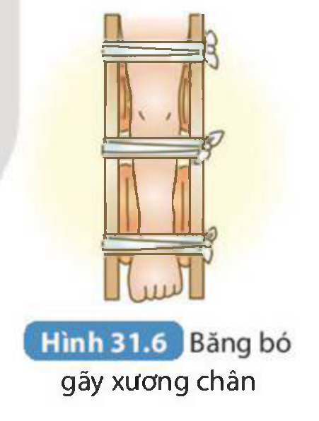

<!-- pdf:127 -->

# BÀI 31: HỆ VẬN ĐỘNG Ở NGƯỜI

## 🎯 Mục tiêu

- Nêu được cấu tạo, chức năng và phân tích được sự phù hợp giữa cấu tạo với chức năng của hệ vận động.
- Mô tả được cấu tạo sơ lược các cơ quan của hệ vận động. Liên hệ được kiến thức đòn bẩy vào hệ vận động. Giải thích sự co cơ, khả năng chịu tải của xương.
- Trình bày được một số bệnh, tật và bệnh học đường liên quan đến hệ vận động. Nêu được biện pháp bảo vệ các cơ quan của hệ vận động và cách phòng chống bệnh.
- Nêu được ý nghĩa của tập thể dục, thể thao và chọn phương pháp luyện tập thể thao phù hợp. Vận dụng hiểu biết về hệ vận động và bệnh học đường để bảo vệ bản thân, tuyên truyền và giúp đỡ người khác.
- Thực hành: Thực hiện được sơ cứu và băng bó khi người khác bị gãy xương; tìm hiểu được tình hình mắc các bệnh về hệ vận động trong trường học và khu dân cư.

## 🔴 Mở đầu

Tại sao mỗi người lại có vóc dáng và kích thước khác nhau? Nhờ đâu mà cơ thể người có thể di chuyển, vận động?

## I. Cấu tạo và chức năng của hệ vận động

### 1. Cấu tạo của hệ vận động

Hệ vận động ở người có cấu tạo gồm bộ xương và hệ cơ. <!-- term: Hệ vận động -->

Xương được cấu tạo từ chất hữu cơ và chất khoáng. Bộ xương ở người trưởng thành có khoảng 206 xương, được chia thành ba phần: xương đầu, xương thân, xương chi (xương tay, xương chân). Nơi tiếp giáp giữa các đầu xương là **khớp xương**. <!-- term: Bộ xương -->

Hệ cơ ở người có khoảng 600 cơ, cơ bám vào xương nhờ các mô liên kết như dây chằng, gân. <!-- term: Hệ cơ -->

Hình 31.1. Một số xương và cơ của hệ vận động

### 2. Chức năng của hệ vận động

Bộ xương tạo nên khung cơ thể, giúp cơ thể có hình dạng nhất định và bảo vệ cơ thể. Cơ bám vào xương, khi cơ co hay dãn sẽ làm xương cử động, giúp cơ thể di chuyển và vận động. <!-- term: Hệ vận động --> <!-- term: Bộ xương --> <!-- term: Hệ cơ -->

Một số khớp xương tạo kết nối kiểu đòn bẩy giữa các xương, nhờ vậy, xương có khả năng chịu tải cao khi vận động. Chất khoáng trong xương làm xương bền chắc, chất hữu cơ giúp xương có tính mềm dẻo, nhờ đó cơ thể vận động linh hoạt và chắc chắn.

Hình 31.2. Tư thế co, duỗi tay

<!-- pdf:128 -->

> ❓
> 1. Quan sát Hình 31.1, phân loại các xương vào ba phần của bộ xương.
> 2. Quan sát Hình 31.2, so sánh tư thế của tay khi cơ co và dãn. Liên hệ kiến thức về đòn bẩy đã học ở bài 19, cho biết tay ở tư thế nào có khả năng chịu tải tốt hơn.

## II. Một số bệnh, tật liên quan đến hệ vận động

### 1. Tật cong vẹo cột sống

**Tật cong vẹo cột sống** là tình trạng cột sống không giữ được trạng thái bình thường, các đốt sống bị xoay lệch về một bên (Hình 31.3), cong quá mức về phía trước hay phía sau. Cong vẹo cột sống có thể do tư thế hoạt động không đúng trong thời gian dài, mang vác vật nặng thường xuyên, do tai nạn hay còi xương.

Hình 31.3. Cột sống bình thường (a) cột sống cong vẹo (b)

### 2. Bệnh loãng xương

Cơ thể thiếu calcium và phosphorus sẽ thiếu nguyên liệu để kiến tạo xương nên mật độ chất khoáng trong xương thưa dần, dẫn đến bệnh loãng xương. Bệnh này thường gặp ở người cao tuổi. Khi bị chấn thương, người mắc bệnh loãng xương có nguy cơ gãy xương cao hơn người không mắc bệnh. <!-- term: Bệnh loãng xương -->

> ✋
> 1. Quan sát Hình 31.4 và dự đoán xương nào bị giòn, dễ gãy. Từ đó nêu tác hại của bệnh loãng xương.
> 2. Tìm hiểu các bệnh về hệ vận động (nguyên nhân, số lượng người mắc) trong trường học và khu dân cư; đề xuất và tuyên truyền biện pháp phòng bệnh, bảo vệ hệ vận động.
>
> 
>
> Hình 31.4. Xương của người bình thường (a) và của người mắc bệnh loãng xương (b)

## III. Ý nghĩa của tập thể dục, thể thao

Tập thể dục, thể thao có vai trò kích thích tăng chiều dài và chu vi của xương, cơ bắp nở nang và rắn chắc, tăng cường sự dẻo dai của cơ thể.

> ✋ Thảo luận nhóm để thực hiện các yêu cầu sau:
>
> 1. Nêu ý nghĩa của luyện tập thể dục, thể thao.
> 2. Lựa chọn phương pháp luyện tập thể dục, thể thao phù hợp với lứa tuổi.

<!-- pdf:129 -->

## IV. Thực hành: Sơ cứu và băng bó khi người khác bị gãy xương

### 1. Mục tiêu

Thực hiện được sơ cứu và băng bó khi người khác bị gãy xương.

### 2. Chuẩn bị

Nẹp bằng tre/gỗ/nhựa dài từ 30 cm đến 40 cm, rộng từ 4 cm đến 5 cm; dây vải rộng bản/băng y tế dài 2 m, rộng từ 4 cm đến 5 cm; bông/gạc y tế hoặc miếng vải sạch kích thước $20 \times 40\text{ cm}$; khăn vải.

Lưu ý: Có thể sử dụng các dụng cụ tương tự phù hợp với điều kiện thực tế.

### 3. Cách tiến hành

**a) Sơ cứu gãy xương cẳng tay**

Bước 1: Đặt tay bị gãy vào sát thân nạn nhân.

Bước 2: Đặt hai nẹp vào hai phía của cẳng tay, nẹp dài từ khuỷu tay tới cổ tay, đồng thời lót bông/gạc y tế hoặc miếng vải sạch vào phía trong nẹp.

Bước 3: Dùng dây vải rộng bản/băng y tế buộc cố định nẹp.

Bước 4: Dùng khăn vải làm dây đeo vào cổ để đỡ cẳng tay treo trước ngực, cẳng tay vuông góc với cánh tay (Hình 31.5).

Hình 31.5. Băng bó gãy xương cẳng tay

**b) Sơ cứu gãy xương chân**

Bước 1: Đặt nạn nhân nằm trên mặt phẳng, chân duỗi thẳng, bàn chân vuông góc với cẳng chân.

Bước 2: Dùng hai nẹp đặt phía trong và ngoài của chân bị gãy, đồng thời lót bông hoặc miếng vải sạch ở vị trí tiếp giáp giữa chân và nẹp.

Bước 3: Dùng dây vải rộng bản/băng y tế buộc cố định hai nẹp với nhau ở các vị trí trên và dưới vùng gãy để cố định chỗ chân bị gãy (Hình 31.6).

Hình 31.6. Băng bó gãy xương chân

### 4. Kết quả

Thực hành sơ cứu, băng bó người khác bị gãy xương cẳng tay và gãy xương chân. Nhận xét về kết quả băng bó của bản thân và các bạn trong nhóm.

> Trả lời các câu hỏi sau:
>
> 1. Khi thực hiện buộc cố định nẹp cần lưu ý những điều gì?
> 2. Có thể sử dụng những dụng cụ nào tương tự nẹp và dây vải rộng bản trong điều kiện thực tế khi sơ cứu và băng bó người khác bị gãy xương?

## 📌 Em đã học

- Hệ vận động ở người có cấu tạo gồm bộ xương và hệ cơ, có chức năng bảo vệ, duy trì hình dạng và vận động cơ thể. <!-- term: Hệ vận động -->
- Một số bệnh, tật liên quan đến hệ vận động như bệnh loãng xương, tật cong vẹo cột sống,...
- Luyện tập thể dục, thể thao giúp bảo vệ hệ vận động và nâng cao sức khoẻ.

## 🚀 Em có thể

- Đề xuất và thực hiện một số biện pháp phòng chống các bệnh, tật liên quan đến hệ vận động ở lứa tuổi học đường.

## 📷 Danh sách hình trong bài

| Mã hình | Trang PDF | Trang sách | Chú thích |
| --- | --- | --- | --- |
| H8-khoa_hoc_tu_nhien-b31-01 | 127 | 125 | Hình 31.1. Một số xương và cơ của hệ vận động |
| H8-khoa_hoc_tu_nhien-b31-02 | 127 | 125 | Hình 31.2. Tư thế co, duỗi tay |
| H8-khoa_hoc_tu_nhien-b31-03 | 128 | 126 | Hình 31.3. Cột sống bình thường (a) cột sống cong vẹo (b) |
| H8-khoa_hoc_tu_nhien-b31-04 | 128 | 126 | Hình 31.4. Xương của người bình thường (a) và của người mắc bệnh loãng xương (b) |
| H8-khoa_hoc_tu_nhien-b31-05 | 129 | 127 | Hình 31.5. Băng bó gãy xương cẳng tay |
| H8-khoa_hoc_tu_nhien-b31-06 | 129 | 127 | Hình 31.6. Băng bó gãy xương chân |
