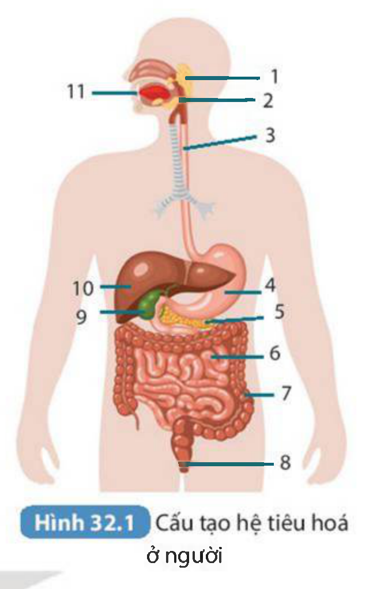
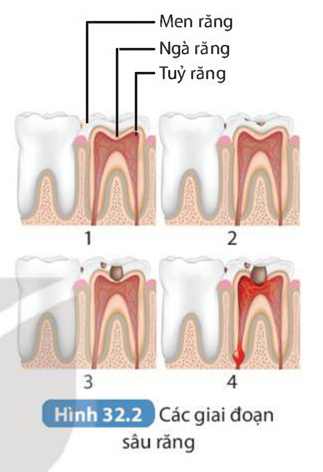
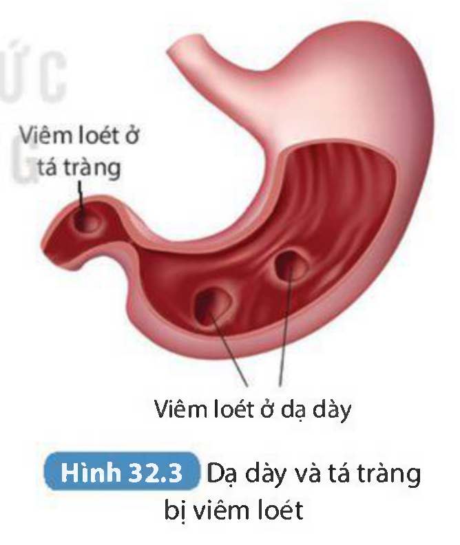
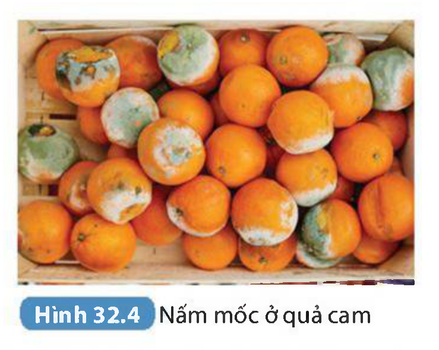

<!-- pdf:130 -->

# BÀI 32: DINH DƯỠNG VÀ TIÊU HOÁ Ở NGƯỜI

## 🎯 Mục tiêu

- Nêu được khái niệm dinh dưỡng, chất dinh dưỡng và mối quan hệ giữa tiêu hoá, dinh dưỡng.
- Trình bày được chức năng của hệ tiêu hoá; kể tên được các cơ quan của hệ tiêu hoá, nêu được chức năng của mỗi cơ quan và sự phối hợp các cơ quan thể hiện chức năng của cả hệ tiêu hoá.
- Trình bày được chế độ dinh dưỡng của con người ở các độ tuổi; nêu được nguyên tắc lập khẩu phần ăn cho con người; thực hành xây dựng chế độ dinh dưỡng cho bản thân và những người trong gia đình.
- Nêu được một số bệnh về đường tiêu hoá và cách phòng chống các bệnh đó; vận dụng để phòng chống các bệnh về tiêu hoá cho bản thân và gia đình.
- Trình bày được một số vấn đề về an toàn thực phẩm.
- Vận dụng được hiểu biết về an toàn vệ sinh thực phẩm để đề xuất các biện pháp lựa chọn, bảo quản, chế biến, chế độ ăn uống an toàn cho bản thân và gia đình; đọc và hiểu được ý nghĩa của các thông tin ghi trên nhãn hiệu bao bì thực phẩm và biết cách sử dụng thực phẩm đó một cách phù hợp.
- Thực hiện được dự án điều tra về vệ sinh an toàn thực phẩm tại địa phương; dự án điều tra một số bệnh đường tiêu hoá trong trường học hoặc tại địa phương.

## 🔴 Mở đầu

Cơ thể cần thường xuyên lấy các chất dinh dưỡng từ nguồn thức ăn để duy trì sự sống và phát triển. Tuy nhiên, thức ăn hầu hết có kích thước lớn nên các tế bào của cơ thể không thể hấp thụ được. Quá trình nào đã giúp cơ thể giải quyết vấn đề này và quá trình đó diễn ra như thế nào?

## I. Khái niệm chất dinh dưỡng và dinh dưỡng

**Chất dinh dưỡng** là các chất có trong thức ăn mà cơ thể sử dụng làm nguyên liệu cấu tạo cơ thể và cung cấp năng lượng cho các hoạt động sống. Các loại thực phẩm khác nhau có thành phần dinh dưỡng khác nhau. Các nhóm chất dinh dưỡng cần thiết cho cơ thể gồm carbohydrate, protein, chất béo, vitamin và chất khoáng. Để cơ thể hoạt động bình thường, khoẻ mạnh, cần cung cấp các chất dinh dưỡng đầy đủ, hợp lí.

**Dinh dưỡng** là quá trình thu nhận, biến đổi và sử dụng chất dinh dưỡng để duy trì sự sống của cơ thể. Hoạt động của hệ tiêu hoá giúp biến đổi thức ăn thành các chất dinh dưỡng cung cấp cho cơ thể.

> ❓ Nêu khái niệm chất dinh dưỡng và dinh dưỡng.

<!-- pdf:131 -->

## II. Tiêu hoá ở người

### 1. Cấu tạo và chức năng của hệ tiêu hoá

Hệ tiêu hoá có các cơ quan (miệng, hầu, thực quản, dạ dày, ruột non, ruột già, hậu môn) và các tuyến tiêu hoá (tuyến nước bọt, tuỵ, gan, mật,...). Hệ tiêu hoá có chức năng biến đổi thức ăn thành các chất dinh dưỡng mà cơ thể có thể hấp thụ được và loại chất thải ra khỏi cơ thể. <!-- term: Hệ tiêu hoá -->

Hình 32.1. Cấu tạo hệ tiêu hoá ở người

> ❓ Quan sát Hình 32.1 và dựa vào kiến thức đã học để thực hiện các yêu cầu sau:
>
> 1. Nêu tên các cơ quan của hệ tiêu hoá tương ứng với những vị trí được đánh số trong hình.
> 2. Xác định tên ba cơ quan mà thức ăn không đi qua.

### 2. Quá trình tiêu hoá ở người

**a) Tiêu hoá ở khoang miệng**

Thức ăn khi vào khoang miệng được tiêu hoá cơ học và hoá học. Tiêu hoá cơ học thức ăn nhờ hoạt động nhai, nghiền của răng và hoạt động đảo trộn của lưỡi. Tiêu hoá hoá học nhờ enzyme amylase của tuyến nước bọt giúp biến đổi một phần tinh bột chín trong thức ăn thành đường maltose. <!-- term: Tiêu hoá cơ học --> <!-- term: Tiêu hoá hoá học -->

**b) Tiêu hoá ở dạ dày**

Dạ dày là nơi nhận thức ăn từ thực quản xuống, tiếp tục quá trình tiêu hoá cơ học và hoá học. Hoạt động co bóp của dạ dày giúp thức ăn được nhuyễn và thấm đều dịch vị (chứa hydrochloric acid, enzyme lipase và enzyme pepsin). Enzyme pepsin giúp biến đổi một phần protein trong thức ăn. <!-- term: Tiêu hoá cơ học --> <!-- term: Tiêu hoá hoá học -->

**c) Tiêu hoá ở ruột non**

Thức ăn từ dạ dày được chuyển xuống tá tràng (đoạn đầu của ruột non), tại đây có dịch tuỵ (do tuyến tuỵ tiết ra), dịch mật (do gan tiết ra) đổ vào. Niêm mạc ruột non chứa tuyến ruột tiết ra dịch ruột. Ba loại dịch trên chứa các enzyme tiêu hoá giúp biến đổi chất dinh dưỡng trong thức ăn thành những chất đơn giản mà cơ thể hấp thụ được. <!-- term: Tiêu hoá hoá học -->

Sự tiêu hoá các chất được diễn ra dọc theo chiều dài của ống tiêu hoá nhưng chủ yếu ở ruột non do ruột non có mạng mao mạch máu và bạch huyết dày đặc. Chất dinh dưỡng trong thức ăn được vận chuyển qua thành của các lông ruột, mạch máu và mạch bạch huyết.

**d) Tiêu hoá ở ruột già và trực tràng**

Phần lớn các chất dinh dưỡng đã được hấp thụ qua thành ruột non, thức ăn chuyển xuống ruột già sẽ hấp thụ thêm một số chất dinh dưỡng, chủ yếu hấp thụ lại nước, cô đặc chất bã. Một số vi khuẩn của ruột già phân huỷ những chất còn lại của protein, carbohydrate, lên men tạo thành phân được thải ra ngoài nhờ nhu động của ruột già và theo cơ chế phản xạ.

<!-- pdf:132 -->

> ✋
> 1. Thảo luận về sự phối hợp các cơ quan thể hiện chức năng của cả hệ tiêu hoá.
> 2. Nêu mối quan hệ giữa tiêu hoá và dinh dưỡng.

## III. Một số bệnh về đường tiêu hoá

### 1. Sâu răng

**Sâu răng** là tình trạng tổn thương phần mô cứng của răng do vi khuẩn gây ra, hình thành các lỗ nhỏ trên răng. Khi lỗ sâu ở răng lan sâu và rộng sẽ gây đau, thức ăn dễ bị nhét vào lỗ sâu gây khó chịu.

Cần vệ sinh răng miệng đúng cách để phòng sâu răng và hạn chế sự lan rộng của các lỗ sâu răng.

Hình 32.2. Các giai đoạn sâu răng

> ✋ Làm việc theo nhóm để thực hiện các yêu cầu sau:
>
> 1. Quan sát Hình 32.2, thảo luận về các giai đoạn hình thành lỗ sâu răng.
> 2. Đề xuất một số biện pháp giúp phòng, chống sâu răng và các việc nên làm để hạn chế những ảnh hưởng tới sức khoẻ khi đã bị sâu răng.

### 2. Viêm loét dạ dày – tá tràng

**Viêm loét dạ dày – tá tràng** (còn gọi là đau dạ dày) là bệnh do tổn thương viêm và loét lớp niêm mạc dạ dày hoặc tá tràng, lớp niêm mạc bị bào mòn (Hình 32.3).

Nguyên nhân chính gây bệnh là nhiễm vi khuẩn *Helicobacter pylori*. Ngoài ra, thói quen sử dụng đồ uống có cồn, ăn uống và sinh hoạt không điều độ cũng là yếu tố tăng nguy cơ bị bệnh.

Người bị bệnh có triệu chứng đau vùng bụng trên rốn, đầy bụng, khó tiêu, buồn nôn, mất ngủ, ngủ không ngon giấc, ợ hơi, ợ chua, rối loạn tiêu hoá,...

Cần duy trì chế độ ăn uống hợp lí, nghỉ ngơi và sinh hoạt điều độ, giữ tinh thần thoải mái để phòng chống bệnh.

Hình 32.3. Dạ dày và tá tràng bị viêm loét

> ✋
> 1. Người bị viêm loét dạ dày – tá tràng nên và không nên sử dụng các loại thức ăn, đồ uống nào? Em hãy kể tên và giải thích.
> 2. Dựa vào thông tin trên, em hãy nêu các biện pháp bảo vệ hệ tiêu hoá và cơ sở khoa học của các biện pháp đó.

<!-- pdf:133 -->

## IV. Chế độ dinh dưỡng ở người

Chế độ dinh dưỡng của mỗi người phụ thuộc vào nhiều yếu tố, trong đó có nhu cầu dinh dưỡng. Nhu cầu dinh dưỡng khuyến nghị cho người Việt Nam theo độ tuổi được trình bày ở Bảng 32.1.

Bảng 32.1. Nhu cầu dinh dưỡng khuyến nghị cho người Việt Nam/ngày$^{(*)}$

| Nhóm tuổi (tuổi) | Giới tính | Protein (g) | Lipid (g) | Carbohydrate (g) | Năng lượng (Kcal) | Calcium (mg) | Sắt (mg) | Vitamin A (mg) | Vitamin B1 (mg) | Vitamin B2 (mg) | Vitamin PP (mg) | Vitamin C (mg) |
| --- | --- | --- | --- | --- | --- | --- | --- | --- | --- | --- | --- | --- |
| 6 – 7 | Nam | 33 | 35 – 52 | 210 – 230 | 1 570 | 650 | 7,2 | 0,45 | 0,8 | 0,9 | 8 | 55 |
| 6 – 7 | Nữ | 32 | 32 – 49 | 200 – 220 | 1 460 | 650 | 7,1 | 0,40 | 0,8 | 0,9 | 8 | 55 |
| 12 – 14 | Nam | 65 | 56 – 83 | 300 – 340 | 2 500 | 1 000 | 15,3 | 0,80 | 1,4 | 1,6 | 12 | 95 |
| 12 – 14 | Nữ | 60 | 51 – 77 | 280 – 300 | 2 310 | 1 000 | 32,6 | 0,70 | 1,3 | 1,4 | 12 | 95 |
| 30 – 49 | Nam | 68 | 52 – 65 | 330 – 360 | 2 350 | 800 | 11,9 | 0,90 | 1,2 | 1,4 | 16 | 100 |
| 30 – 49 | Nữ | 60 | 45 – 56 | 290 – 320 | 2 010 | 800 | 26,1 | 0,70 | 1,0 | 1,2 | 14 | 100 |
| Từ 70 trở lên | Nam | 68 | 49 – 61 | 300 – 320 | 2 190 | 1 000 | 11,0 | 0,80 | 1,1 | 1,3 | 16 | 100 |
| Từ 70 trở lên | Nữ | 59 | 40 – 51 | 250 – 280 | 1 820 | 1 000 | 9,4 | 0,65 | 1,0 | 1,1 | 14 | 100 |
<!-- ocr-ok: Bảng 32.1 nhiều cột số liệu, OCR đọc dính số và ký tự nhiễu -->

Trẻ em có nhu cầu dinh dưỡng cao hơn người cao tuổi vì ngoài việc đảm bảo có đủ nguyên liệu để tạo ra năng lượng cung cấp cho các hoạt động còn cần nguyên liệu để xây dựng cơ thể, giúp cơ thể lớn lên. Người lao động cường độ cao có nhu cầu dinh dưỡng cao vì cần nhiều năng lượng để vận động. Người bị bệnh và khi mới khỏi bệnh cần được cung cấp chất dinh dưỡng nhiều hơn để phục hồi sức khoẻ.

Lượng thức ăn cung cấp cho cơ thể trong một ngày là **khẩu phần ăn**. Nguyên tắc lập khẩu phần là đảm bảo đủ lượng thức ăn phù hợp với nhu cầu dinh dưỡng của cơ thể, cân đối thành phần các chất dinh dưỡng, cung cấp đủ năng lượng cho cơ thể.

> ✋ Dựa vào thông tin trên, thảo luận nhóm để thực hiện yêu cầu và trả lời các câu hỏi sau:
>
> 1. Chế độ dinh dưỡng của cơ thể người phụ thuộc vào những yếu tố nào? Cho ví dụ.
> 2. Thực hành xây dựng khẩu phần ăn cho bản thân theo các bước sau:
>
> Bước 1: Kẻ bảng ghi nội dung cần xác định theo mẫu Bảng 32.2.
>
> Bảng 32.2.
>
> | Tên thực phẩm | Khối lượng X (g) | Khối lượng Y (g) | Khối lượng Z (g) | Protein (g) | Lipid (g) | Carbohydrate (g) | Năng lượng (Kcal) | Calcium (mg) | Sắt (mg) | Vitamin A (mg) | Vitamin B1 (mg) | Vitamin B2 (mg) | Vitamin PP (mg) | Vitamin C (mg) |
> | --- | --- | --- | --- | --- | --- | --- | --- | --- | --- | --- | --- | --- | --- | --- |
> | ? | ? | ? | ? | ? | ? | ? | ? | ? | ? | ? | ? | ? | ? | ? |

> (\*) Nguồn: Viện Dinh dưỡng Quốc gia năm 2016

<!-- pdf:134 -->

> Bước 2: Điền tên thực phẩm và xác định lượng thực phẩm ăn được.
>
> Xác định tên thực phẩm và lượng thực phẩm ăn được (Z), Z = X − Y. Trong đó: X là khối lượng cung cấp; Y là lượng thải bỏ, Y = X × tỉ lệ thải bỏ.
>
> Lưu ý: Xác định tỉ lệ thải bỏ của thực phẩm bằng cách tra Bảng 32.3.
>
> Bảng 32.3. Thành phần dinh dưỡng của một số thực phẩm phổ biến ở Việt Nam/100 g$^{(*)}$
>
> | Tên thực phẩm | Tỉ lệ thải bỏ (%) | Protein (g) | Lipid (g) | Carbohydrate (g) | Năng lượng (Kcal) | Calcium (mg) | Sắt (mg) | Vitamin A (mg) | Vitamin B1 (mg) | Vitamin B2 (mg) | Vitamin PP (mg) | Vitamin C (mg) |
> | --- | --- | --- | --- | --- | --- | --- | --- | --- | --- | --- | --- | --- |
> | Gạo tẻ | 1,0 | 7,9 | 1,0 | 75,9 | 344 | 30 | 1,3 | - | 0,1 | 0,0 | 1,6 | 0,0 |
> | Ngô tươi | 45,0 | 4,1 | 2,3 | 39,6 | 196 | 4 | 0,6 | - | 0,2 | 0,1 | 1,8 | 0,0 |
> | Bánh mì | 0,0 | 7,9 | 0,8 | 52,6 | 249 | 28 | 2,0 | - | 0,1 | 0,1 | 0,7 | 0,0 |
> | Khoai lang | 17,0 | 0,8 | 0,2 | 28,5 | 119 | 34 | 1,0 | - | 0,1 | 0,1 | 0,6 | 23,0 |
> | Đậu tương | 2,0 | 34,0 | 18,4 | 24,6 | 400 | 165 | 11,0 | - | 0,5 | 0,3 | 2,3 | 4,0 |
> | Đậu xanh | 2,0 | 23,4 | 2,4 | 53,1 | 328 | 64 | 4,8 | - | 0,7 | 0,2 | 2,4 | 4,0 |
> | Rau dền đỏ | 38,0 | 3,3 | 0,3 | 6,2 | 41 | 288 | 5,4 | - | 0,1 | 1,2 | 1,4 | 89,0 |
> | Chuối tây | 26,5 | 0,9 | 0,3 | 12,4 | 56 | 12 | 0,5 | - | 0,0 | 0,1 | 0,6 | 6,0 |
> | Xoài chín | 20,0 | 0,6 | 0,3 | 14,1 | 62 | 10 | 0,4 | - | 0,1 | 0,1 | 0,3 | 30,0 |
> | Bơ | 0,0 | 0,5 | 83,5 | 0,5 | 756 | 12 | 0,1 | 0,6 | 0,0 | 0,0 | 0,0 | 0,0 |
> | Thịt gà ta | 52 | 20,3 | 13,1 | 0,0 | 199 | 12 | 1,5 | 0,12 | 0,2 | 0,2 | 8,1 | 4,0 |
> | Thịt lợn | 2,0 | 14,5 | 37,3 | 0,0 | 394 | 8 | 0,4 | 0,0 | 0,0 | 0,0 | 0,0 | 0,0 |
> | Cá chép | 40 | 16,0 | 3,6 | 0,0 | 96 | 17 | 0,9 | 0,18 | 0,0 | 0,0 | 1,5 | 0,0 |
> | Trứng gà | 14 | 14,8 | 11,6 | 0,5 | 166 | 55 | 2,7 | 0,7 | 0,2 | 0,3 | 0,2 | 0,0 |
> | Sữa bò tươi | 0,0 | 3,9 | 4,4 | 4,8 | 74 | 120 | 0,1 | 0,05 | 0,1 | 0,2 | 0,1 | 1,0 |
> | Nước mắm cá | 0,0 | 15,0 | 0,0 | 0,0 | 60 | 387 | 2,7 | - | 0,1 | 0,9 | - | 0,0 |
>
> Bước 3: Xác định giá trị dinh dưỡng của các loại thực phẩm.
>
> Xác định giá trị dinh dưỡng của từng loại thực phẩm bằng cách lấy số liệu ở Bảng 32.3 nhân với khối lượng thực phẩm ăn được (Z) chia cho 100.
>
> Bước 4: Đánh giá chất lượng của khẩu phần.
>
> Cộng các số liệu đã liệt kê, đối chiếu với Bảng 32.1, từ đó điều chỉnh chế độ ăn uống cho thích hợp.
>
> Bước 5: Báo cáo kết quả sau khi đã điều chỉnh khẩu phần ăn.

> (\*) Nguồn: Viện Dinh dưỡng Quốc gia năm 2007

<!-- pdf:135 -->

## V. An toàn vệ sinh thực phẩm

**An toàn vệ sinh thực phẩm** là giữ cho thực phẩm không bị nhiễm khuẩn, nhiễm độc và biến chất.

Thực phẩm không an toàn có thể nhiễm vi sinh vật và độc tố của chúng (Hình 32.4); bị biến chất (thức ăn ôi thiu chứa histamine); bị nhiễm các chất độc hoá học (chì, formaldehyde,...) hoặc thực phẩm có sẵn độc tố (mầm khoai tây có chứa solanine, cá nóc có chứa tetrodotoxin,...);...

Hình 32.4. Nấm mốc ở quả cam

Khi ăn phải thực phẩm không an toàn có thể bị ngộ độc thực phẩm, rối loạn tiêu hoá gây đầy hơi, đau bụng, tiêu chảy; rối loạn thần kinh gây đau đầu, chóng mặt, hôn mê, tê liệt các chi;...

Để giữ vệ sinh an toàn thực phẩm, cần lựa chọn thực phẩm đảm bảo vệ sinh, nguồn gốc rõ ràng; chế biến và bảo quản thực phẩm đúng cách; các thực phẩm đóng hộp, chế biến sẵn chỉ sử dụng khi còn hạn sử dụng. Những loại thực phẩm dễ hỏng như rau, quả, cá tươi, thịt tươi,... cần được bảo quản lạnh; thực phẩm cần được nấu chín, thực phẩm ăn sống (rau, quả,...) cần lựa chọn đảm bảo vệ sinh và sơ chế thật kĩ, không để lẫn thực phẩm ăn sống với thực phẩm cần nấu chín (thịt, cá); thực phẩm sau khi chế biến cần được che đậy cẩn thận;...

> ✋ Vận dụng hiểu biết về an toàn vệ sinh thực phẩm, em hãy thực hiện các yêu cầu sau:
>
> 1. Cho biết ý nghĩa của thông tin trên bao bì (hạn sử dụng, giá trị dinh dưỡng,...) thực phẩm đóng gói.
> 2. Trình bày một số bệnh do mất vệ sinh an toàn thực phẩm. Đề xuất các biện pháp lựa chọn, bảo quản và chế biến thực phẩm giúp phòng chống các bệnh vừa nêu.

## VI. Dự án: Điều tra một số bệnh đường tiêu hoá và vấn đề vệ sinh an toàn thực phẩm

### 1. Mục tiêu

- Điều tra được một số bệnh đường tiêu hoá trong trường học hoặc tại địa phương.
- Điều tra được vấn đề vệ sinh an toàn thực phẩm tại địa phương.

### 2. Cách tiến hành

**a) Điều tra một số bệnh đường tiêu hoá trong trường học hoặc tại địa phương**

Bước 1: Điều tra các bệnh về tiêu hoá xuất hiện trong trong trường học hoặc tại địa phương, số người mắc và tìm hiểu nguyên nhân gây bệnh.

Bước 2: Thảo luận, đề xuất các biện pháp phòng chống bệnh.

Bước 3: Viết báo cáo theo mẫu Bảng 32.4.

<!-- pdf:136 -->

**b) Điều tra về vệ sinh an toàn thực phẩm tại địa phương**

Bước 1: Điều tra về các trường hợp mất vệ sinh an toàn thực phẩm tại địa phương và tìm hiểu nguyên nhân.

Bước 2: Thảo luận, đề xuất các biện pháp phòng chống.

Bước 3: Viết báo cáo theo mẫu Bảng 32.5.

### 3. Kết quả

1. Ghi kết quả điều tra một số bệnh đường tiêu hoá theo mẫu Bảng 32.4.

Bảng 32.4.

| Tên bệnh | Số người mắc | Nguyên nhân | Biện pháp phòng chống |
| --- | --- | --- | --- |
| ? | ? | ? | ? |
<!-- ocr-ok: Bảng 32.4 OCR đọc dính cụm 'Sốngườimắc' -->

2. Ghi kết quả điều tra về vệ sinh an toàn thực phẩm theo mẫu Bảng 32.5.

Bảng 32.5.

| Trường hợp mất vệ sinh an toàn thực phẩm | Nguyên nhân | Biện pháp phòng chống |
| --- | --- | --- |
| ? | ? | ? |

> 🔍 **Tiêu chảy du lịch**
>
> Trong phần ruột già của người có một số vi khuẩn không gây hại cư trú, trong đó có vi khuẩn *Escherichia coli* (*E. coli*). Đa số *E. coli* là vô hại, một số có hại gây bệnh tiêu chảy, ngộ độc. Người dân ở mỗi vùng thường có một chủng *E. coli* khác nhau. Khi khách đến và ăn đồ ăn ở nơi du lịch có thể nhiễm phải chủng *E. coli* khác với chủng thường xuyên cư trú trong ruột già, do đó niêm mạc ruột già bị kích thích và rối loạn, dẫn đến vừa tiết thêm nước vào ruột, vừa không hấp thụ được nước từ nhũ chấp, dẫn đến tiêu chảy. Nếu khách ở lại nơi du lịch lâu sẽ quen dần và hết tiêu chảy.

## 📌 Em đã học

- **Tiêu hoá** là quá trình biến đổi thức ăn thành các chất dinh dưỡng mà cơ thể có thể hấp thụ được và loại chất thải ra khỏi cơ thể. Sự tiêu hoá thức ăn diễn ra từ khoang miệng đến ruột nhưng chủ yếu ở ruột non.
- Các loại thức ăn khác nhau chứa các nhóm chất dinh dưỡng khác nhau như protein, carbohydrate, lipid, vitamin, chất khoáng. Một chế độ dinh dưỡng hợp lí cần chứa đầy đủ các nhóm chất dinh dưỡng và năng lượng cần thiết mà cơ thể sử dụng mỗi ngày. Chế độ dinh dưỡng không hợp lí có thể gây ra bệnh về dinh dưỡng.
- Vệ sinh an toàn thực phẩm là các điều kiện và biện pháp cần thiết để đảm bảo thực phẩm không gây hại cho sức khoẻ, tính mạng của con người.

## 🚀 Em có thể

- Thực hiện được các biện pháp phòng chống một số bệnh về tiêu hoá và dinh dưỡng.
- Xây dựng được chế độ dinh dưỡng cho bản thân và những người trong gia đình.
- Thực hiện được các biện pháp bảo quản, chế biến thực phẩm an toàn.

## 📷 Danh sách hình trong bài

| Mã hình | Trang PDF | Trang sách | Chú thích |
| --- | --- | --- | --- |
| H8-khoa_hoc_tu_nhien-b32-01 | 131 | 129 | Hình 32.1. Cấu tạo hệ tiêu hoá ở người |
| H8-khoa_hoc_tu_nhien-b32-02 | 132 | 130 | Hình 32.2. Các giai đoạn sâu răng |
| H8-khoa_hoc_tu_nhien-b32-03 | 132 | 130 | Hình 32.3. Dạ dày và tá tràng bị viêm loét |
| H8-khoa_hoc_tu_nhien-b32-04 | 135 | 133 | Hình 32.4. Nấm mốc ở quả cam |
