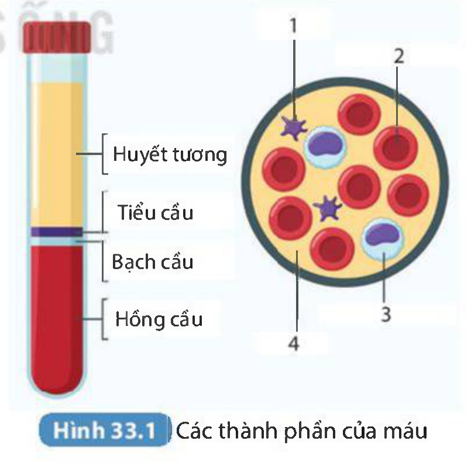
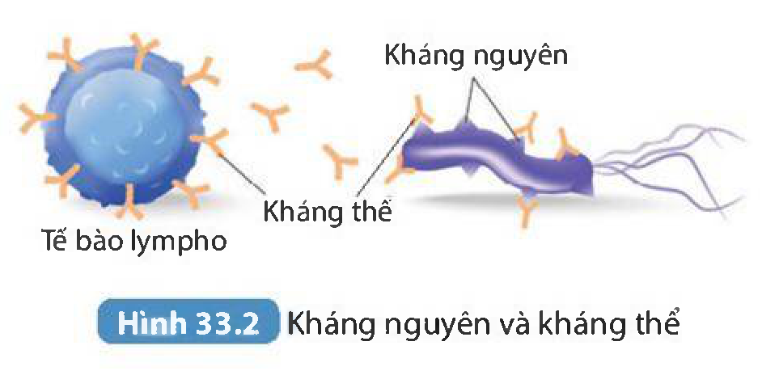
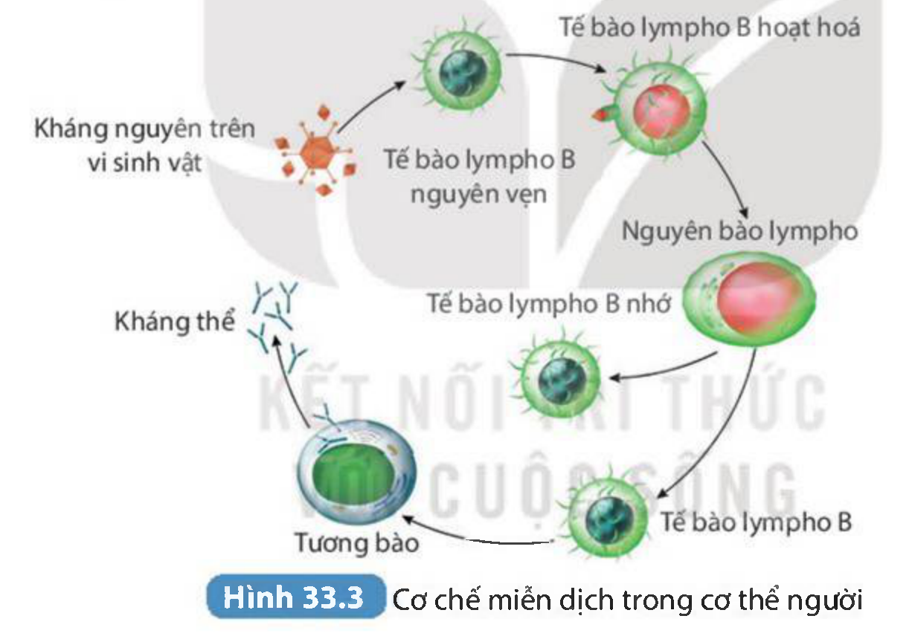
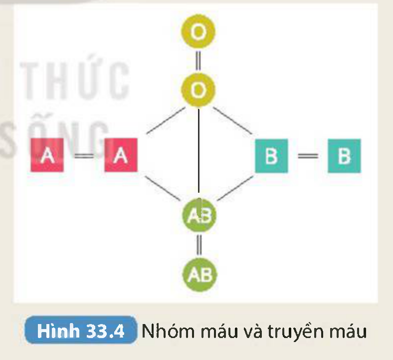
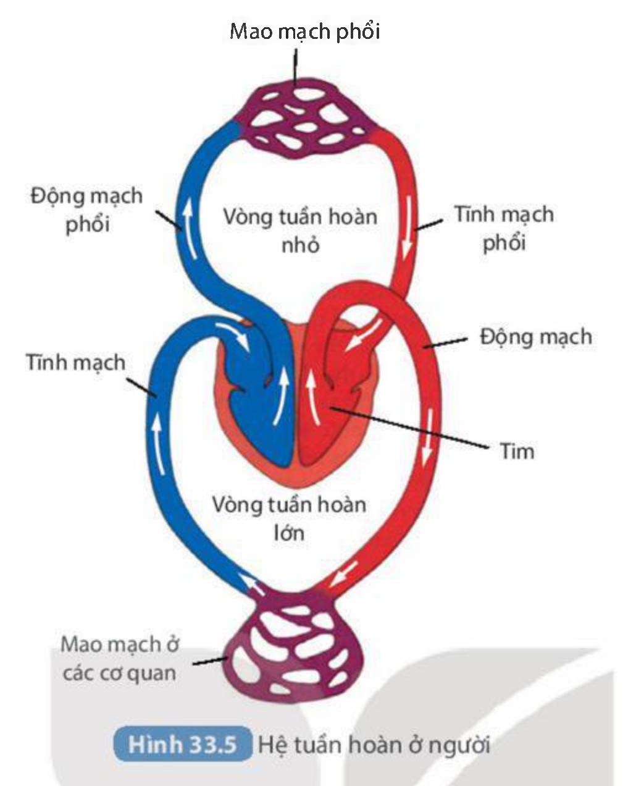
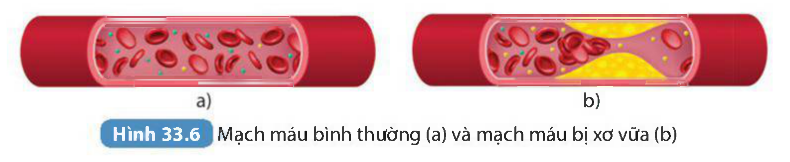
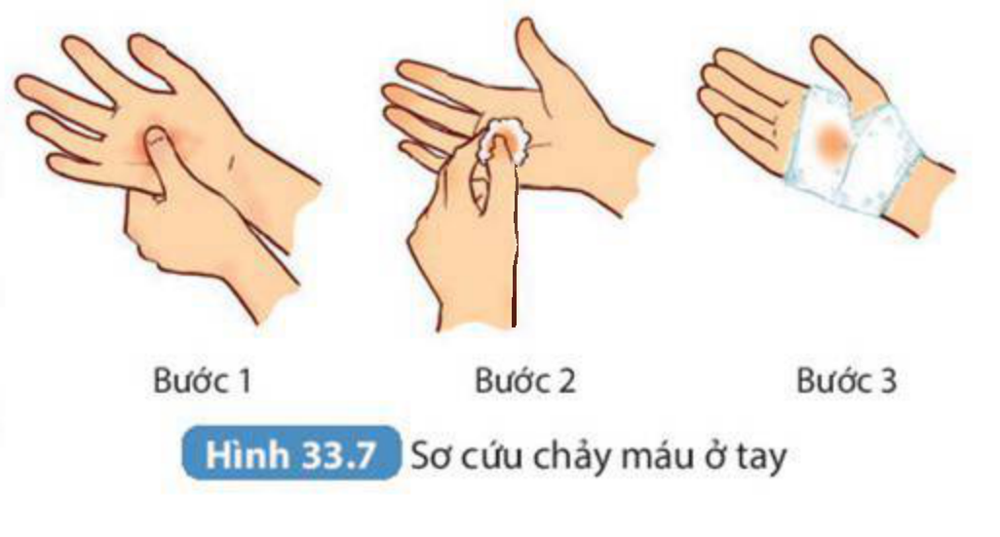
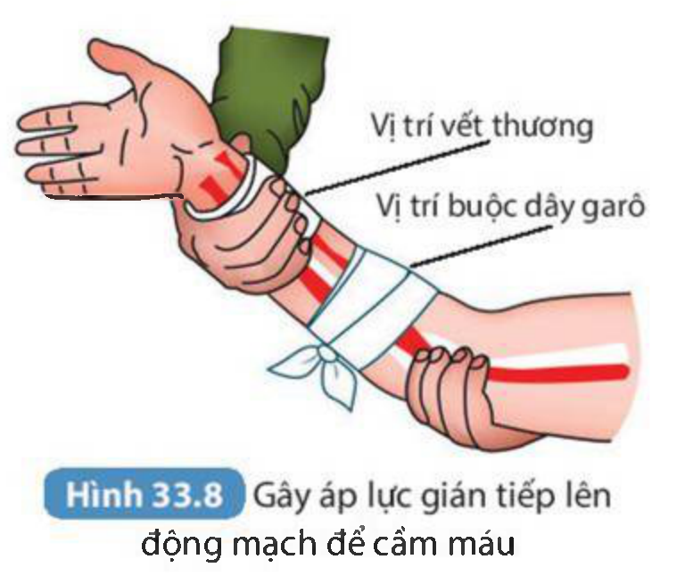

<!-- pdf:137 -->

# BÀI 33: MÁU VÀ HỆ TUẦN HOÀN CỦA CƠ THỂ NGƯỜI

## 🎯 Mục tiêu

- Nêu được chức năng của máu; nêu tên các thành phần của máu và chức năng của mỗi thành phần.
- Nêu được khái niệm nhóm máu; phân tích được vai trò của việc hiểu biết về nhóm máu trong thực tiễn.
- Nêu được khái niệm miễn dịch, kháng nguyên, kháng thể; vai trò của vaccine và tiêm vaccine trong việc phòng bệnh; trình bày được cơ chế miễn dịch trong cơ thể người; giải thích được vì sao con người sống trong môi trường có nhiều vi khuẩn có hại nhưng vẫn có thể sống khoẻ mạnh.
- Nêu được một số bệnh về máu, tim mạch và cách phòng chống; vận dụng được hiểu biết về máu và tuần hoàn để bảo vệ bản thân và gia đình.
- Kể tên được các cơ quan của hệ tuần hoàn; nêu được chức năng của mỗi cơ quan và sự phối hợp các cơ quan thể hiện chức năng của cả hệ tuần hoàn.
- Thực hiện được tình huống giả định cấp cứu người bị chảy máu, tai biến, đột quỵ; băng bó vết thương khi bị chảy nhiều máu; thực hiện được các bước đo huyết áp.
- Thực hiện được dự án, bài tập: Điều tra một số bệnh liên quan đến máu và hệ tuần hoàn; tìm hiểu được phong trào hiến máu nhân đạo tại địa phương.

## 🔴 Mở đầu

Một người bị mất máu liên tục sẽ yếu dần và nguy hiểm đến tính mạng. Máu có vai trò gì đối với cơ thể? Máu lưu thông trong cơ thể như thế nào và tim có vai trò gì trong quá trình đó?

## I. Máu

### 1. Các thành phần của máu

**Máu** là phần dịch lỏng trong cơ thể, gồm huyết tương và hồng cầu, tiểu cầu, bạch cầu.

Huyết tương chiếm khoảng 55% thể tích máu, gồm chủ yếu là nước và các chất tan. Huyết tương có vai trò duy trì máu ở trạng thái lỏng giúp máu dễ dàng lưu thông trong mạch; vận chuyển chất dinh dưỡng, các chất cần thiết khác và chất thải. <!-- term: Huyết tương -->

Hồng cầu, bạch cầu và tiểu cầu chiếm khoảng 45% thể tích máu. Hồng cầu vận chuyển oxygen và carbon dioxide trong máu. Bạch cầu có chức năng bảo vệ cơ thể. Tiểu cầu tham gia bảo vệ cơ thể nhờ cơ chế làm đông máu. <!-- term: Hồng cầu --> <!-- term: Bạch cầu --> <!-- term: Tiểu cầu -->

Hình 33.1. Các thành phần của máu

> ❓
> 1. Xác định tên và chức năng các thành phần của máu được đánh số trong Hình 33.1.
> 2. Điều gì sẽ xảy ra với cơ thể chúng ta nếu thiếu một trong các thành phần của máu?

<!-- pdf:138 -->

### 2. Miễn dịch và vaccine

**a) Miễn dịch**

**Kháng nguyên** là những chất khi xâm nhập vào cơ thể có khả năng kích thích cơ thể tạo ra các kháng thể tương ứng. **Kháng thể** là những phân tử protein do một loại bạch cầu (tế bào lympho B) tạo ra để chống lại các kháng nguyên. Tương tác giữa kháng nguyên và kháng thể theo cơ chế chìa khoá và ổ khoá để tạo phản ứng miễn dịch (Hình 33.2).

Hình 33.2. Kháng nguyên và kháng thể

Khi có các vi sinh vật xâm nhập vào cơ thể, tế bào lympho B nhận diện kháng nguyên tương ứng và được hoạt hoá thành nguyên bào lympho. Nguyên bào lympho phân bào và biệt hoá thành tương bào. Tương bào tạo ra kháng thể tiêu diệt các vi sinh vật hoặc làm bất hoạt độc tố của chúng (Hình 33.3). Một số tế bào lympho B không trở thành tương bào mà trở thành tế bào lympho B nhớ, sẵn sàng đáp ứng nhanh và mạnh khi có vi sinh vật cùng loại xâm nhập lần sau, giúp cơ thể có khả năng miễn dịch.

Hình 33.3. Cơ chế miễn dịch trong cơ thể người

**b) Vaccine**

Con người có thể tạo miễn dịch nhân tạo cho cơ thể bằng cách sử dụng vaccine. Mầm bệnh đã chết hoặc suy yếu,... trong vaccine có tác dụng kích thích tế bào bạch cầu tạo ra kháng thể. Kháng thể tạo ra tiếp tục tồn tại trong máu giúp cơ thể miễn dịch với bệnh đã được tiêm vaccine.

> ❓
> 1. Giải thích vì sao con người sống trong môi trường chứa nhiều vi khuẩn có hại nhưng vẫn có thể sống khoẻ mạnh.
> 2. Tiêm vaccine có vai trò gì trong việc phòng bệnh?

<!-- pdf:139 -->

### 3. Nhóm máu và truyền máu

**a) Nhóm máu**

**Nhóm máu** là nhóm các tế bào hồng cầu được xác định dựa vào các đặc tính kháng nguyên khác nhau. Có nhiều hệ nhóm máu khác nhau nhưng phổ biến nhất là hệ nhóm máu ABO gồm bốn nhóm máu A, B, AB, O. <!-- term: Hệ nhóm máu ABO -->

Các nhóm máu trong hệ nhóm máu ABO được xác định dựa vào loại kháng nguyên (A và B) trên bề mặt hồng cầu và kháng thể ($\alpha$ và $\beta$) trong huyết tương. Trong đó, $\alpha$ gây kết dính A và $\beta$ gây kết dính B. Cách xác định nhóm máu trong hệ ABO được trình bày trong Bảng 33.1. <!-- term: Hệ nhóm máu ABO -->

Bảng 33.1. Các loại nhóm máu

| Đặc điểm \ Nhóm máu | A | B | AB | O |
| --- | --- | --- | --- | --- |
| Kháng nguyên trên hồng cầu | A | B | A, B | Không có A, B |
| Kháng thể trong huyết tương | $\beta$ | $\alpha$ | Không có $\alpha$, $\beta$ | $\alpha$, $\beta$ |

**b) Truyền máu**

Trong quá trình truyền máu, để tránh hiện tượng kết dính có thể xảy ra, máu của người cho cần cùng nhóm với máu của người nhận. Trong trường hợp không có máu trùng với nhóm máu của người nhận, có thể truyền máu khác nhóm nhưng đảm bảo nguyên tắc không để kháng thể trong máu của người nhận gây kết dính kháng nguyên trong máu được truyền.

> ✋ Thảo luận nhóm để thực hiện các yêu cầu và trả lời câu hỏi sau:
>
> 1. Vẽ Hình 33.4 vào vở rồi hoàn thành sơ đồ truyền máu bằng cách đánh dấu chiều mũi tên để thể hiện mối quan hệ cho, nhận giữa các nhóm máu.
> 2. Giả sử một người có nhóm máu A cần được truyền máu, người này có thể nhận những nhóm máu nào? Nếu truyền nhóm máu không phù hợp sẽ dẫn đến hậu quả gì?
>
> 
>
> Hình 33.4. Nhóm máu và truyền máu

## II. Hệ tuần hoàn

### 1. Cấu tạo của hệ tuần hoàn

Hệ tuần hoàn gồm tim và hệ mạch (Hình 33.5). Tim hoạt động như một chiếc bơm, vừa hút, vừa đẩy máu lưu thông trong hệ tuần hoàn. Hệ mạch gồm động mạch, mao mạch, tĩnh mạch. Các mạch máu có dạng ống, hợp thành một hệ thống kín. Trong đó, động mạch vận chuyển máu từ tim đến mao mạch để trao đổi nước, chất khí, các chất giữa máu và các tế bào; máu trao đổi tại mao mạch theo tĩnh mạch trở về tim. <!-- term: Hệ tuần hoàn --> <!-- term: Hệ mạch -->

<!-- pdf:140 -->

Hình 33.5. Hệ tuần hoàn ở người

### 2. Chức năng của hệ tuần hoàn

Hệ tuần hoàn có chức năng vận chuyển các chất dinh dưỡng, chất khí và các chất khác đến các tế bào và mô của cơ thể nhờ sự lưu thông của máu qua vòng tuần hoàn lớn và vòng tuần hoàn nhỏ. <!-- term: Hệ tuần hoàn -->

> ❓ Nêu cấu tạo của hệ tuần hoàn và trình bày sự phối hợp các cơ quan thể hiện chức năng của cả hệ tuần hoàn.

## III. Một số bệnh về máu và tim mạch

### 1. Thiếu máu

**Thiếu máu** là tình trạng giảm số lượng hồng cầu hoặc huyết sắc tố (hemoglobin) dẫn đến máu giảm khả năng vận chuyển oxygen trong cơ thể. Khi cơ thể thiếu máu thường xuất hiện các triệu chứng như mệt mỏi, da xanh, tim đập nhanh,... Chế độ ăn thiếu sắt có thể dẫn đến bệnh thiếu máu do cơ thể không sản xuất đủ lượng hemoglobin, được gọi là **thiếu máu dinh dưỡng**. **Thiếu máu do chảy máu** là tình trạng mất quá nhiều máu khi bị thương, khi đến kì kinh nguyệt,...

### 2. Huyết áp cao

Có nhiều nguyên nhân gây tình trạng huyết áp cao. Huyết áp tăng cao lúc đầu có thể là kết quả nhất thời sau khi luyện tập thể dục, thể thao, khi tức giận hay khi bị sốt,... Nếu tình trạng này kéo dài có thể làm tổn thương cấu trúc thành động mạch và gây ra bệnh huyết áp cao. <!-- term: Bệnh huyết áp cao -->

Ngoài ra, huyết áp cao có thể do chế độ ăn nhiều đường và muối, thức ăn chứa nhiều chất béo,...

<!-- pdf:141 -->

### 3. Xơ vữa động mạch

Khi hàm lượng cholesterol trong máu tăng cao sẽ kết hợp với $\ce{Ca^2+}$ ngấm vào thành mạch, làm hẹp lòng mạch (Hình 33.6), mạch bị xơ vữa, dẫn đến tăng huyết áp, giảm dòng máu, tạo thành các cục máu đông dẫn đến tắc mạch. Nếu các cục máu đông xuất hiện ở động mạch vành tim gây đau tim, còn ở động mạch não là nguyên nhân gây đột quỵ. <!-- term: Xơ vữa động mạch -->

Xơ vữa động mạch có thể do chế độ ăn chưa hợp lí, hút thuốc lá, ít vận động,...

Hình 33.6. Mạch máu bình thường (a) và mạch máu bị xơ vữa (b)

> ✋ Làm việc theo nhóm để thực hiện các yêu cầu sau:
>
> 1. Tìm hiểu nguyên nhân, triệu chứng, hậu quả của một số bệnh về máu, tim mạch.
> 2. Vận dụng hiểu biết về các bệnh đã tìm hiểu, em hãy đề xuất biện pháp phòng bệnh, bảo vệ hệ tuần hoàn và cơ thể. Giải thích cơ sở của các biện pháp đó.

## IV. Thực hành: Thực hiện tình huống giả định cấp cứu người bị chảy máu, tai biến, đột quỵ và đo huyết áp

### 1. Mục tiêu

- Thực hiện được tình huống giả định cấp cứu người bị chảy máu, tai biến, đột quỵ.
- Thực hiện được các bước đo huyết áp.

### 2. Chuẩn bị

- Băng gạc (1 cuộn), gạc (1 gói), bông y tế (1 gói), dây cao su hoặc dây vải, vải mềm (1 miếng kích thước $10\text{ cm} \times 30\text{ cm}$), cồn iodine.
- Huyết áp kế (huyết áp kế đồng hồ hoặc huyết áp kế điện tử), ống nghe tim phổi.

### 3. Cách tiến hành

**a) Sơ cứu cầm máu trong các trường hợp giả định**

\* Sơ cứu chảy máu mao mạch và tĩnh mạch (Hình 33.7)

Bước 1: Dùng ngón tay bịt chặt miệng vết thương cho tới khi thấy máu không chảy nữa.

Bước 2: Sát trùng vết thương bằng cồn iodine.

Bước 3: Che kín miệng vết thương bằng bông, gạc, băng gạc.

Hình 33.7. Sơ cứu chảy máu ở tay

<!-- pdf:142 -->

\* Sơ cứu chảy máu động mạch cánh tay (Hình 33.8)

Bước 1: Dùng ngón tay cái dò tìm vị trí động mạch cánh tay, khi thấy dấu hiệu mạch đập rõ thì ấn mạnh để làm ngừng chảy máu ở vết thương.

Bước 2: Buộc dây garô.

Dùng dây cao su hay dây vải mềm buộc chặt ở vị trí gần sát vết thương (cao hơn vết thương về phía tim) với lực ép đủ làm cầm máu.

Bước 3: Sát trùng vết thương bằng cồn iodine rồi che kín miệng vết thương.
<!-- ocr-ok: OCR đọc thiếu đầu và cuối câu Bước 3 cạnh Hình 33.8 -->

Bước 4: Đưa người bị thương đến cơ sở y tế gần nhất.

Hình 33.8. Gây áp lực gián tiếp lên động mạch để cầm máu

**b) Sơ cứu đột quỵ**

Các dấu hiệu đột quỵ có thể xuất hiện và biến mất rất nhanh, lặp đi lặp lại nhiều lần, bao gồm đột ngột hôn mê, mất ý thức, tê bì tay chân, đau đầu dữ dội, mất thăng bằng, không nói được, méo mồm, giảm thị lực,... Khi phát hiện người có các biểu hiện trên, cần tiến hành sơ cứu theo các bước sau: <!-- term: Đột quỵ -->

Bước 1: Gọi người trợ giúp và nhanh chóng gọi cấp cứu 115.

Bước 2: Trong thời gian chờ xe cấp cứu đến, cần đặt phần đầu và lưng của nạn nhân nằm nghiêng để tránh bị sặc đường thở.

Bước 3: Nới lỏng quần áo cho rộng, thoáng; mở phần cổ áo để kiểm tra tình trạng hô hấp của nạn nhân.

Bước 4: Dùng vải mềm quấn vào ngón tay trỏ rồi lấy sạch đờm, dãi trong miệng nạn nhân.

Bước 5: Ghi lại thời điểm nạn nhân khởi phát biểu hiện đột quỵ, những loại thuốc mà nạn nhân đang dùng hoặc mang theo đơn thuốc đang có.

**c) Đo huyết áp (bằng huyết áp kế đồng hồ)**

Bước 1: Yêu cầu người đo huyết áp nằm hoặc ngồi ở tư thế thoải mái, duỗi thẳng cánh tay. Xác định vị trí động mạch cánh tay để đặt ống nghe.

Bước 2: Quấn vòng bít của huyết áp kế quanh vị trí đặt ống nghe (Hình 1.4).

Bước 3: Vặn chặt núm xoay và bóp quả bóng cao su để bơm khí vào vòng bít của huyết áp kế cho đến khi đồng hồ chỉ khoảng 160 – 180 mmHg thì dừng lại.

Bước 4: Vặn ngược núm xoay từ từ để xả hơi, đồng thời đeo ống nghe tim phổi để nghe thấy tiếng đập đầu tiên, đó là huyết áp tối đa. Tiếp tục nghe cho đến khi không có tiếng đập nữa, đó là huyết áp tối thiểu.

### 4. Kết quả

Đọc chỉ số đo huyết áp của bản thân và của các bạn trong nhóm. Nhận xét về chỉ số đo được, biết rằng huyết áp bình thường tối thiểu là từ 60 mmHg đến dưới 90 mmHg và tối đa là từ 90 mmHg đến dưới 140 mmHg$^{(*)}$.

> Sau khi thực hành sơ cứu cầm máu và đo huyết áp, em hãy trả lời các câu hỏi sau:
>
> 1. Khi thực hiện biện pháp buộc dây garô cần lưu ý những điều gì?
> 2. Vì sao chỉ dùng biện pháp buộc dây garô để sơ cứu những vết thương chảy máu động mạch ở tay hoặc chân? Những vết thương chảy máu động mạch không phải ở tay, chân cần được xử lí như thế nào?

> (\*) Nguồn: Tổ chức Y tế Thế giới (WHO)

<!-- pdf:143 -->

## V. Dự án: Điều tra một số bệnh về máu, tim mạch và phong trào hiến máu nhân đạo tại địa phương

### 1. Mục tiêu

- Điều tra được các bệnh về máu và tim mạch tại địa phương.
- Tìm hiểu được phong trào hiến máu nhân đạo tại địa phương.

### 2. Cách tiến hành

Bước 1: Lập kế hoạch và tiến hành điều tra một số bệnh về máu, tim mạch và phong trào hiến máu nhân đạo tại địa phương.

Bước 2: Thảo luận, đề xuất các biện pháp phòng chống bệnh về máu, tim mạch.

Bước 3: Viết báo cáo điều tra một số bệnh về máu, tim mạch theo mẫu Bảng 33.2 và viết một đoạn tổng hợp thông tin tìm hiểu về phong trào hiến máu nhân đạo tại địa phương.

### 3. Kết quả

Ghi kết quả điều tra một số bệnh về máu và tim mạch theo mẫu Bảng 33.2.

Bảng 33.2.

| Tên bệnh | Số lượng người mắc | Nguyên nhân | Biện pháp phòng chống |
| --- | --- | --- | --- |
| ? | ? | ? | ? |

> Trả lời các câu hỏi sau:
>
> 1. Hiến máu có hại cho sức khoẻ không? Vì sao?
> 2. Những ai có thể hiến máu được và những ai không thể hiến máu?

> 🔍 Khi cơ thể hít phải khí $\ce{CO}$, khí này khuếch tán vào máu và liên kết với nguyên tử sắt của hemoglobin (Hb), làm cho Hb không liên kết được với $\ce{O2}$. Khả năng kết hợp giữa Hb với $\ce{CO}$ cao gấp 200 lần so với $\ce{O2}$, do đó khi hít phải một lượng $\ce{CO}$ rất nhỏ vẫn gây ảnh hưởng xấu đến khả năng vận chuyển $\ce{O2}$ của hồng cầu. Ngộ độc $\ce{CO}$ với lượng ít cũng có thể hôn mê và tử vong nếu không được phát hiện và điều trị kịp thời.

## 📌 Em đã học

- Máu là dịch lỏng lưu thông trong hệ tuần hoàn; gồm huyết tương, hồng cầu, bạch cầu và tiểu cầu.
- Nhóm máu là nhóm tế bào hồng cầu, được chia thành bốn nhóm trong hệ nhóm máu ABO. Khi truyền máu, cần lựa chọn nhóm máu truyền phù hợp theo nguyên tắc truyền máu.
- Hệ tuần hoàn gồm tim và các mạch máu tạo thành vòng tuần hoàn, giúp máu lưu thông đến mọi tế bào trong cơ thể để thực hiện quá trình trao đổi chất. <!-- term: Hệ tuần hoàn -->

## 🚀 Em có thể

- Thực hiện được các biện pháp phòng chống một số bệnh về máu và tim mạch.
- Vận dụng được hiểu biết về máu và tuần hoàn để bảo vệ bản thân và gia đình.

## 📷 Danh sách hình trong bài

| Mã hình | Trang PDF | Trang sách | Chú thích |
| --- | --- | --- | --- |
| H8-khoa_hoc_tu_nhien-b33-01 | 137 | 135 | Hình 33.1. Các thành phần của máu |
| H8-khoa_hoc_tu_nhien-b33-02 | 138 | 136 | Hình 33.2. Kháng nguyên và kháng thể |
| H8-khoa_hoc_tu_nhien-b33-03 | 138 | 136 | Hình 33.3. Cơ chế miễn dịch trong cơ thể người |
| H8-khoa_hoc_tu_nhien-b33-04 | 139 | 137 | Hình 33.4. Nhóm máu và truyền máu |
| H8-khoa_hoc_tu_nhien-b33-05 | 140 | 138 | Hình 33.5. Hệ tuần hoàn ở người |
| H8-khoa_hoc_tu_nhien-b33-06 | 141 | 139 | Hình 33.6. Mạch máu bình thường (a) và mạch máu bị xơ vữa (b) |
| H8-khoa_hoc_tu_nhien-b33-07 | 141 | 139 | Hình 33.7. Sơ cứu chảy máu ở tay |
| H8-khoa_hoc_tu_nhien-b33-08 | 142 | 140 | Hình 33.8. Gây áp lực gián tiếp lên động mạch để cầm máu |
