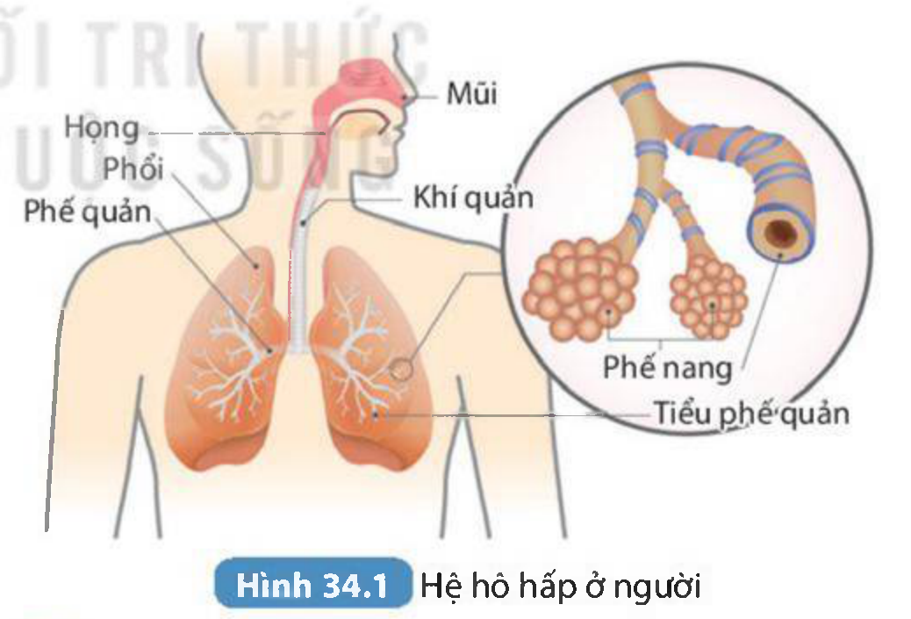
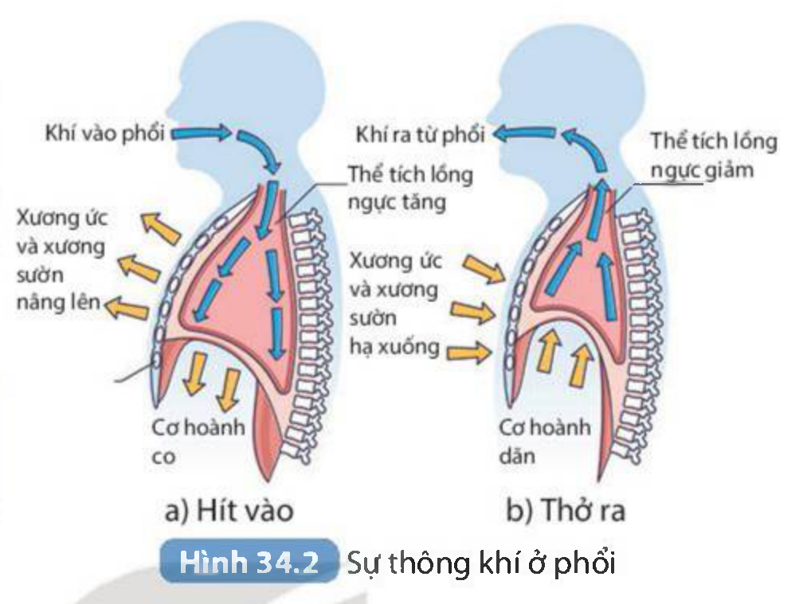
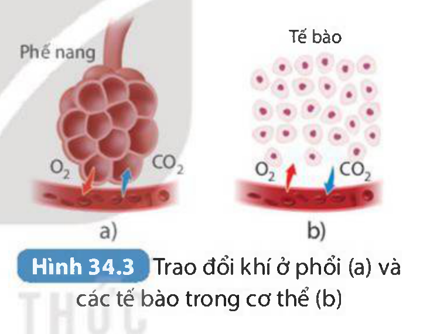
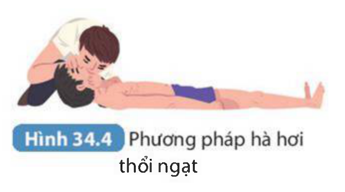
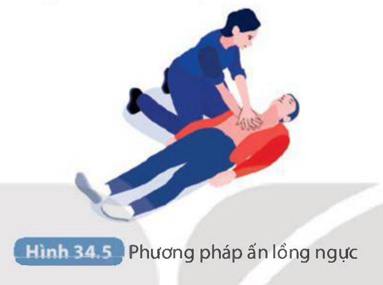

<!-- pdf:144 -->

# BÀI 34: HỆ HÔ HẤP Ở NGƯỜI

## 🎯 Mục tiêu

- Nêu được cấu tạo và chức năng của hệ hô hấp; nêu được chức năng của mỗi cơ quan và sự phối hợp các cơ quan thể hiện chức năng của cả hệ hô hấp.
- Nêu được một số bệnh về phổi, đường hô hấp và cách phòng chống bệnh; vận dụng được hiểu biết về hô hấp để bảo vệ bản thân và gia đình.
- Trình bày được vai trò của việc chống ô nhiễm không khí liên quan đến các bệnh về hô hấp.
- Điều tra được một số bệnh về đường hô hấp trong trường học hoặc tại địa phương, nêu được nguyên nhân và cách phòng chống.
- Thực hiện được tình huống giả định hô hấp nhân tạo, cấp cứu người đuối nước; thiết kế được áp phích tuyên truyền không hút thuốc lá; đưa ra được quan điểm nên hay không nên hút thuốc lá và kinh doanh thuốc lá.

## 🔴 Mở đầu

Con người tồn tại và hoạt động được là nhờ có nguồn năng lượng sinh ra từ quá trình hô hấp tế bào. Quá trình đó cần sử dụng khí $\ce{O2}$ và thải ra khí $\ce{CO2}$. Việc lấy khí $\ce{O2}$ từ môi trường và thải khí $\ce{CO2}$ ra khỏi cơ thể được thực hiện như thế nào?

## I. Cấu tạo và chức năng của hệ hô hấp

### 1. Cấu tạo của hệ hô hấp

Hệ hô hấp ở người gồm đường dẫn khí (mũi, họng, thanh quản, khí quản, phế quản) và cơ quan trao đổi khí là hai lá phổi (Hình 34.1). Mũi có lớp niêm mạc tiết chất nhầy, có nhiều lông mũi và lớp mao mạch dày đặc giúp ngăn bụi, làm ẩm, làm ấm không khí vào phổi. Thanh quản có nắp thanh quản, có thể cử động để đậy kín đường hô hấp khi nuốt thức ăn. Khí quản có lớp niêm mạc tiết chất nhầy với nhiều lông rung chuyển động liên tục, dẫn khí từ ngoài vào. Phế quản và tiểu phế quản dẫn khí vào phổi rồi đến phế nang. Phổi gồm nhiều phế nang (là nơi diễn ra quá trình trao đổi khí). Phế nang được bao bọc bởi hệ thống mạch máu dày đặc giúp quá trình trao đổi khí diễn ra dễ dàng. <!-- term: Hệ hô hấp --> <!-- term: Đường dẫn khí --> <!-- term: Phổi --> <!-- term: Phế nang -->

Hình 34.1. Hệ hô hấp ở người

> ❓ Đọc thông tin kết hợp quan sát Hình 34.1, nêu tên các cơ quan của hệ hô hấp, đặc điểm và chức năng của mỗi cơ quan.

<!-- pdf:145 -->

### 2. Chức năng của hệ hô hấp

Đường dẫn khí có chức năng dẫn khí ra và vào phổi, ngăn bụi, làm ẩm, làm ấm không khí vào phổi, đồng thời bảo vệ phổi khỏi tác nhân có hại từ môi trường. Phổi thực hiện chức năng trao đổi khí giữa môi trường ngoài và máu trong mao mạch phổi. Sự phối hợp của đường dẫn khí và phổi đảm bảo chức năng lưu thông và trao đổi khí của hệ hô hấp. <!-- term: Hệ hô hấp --> <!-- term: Đường dẫn khí --> <!-- term: Phổi -->

**a) Thông khí ở phổi**

Sự thông khí ở phổi được diễn ra nhờ cử động hô hấp (hít vào, thở ra). Khi hít vào hay thở ra, hoạt động của cơ, xương thay đổi sẽ làm tăng hoặc giảm thể tích lồng ngực.

Hình 34.2. Sự thông khí ở phổi

> ❓ Quan sát Hình 34.2, mô tả hoạt động của cơ, xương và sự thay đổi thể tích lồng ngực khi cử động hô hấp.

**b) Trao đổi khí ở phổi và tế bào**

Ở phổi và các tế bào trong cơ thể, chất khí được trao đổi theo cơ chế khuếch tán.

Hình 34.3. Trao đổi khí ở phổi (a) và các tế bào trong cơ thể (b)

> ❓
> 1. Quan sát Hình 34.3, mô tả sự trao đổi khí ở phổi và ở tế bào.
> 2. Trình bày sự phối hợp chức năng của mỗi cơ quan thể hiện chức năng của cả hệ hô hấp.

## II. Một số bệnh về phổi, đường hô hấp

Một số cơ quan của hệ hô hấp tiếp xúc trực tiếp với môi trường nên dễ mắc các bệnh về phổi và đường hô hấp như viêm đường hô hấp, viêm phổi,...

### 1. Viêm đường hô hấp

Đường dẫn khí thường xuyên tiếp xúc với không khí. Không khí bị ô nhiễm, có chứa vi sinh vật hoặc các chất có hại là nguyên nhân chính gây viêm đường hô hấp: viêm mũi, viêm họng, viêm phế quản,... <!-- term: Viêm đường hô hấp -->

Viêm họng và viêm phế quản có thể do vi khuẩn hoặc virus. Các triệu chứng khi bị viêm họng như khó chịu ở họng (đau, rát, sưng họng); ho có đờm; có thể sốt, nhức đầu, mệt mỏi;...

Viêm phế quản cũng có các triệu chứng như viêm họng nhưng biểu hiện rõ ràng hơn: ho nhiều, ho có đờm, sốt kéo dài, khò khè, khó thở, mệt mỏi, tức ngực,...

### 2. Viêm phổi

Virus, vi khuẩn, nấm, hoá chất trong không khí xâm nhập vào phổi có thể gây viêm phổi. Khi đó, các phế nang bị viêm, tiết nhiều dịch làm ảnh hưởng đến chức năng trao đổi khí của phổi. Các triệu chứng của bệnh bao gồm đau ngực, ho, mệt mỏi, sốt, đổ mồ hôi và ớn lạnh, buồn nôn, khó thở,... Nếu không điều trị bệnh kịp thời có thể nguy hiểm đến tính mạng hoặc gây nhiều biến chứng. <!-- term: Viêm phổi -->

<!-- pdf:146 -->

### 3. Lao phổi

Lao phổi do vi khuẩn *Mycobacterium tuberculosis* xâm nhập vào phổi, phá huỷ các mô và mạch máu trong phổi, gây chảy máu và tiết chất nhầy. Người bị bệnh có biểu hiện đau ngực, ho khạc kéo dài, có thể ho khạc ra máu, sốt nhẹ về chiều, đổ mồ hôi, sút cân, kém ăn, mệt mỏi,... Bệnh dễ lây lan qua đường hô hấp khi tiếp xúc gần với người bệnh. <!-- term: Lao phổi -->

> ✋
> 1. Đọc thông tin và thảo luận, nêu nguyên nhân gây bệnh về phổi và đường hô hấp; vận dụng những hiểu biết về các bệnh, nêu biện pháp phòng chống bệnh để bảo vệ sức khoẻ bản thân và gia đình.
> 2. Điều tra một số bệnh về phổi và đường hô hấp trong trường học hoặc địa phương, số lượng người mắc và đề xuất biện pháp phòng chống bệnh rồi hoàn thành thông tin điều tra theo mẫu Bảng 34.1.
>
> Bảng 34.1.
>
> | Tên bệnh | Số lượng người mắc | Biện pháp phòng chống |
> | --- | --- | --- |
> | ? | ? | ? |

## III. Thuốc lá và tác hại của khói thuốc lá

Khói thuốc lá chứa nhiều chất độc có hại cho hệ hô hấp như khí $\ce{CO}$, khí $\text{NO}_x$, nicotine,... $\ce{CO}$ chiếm chỗ của $\ce{O2}$ trong hồng cầu, làm cho cơ thể ở trạng thái thiếu $\ce{O2}$. $\text{NO}_x$ gây viêm, sưng lớp niêm mạc, cản trở trao đổi khí. Nồng độ khí $\ce{CO}$ và $\text{NO}_x$ trong không khí vượt quá giới hạn cho phép gây nguy hiểm đến sức khoẻ, có thể dẫn đến tử vong. Nicotine làm tê liệt lớp lông rung trong phế quản, giảm hiệu quả lọc sạch không khí, chất này còn làm tăng nguy cơ ung thư phổi.

> ✋
> 1. Làm việc nhóm, đưa ra quan điểm của bản thân về việc nên hay không nên hút thuốc lá và kinh doanh thuốc lá.
> 2. Thiết kế một áp phích (poster) tuyên truyền không hút thuốc lá.

## IV. Thực hành: Hô hấp nhân tạo, cấp cứu người đuối nước

### 1. Mục tiêu

Thực hiện được tình huống giả định hô hấp nhân tạo, cấp cứu người đuối nước.

### 2. Chuẩn bị

Tranh mô tả các thao tác hô hấp nhân tạo, cấp cứu người đuối nước.

### 3. Cách tiến hành

Bước 1: Nhanh chóng đưa nạn nhân ra khỏi mặt nước. Đặt nạn nhân nằm nơi khô ráo, thoáng khí.

Bước 2: Tiến hành hô hấp nhân tạo cho nạn nhân (theo tranh ở phần chuẩn bị).

\* Phương pháp hà hơi thổi ngạt (Hình 34.4)

- Đặt nạn nhân nằm ngửa, đầu hơi ngửa ra phía sau.

<!-- pdf:147 -->

- Dùng 2 ngón tay để bịt mũi nạn nhân.
- Hít một hơi mạnh rồi ghé môi sát miệng nạn nhân và thổi hết hơi vào. Lặp lại liên tục khoảng 12 đến 20 lần/phút cho tới khi hô hấp của nạn nhân được ổn định.

Hình 34.4. Phương pháp hà hơi thổi ngạt

\* Phương pháp ấn lồng ngực (Hình 34.5)

- Đặt nạn nhân nằm ngửa, đầu hơi ngửa ra phía sau.
- Đặt 2 bàn tay chồng lên nhau, các ngón tay đan vào nhau. Dùng sức nặng cơ thể ấn mạnh vào ngực nạn nhân để đẩy không khí ra ngoài.
- Thực hiện ấn mạnh khoảng 12 đến 20 lần/phút cho tới khi hô hấp của nạn nhân được ổn định.

Hình 34.5. Phương pháp ấn lồng ngực

### 4. Kết quả

> Sau khi thực hành hô hấp nhân tạo, em hãy trả lời các câu hỏi sau:
>
> 1. Nêu ý nghĩa của việc bịt mũi nạn nhân trong phương pháp hà hơi thổi ngạt.
> 2. Tại sao phải dùng tay ấn vào lồng ngực trong phương pháp ấn lồng ngực?

> 🔍 Virus gây ra dịch bệnh COVID-19 là SARS-CoV-2 được Tổ chức Y tế Thế giới (WHO) đặt tên chính thức vào ngày 11/02/2020. Các triệu chứng đầu tiên khi nhiễm SARS-CoV-2 tương tự bệnh cúm thông thường như sốt, ho, rồi tiếp tục tiến triển thành viêm phổi hoặc nặng hơn là tử vong trong thời gian ngắn. Theo WHO, SARS-CoV-2 tấn công phổi qua ba giai đoạn: virus nhân lên gây viêm phổi, đáp ứng quá mức của hệ miễn dịch gây tổn thương phổi và sự tàn phá phổi dẫn đến suy hô hấp.

## 📌 Em đã học

- Hệ hô hấp ở người gồm đường dẫn khí và phổi. Trong đường dẫn khí có các tuyến nhầy tiết ra dịch nhầy, có tác dụng cản bụi và tiêu diệt vi khuẩn. Phổi có nhiều phế nang, là nơi diễn ra quá trình trao đổi khí. <!-- term: Hệ hô hấp --> <!-- term: Phế nang -->
- Một số cơ quan của hệ hô hấp thường xuyên tiếp xúc với môi trường bên ngoài nên rất dễ nhiễm bệnh. Cần giữ gìn vệ sinh hệ hô hấp, chống ô nhiễm không khí, luyện tập thể dục để tăng cường sức khoẻ.

## 🚀 Em có thể

- Thực hiện được các biện pháp phòng chống bệnh về đường hô hấp và phổi.
- Thực hiện được các phương pháp hô hấp nhân tạo cấp cứu người đuối nước.

## 📷 Danh sách hình trong bài

| Mã hình | Trang PDF | Trang sách | Chú thích |
| --- | --- | --- | --- |
| H8-khoa_hoc_tu_nhien-b34-01 | 144 | 142 | Hình 34.1. Hệ hô hấp ở người |
| H8-khoa_hoc_tu_nhien-b34-02 | 145 | 143 | Hình 34.2. Sự thông khí ở phổi |
| H8-khoa_hoc_tu_nhien-b34-03 | 145 | 143 | Hình 34.3. Trao đổi khí ở phổi (a) và các tế bào trong cơ thể (b) |
| H8-khoa_hoc_tu_nhien-b34-04 | 147 | 145 | Hình 34.4. Phương pháp hà hơi thổi ngạt |
| H8-khoa_hoc_tu_nhien-b34-05 | 147 | 145 | Hình 34.5. Phương pháp ấn lồng ngực |
