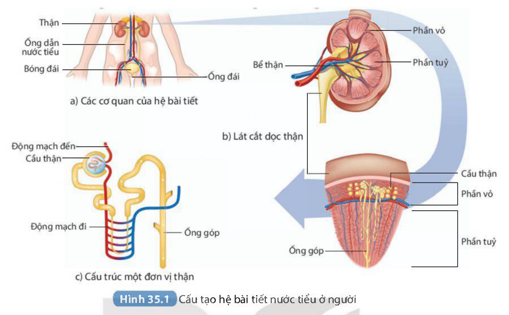
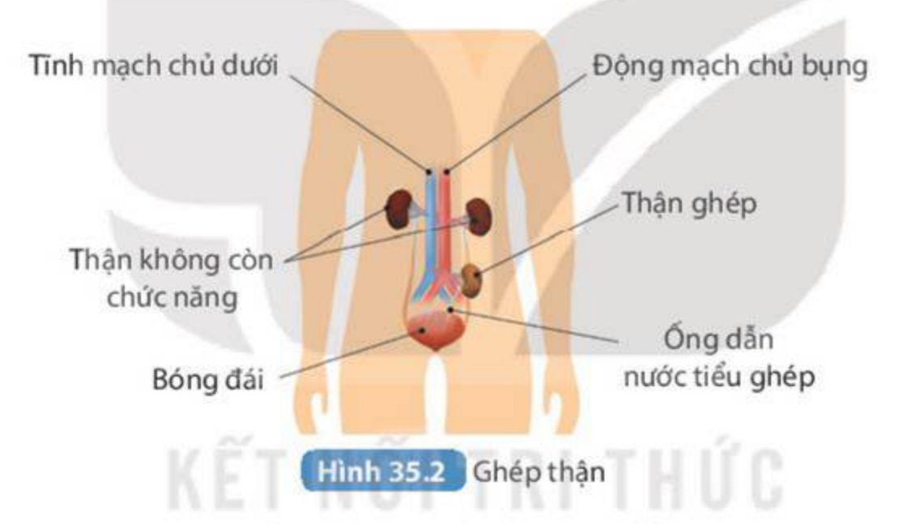
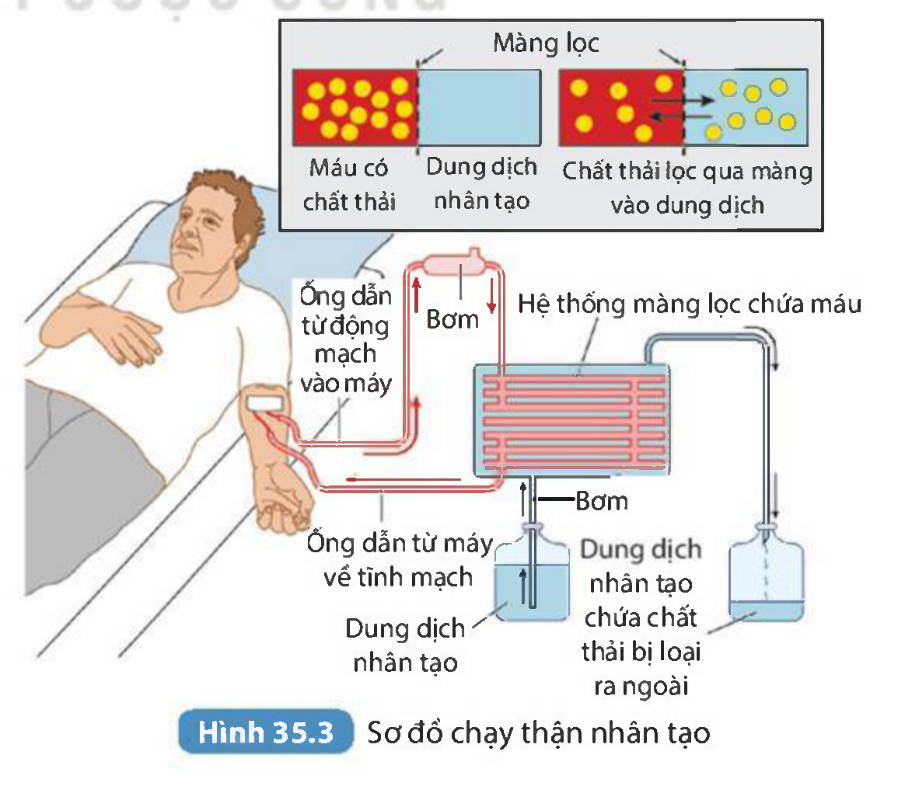

<!-- pdf:148 -->

# BÀI 35: HỆ BÀI TIẾT Ở NGƯỜI

## 🎯 Mục tiêu

- Nêu được chức năng của hệ bài tiết; kể tên được các cơ quan của hệ bài tiết nước tiểu và các bộ phận chủ yếu của thận.
- Trình bày được một số bệnh về hệ bài tiết và cách phòng chống bệnh; vận dụng kiến thức về hệ bài tiết để bảo vệ sức khoẻ.
- Tìm hiểu được một số thành tựu: ghép thận, chạy thận nhân tạo.
- Thực hiện được dự án, bài tập: Điều tra bệnh về thận như sỏi thận, viêm thận,... trong trường học hoặc địa phương.

## 🔴 Mở đầu

Để kéo dài sự sống cho những người bị bệnh suy thận, người ta thường phải chạy thận nhân tạo hoặc ghép thận. Em hãy giải thích tại sao.

## I. Cấu tạo và chức năng của hệ bài tiết

### 1. Chức năng của hệ bài tiết

Hệ bài tiết có chức năng lọc và thải ra môi trường ngoài các chất cặn bã do tế bào tạo ra trong quá trình trao đổi chất và các chất có thể gây độc cho cơ thể. <!-- term: Hệ bài tiết -->

Quá trình bài tiết có các cơ quan tham gia chủ yếu như phổi (thải khí carbon dioxide,...), da (thải mồ hôi) và thận (lọc máu thải nước tiểu). Trong đó, thận thải tới 90% sản phẩm bài tiết nên có vai trò rất quan trọng.

### 2. Cấu tạo của hệ bài tiết nước tiểu

Hệ bài tiết nước tiểu của người gồm hai quả thận, ống dẫn nước tiểu, bóng đái, ống đái, trong đó quan trọng nhất là thận. Mỗi quả thận có khoảng 1 triệu đơn vị chức năng. Mỗi đơn vị chức năng được cấu tạo từ ống thận và cầu thận. **Cầu thận** là một búi mao mạch dày đặc, bám sát vào mao mạch là màng lọc có các lỗ nhỏ đường kính từ $30\text{ \AA}$ đến $40\text{ \AA}^{(*)}$. Bao ngoài cầu thận là một túi gọi là **nang cầu thận**. <!-- term: Hệ bài tiết nước tiểu --> <!-- term: Đơn vị chức năng của thận -->

> ❓ Đọc đoạn thông tin trên kết hợp quan sát Hình 35.1, kể tên các cơ quan của hệ bài tiết nước tiểu và các bộ phận chủ yếu của thận.

> (\*) Angstrom, $1\text{ \AA} = 10^{-10}\text{ m}$

<!-- pdf:149 -->

Hình 35.1. Cấu tạo hệ bài tiết nước tiểu ở người

## II. Một số bệnh về hệ bài tiết

### 1. Bệnh sỏi thận

Khi calcium oxalate, muối phosphate, muối urate,... tích tụ trong thận với nồng độ cao, gặp điều kiện pH thích hợp sẽ tạo thành sỏi, gây bệnh sỏi thận. Người bị bệnh sỏi thận có triệu chứng đau lưng và hai bên hông, tiểu són, tiểu dắt hoặc có lẫn máu trong nước tiểu,... <!-- term: Bệnh sỏi thận -->

Để phòng bệnh, cần uống đủ nước và có chế độ ăn hợp lí.

### 2. Bệnh viêm cầu thận

Bệnh viêm cầu thận do liên cầu khuẩn gây nên. Người bị bệnh thường có triệu chứng phù nề, tăng huyết áp, thiếu máu, có lẫn máu trong nước tiểu,... <!-- term: Bệnh viêm cầu thận -->

Để phòng bệnh, cần tránh nhiễm khuẩn đường mũi, họng và ngoài da; điều trị các ổ viêm amidan, sâu răng,...

### 3. Bệnh suy thận

Có nhiều nguyên nhân gây bệnh suy thận như do bệnh đái tháo đường, tăng huyết áp, mất máu hay các bệnh về thận khác. Người bị bệnh thường có triệu chứng buồn nôn, mệt mỏi, mất ngủ, phù nề, huyết áp cao,... <!-- term: Bệnh suy thận -->

Để không mắc bệnh suy thận, cần thực hiện biện pháp phòng tránh các bệnh lí khác về thận, đồng thời duy trì huyết áp ổn định, bảo vệ cơ thể để tránh hiện tượng mất máu,...

> ✋ **Đề xuất biện pháp bảo vệ hệ bài tiết**
>
> Đọc thông tin trong Bảng 35.1 và đề xuất biện pháp phù hợp để bảo vệ hệ bài tiết rồi hoàn thành theo mẫu Bảng 35.1.

<!-- pdf:150 -->

> Bảng 35.1.
>
> | Thói quen | Nguy cơ xảy ra | Đề xuất biện pháp |
> | --- | --- | --- |
> | Ăn quá mặn, quá chua, nhiều đường | Hệ bài tiết làm việc quá tải | ? ? ? |
> | Không uống đủ nước | Giảm khả năng bài tiết nước tiểu | ? ? ? |
> | Nhịn đi tiểu khi buồn tiểu | Tăng nguy cơ lắng sỏi trong hệ bài tiết nước tiểu | ? ? ? |
> | Không giữ vệ sinh hệ bài tiết nước tiểu | Tăng nguy cơ viêm nhiễm hệ bài tiết nước tiểu | ? ? ? |
> | Ăn thức ăn ôi thiu | Gây độc hại cho hệ bài tiết nước tiểu | ? ? ? |

## III. Một số thành tựu ghép thận, chạy thận nhân tạo

### 1. Ghép thận

**Ghép thận** là ghép vào cơ thể người bệnh quả thận hoạt động bình thường để thay thế cho thận suy giảm hoặc không còn chức năng (Hình 35.2).

Hình 35.2. Ghép thận

### 2. Chạy thận nhân tạo

**Chạy thận nhân tạo** là phương pháp sử dụng máy chạy thận để lọc máu giúp thải chất độc, chất thải ra khỏi cơ thể (Hình 35.3) khi chức năng của thận bị suy giảm không thể thực hiện được nhiệm vụ này.

Hình 35.3. Sơ đồ chạy thận nhân tạo

<!-- pdf:151 -->

> ✋ **Tìm hiểu một số thành tựu ghép thận, chạy thận nhân tạo**
>
> Thảo luận nhóm để thực hiện các yêu cầu sau:
>
> 1. Tìm hiểu một số thành tựu ghép thận và chạy thận nhân tạo ở Việt Nam và trên thế giới.
> 2. Nêu quan điểm của em về tính nhân văn của việc hiến thận.

## IV. Dự án, bài tập: Điều tra một số bệnh về thận trong trường học hoặc địa phương

### 1. Mục tiêu

Điều tra được các bệnh về thận trong trường học hoặc địa phương.

### 2. Cách tiến hành

Bước 1: Lập kế hoạch và tiến hành điều tra trong trường học hoặc địa phương có những bệnh nào liên quan đến thận, số lượng người mắc bệnh và nguyên nhân gây bệnh.

Bước 2: Thảo luận, đề xuất biện pháp phòng chống bệnh.

Bước 3: Viết báo cáo theo mẫu Bảng 35.2.

### 3. Kết quả

Ghi kết quả điều tra một số bệnh về thận theo mẫu Bảng 35.2.

Bảng 35.2.

| Tên bệnh | Số lượng người mắc | Nguyên nhân | Biện pháp phòng chống |
| --- | --- | --- | --- |
| ? | ? | ? | ? |

> Trả lời câu hỏi sau:
>
> Kể tên một số loại thực phẩm phù hợp với người bị bệnh sỏi thận, suy thận và viêm cầu thận.
<!-- ocr-ok: OCR bỏ sót hoàn toàn khung viền nét đứt Trả lời câu hỏi sau ở trang 151 -->

> 🔍 Lịch sử ngành Ghép thận Việt Nam được đánh dấu bằng sự kiện ghép thận cho bệnh nhân bị suy thận giai đoạn cuối vào ngày 4/6/1992 tại Bệnh viện Quân y 103. Sự kiện này đánh dấu bước phát triển mới của nền y học nước ta, đồng thời mở ra cơ hội sống tiếp cho những bệnh nhân suy thận đang đấu tranh giành sự sống. Ngày 11/1/2017, Bệnh viện Chợ Rẫy lần đầu tiên thực hiện thành công ca ghép thận trao đổi chéo, cứu sống hai cô gái được bố mẹ cho thận.

## 📌 Em đã học

- Hệ bài tiết có chức năng lọc và thải ra môi trường ngoài các chất cặn bã do tế bào tạo ra trong quá trình trao đổi chất và các chất có thể gây độc cho cơ thể. <!-- term: Hệ bài tiết -->
- Hệ bài tiết nước tiểu gồm hai quả thận, ống dẫn nước tiểu, ống đái, bóng đái. <!-- term: Hệ bài tiết nước tiểu -->

## 🚀 Em có thể

- Thực hiện các biện pháp nhằm bảo vệ hệ bài tiết: uống đủ nước, ăn các loại thức ăn phù hợp, vệ sinh hệ bài tiết và cơ thể,...

## 📷 Danh sách hình trong bài

| Mã hình | Trang PDF | Trang sách | Chú thích |
| --- | --- | --- | --- |
| H8-khoa_hoc_tu_nhien-b35-01 | 149 | 147 | Hình 35.1. Cấu tạo hệ bài tiết nước tiểu ở người |
| H8-khoa_hoc_tu_nhien-b35-02 | 150 | 148 | Hình 35.2. Ghép thận |
| H8-khoa_hoc_tu_nhien-b35-03 | 150 | 148 | Hình 35.3. Sơ đồ chạy thận nhân tạo |
