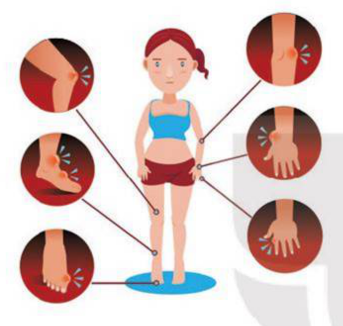
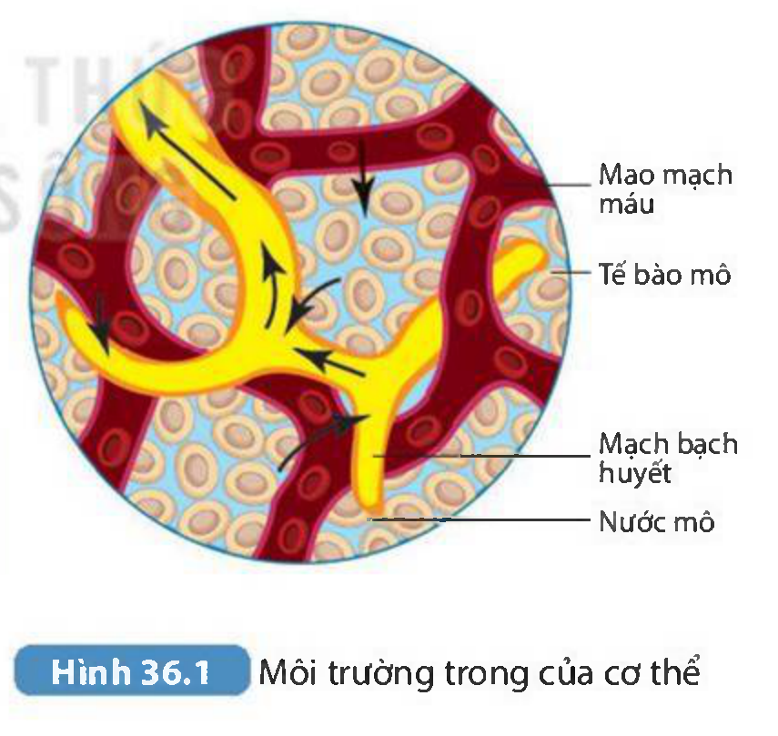

<!-- pdf:152 -->

# BÀI 36: ĐIỀU HOÀ MÔI TRƯỜNG TRONG CỦA CƠ THỂ NGƯỜI

## 🎯 Mục tiêu

- Nêu được khái niệm môi trường trong của cơ thể.
- Nêu được khái niệm cân bằng môi trường trong và vai trò của sự duy trì ổn định môi trường trong của cơ thể (ví dụ: nồng độ glucose, nồng độ muối, urea, uric acid, pH trong máu).
- Đọc và hiểu được thông tin một ví dụ cụ thể về kết quả xét nghiệm nồng độ glucose và uric acid trong máu.

## 🔴 Mở đầu

Hình bên mô tả một số triệu chứng của một người bị bệnh gout. Một trong những nguyên nhân gây bệnh trên là do rối loạn môi trường trong của cơ thể (tăng nồng độ uric acid trong máu). Môi trường trong của cơ thể là gì? Rối loạn môi trường trong gây ra những nguy cơ nào cho cơ thể?

## I. Môi trường trong của cơ thể

Môi trường trong của cơ thể bao gồm máu, nước mô và bạch huyết. Môi trường trong cơ thể thường xuyên liên hệ với môi trường ngoài thông qua các hệ cơ quan như hệ tiêu hoá, hệ tuần hoàn, hệ hô hấp và da,... <!-- term: Môi trường trong của cơ thể -->

Hình 36.1. Môi trường trong của cơ thể

> ❓ Quan sát Hình 36.1, mô tả các thành phần môi trường trong của cơ thể.

## II. Cân bằng môi trường trong của cơ thể

**Cân bằng môi trường trong của cơ thể** là duy trì sự ổn định của môi trường trong cơ thể, đảm bảo cho các hoạt động sống của cơ thể diễn ra bình thường. Khi môi trường trong của cơ thể không được duy trì ổn định (mất cân bằng) sẽ gây ra sự biến đổi hoặc rối loạn hoạt động của tế bào, cơ quan và cơ thể.

<!-- pdf:153 -->

Nồng độ glucose, sodium chloride, urea, uric acid và pH trong máu có vai trò quan trọng trong việc duy trì sự ổn định môi trường trong của cơ thể. Nếu những yếu tố này mất cân bằng, cơ thể có nguy cơ mắc một số bệnh.

Ví dụ: Nếu chỉ số glucose trong máu cao hơn bình thường trong thời gian dài (chỉ số glucose khi không ăn trong vòng 8 giờ trên 7 mmol/L) thì cơ thể đã mắc bệnh tiểu đường. Nếu lượng uric acid trong máu cao hơn mức bình thường kéo dài sẽ dẫn đến mắc bệnh viêm khớp, gout, suy thận,... Nếu lượng uric acid trong máu thấp hơn bình thường trong thời gian dài, cơ thể có nguy cơ bị các bệnh rối loạn chức năng gan, thận.

Để xác định nồng độ một số yếu tố trong cơ thể như nồng độ glucose, uric acid, người ta thường làm xét nghiệm máu hoặc nước tiểu.

> ❓
> 1. Cân bằng môi trường trong cơ thể là gì và có vai trò như thế nào đối với cơ thể?
> 2. Sau khi ăn quá mặn, chúng ta thường có cảm giác khát. Việc uống nhiều nước sau khi ăn quá mặn có ý nghĩa gì đối với cơ thể?

> ✋ **Đọc kết quả xét nghiệm nồng độ glucose và uric acid trong máu**
>
> Bảng 36.1. Mẫu kết quả xét nghiệm một số chỉ số sinh lí, sinh hoá máu của một người
>
> | Tên xét nghiệm | Kết quả | Chỉ số bình thường | Đơn vị |
> | --- | --- | --- | --- |
> | Định lượng glucose (máu) | 9,8 | 3,9 – 6,4 | mmol/L |
> | Định lượng uric acid (máu) | 171 | Nam: 210 – 420; Nữ: 150 – 350 | $\mu\text{mol/L}$ |
> | ... | ... | ... | ... |
>
> Giả sử Bảng 36.1 là kết quả xét nghiệm của một bệnh nhân nam. Thảo luận nhóm, nhận xét về kết quả xét nghiệm, dự đoán các nguy cơ về sức khoẻ của bệnh (nếu có) và đưa ra lời khuyên phù hợp.

## 📌 Em đã học

- Môi trường trong của cơ thể bao gồm máu, nước mô và bạch huyết. <!-- term: Môi trường trong của cơ thể -->
- Môi trường trong của cơ thể được duy trì ổn định giúp cơ thể hoạt động bình thường. Mất cân bằng môi trường trong, cơ thể có nguy cơ mắc một số bệnh nguy hiểm.

## 🚀 Em có thể

- Lựa chọn và sử dụng các loại thức ăn phù hợp góp phần duy trì ổn định môi trường trong của cơ thể và bảo vệ sức khoẻ.

## 📷 Danh sách hình trong bài

| Mã hình | Trang PDF | Trang sách | Chú thích |
| --- | --- | --- | --- |
| H8-khoa_hoc_tu_nhien-b36-01 | 152 | 150 | Hình minh hoạ triệu chứng bệnh gout (Mở đầu) |
| H8-khoa_hoc_tu_nhien-b36-02 | 152 | 150 | Hình 36.1. Môi trường trong của cơ thể |
