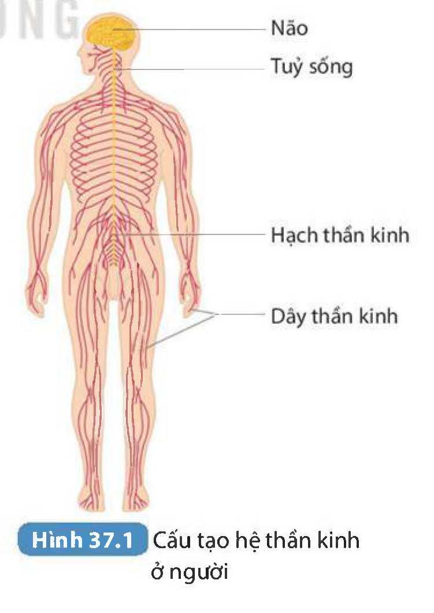
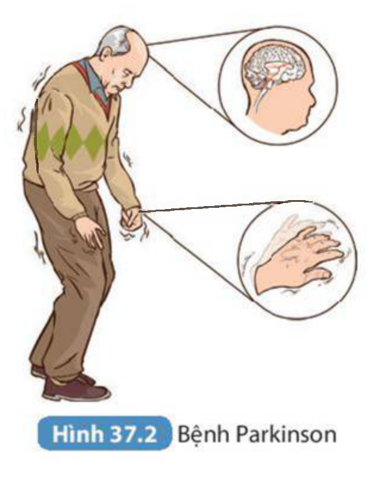
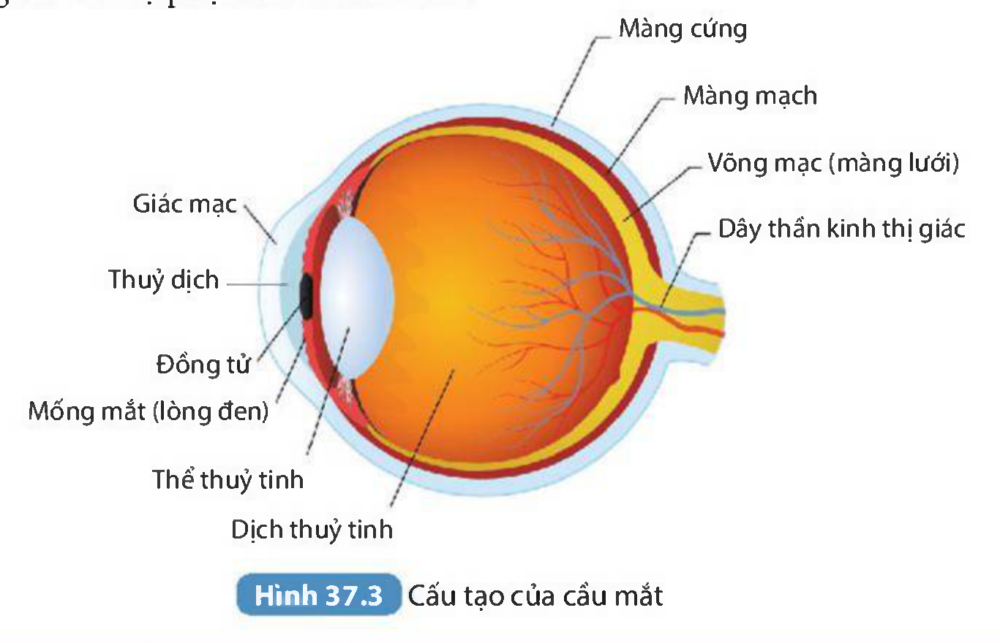
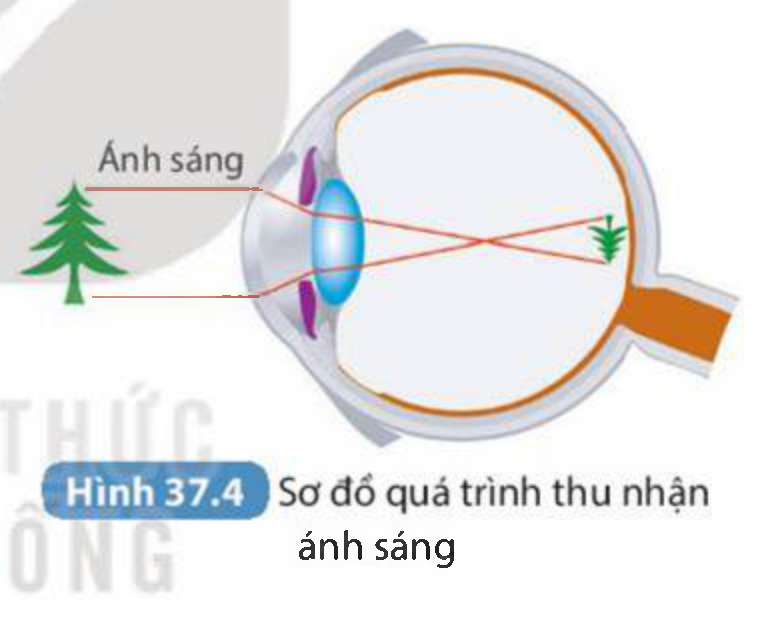
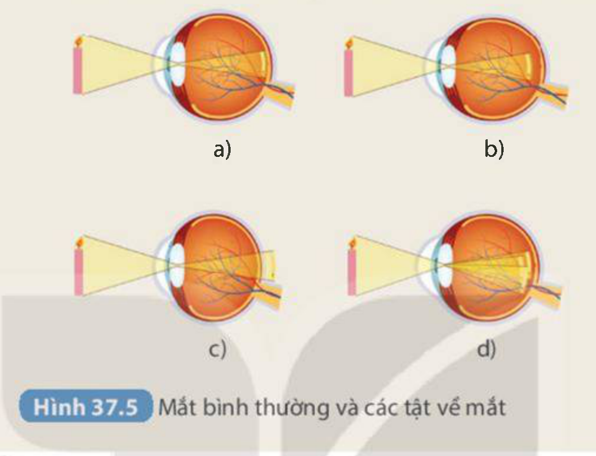

<!-- pdf:154 -->

# BÀI 37: HỆ THẦN KINH VÀ CÁC GIÁC QUAN Ở NGƯỜI

## 🎯 Mục tiêu

- Nêu được cấu tạo và chức năng của hệ thần kinh; nêu được chức năng của các giác quan, giác quan thị giác và thính giác.
- Trình bày được một số bệnh về hệ thần kinh và cách phòng chống các bệnh đó.
- Nêu được tác hại của các chất gây nghiện đối với hệ thần kinh; không sử dụng các chất gây nghiện và tuyên truyền hiểu biết cho người khác.
- Kể tên được các bộ phận của mắt và sơ đồ đơn giản quá trình thu nhận ánh sáng; liên hệ được kiến thức truyền ánh sáng trong thu nhận ánh sáng ở mắt.
- Kể tên được các bộ phận của tai và sơ đồ đơn giản quá trình thu nhận âm thanh; liên hệ được cơ chế truyền âm thanh trong thu nhận âm thanh ở tai.
- Trình bày được một số bệnh về thị giác, thính giác, cách phòng chống các bệnh đó; vận dụng để bảo vệ bản thân và người thân trong gia đình.
- Tìm hiểu được các bệnh và tật về mắt trong trường học, tuyên truyền chăm sóc và bảo vệ đôi mắt.

## 🔴 Mở đầu

Tại sao chúng ta có thể nghe được âm thanh và nhìn được hình dạng, màu sắc của các sự vật, hiện tượng xung quanh?

## I. Hệ thần kinh

### 1. Cấu tạo và chức năng của hệ thần kinh

Hệ thần kinh ở người có chức năng điều khiển, điều hoà và phối hợp hoạt động của các cơ quan, hệ cơ quan trong cơ thể thành một thể thống nhất. <!-- term: Hệ thần kinh -->

Hệ thần kinh ở người có dạng hình ống, gồm hai bộ phận: bộ phận trung ương có não và tuỷ sống, bộ phận ngoại biên có các dây thần kinh và hạch thần kinh. Trong đó, bộ phận trung ương đóng vai trò chủ đạo. <!-- term: Hệ thần kinh -->

Hình 37.1. Cấu tạo hệ thần kinh ở người

> ❓ Đọc thông tin trên kết hợp quan sát Hình 37.1, trình bày cấu tạo và chức năng của hệ thần kinh; nêu vị trí của mỗi bộ phận.

<!-- pdf:155 -->

### 2. Một số bệnh về hệ thần kinh và chất gây nghiện đối với hệ thần kinh

**a) Một số bệnh về hệ thần kinh**

Bệnh Parkinson: do thoái hoá tế bào thần kinh, xuất phát từ các nguyên nhân: cao tuổi, nhiễm khuẩn (viêm não) hoặc nhiễm độc thần kinh,... Bệnh gây suy giảm chức năng vận động, dẫn đến các triệu chứng run tay, mất thăng bằng, khó khăn khi di chuyển. Bệnh thường gặp ở người cao tuổi. Để phòng bệnh, nên bổ sung vitamin D từ thực phẩm hoặc tắm nắng, luyện tập thể dục, thể thao hợp lí, tránh xa môi trường độc hại,... <!-- term: Bệnh Parkinson -->

Hình 37.2. Bệnh Parkinson
<!-- ocr-ok: OCR đọc sai nhãn nền xanh 'Hình 37.2' thành 'Œ7TT7Z3' -->

Bệnh động kinh: do rối loạn hệ thống thần kinh trung ương, nguyên nhân có thể do di truyền, chấn thương hoặc các bệnh về não,... Triệu chứng phổ biến của bệnh là co giật hoặc có những hành vi bất thường, đôi lúc mất ý thức. Để phòng bệnh, nên giữ tinh thần vui vẻ, ngủ đủ giấc, luyện tập thể dục, thể thao hợp lí, ăn uống đủ chất,... <!-- term: Bệnh động kinh -->

Bệnh Alzheimer: do rối loạn thần kinh, thường gặp ở người cao tuổi. Người bị bệnh có những triệu chứng phổ biến như mất trí nhớ, giảm khả năng ngôn ngữ, lẩm cẩm, khả năng hoạt động kém. Để phòng bệnh, nên luyện trí não bằng cách đọc sách, báo; có chế độ ăn uống hợp lí; giữ tinh thần thoải mái và tăng cường vận động;... <!-- term: Bệnh Alzheimer -->

**b) Các chất gây nghiện đối với hệ thần kinh**

**Chất gây nghiện đối với hệ thần kinh** (như nicotine trong thuốc lá, etanol trong rượu,...) là chất kích thích thần kinh, làm thay đổi chức năng bình thường của cơ thể, làm cho cơ thể phụ thuộc hoặc có cảm giác thèm, nhớ, nghiện chất đó ở các mức độ khác nhau. Đặc biệt, các chất ma tuý (ví dụ: thuốc phiện, heroin,...) có ảnh hưởng vô cùng nguy hiểm đến cơ thể, gây nghiện sau thời gian ngắn sử dụng, rất khó cai và dễ tái nghiện. Ma tuý gây tổn thương hệ thần kinh, giảm sút sức khoẻ, dẫn đến các tệ nạn nghiêm trọng đối với người sử dụng và xã hội.

> ✋ Thảo luận nhóm để trả lời các câu hỏi và thực hiện các yêu cầu sau:
>
> 1. Nghiện ma tuý gây ra những tệ nạn gì cho xã hội?
> 2. Từ những hiểu biết về chất gây nghiện, em sẽ tuyên truyền điều gì đến người thân và mọi người xung quanh?

## II. Các giác quan

Con người có năm giác quan gồm thị giác, thính giác, xúc giác, vị giác và khứu giác. Các giác quan giúp cơ thể nhận biết kích thích từ bên ngoài hay bên trong cơ thể, đảm bảo cho cơ thể thích nghi với môi trường xung quanh. <!-- term: Giác quan -->

### 1. Thị giác

**a) Cấu tạo và chức năng**

Thị giác có cấu tạo gồm mắt, dây thần kinh thị giác và vùng thị giác ở não. Thị giác có chức năng quan sát, thu nhận hình ảnh, màu sắc của sự vật và hiện tượng, giúp não nhận biết và xử lí thông tin. <!-- term: Thị giác -->

<!-- pdf:156 -->

Phía ngoài của mắt có mí mắt, lông mi và cầu mắt nằm trong hốc mắt. Cấu tạo trong cầu mắt gồm các bộ phận như Hình 37.3.

Hình 37.3. Cấu tạo của cầu mắt

> ❓ Đọc thông tin trên và quan sát Hình 37.3, kể tên các bộ phận của mắt.

**b) Quá trình thu nhận ánh sáng**

Chúng ta có thể nhìn thấy vật là do có ánh sáng phản chiếu từ vật khúc xạ qua giác mạc và thể thuỷ tinh tới màng lưới, tác động lên tế bào thụ cảm thị giác, gây hưng phấn các tế bào này và truyền theo dây thần kinh thị giác tới não cho ta cảm nhận về hình ảnh của vật. <!-- term: Quá trình thu nhận ánh sáng ở mắt -->

Hình 37.4. Sơ đồ quá trình thu nhận ánh sáng

> ❓ Liên hệ kiến thức truyền ánh sáng, giải thích quá trình thu nhận ánh sáng ở mắt trong Hình 37.4.

**c) Một số bệnh, tật về thị giác**

Khả năng nhìn của mắt có thể bị suy giảm do một số bệnh và tật như bệnh đau mắt đỏ, tật cận thị, viễn thị,... gây nên.

Bệnh đau mắt đỏ: do virus Adeno, vi khuẩn *Staphylococcus*,... gây nên. Người bị bệnh đau mắt đỏ có các triệu chứng như đỏ mắt, chảy nước mắt, có nhiều ghèn (dử) mắt, cộm mắt. Để phòng bệnh, nên rửa tay thường xuyên, đeo kính bảo vệ mắt, hạn chế dụi mắt, bổ sung các thực phẩm có lợi cho mắt, không nên tiếp xúc trực tiếp hoặc dùng chung đồ cá nhân với người bị bệnh,... <!-- term: Bệnh đau mắt đỏ -->

Một số tật về mắt: như cận thị, viễn thị và loạn thị. Khi bị mắc các tật này, ảnh của vật sẽ không hiện trên màng lưới.

Cận thị có thể do bẩm sinh cầu mắt dài hoặc do nhìn gần khi đọc sách hay làm việc trong ánh sáng yếu, lâu dần làm thể thuỷ tinh phồng lên. Tình trạng này kéo dài làm thể thuỷ tinh mất dần khả năng đàn hồi. Khi bị cận thị, mắt chỉ nhìn rõ các vật ở gần mà không nhìn rõ các vật ở xa, ảnh của vật ở phía trước màng lưới. Để khắc phục tật cận thị, cần đeo kính cận (kính phân kì) phù hợp giúp ảnh lùi về đúng màng lưới. <!-- term: Cận thị -->

<!-- pdf:157 -->

Viễn thị có thể do cầu mắt quá ngắn hoặc thể thuỷ tinh bị lão hoá xẹp xuống khó phồng lên. Khi bị viễn thị mắt chỉ nhìn rõ các vật ở xa, ảnh của vật nằm ở phía sau màng lưới. Để khắc phục tật viễn thị, cần đeo kính lão (kính hội tụ) phù hợp giúp kéo ảnh về đúng màng lưới. <!-- term: Viễn thị -->

Loạn thị do giác mạc bị biến dạng không đều khiến các tia sáng đi vào mắt hội tụ ở nhiều điểm. Khi bị loạn thị, hình ảnh của vật không thể hội tụ ở màng lưới, khiến mắt nhìn bị mờ, nhoè. Để khắc phục tật loạn thị, cần đeo kính thuốc giúp nhìn rõ vật. <!-- term: Loạn thị -->

> ❓ Quan sát Hình 37.5, xác định mắt bình thường và mắt mắc các tật trong hình.
>
> 
>
> Hình 37.5. Mắt bình thường và các tật về mắt

> ✋ **Tìm hiểu các bệnh và tật về mắt trong trường học**
>
> 1. Tìm hiểu các bệnh và tật về mắt trong trường học rồi hoàn thành thông tin theo mẫu.
>
> Bảng 37.1.
>
> | Tên bệnh, tật | Số lượng người mắc | Nguyên nhân | Biện pháp phòng chống |
> | --- | --- | --- | --- |
> | ? | ? | ? | ? |
>
> 2. Thiết kế poster tuyên truyền cho mọi người cách chăm sóc, bảo vệ đôi mắt.

### 2. Thính giác

**a) Cấu tạo và chức năng**

Thính giác có cấu tạo gồm tai, dây thần kinh thính giác và vùng thính giác ở não. Thính giác có chức năng thu nhận âm thanh từ môi trường, truyền lên não xử lí giúp ta nhận biết được âm thanh. <!-- term: Thính giác -->

Tai có cấu tạo gồm ba phần: tai ngoài gồm vành tai và ống tai; tai giữa có màng nhĩ và chuỗi xương tai, từ đây có vòi tai thông với khoang miệng; tai trong có ốc tai chứa các cơ quan thụ cảm âm thanh, từ ốc tai có dây thần kinh thính giác đi về não (Hình 16.7). <!-- term: Tai -->

Tai thu nhận âm thanh theo cơ chế truyền sóng âm. Âm thanh được vành tai hứng, truyền qua ống tai làm rung màng nhĩ, gây tác động vào chuỗi xương tai làm rung các màng và dịch trong ốc tai. Những rung động này gây hưng phấn cơ quan thụ cảm, làm xuất hiện xung thần kinh đi theo dây thần kinh thính giác về não cho ta cảm nhận âm thanh. <!-- term: Quá trình thu nhận âm thanh ở tai -->

<!-- pdf:158 -->

> ❓ Đọc thông tin và quan sát Hình 16.7, thực hiện các yêu cầu sau:
>
> 1. Sơ đồ hoá quá trình thu nhận âm thanh của tai.
> 2. Giải thích vai trò của vòi tai trong cân bằng áp suất không khí giữa tai và khoang miệng.

**b) Một số bệnh về thính giác**

Tai thường mắc một số bệnh có thể gây giảm khả năng nghe, phổ biến như bệnh viêm tai giữa, ù tai,...

**Bệnh viêm tai giữa**: là tình trạng tổn thương và viêm nhiễm tai giữa do vi khuẩn. Các nguyên nhân gây bệnh như nước bẩn lọt vào tai, ráy tai bị nhiễm khuẩn gây nhiễm trùng, thiếu máu não, nhiễm lạnh hay do biến chứng từ các bệnh vùng mũi, họng. Bệnh thường có các triệu chứng như đau tai, nhức đầu, suy giảm thính giác, có dịch lỏng và hôi chảy từ tai, có thể kèm theo sốt nhẹ, đau họng.

Bệnh ù tai: do một số nguyên nhân như làm việc trong môi trường tiếng ồn lớn; nghe tiếng bom, mìn nổ; ráy tai nhiều gây tắc nghẽn; có dị vật ở tai; thiếu máu não;... Người bị bệnh thường không nghe rõ được âm thanh, luôn nghe thấy tiếng “ù ù” trong tai. <!-- term: Bệnh ù tai -->

> ❓ Dựa vào thông tin trên, em hãy nêu cách phòng chống bệnh viêm tai giữa, ù tai để bảo vệ bản thân và gia đình.

## 📌 Em đã học

- Hệ thần kinh ở người có chức năng điều khiển, điều hoà và phối hợp hoạt động của cơ quan, hệ cơ quan trong cơ thể. Hệ thần kinh của người gồm hai bộ phận: bộ phận trung ương gồm não và tuỷ sống, bộ phận ngoại biên gồm các hạch thần kinh và dây thần kinh. <!-- term: Hệ thần kinh -->
- Những chất kích thích thần kinh làm thay đổi chức năng bình thường của cơ thể như ma tuý, nicotine, etanol,... là những chất gây nghiện hệ thần kinh.
- Thị giác có cấu tạo gồm mắt, dây thần kinh thị giác và vùng thị giác ở não. Thị giác có chức năng quan sát, thu nhận hình ảnh, màu sắc của sự vật và hiện tượng. <!-- term: Thị giác -->
- Thính giác có cấu tạo gồm tai, dây thần kinh thính giác và vùng thính giác ở não. Thính giác có chức năng thu nhận âm thanh. <!-- term: Thính giác -->

## 🚀 Em có thể

- Thực hiện được các biện pháp phòng chống bệnh về hệ thần kinh; bệnh, tật về thị giác, thính giác.
- Tuyên truyền chăm sóc và bảo vệ đôi mắt.

## 📷 Danh sách hình trong bài

| Mã hình | Trang PDF | Trang sách | Chú thích |
| --- | --- | --- | --- |
| H8-khoa_hoc_tu_nhien-b37-01 | 154 | 152 | Hình 37.1. Cấu tạo hệ thần kinh ở người |
| H8-khoa_hoc_tu_nhien-b37-02 | 155 | 153 | Hình 37.2. Bệnh Parkinson |
| H8-khoa_hoc_tu_nhien-b37-03 | 156 | 154 | Hình 37.3. Cấu tạo của cầu mắt |
| H8-khoa_hoc_tu_nhien-b37-04 | 156 | 154 | Hình 37.4. Sơ đồ quá trình thu nhận ánh sáng |
| H8-khoa_hoc_tu_nhien-b37-05 | 157 | 155 | Hình 37.5. Mắt bình thường và các tật về mắt |
