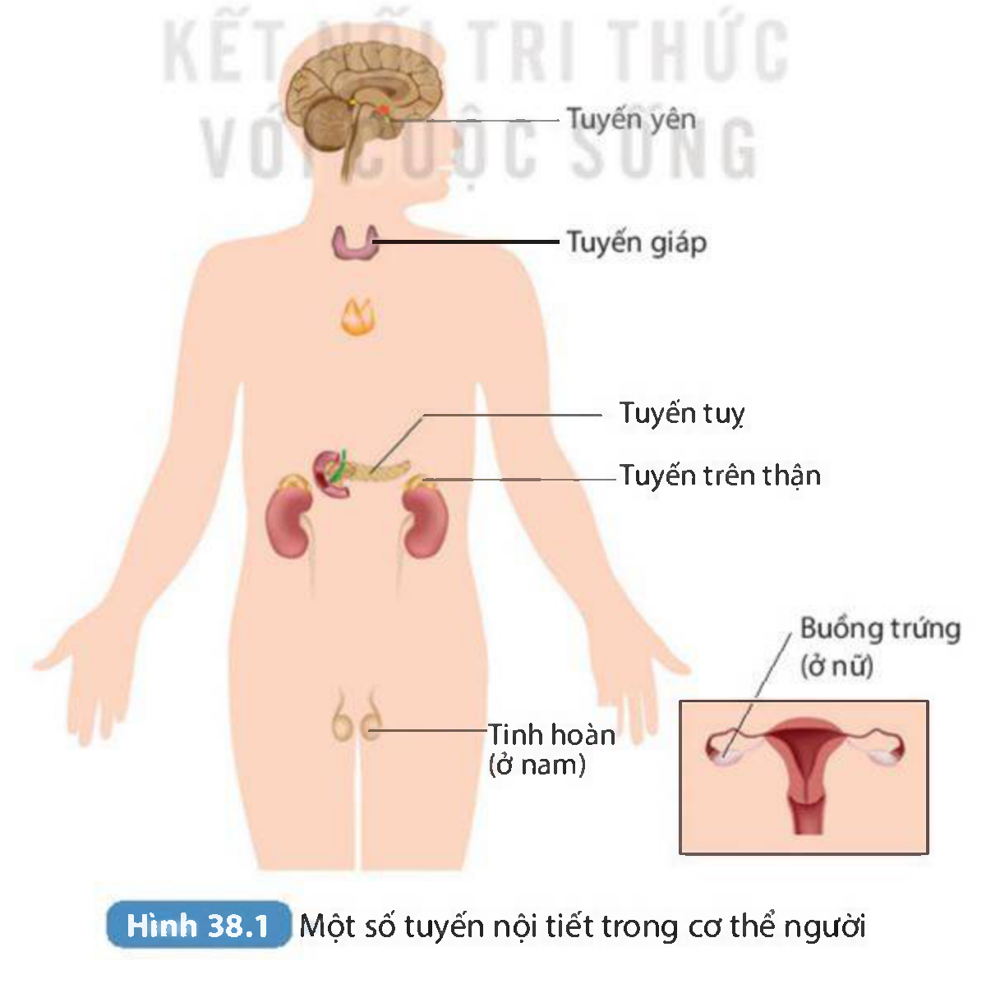
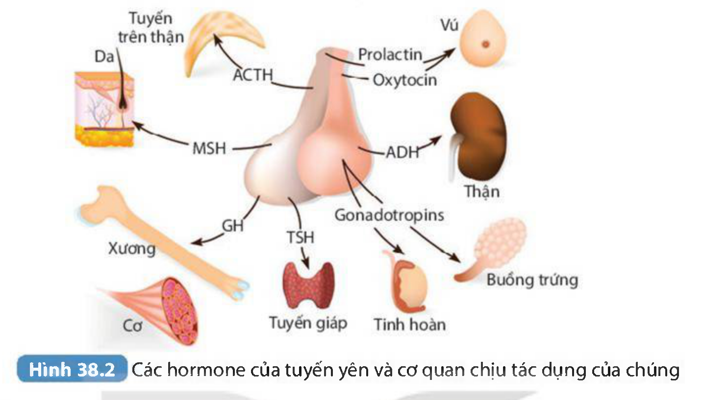

<!-- pdf:159 -->

# BÀI 38: HỆ NỘI TIẾT Ở NGƯỜI

## 🎯 Mục tiêu

- Kể được tên và nêu được chức năng của các tuyến nội tiết.
- Nêu được một số bệnh liên quan đến hệ nội tiết và cách phòng chống các bệnh đó; vận dụng được hiểu biết về các tuyến nội tiết để bảo vệ sức khoẻ bản thân và người thân trong gia đình.
- Tìm hiểu được các bệnh nội tiết ở địa phương (tiểu đường, bướu cổ do thiếu iodine,...).

## 🔴 Mở đầu

Với chiều cao 2,51 m, anh Kosen người Thổ Nhĩ Kì được sách Kỉ lục Guiness ghi nhận là người đàn ông cao nhất thế giới vào ngày 9/5/2011. Ngược lại, với chiều cao 0,51 m, anh Dangi người Nepal được ghi nhận là người đàn ông trưởng thành thấp nhất thế giới vào ngày 26/2/2012. Điều gì khiến họ cao lớn hoặc thấp bé bất thường so với chúng ta?

## I. Các tuyến nội tiết trong cơ thể người

Các tuyến nội tiết tiết ra hormone rồi được vận chuyển theo đường máu đến cơ quan đích giúp điều khiển, điều hoà hoạt động của các cơ quan, duy trì sự ổn định của môi trường trong cơ thể. Hormone có hoạt tính sinh học cao nên chỉ cần một lượng nhỏ cũng gây hiệu quả rõ rệt. Một tuyến nội tiết nào đó không hoạt động bình thường sẽ ảnh hưởng đến quá trình sinh trưởng và phát triển, có thể gây ra các bệnh cho cơ thể. <!-- term: Hệ nội tiết --> <!-- term: Tuyến nội tiết --> <!-- term: Hormone -->

Hình 38.1. Một số tuyến nội tiết trong cơ thể người

<!-- pdf:160 -->

### 1. Tuyến yên

Tuyến yên tiết ra các hormone kích thích hoạt động của nhiều tuyến nội tiết khác trong cơ thể, đồng thời tiết ra hormone ảnh hưởng đến sự tăng trưởng của cơ và xương, sự trao đổi nước ở thận, sự co thắt cơ trơn ở tử cung, tiết sữa ở tuyến vú (Hình 38.2). <!-- term: Tuyến yên -->

Hình 38.2. Các hormone của tuyến yên và cơ quan chịu tác dụng của chúng

### 2. Tuyến giáp

Tuyến giáp tiết ra hormone thyroxine (TH). Hormone này chứa iodine, có vai trò quan trọng đối với quá trình trao đổi chất và chuyển hoá năng lượng trong tế bào. Ngoài ra, tuyến giáp còn tiết hormone calcitonin tham gia điều hoà calcium và phosphorus trong máu. <!-- term: Tuyến giáp -->

### 3. Tuyến tuỵ

Tuyến tuỵ vừa tiết dịch tiêu hoá đổ vào tá tràng (chức năng ngoại tiết) vừa tiết các hormone (chức năng nội tiết), do đó tuyến tuỵ được gọi là tuyến pha. Tuyến tuỵ tiết hai loại hormone là insulin và glucagon. Hormone insulin chuyển hoá glucose trong máu thành glycogen dự trữ ở gan, dẫn đến giảm đường huyết khi đường huyết tăng, còn hormone glucagon có tác dụng ngược lại. <!-- term: Tuyến tuỵ -->

### 4. Tuyến trên thận

Tuyến trên thận tiết ra adrenaline và noradrenaline có vai trò làm tăng nhịp tim, co mạch, tăng nhịp hô hấp, dãn phế quản và góp phần làm tăng đường huyết khi đường huyết giảm. Đồng thời, tuyến trên thận còn tiết các loại hormone khác có vai trò điều hoà nồng độ glucose, muối sodium và potassium trong máu; điều hoà sinh dục nam, gây những biến đổi đặc tính sinh dục ở nam. <!-- term: Tuyến trên thận -->

### 5. Tuyến sinh dục

Tuyến sinh dục là tinh hoàn (ở nam) và buồng trứng (ở nữ). Tinh hoàn tiết ra hormone testosterone kích thích sự sinh tinh trùng ở nam; buồng trứng tiết ra hormone estrogen kích thích sự phát triển và rụng trứng ở nữ. Cả hai hormone này đều gây ra những biến đổi cơ thể ở tuổi dậy thì của cả nam và nữ. <!-- term: Tuyến sinh dục -->

> ❓
> 1. Nêu chức năng của các tuyến nội tiết.
> 2. Em hãy giải thích vì sao hoạt động của các hormone tuyến tuỵ giúp ổn định lượng đường trong máu. Quá trình tiết hormone điều hoà đường huyết bị rối loạn có thể dẫn đến hậu quả gì?

<!-- pdf:161 -->

## II. Một số bệnh liên quan đến hệ nội tiết

### 1. Bệnh đái tháo đường

**Đái tháo đường** (hay tiểu đường, đái đường) là một bệnh rối loạn chuyển hoá glucose trong máu. Nguyên nhân gây rối loạn chủ yếu do thiếu hormone insulin hoặc insulin tiết ra nhưng bị giảm tác dụng điều hoà lượng đường trong máu, dẫn đến lượng glucose trong máu tăng nhưng tế bào không hấp thụ đủ để làm nguyên liệu cho hoạt động trao đổi chất, đường trong máu sẽ thải ra ngoài qua nước tiểu.

Người mắc bệnh đái tháo đường thường có các triệu chứng ăn nhiều, uống nhiều, đi tiểu nhiều, sụt cân,... Bệnh có thể gây nhiều biến chứng nguy hiểm như mù loà, tổn thương dây thần kinh, hoại tử da,...

### 2. Bệnh bướu cổ do thiếu iodine

**Bướu cổ** là tình trạng phì đại tuyến giáp. Nguyên nhân gây bệnh do cơ thể thiếu iodine dẫn đến TH không được tiết ra, khi đó tuyến yên sẽ tiết ra TSH để tăng cường hoạt động của tuyến giáp, gây phì đại tuyến. Hậu quả của bệnh là làm cho trẻ chậm lớn, trí tuệ chậm phát triển; giảm sút trí nhớ ở người lớn và hoạt động thần kinh suy giảm.

> ✋ Thảo luận nhóm để trả lời các câu hỏi và thực hiện các yêu cầu sau:
>
> 1. Em hãy nêu các biểu hiện trên cơ thể và đề xuất biện pháp phòng chống đối với:
>    a) Bệnh tiểu đường.
>    b) Bệnh bướu cổ do thiếu iodine.
> 2. Vận dụng hiểu biết về các tuyến nội tiết, em hãy đề xuất các biện pháp bảo vệ sức khoẻ bản thân và gia đình, nêu tác dụng của các biện pháp đó.
> 3. Tìm hiểu một số bệnh nội tiết thường gặp ở địa phương theo gợi ý trong Bảng 38.1.
>
> Bảng 38.1.
>
> | Tên bệnh, tật | Số lượng người mắc | Nguyên nhân | Biện pháp phòng chống |
> | --- | --- | --- | --- |
> | ? | ? | ? | ? |

> 🔍 Hormone insulin được sử dụng trong điều trị bệnh đái tháo đường hiện nay không phải được tách trực tiếp từ tuyến tuỵ ở người mà được sản xuất nhờ ứng dụng công nghệ di truyền. Gene tổng hợp insulin từ tế bào người được tách và chuyển sang vi khuẩn *E. coli*. Vi khuẩn *E. coli* chuyển gene có thể tạo ra một lượng lớn hormone insulin. Bằng cách này, có thể sản xuất hormone insulin số lượng lớn, giá thành rẻ, hỗ trợ chữa trị các bệnh nhân mắc bệnh tiểu đường do thiếu hormone insulin.

## 📌 Em đã học

- Một số tuyến nội tiết trong cơ thể người như tuyến yên, tuyết giáp, tuyến tuỵ, tuyến trên thận và tuyến sinh dục. <!-- term: Hệ nội tiết -->
- Một số tuyến nội tiết tiết hormone vận chuyển theo đường máu, tác động đến cơ quan đích giúp điều khiển, điều hoà hoạt động của các cơ quan nói riêng và cơ thể nói chung. <!-- term: Tuyến nội tiết --> <!-- term: Hormone -->

## 🚀 Em có thể

- Lựa chọn được khẩu phần ăn phù hợp để phòng chống các bệnh về hệ nội tiết.

## 📷 Danh sách hình trong bài

| Mã hình | Trang PDF | Trang sách | Chú thích |
| --- | --- | --- | --- |
| H8-khoa_hoc_tu_nhien-b38-01 | 159 | 157 | Hình 38.1. Một số tuyến nội tiết trong cơ thể người |
| H8-khoa_hoc_tu_nhien-b38-02 | 160 | 158 | Hình 38.2. Các hormone của tuyến yên và cơ quan chịu tác dụng của chúng |
