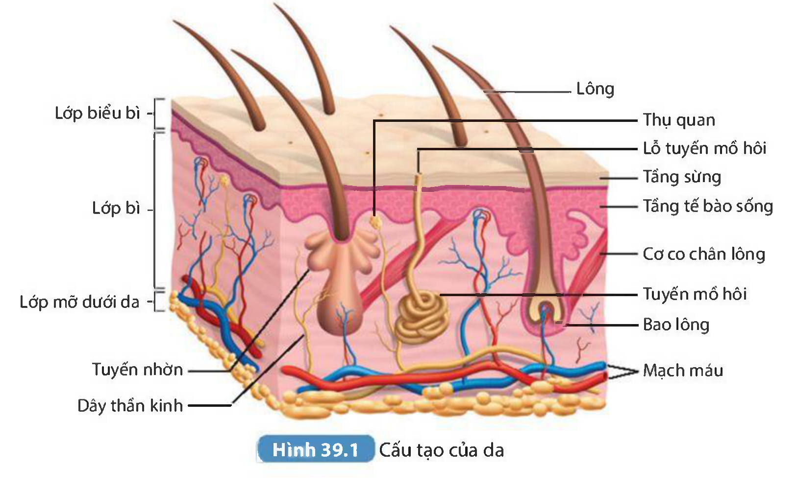
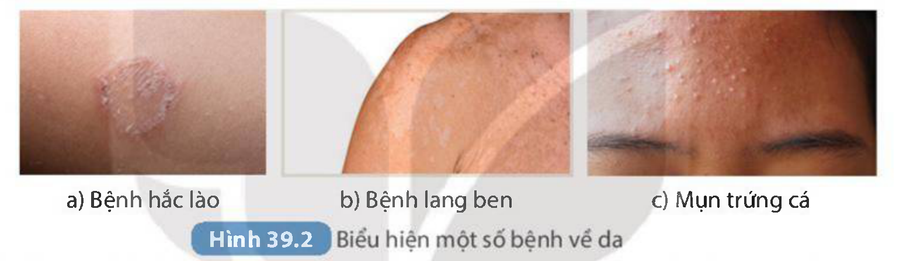
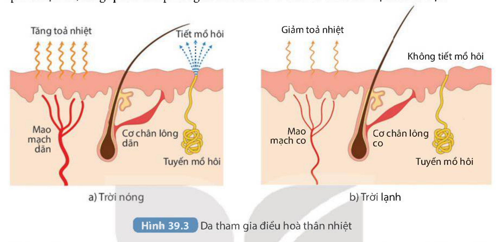

<!-- pdf:162 -->

# BÀI 39: DA VÀ ĐIỀU HOÀ THÂN NHIỆT Ở NGƯỜI

## 🎯 Mục tiêu

- Nêu được cấu tạo sơ lược và chức năng của da.
- Trình bày được một số bệnh về da và các biện pháp chăm sóc, bảo vệ, làm đẹp da an toàn; vận dụng được hiểu biết về da để chăm sóc da, trang điểm an toàn cho da.
- Tìm hiểu được một số thành tựu ghép da trong y học, các bệnh về da trong trường học hoặc trong khu dân cư.
- Nêu được khái niệm thân nhiệt; thực hành được cách đo thân nhiệt và nêu được ý nghĩa của việc đo thân nhiệt.
- Nêu được vai trò và cơ chế duy trì thân nhiệt ổn định ở người; vai trò của da và hệ thần kinh trong điều hoà thân nhiệt.
- Trình bày được một số phương pháp chống nóng, lạnh cho cơ thể; nêu được một số biện pháp chống cảm lạnh, cảm nóng; thực hiện được tình huống giả định cấp cứu khi cảm nóng hoặc cảm lạnh.

## 🔴 Mở đầu

Nhiệt độ cơ thể tăng cao hoặc hạ thấp quá mức đều là bất thường. Nhiệt độ cơ thể ổn định có vai trò gì và yếu tố nào tham gia duy trì sự ổn định đó?

## I. Da ở người

### 1. Cấu tạo và chức năng của da

**a) Cấu tạo**

**Da** là lớp vỏ bọc bên ngoài cơ thể, được cấu tạo gồm lớp biểu bì, lớp bì và lớp mỡ dưới da (Hình 39.1).

Hình 39.1. Cấu tạo của da

<!-- pdf:163 -->

**b) Chức năng**

Da có chức năng bảo vệ cơ thể, chống lại các yếu tố bất lợi của môi trường như sự va đập, sự xâm nhập của vi khuẩn, chống thấm nước và mất nước. Da tham gia điều hoà thân nhiệt nhờ hoạt động của tuyến mồ hôi; hoạt động co, dãn của mạch máu dưới da; co, dãn chân lông. Bên cạnh đó, da còn có chức năng nhận biết các kích thích của môi trường nhờ thụ quan và chức năng bài tiết qua tuyến mồ hôi.

> ❓
> 1. Quan sát Hình 39.1, em hãy xác định các thành phần của lớp biểu bì, lớp bì và lớp mỡ dưới da.
> 2. Nêu chức năng các thành phần của da.

### 2. Một số bệnh về da và bảo vệ da

**a) Một số bệnh về da**

Da tiếp xúc trực tiếp với môi trường ngoài nên có nguy cơ cao mắc các bệnh như hắc lào, lang ben, mụn trứng cá,...

Hình 39.2. Biểu hiện một số bệnh về da

Bệnh hắc lào và bệnh lang ben: do nấm gây ra. Cả hai bệnh trên thường xảy ra trong điều kiện môi trường nóng, ẩm, đây là điều kiện thuận lợi cho nấm gây bệnh phát triển. Người bị bệnh hắc lào thường xuất hiện các vùng da tổn thương có dạng tròn, đóng vảy (Hình 39.2a); ngứa ở vùng mông, bẹn, nách. Bệnh lang ben gây ra các vùng da lốm đốm trắng hơn bình thường (Hình 39.2b). <!-- term: Bệnh hắc lào --> <!-- term: Bệnh lang ben -->

Mụn trứng cá: có thể do nang lông bị bít tắc bởi tế bào chết hoặc chất nhờn tiết ra quá nhiều, vi khuẩn gây viêm nhiễm và tổn thương trên da,... Bệnh thường xuất hiện nhiều ở độ tuổi dậy thì, gồm các dạng mụn sần, mụn mủ, mụn đầu trắng, mụn đầu đen,... (Hình 39.2c). <!-- term: Mụn trứng cá -->

**b) Chăm sóc, bảo vệ da và làm đẹp da an toàn**

Da sạch có khả năng diệt đến 85% vi khuẩn bám trên da nhưng da bẩn chỉ diệt được khoảng 5%. Da bị xây xát là cơ hội cho vi khuẩn xâm nhập, gây các bệnh nguy hiểm cho da và cơ thể.

Bên cạnh đó, trang điểm cũng có thể gây tổn thương da nếu lạm dụng và không vệ sinh đúng cách. Một số sản phẩm trang điểm có chứa dầu khiến lỗ chân lông bị bít tắc, gây mụn trứng cá. Vì vậy, để chăm sóc và bảo vệ da cần tránh làm da bị tổn thương, vệ sinh cơ thể sạch sẽ, tránh để da tiếp xúc với ánh nắng gay gắt, không nên lạm dụng mĩ phẩm và cần vệ sinh da sạch sẽ sau khi trang điểm,...

> ❓
> 1. Vì sao nói giữ gìn vệ sinh môi trường cũng là một biện pháp bảo vệ da?
> 2. Vận dụng những hiểu biết về da, nêu các biện pháp chăm sóc, bảo vệ và trang điểm da an toàn.

<!-- pdf:164 -->

> ✋ **Tìm hiểu một số bệnh về da**
>
> Tìm hiểu một số bệnh về da trong trường học hoặc khu dân cư rồi hoàn thành thông tin theo mẫu Bảng 39.1.
>
> Bảng 39.1.
>
> | Tên bệnh | Số người mắc | Biện pháp phòng chống |
> | --- | --- | --- |
> | ? | ? | ? |

### 3. Một số thành tựu ghép da trong y học

**Ghép da** là việc lấy một phần da trên cơ thể và di chuyển hoặc cấy ghép đến vùng khác trên cơ thể cần chúng. Ghép da thành công giúp cứu chữa những người có da bị tổn thương nặng do bỏng, nhiễm trùng da,...

> ❓ Em hãy tìm hiểu và nêu một số thành tựu ghép da trong y học.

## II. Điều hoà thân nhiệt ở người

### 1. Khái niệm thân nhiệt

**Thân nhiệt** là nhiệt độ của cơ thể. Mỗi vùng trong cơ thể người có một nhiệt độ khác nhau, nhiệt độ cao nhất ở gan rồi đến máu và thấp nhất ở da. Thân nhiệt ở người bình thường khoảng $37\text{ }^\circ\text{C}$ và dao động không quá $0,5\text{ }^\circ\text{C}$.

> ✋ **Đo thân nhiệt bằng nhiệt kế điện tử**
>
> *Chuẩn bị:* Nhiệt kế điện tử, bông y tế.
>
> *Tiến hành:*
>
> Bước 1: Dùng bông y tế lau sạch nhiệt kế, bật nhiệt kế.
>
> Bước 2: Đưa đầu của nhiệt kế vào vị trí cần đo (trán, tai,...) và ấn nút bật một lần nữa.
>
> Bước 3: Đợi 3 đến 5 giây và đọc kết quả hiển thị trên màn hình.
>
> Bước 4: Tắt nhiệt kế, lau sạch và cất vào nơi quy định.
>
> *Thực hiện các yêu cầu sau:*
>
> 1. Đọc giá trị đo thân nhiệt của bản thân và nhận xét về giá trị đo.
> 2. Cho biết ý nghĩa của việc đo thân nhiệt.

### 2. Vai trò và cơ chế duy trì thân nhiệt ổn định ở người

Thân nhiệt của người được duy trì ổn định quanh một giá trị nhất định ngay cả khi nhiệt độ môi trường cao hơn hoặc thấp hơn nhiệt độ cơ thể. Thân nhiệt duy trì ổn định giúp các quá trình sống trong cơ thể diễn ra bình thường. Nếu thân nhiệt dưới $35\text{ }^\circ\text{C}$ hoặc trên $38\text{ }^\circ\text{C}$ thì tim, hệ thần kinh và các cơ quan khác có thể bị rối loạn, ảnh hưởng đến các hoạt động sống của cơ thể. <!-- term: Điều hoà thân nhiệt -->

<!-- pdf:165 -->

Da có vai trò quan trọng nhất trong điều hoà thân nhiệt. Nếu nhiệt độ môi trường hay thân nhiệt tăng cao, não sẽ gửi tín hiệu đến mao mạch và tuyến mồ hôi nằm ở da, kích thích sự dãn mạch và tăng tiết mồ hôi, tăng toả nhiệt (Hình 39.3a). Khi nhiệt độ môi trường thấp hoặc thân nhiệt giảm sẽ có các phản ứng ngược lại làm giảm toả nhiệt (Hình 39.3b). Ngoài ra, khi trời quá lạnh còn có hiện tượng cơ co và dãn liên tục gây phản xạ run, tăng quá trình phân giải các chất ở tế bào để điều tiết sự sinh nhiệt. <!-- term: Điều hoà thân nhiệt -->

Hình 39.3. Da tham gia điều hoà thân nhiệt

Hiện tượng run; phản ứng co, dãn mạch máu dưới da; tăng, giảm tiết mồ hôi; co, dãn cơ chân lông;... để điều tiết sự toả nhiệt của cơ thể đều là phản xạ. Điều đó chứng tỏ hệ thần kinh giữ vai trò chủ đạo trong hoạt động điều hoà thân nhiệt. <!-- term: Điều hoà thân nhiệt -->

> ❓
> 1. Duy trì ổn định thân nhiệt ở người có vai trò gì? Nêu các cơ chế duy trì thân nhiệt ở người.
> 2. Trình bày vai trò của da và hệ thần kinh trong điều hoà thân nhiệt.

### 3. Một số phương pháp phòng chống nóng, lạnh cho cơ thể

**a) Phòng chống nóng, lạnh cho cơ thể**

Khi thời tiết nắng nóng, cần giữ cơ thể mát mẻ; đội mũ, nón khi làm việc ngoài trời và không chơi thể thao dưới ánh nắng trực tiếp. Sau khi vận động mạnh, mồ hôi ra nhiều, không nên tắm ngay hay ngồi trước quạt và ở nơi có gió mạnh.

Khi thời tiết lạnh, cần giữ ấm cơ thể, đặc biệt là các vùng ngực, cổ, chân, tay. Thường xuyên luyện tập thể dục, thể thao để nâng cao khả năng chống nóng, lạnh của cơ thể.

> ❓ Cho những hoạt động sau: trồng cây xanh, chống nóng cho nhà ở, sử dụng quạt, mặc áo ấm, luyện tập thể dục, thể thao, sử dụng điều hoà hai chiều. Hoạt động nào có vai trò chống nóng, hoạt động nào có vai trò chống lạnh cho cơ thể?

<!-- pdf:166 -->

**b) Phòng chống cảm nóng, cảm lạnh**

Khi ở ngoài trời nắng quá lâu, trung tâm điều hoà thân nhiệt của cơ thể (ở vùng gáy) bị tác động, có thể làm rối loạn điều hoà thân nhiệt, dẫn đến hiện tượng cảm nóng. Để phòng chống cảm nóng, nên che nắng, uống đủ nước, tránh ánh nắng trực tiếp vào vùng sau gáy, hạn chế ra ngoài trời khi nắng nóng,... <!-- term: Cảm nóng -->

Khi trời mưa, lạnh hay thay đổi thời tiết đột ngột, cơ thể dễ bị cảm lạnh. Tác nhân gây bệnh cảm lạnh là virus gây bệnh ở đường hô hấp. Để phòng chống cảm lạnh, cần vệ sinh mũi, miệng sạch sẽ, súc họng bằng nước muối sinh lí 2 đến 4 lần/ngày, uống nước ấm, giữ ấm cho cơ thể,... <!-- term: Cảm lạnh -->

> ✋ Thảo luận theo nhóm về cách xử lí tình huống khi gặp một người bị say nắng (cảm nóng) và một người bị cảm lạnh.

> 🔍
> - Bệnh viện Bỏng Quốc gia đã nghiên cứu, xử lí và sử dụng da ếch tươi, da ếch đông khô tiệt trùng bằng tia Gamma hoặc sử dụng trung bì (lớp bì) da lợn tươi, da lợn đông khô ở độ lạnh sâu để ghép da, điều trị vết bỏng cho người bệnh. Gần đây, công nghệ nhân nuôi tế bào sợi được chuyển giao từ Nga và Singapore giúp Bệnh viện Bỏng Quốc gia thành công trong việc cấy nguyên bào sợi nhằm nghiên cứu và điều trị bỏng.
> - Peter Medawar nhận giải thưởng Nobel vào năm 1960 với công trình chứng minh thải mảnh ghép là hiện tượng miễn dịch chủ động. Mảnh da ghép là một kháng nguyên lạ, khi xuất hiện ở cơ thể chủ sẽ kích hoạt hệ thống miễn dịch của cơ thể, gây ra sự thải tức thì do tính đặc hiệu với cơ thể cho mảnh ghép. Phát hiện về ghép da này đã làm nền móng cho ngành phẫu thuật ghép tạng và liệu pháp chống thải ghép hiện đại.

## 📌 Em đã học

- Da gồm lớp biểu bì có tầng sừng và tầng tế bào sống giúp bảo vệ cơ thể; lớp bì có các bộ phận giúp da thực hiện chức năng cảm giác, bài tiết, điều hoà thân nhiệt; trong cùng là lớp mỡ dưới da.
- Cần giữ vệ sinh cơ thể, tránh để xây xát da, giữ gìn vệ sinh nơi ở để bảo vệ cơ thể không mắc các bệnh về da và các bệnh khác do vi sinh vật xâm nhập qua vết thương trên da gây nên.
- Thân nhiệt của người được duy trì ổn định vì cơ thể người có các cơ chế điều hoà thân nhiệt, trong đó da và hệ thần kinh có vai trò quan trọng. <!-- term: Điều hoà thân nhiệt -->

## 🚀 Em có thể

- Thực hiện các việc làm để bảo vệ, chăm sóc, làm đẹp cho da và trang điểm an toàn.
- Thực hiện được một số phương pháp chống nóng, lạnh cho cơ thể; chống cảm nóng, cảm lạnh.

## 📷 Danh sách hình trong bài

| Mã hình | Trang PDF | Trang sách | Chú thích |
| --- | --- | --- | --- |
| H8-khoa_hoc_tu_nhien-b39-01 | 162 | 160 | Hình 39.1. Cấu tạo của da |
| H8-khoa_hoc_tu_nhien-b39-02 | 163 | 161 | Hình 39.2. Biểu hiện một số bệnh về da |
| H8-khoa_hoc_tu_nhien-b39-03 | 165 | 163 | Hình 39.3. Da tham gia điều hoà thân nhiệt |
