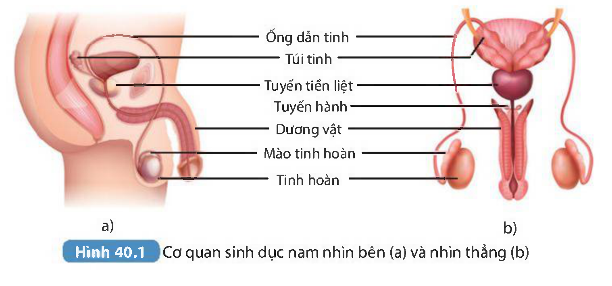
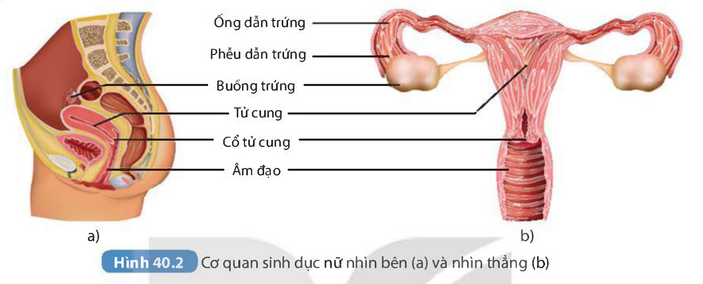
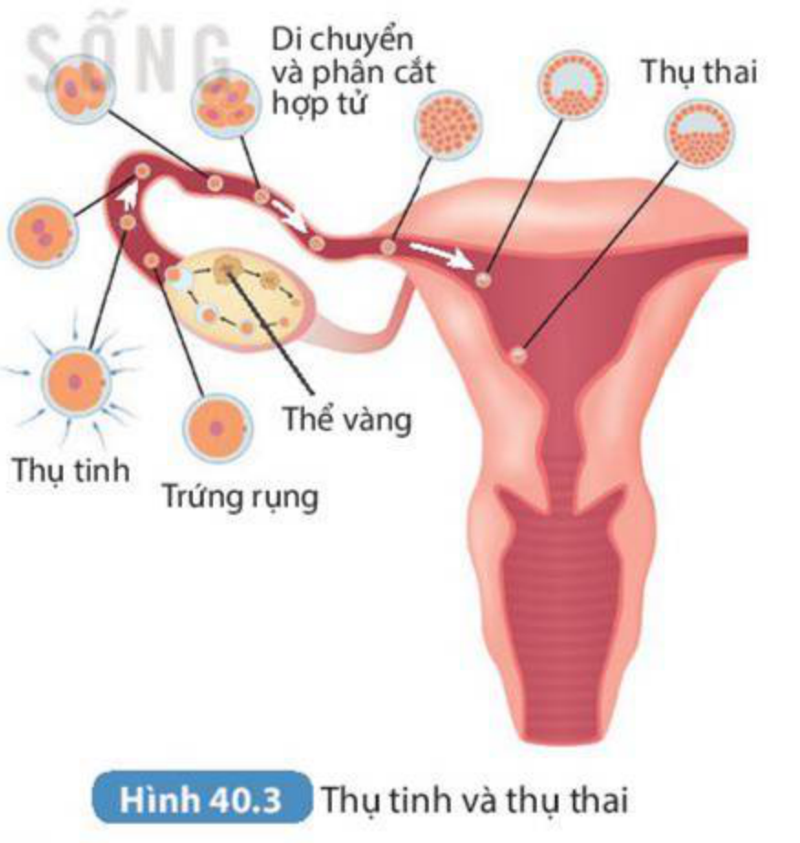
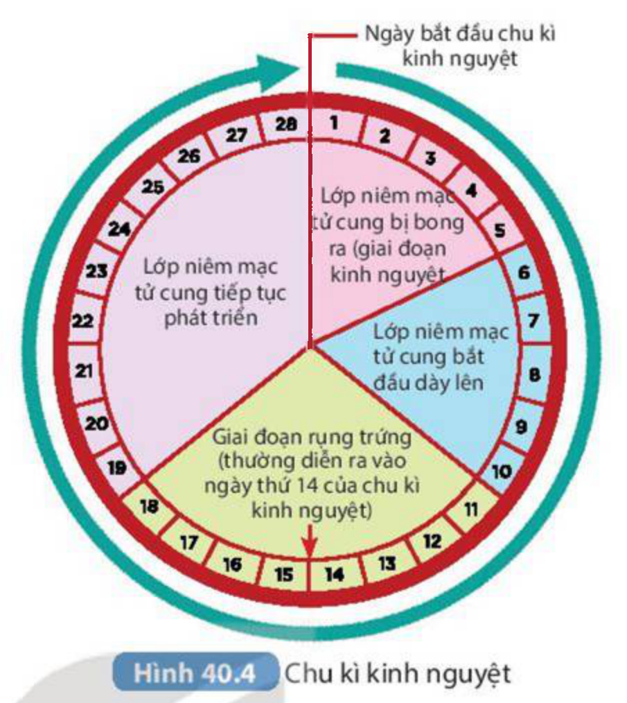
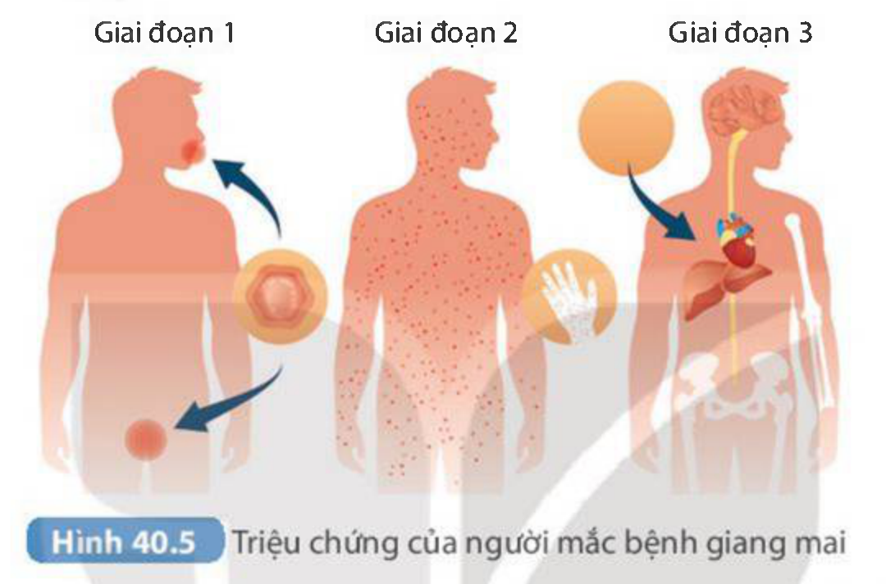

<!-- pdf:167 -->

# BÀI 40: SINH SẢN Ở NGƯỜI

## 🎯 Mục tiêu

- Nêu được chức năng của hệ sinh dục; kể tên và trình bày được chức năng của các cơ quan sinh dục nam, cơ quan sinh dục nữ.
- Nêu được khái niệm thụ tinh và thụ thai; nêu được hiện tượng kinh nguyệt và cách phòng tránh thai.
- Kể tên và trình bày được cách phòng chống một số bệnh lây truyền qua đường sinh dục.
- Nêu được ý nghĩa và các biện pháp bảo vệ sức khoẻ sinh sản vị thành niên; vận dụng được hiểu biết về sinh sản để bảo vệ sức khoẻ bản thân.
- Điều tra được sự hiểu biết của học sinh trong trường học về sức khoẻ sinh sản vị thành niên (an toàn tình dục).

## 🔴 Mở đầu

Để duy trì nòi giống, mọi sinh vật đều trải qua quá trình sinh sản. Ở người, cơ quan và hệ cơ quan nào đảm nhận vai trò sinh sản?

## I. Hệ sinh dục

Hệ sinh dục có chức năng duy trì nòi giống thông qua quá trình sinh sản. Hệ sinh dục ở nam và nữ có sự khác nhau về cấu tạo và chức năng. Chức năng chính của hệ sinh dục nam là sản sinh ra tinh trùng còn hệ sinh dục nữ sản sinh ra trứng, bảo vệ và nuôi dưỡng thai nhi cho đến khi sinh ra. <!-- term: Hệ sinh dục -->

### 1. Cơ quan sinh dục nam

Cơ quan sinh dục ở nam gồm hai tinh hoàn nằm trong bìu, mào tinh, ống dẫn tinh, túi tinh, ống đái, dương vật. Tinh hoàn là nơi sản sinh ra tinh trùng, nhiệt độ thích hợp cho việc sản sinh tinh trùng là khoảng $35\text{ }^\circ\text{C}$. Mào tinh là nơi tinh trùng tiếp tục phát triển và hoàn thiện về cấu tạo. Ống dẫn tinh giúp tinh trùng di chuyển đến túi tinh, đó là nơi chứa và nuôi dưỡng tinh trùng. Khi phóng tinh, tuyến tiền liệt tiết dịch hoà với tinh trùng thành tinh dịch phóng ra ngoài qua ống đái trong dương vật. Tuyến hành tiết dịch bôi trơn khi quan hệ tình dục. <!-- term: Cơ quan sinh dục nam -->

Hình 40.1. Cơ quan sinh dục nam nhìn bên (a) và nhìn thẳng (b)

<!-- pdf:168 -->

### 2. Cơ quan sinh dục nữ

Cơ quan sinh dục ở nữ bao gồm hai buồng trứng nằm trong khoang bụng, ống dẫn trứng, tử cung và âm đạo. Buồng trứng sản sinh ra trứng. Trứng sau khi rụng được phễu dẫn trứng hứng và đưa vào ống dẫn trứng, tại đây sẽ xảy ra quá trình thụ tinh nếu trứng gặp tinh trùng. Tử cung làm nhiệm vụ nuôi dưỡng thai nhi phát triển. Âm đạo là nơi tiếp nhận tinh trùng và là đường ra của trẻ khi sinh. Bên cạnh các cơ quan sinh dục nữ còn có tuyến sinh dục phụ như tuyến tiền đình tiết dịch nhờn để bôi trơn âm đạo. <!-- term: Cơ quan sinh dục nữ -->

Hình 40.2. Cơ quan sinh dục nữ nhìn bên (a) và nhìn thẳng (b)

> ❓ Đọc thông tin trên kết hợp quan sát Hình 40.1 và 40.2 để thực hiện yêu cầu và trả lời câu hỏi sau:
>
> 1. Trình bày chức năng của các cơ quan sinh dục nam và nữ.
> 2. Tinh hoàn nằm trong bìu có thuận lợi gì cho việc sản sinh tinh trùng?

## II. Thụ tinh và thụ thai

### 1. Thụ tinh

Khi trứng chín và rụng sẽ di chuyển theo ống dẫn trứng về phía tử cung. Tinh trùng sau khi phóng vào âm đạo sẽ bơi qua tử cung lên ống dẫn trứng. Quá trình tinh trùng kết hợp với trứng tạo thành hợp tử là **sự thụ tinh**. Dù có rất nhiều tinh trùng tiếp cận nhưng chỉ có một tinh trùng kết hợp với một trứng.

Hợp tử hình thành sẽ vừa di chuyển đến tử cung vừa phân chia để tạo thành phôi.

### 2. Thụ thai

Phôi di chuyển đến tử cung và bám vào niêm mạc tử cung để làm tổ, đó là **sự thụ thai** (Hình 40.3). Tại nơi phôi bám vào sẽ hình thành nhau thai để thực hiện trao đổi chất với cơ thể mẹ giúp phôi thai phát triển. <!-- term: Nhau thai -->

Hình 40.3. Thụ tinh và thụ thai

> ❓ Em hãy phân biệt thụ tinh và thụ thai.

<!-- pdf:169 -->

## III. Hiện tượng kinh nguyệt và các biện pháp tránh thai

### 1. Hiện tượng kinh nguyệt

Cùng với sự phát triển của nang trứng, hormone estrogen từ buồng trứng tiết ra có tác dụng làm cho lớp niêm mạc tử cung dày lên, xốp, chứa nhiều mạch máu để chuẩn bị đón phôi xuống làm tổ. Nếu trứng được thụ tinh, lớp niêm mạc tử cung duy trì trong khoảng 3 tháng nhờ hormone progesterone tiết ra từ thể vàng. Nếu trứng không được thụ tinh thì sau 14 ngày kể từ khi trứng rụng, thể vàng bị tiêu giảm kéo theo giảm nồng độ hormone progesterone làm cho lớp niêm mạc bong ra, gây đứt mạch máu và chảy máu, đó là **hiện tượng kinh nguyệt**. Ở phụ nữ không mang thai, hiện tượng kinh nguyệt diễn ra theo chu kì.

Hình 40.4. Chu kì kinh nguyệt

> ❓ Dựa vào thông tin trong Hình 40.4, em hãy mô tả sự thay đổi độ dày niêm mạc tử cung trong chu kì kinh nguyệt. Theo em, sự thay đổi này có ý nghĩa gì?

### 2. Các biện pháp tránh thai

Mang thai ngoài ý muốn, đặc biệt là ở lứa tuổi vị thành niên sẽ gặp rất nhiều nguy cơ như tỉ lệ sinh non và sẩy thai cao do tử cung chưa phát triển hoàn thiện để mang thai đến đủ tháng; khi sinh thường bị sót nhau thai, băng huyết, nhiễm khuẩn; con sinh ra thường nhẹ cân, tỉ lệ tử vong cao. Mang thai và sinh con ở tuổi vị thành niên còn ảnh hưởng đến học tập, cơ hội phát triển bản thân,...

Nguyên tắc tránh thai là ngăn không cho trứng chín và rụng, tránh không cho tinh trùng gặp trứng hoặc chống sự làm tổ của trứng đã thụ tinh. Một số biện pháp tránh thai thường được áp dụng như sử dụng bao cao su, sử dụng thuốc tránh thai hằng ngày, đặt vòng tránh thai,... <!-- term: Tránh thai -->

> ✋ **Tìm hiểu vai trò và các biện pháp tránh thai**
>
> Đọc thông tin trên kết hợp tìm hiểu thông tin trên các phương tiện khác, thảo luận để trả lời các câu hỏi và yêu cầu sau:
>
> 1. Cần sử dụng các biện pháp tránh thai trong những trường hợp nào? Tại sao?
> 2. Nêu các biện pháp tránh thai và tác dụng của mỗi biện pháp đó theo mẫu sau:
>
> Bảng 40.1. Biện pháp tránh thai và tác dụng của mỗi biện pháp
>
> | Biện pháp tránh thai | Tác dụng |
> | --- | --- |
> | Sử dụng thuốc tránh thai hằng ngày | Ngăn không cho trứng chín và rụng |
> | Sử dụng thuốc tránh thai khẩn cấp | ? |
> | Sử dụng bao cao su | ? |
> | ? | ? |

<!-- pdf:170 -->

## IV. Một số bệnh lây truyền qua đường sinh dục và bảo vệ sức khoẻ sinh sản vị thành niên

### 1. Một số bệnh lây truyền qua đường sinh dục

Một số bệnh lây truyền qua đường sinh dục phổ biến như bệnh giang mai, bệnh lậu, hội chứng AIDS,...

Bệnh giang mai: do xoắn khuẩn *Treponema pallidum* gây ra. Xoắn khuẩn xâm nhập trực tiếp vào cơ thể khi quan hệ tình dục không an toàn hoặc truyền từ mẹ sang con. Người bị bệnh thường xuất hiện vết loét ở cơ quan sinh dục, giai đoạn sau có thể bị tổn thương tim, gan, hệ thần kinh (Hình 40.5). <!-- term: Bệnh giang mai -->

Hình 40.5. Triệu chứng của người mắc bệnh giang mai

Bệnh lậu: do song cầu khuẩn *Neisseria gonorrhoeae* gây ra. Bệnh lây truyền do quan hệ tình dục không an toàn, có thể lây từ mẹ sang con. Người bị bệnh thường xuất hiện mủ màu trắng hoặc xanh ở bộ phận sinh dục. <!-- term: Bệnh lậu -->

**AIDS**: là Hội chứng suy giảm miễn dịch mắc phải, do HIV gây ra. Virus này lây truyền qua quan hệ tình dục không an toàn, qua đường máu hoặc từ mẹ sang con. Khi vào cơ thể, HIV tấn công tế bào lympho T trong hệ miễn dịch, người bệnh giảm khả năng miễn dịch và có thể tử vong vì các bệnh thông thường như lao, viêm phổi,...

> ✋ **Tìm hiểu tác hại và biện pháp phòng chống các bệnh lây truyền qua đường sinh dục**
>
> 1. Các bệnh lây truyền qua đường sinh dục có thể gây ra những hậu quả gì?
> 2. Từ những hiểu biết về các bệnh lây truyền qua đường sinh dục, em hãy đề xuất biện pháp phòng chống các bệnh đó.

### 2. Bảo vệ sức khoẻ sinh sản vị thành niên

Bảo vệ sức khoẻ vị thành niên bao gồm việc hình thành thói quen sống tốt, lối sống lành mạnh, luyện tập thể dục, thể thao phù hợp, giữ vệ sinh cơ quan sinh dục,... <!-- term: Bảo vệ sức khoẻ sinh sản vị thành niên -->

> ❓
> 1. Bảo vệ sức khoẻ sinh sản vị thành niên có ý nghĩa gì?
> 2. Em có thể vận dụng những kiến thức về sinh sản để bảo vệ sức khoẻ bản thân như thế nào?

<!-- pdf:171 -->

> ✋ **Điều tra hiểu biết của học sinh về sức khoẻ sinh sản vị thành niên**
>
> 1. Tiến hành điều tra trong trường học hiểu biết của các bạn về sức khoẻ sinh sản vị thành niên theo mẫu điều tra Bảng 40.2.
>
> Bảng 40.2.
>
> | Nội dung điều tra | Có | Không |
> | --- | --- | --- |
> | Biết về cấu tạo và chức năng của cơ quan sinh dục | ? | ? |
> | Biết việc nạo, phá thai ảnh hưởng xấu đến sức khoẻ sinh sản | ? | ? |
> | Biết các biện pháp phòng ngừa xâm hại tình dục | ? | ? |
> | Biết về các biện pháp tránh thai ngoài ý muốn | ? | ? |
> | Biết nguyên nhân, triệu chứng, cách phòng chống bệnh lậu | ? | ? |
> | Biết nguyên nhân, triệu chứng, cách phòng chống bệnh giang mai | ? | ? |
> | Biết nguyên nhân, triệu chứng, cách phòng chống AIDS | ? | ? |
>
> 2. Từ kết quả điều tra, em hãy cùng bạn xây dựng nội dung tuyên truyền nhằm nâng cao hiểu biết về sức khoẻ sinh sản vị thành niên.

> 🔍 **Thụ tinh trong ống nghiệm** là kĩ thuật hỗ trợ sinh sản cho những cặp vợ chồng không có khả năng sinh sản tự nhiên. Tinh trùng và trứng sẽ được thụ tinh trong ống nghiệm để tạo thành phôi. Sau khoảng thời gian nuôi cấy trong ống nghiệm (thông thường từ 2 đến 5 ngày), phôi sẽ được đưa vào tử cung của người mẹ để phát triển thành thai nhi. Kĩ thuật thụ tinh trong ống nghiệm bắt đầu được thực hiện tại Việt Nam năm 1997, đã mang lại niềm hạnh phúc cho rất nhiều cặp vợ chồng hiếm muộn và là kĩ thuật hỗ trợ sinh sản có tỉ lệ thành công cao nhất hiện nay.

## 📌 Em đã học

- Hệ sinh dục có chức năng duy trì nòi giống thông qua quá trình sinh sản. <!-- term: Hệ sinh dục -->
- Cơ quan sinh dục nam gồm hai tinh hoàn nằm trong bìu, mào tinh, ống dẫn tinh, túi tinh, ống đái, dương vật. Cơ quan sinh dục nữ gồm hai buồng trứng, ống dẫn trứng, tử cung và âm đạo. <!-- term: Cơ quan sinh dục nam --> <!-- term: Cơ quan sinh dục nữ -->
- Sự thụ tinh là quá trình kết hợp giữa trứng và tinh trùng tạo thành hợp tử. Sự thụ thai xảy ra khi phôi làm tổ được ở tử cung.
- Hiện tượng kinh nguyệt ở nữ giới diễn ra theo chu kì khi trứng không được thụ tinh.

## 🚀 Em có thể

- Xây dựng lối sống lành mạnh để bảo vệ sức khoẻ sinh sản của bản thân.

## 📷 Danh sách hình trong bài

| Mã hình | Trang PDF | Trang sách | Chú thích |
| --- | --- | --- | --- |
| H8-khoa_hoc_tu_nhien-b40-01 | 167 | 165 | Hình 40.1. Cơ quan sinh dục nam nhìn bên (a) và nhìn thẳng (b) |
| H8-khoa_hoc_tu_nhien-b40-02 | 168 | 166 | Hình 40.2. Cơ quan sinh dục nữ nhìn bên (a) và nhìn thẳng (b) |
| H8-khoa_hoc_tu_nhien-b40-03 | 168 | 166 | Hình 40.3. Thụ tinh và thụ thai |
| H8-khoa_hoc_tu_nhien-b40-04 | 169 | 167 | Hình 40.4. Chu kì kinh nguyệt |
| H8-khoa_hoc_tu_nhien-b40-05 | 170 | 168 | Hình 40.5. Triệu chứng của người mắc bệnh giang mai |
