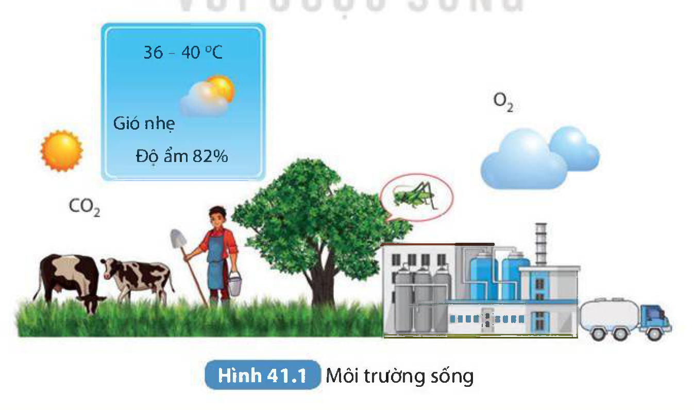
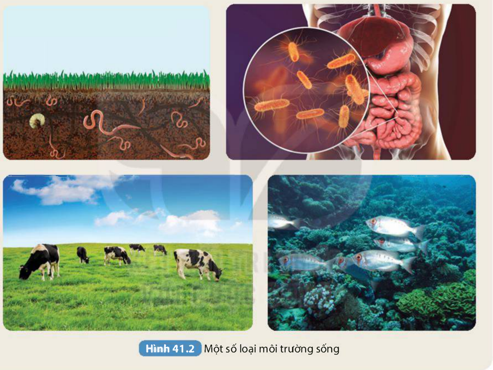
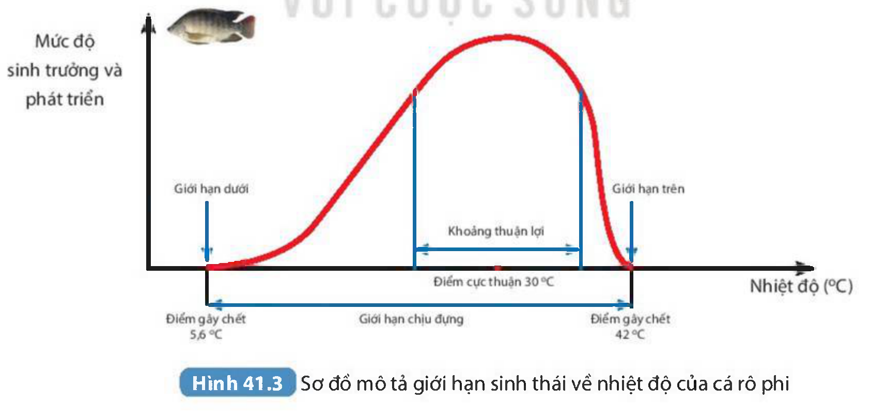
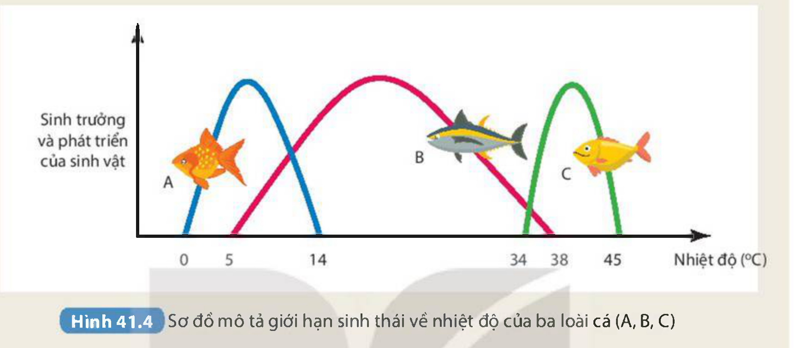

<!-- pdf:172 -->

# BÀI 41: MÔI TRƯỜNG VÀ CÁC NHÂN TỐ SINH THÁI

## 🎯 Mục tiêu

- Nêu được khái niệm môi trường sống của sinh vật; phân biệt được bốn loại môi trường sống chủ yếu và lấy được ví dụ minh hoạ.
- Nêu được khái niệm nhân tố sinh thái; phân biệt được nhân tố vô sinh và hữu sinh; lấy được ví dụ minh hoạ các nhân tố sinh thái và ảnh hưởng của nhân tố sinh thái lên đời sống sinh vật.
- Trình bày được khái niệm và lấy được ví dụ về giới hạn sinh thái.

## 🔴 Mở đầu

Một hồ nước, một rừng cây, thậm chí một thân cây cũng được coi là môi trường sống của sinh vật. Vậy, môi trường sống là gì? Có những loại môi trường sống nào? Những nhân tố nào tạo nên môi trường sống?

## I. Môi trường sống

### 1. Khái niệm môi trường sống

**Môi trường sống** là nơi sống của sinh vật, bao gồm các nhân tố xung quanh sinh vật, có ảnh hưởng trực tiếp hoặc gián tiếp đến sự tồn tại và phát triển của chúng.

Hình 41.1. Môi trường sống

> ✋ Quan sát Hình 41.1, em hãy kể tên các nhân tố trong môi trường sống của cây xanh.

<!-- pdf:173 -->

### 2. Các loại môi trường sống chủ yếu

<!-- term: Môi trường trên cạn -->
<!-- term: Môi trường nước -->
<!-- term: Môi trường trong đất -->
<!-- term: Môi trường sinh vật -->
Mỗi loài sinh vật có một môi trường sống đặc trưng. Môi trường sống chủ yếu của sinh vật gồm môi trường trên cạn, môi trường nước, môi trường trong đất và môi trường sinh vật.

<!-- term: Môi trường trên cạn -->
<!-- term: Môi trường nước -->
<!-- term: Môi trường trong đất -->
<!-- term: Môi trường sinh vật -->
Môi trường cạn bao gồm mặt đất và lớp khí quyển. Môi trường nước gồm những vùng nước ngọt, nước mặn, nước lợ. Môi trường trong đất gồm các lớp đất. Môi trường sinh vật là cơ thể của động vật, thực vật, con người,...

> ❓ Em hãy xác định các loại môi trường sống được thể hiện trong Hình 41.2.

Hình 41.2. Một số loại môi trường sống

## II. Nhân tố sinh thái

### 1. Khái niệm nhân tố sinh thái

Các nhân tố trong môi trường ảnh hưởng đến sự tồn tại và phát triển của sinh vật được gọi là các **nhân tố sinh thái**. Các nhân tố sinh thái được xếp vào hai nhóm: **nhân tố sinh thái vô sinh** – là các yếu tố không sống của môi trường và nhóm **nhân tố sinh thái hữu sinh** – là các yếu tố sống của môi trường (bao gồm con người và các sinh vật khác).

<!-- pdf:174 -->

### 2. Ảnh hưởng của các nhân tố sinh thái đến sinh vật

**a) Ảnh hưởng của các nhân tố vô sinh**

<!-- term: Cây ưa sáng -->
<!-- term: Cây ưa bóng -->
Ánh sáng, nhiệt độ,... là những nhân tố vô sinh có ảnh hưởng thường xuyên đến sinh vật. Thực vật thích nghi khác nhau trong các điều kiện chiếu sáng khác nhau, được chia thành hai nhóm chủ yếu là cây ưa sáng và cây ưa bóng. Ánh sáng tạo điều kiện cho động vật nhận biết các vật và định hướng di chuyển trong không gian. Nhiệt độ môi trường có ảnh hưởng tới hình thái, hoạt động sinh lí của sinh vật.

**b) Ảnh hưởng của các nhân tố hữu sinh**

Mỗi sinh vật sống trong môi trường đều trực tiếp hoặc gián tiếp ảnh hưởng tới các sinh vật sống xung quanh. Thông qua các mối quan hệ cùng loài hoặc khác loài, các sinh vật có thể hỗ trợ hoặc cạnh tranh lẫn nhau.

> ❓ 1. Phân loại các nhân tố trong môi trường sống của cây xanh ở Hình 41.1 vào nhóm nhân tố vô sinh và nhân tố hữu sinh.
>
> 2. Tại sao nói trong nhóm nhân tố hữu sinh thì con người là nhân tố có ảnh hưởng lớn nhất tới đời sống của nhiều loài sinh vật?

## III. Giới hạn sinh thái

**Giới hạn sinh thái** là khoảng giá trị của một nhân tố sinh thái mà trong khoảng đó, sinh vật có thể tồn tại và phát triển ổn định theo thời gian. Ví dụ: Cá rô phi ở Việt Nam không thể tồn tại ở nhiệt độ dưới $5,6\text{ }^\circ\text{C}$ và trên $42\text{ }^\circ\text{C}$, khoảng nhiệt từ $5,6\text{ }^\circ\text{C}$ đến $42\text{ }^\circ\text{C}$ được gọi là giới hạn sinh thái về nhiệt độ của cá rô phi (Hình 41.3).

Hình 41.3. Sơ đồ mô tả giới hạn sinh thái về nhiệt độ của cá rô phi

<!-- pdf:175 -->

> ✋ 1. Ở một địa phương, người ta có ý định nhập nội ba loài cá (A, B, C) về nuôi. Nhiệt độ trung bình trong năm tại đây dao động từ $15\text{ }^\circ\text{C}$ đến $30\text{ }^\circ\text{C}$. Dựa vào thông tin về giới hạn sinh thái nhân tố nhiệt độ của mỗi loài cá (Hình 41.4), hãy cho biết nên nhập loại cá nào để nuôi tại đây và giải thích.

Hình 41.4. Sơ đồ mô tả giới hạn sinh thái về nhiệt độ của ba loài cá (A, B, C)

> 2. Tại sao một số loài cây nếu được trồng dưới tán rừng thì cho năng suất cao hơn khi trồng ở nơi trống trải?

> 🔍 Phần lớn các nhân tố sinh thái (nhiệt độ, ánh sáng, chất dinh dưỡng,...) chỉ có tác động trực tiếp trong một đời cá thể. Tuy nhiên, có những nhân tố có thể có tác động kéo dài qua nhiều thế hệ. Ví dụ: Các loại vũ khí hạt nhân, chất độc màu da cam,... có thể khiến nhiều thế hệ con người, sinh vật bị dị dạng, dị tật bẩm sinh.

## 📌 Em đã học

- Môi trường sống của sinh vật bao gồm các nhân tố xung quanh sinh vật, có ảnh hưởng trực tiếp hoặc gián tiếp đến sự tồn tại và phát triển của chúng.
- Các nhân tố trong môi trường ảnh hưởng đến sự tồn tại và phát triển của sinh vật được gọi là các nhân tố sinh thái.
- Giới hạn sinh thái là khoảng giá trị của một nhân tố sinh thái mà trong khoảng đó, sinh vật có thể tồn tại và phát triển.

## ✏️ Em có thể

- Trên cơ sở kiến thức về môi trường sống, có thể tự bảo vệ, chăm sóc sức khoẻ bản thân và chăm sóc tốt vật nuôi, cây trồng.
- Vận dụng kiến thức về giới hạn sinh thái vào việc chăm sóc và đánh giá khả năng nhập nội vật nuôi, cây trồng.

## 📷 Danh sách hình trong bài

| Mã hình | Trang PDF | Trang sách | Chú thích |
|---|---|---|---|
| H8-khoa_hoc_tu_nhien-b41-01 | 172 | 170 | Hình 41.1. Môi trường sống |
| H8-khoa_hoc_tu_nhien-b41-02 | 173 | 171 | Hình 41.2. Một số loại môi trường sống |
| H8-khoa_hoc_tu_nhien-b41-03 | 174 | 172 | Hình 41.3. Sơ đồ mô tả giới hạn sinh thái về nhiệt độ của cá rô phi |
| H8-khoa_hoc_tu_nhien-b41-04 | 175 | 173 | Hình 41.4. Sơ đồ mô tả giới hạn sinh thái về nhiệt độ của ba loài cá (A, B, C) |
