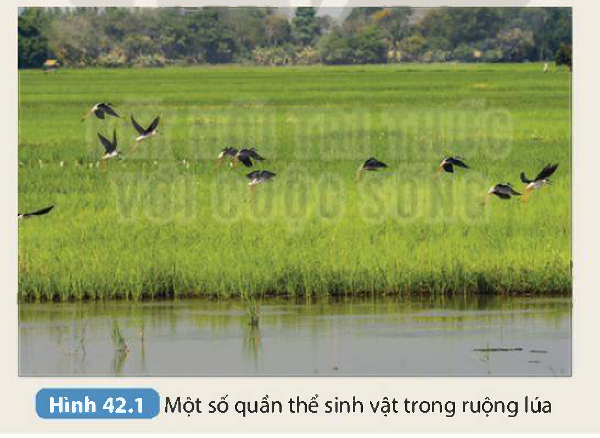
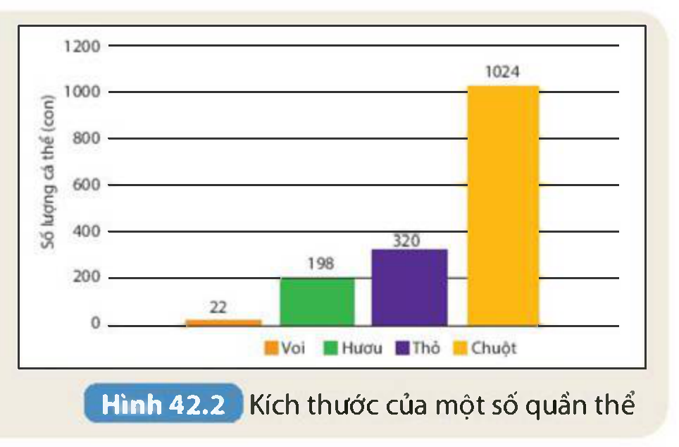
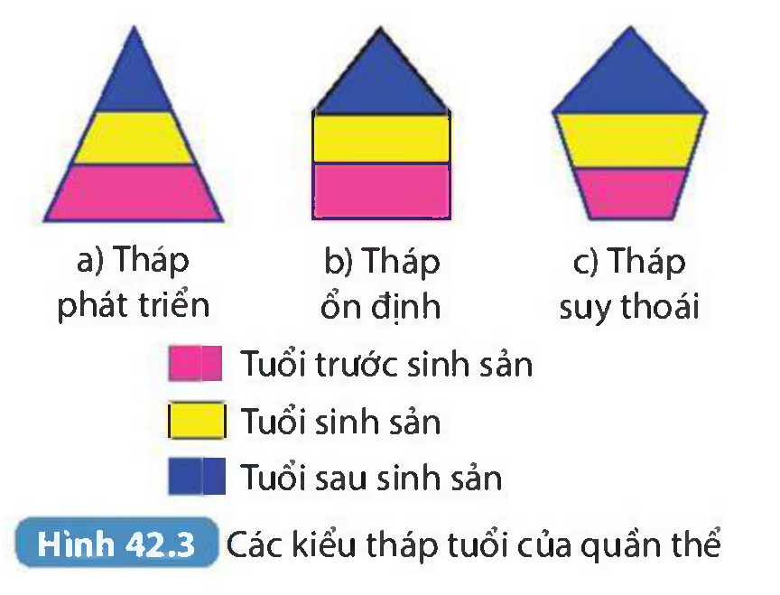
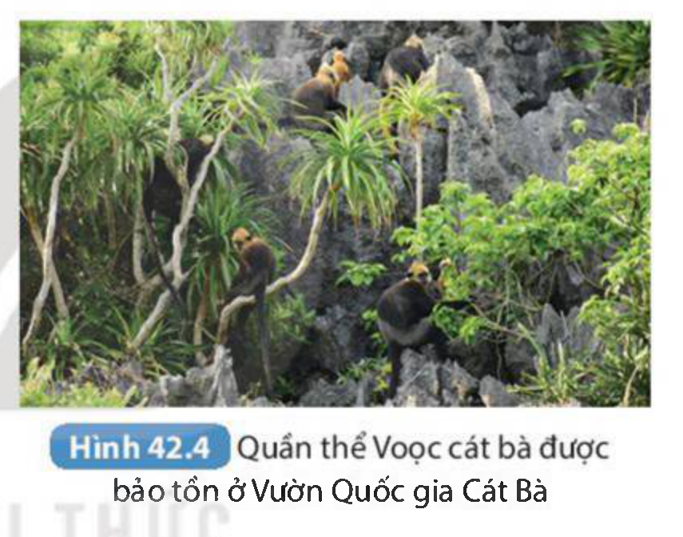

<!-- pdf:176 -->

# BÀI 42: QUẦN THỂ SINH VẬT

## 🎯 Mục tiêu

- Phát biểu được khái niệm quần thể sinh vật.
- Nêu được các đặc trưng cơ bản của quần thể sinh vật và lấy được ví dụ minh hoạ.
- Nêu được một số biện pháp bảo vệ quần thể.

## 🔴 Mở đầu

Trong thế giới sống, quần thể sinh vật là cấp độ tổ chức thấp nhất trong các cấp độ tổ chức trên cơ thể. Quần thể sinh vật là gì? Quần thể có những đặc trưng cơ bản nào?

## I. Khái niệm quần thể sinh vật

**Quần thể sinh vật** là tập hợp các cá thể cùng loài, sinh sống trong một khoảng không gian xác định, ở một thời điểm nhất định và có khả năng sinh sản để tạo thành những thế hệ mới.

> ✋ 1. Quan sát Hình 42.1, cho biết trong ruộng lúa này có thể có những quần thể sinh vật nào?
>
> 2. Lấy một ví dụ về quần thể sinh vật trong tự nhiên và một quần thể vật nuôi hoặc cây trồng.

Hình 42.1. Một số quần thể sinh vật trong ruộng lúa

## II. Các đặc trưng cơ bản của quần thể

Mỗi quần thể có những đặc trưng cơ bản, đó là dấu hiệu để phân biệt quần thể này với quần thể khác. Các đặc trưng cơ bản của quần thể gồm kích thước quần thể, mật độ cá thể trong quần thể, tỉ lệ giới tính, thành phần nhóm tuổi và kiểu phân bố các cá thể trong quần thể.

### 1. Kích thước quần thể

**Kích thước của quần thể** là số lượng các cá thể phân bố trong khoảng không gian của quần thể.

<!-- pdf:177 -->

> ❓ Hình 42.2 biểu thị kích thước của bốn quần thể cùng sống trong một khu rừng. Em hãy quan sát hình, so sánh và rút ra nhận xét về tương quan giữa kích thước cơ thể và kích thước quần thể voi, hươu, thỏ, chuột.

Hình 42.2. Kích thước của một số quần thể

> 🔍 Đối với quần thể vi sinh vật, do số lượng cá thể trong quần thể rất lớn nên kích thước của quần thể không được xác định bằng số lượng cá thể mà xác định bằng sinh khối (miligam, gam,...) của quần thể.

### 2. Mật độ cá thể trong quần thể

**Mật độ cá thể của quần thể** là số lượng cá thể trên một đơn vị diện tích hay thể tích của quần thể.

> ❓ Dựa vào thông tin trong Bảng 42.1, hãy xác định mật độ cá thể của mỗi quần thể được nhắc đến.
>
> Bảng 42.1. Số lượng cá thể và không gian phân bố của một số quần thể
>
> | Quần thể | Số lượng cá thể | Không gian phân bố |
> |---|---|---|
> | Lim xanh | 11 250 | 15 ha |
> | Bắp cải | 3 000 | 750 $\text{m}^2$ |
> | Cá chép | 120 000 | 60 000 $\text{m}^3$ |

### 3. Tỉ lệ giới tính

**Tỉ lệ giới tính** là tỉ lệ giữa số lượng cá thể đực và số lượng cá thể cái trong quần thể. Trong quá trình sống, tỉ lệ giới tính có thể thay đổi theo thời gian, điều kiện sống,... Tỉ lệ giới tính là đặc trưng quan trọng đảm bảo hiệu quả sinh sản của quần thể.

### 4. Nhóm tuổi

<!-- term: Nhóm tuổi -->
<!-- term: Tháp tuổi -->
Quần thể có nhiều nhóm tuổi, mỗi nhóm tuổi có ý nghĩa sinh thái khác nhau. Cấu trúc nhóm tuổi của quần thể được biểu thị bằng các kiểu tháp tuổi (Hình 42.3).

Hình 42.3. Các kiểu tháp tuổi của quần thể

> ❓ Quan sát Hình 42.3, hãy nhận xét mối tương quan về số lượng cá thể của nhóm tuổi trước sinh sản và nhóm tuổi sinh sản trong mỗi kiểu tháp tuổi.

<!-- pdf:178 -->

### 5. Phân bố cá thể trong quần thể

<!-- term: Kiểu phân bố cá thể trong quần thể -->
<!-- term: Phân bố đều -->
<!-- term: Phân bố theo nhóm -->
<!-- term: Phân bố ngẫu nhiên -->
Mỗi quần thể có cách phân bố cá thể khác nhau. Có ba kiểu phân bố gồm phân bố đều, phân bố theo nhóm và phân bố ngẫu nhiên.

Bảng 42.2. Các kiểu phân bố cá thể trong quần thể

<!-- term: Kiểu phân bố cá thể trong quần thể -->
<!-- term: Phân bố đều -->
<!-- term: Phân bố theo nhóm -->
<!-- term: Phân bố ngẫu nhiên -->
| Kiểu phân bố | Sơ đồ | Nguyên nhân |
|---|---|---|
| Đều | | Điều kiện sống phân bố đều, các cá thể có sự cạnh tranh gay gắt |
| Theo nhóm | | Điều kiện sống phân bố không đều, các cá thể có tập tính sống theo nhóm |
| Ngẫu nhiên | | Điều kiện sống phân bố tương đối đồng đều, các cá thê không có sự cạnh tranh gay gắt |

## III. Biện pháp bảo vệ quần thể

Các quần thể sinh vật có thể bị biến động do tác động của các nhân tố vô sinh và hữu sinh, các tác động này có thể thay đổi theo chu kì hoặc không theo chu kì. Bảo vệ môi trường sống của quần thể bằng cách thành lập vườn quốc gia (Hình 42.4) và khu bảo tồn, kiểm soát dịch bệnh, khai thác tài nguyên sinh vật hợp lí,... là những biện pháp quan trọng để quần thể được phát triển ổn định. Đối với những quần thể có nguy cơ tuyệt chủng ở môi trường sống tự nhiên của chúng, cần di chuyển quần thể đến nơi sống mới như vườn thú, trang trại bảo tồn,...

Hình 42.4. Quần thể Voọc cát bà được bảo tồn ở Vườn Quốc gia Cát Bà

> ❓ 1. Tại sao bảo vệ môi trường sống của quần thể chính là bảo vệ quần thể? Cho ví dụ về việc bảo vệ môi trường sống của quần thể.
>
> 2. Em hãy đề xuất biện pháp bảo vệ đối với các quần thể có nguy cơ tuyệt chủng.

## 📌 Em đã học

- Quần thể sinh vật là tập hợp các cá thể cùng loài, sinh sống trong một khoảng không gian xác định, ở một thời điểm nhất định và có khả năng sinh sản để tạo thành những thế hệ mới.
- Kích thước quần thể, mật độ cá thể, tỉ lệ giới tính, nhóm tuổi, phân bố các cá thể là các dấu hiệu đặc trưng để phân biệt quần thể này với quần thể khác.
- Bảo vệ môi trường sống của quần thể, kiểm soát dịch bệnh, khai thác tài nguyên hợp lí,... là những biện pháp quan trọng để quần thể sinh vật được phát triển ổn định.

## ✏️ Em có thể

Vận dụng kiến thức về các đặc trưng của quần thể để áp dụng trong thực tiễn: sản xuất nông nghiệp, bảo vệ tài nguyên sinh vật,...

## 📷 Danh sách hình trong bài

| Mã hình | Trang PDF | Trang sách | Chú thích |
|---|---|---|---|
| H8-khoa_hoc_tu_nhien-b42-01 | 176 | 174 | Hình 42.1. Một số quần thể sinh vật trong ruộng lúa |
| H8-khoa_hoc_tu_nhien-b42-02 | 177 | 175 | Hình 42.2. Kích thước của một số quần thể |
| H8-khoa_hoc_tu_nhien-b42-03 | 177 | 175 | Hình 42.3. Các kiểu tháp tuổi của quần thể |
| H8-khoa_hoc_tu_nhien-b42-04 | 178 | 176 | Hình 42.4. Quần thể Voọc cát bà được bảo tồn ở Vườn Quốc gia Cát Bà |
