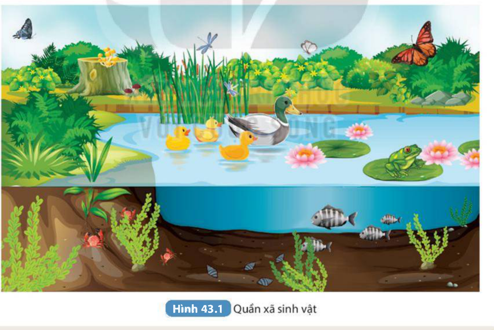
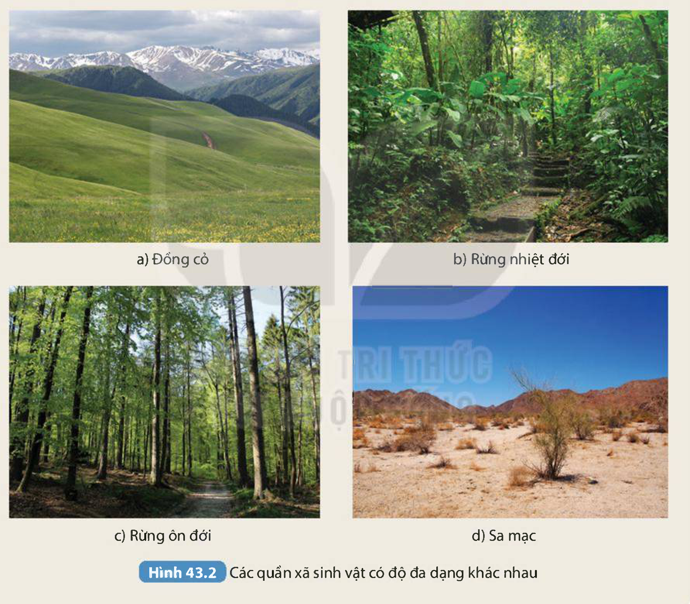

<!-- pdf:179 -->

# BÀI 43: QUẦN XÃ SINH VẬT

## 🎯 Mục tiêu

- Phát biểu được khái niệm quần xã sinh vật.
- Nêu được một số đặc trưng cơ bản của quần xã. Lấy được ví dụ minh hoạ.
- Nêu được một số biện pháp bảo vệ đa dạng sinh học trong quần xã.

## 🔴 Mở đầu

Trong một khoảng không gian xác định luôn có nhiều quần thể cùng tồn tại tạo nên một cấp độ tổ chức sống cao hơn, đó là quần xã sinh vật. Quần xã sinh vật là gì và có những đặc trưng cơ bản nào?

## I. Khái niệm quần xã sinh vật

**Quần xã sinh vật** là một tập hợp các quần thể sinh vật thuộc nhiều loài khác nhau, cùng sống trong một không gian và thời gian nhất định. Các sinh vật trong quần xã có mối quan hệ gắn bó với nhau như một thể thống nhất, do đó quần xã có cấu trúc tương đối ổn định.

Hình 43.1. Quần xã sinh vật

> ❓ 1. Kể tên một số quần thể có trong Hình 43.1.
>
> 2. Lấy thêm ví dụ về quần xã sinh vật và chỉ ra các thành phần quần thể trong quần xã đó.

<!-- pdf:180 -->

## II. Một số đặc trưng cơ bản của quần xã

Mỗi quần xã có những đặc trưng cơ bản, là dấu hiệu để phân biệt quần xã này với quần xã khác. Một số đặc trưng cơ bản của quần xã như độ đa dạng và thành phần loài trong quần xã.

<!-- term: Độ đa dạng của quần xã -->
Độ đa dạng của quần xã được thể hiện bằng mức độ phong phú về số lượng loài và số lượng cá thể của mỗi loài trong quần xã. Quần xã nào có số lượng loài và số lượng cá thể của mỗi loài càng lớn thì quần xã đó có độ đa dạng càng cao.

> ❓ Hãy sắp xếp các quần xã trong Hình 43.2 theo thứ tự giảm dần về độ đa dạng. Tại sao lại có sự khác biệt lớn về độ đa dạng giữa các quần xã này?

- *a) Đồng cỏ*
- *b) Rừng nhiệt đới*
- *c) Rừng ôn đới*
- *d) Sa mạc*
<!-- ocr-ok: đã đối chiếu p180.png, OCR bỏ sót nhãn hình a) Đồng cỏ và b) Rừng nhiệt đới trong Hình 43.2 -->

Hình 43.2. Các quần xã sinh vật có độ đa dạng khác nhau

**Loài ưu thế** là loài có số lượng cá thể nhiều, hoạt động mạnh, đóng vai trò quan trọng trong quần xã. Ví dụ: Lúa là loài ưu thế trong quần xã ruộng lúa.

**Loài đặc trưng** là loài chỉ có ở một quần xã hoặc có nhiều hơn hẳn các loài khác trong quần xã. Ví dụ: Cá cóc là loài đặc trưng của Vườn Quốc gia Tam Đảo.

<!-- pdf:181 -->

> ❓ 1. Lấy ví dụ về loài ưu thế trong quần xã.
>
> 2. Cho các loài sinh vật gồm lim xanh, gấu trắng, hổ, lạc đà, lúa nước, đước.
> Em hãy xác định loài đặc trưng tương ứng với các quần xã sinh vật: bắc cực, sa mạc, rừng ngập mặn.

## III. Bảo vệ đa dạng sinh học trong quần xã

Do nhiều nguyên nhân khác nhau, đa dạng sinh học ở Việt Nam và nhiều quốc gia trên thế giới đang bị suy giảm. Vì vậy, bảo vệ đa dạng sinh học trong quần xã là vấn đề cần được quan tâm.

Có nhiều biện pháp bảo vệ đa dạng sinh học trong quần xã như tuyên truyền về giá trị của đa dạng sinh học; xây dựng luật và chiến lược quốc gia về bảo tồn đa dạng sinh học; thành lập các vườn quốc gia, khu bảo tồn thiên nhiên; tăng cường công tác bảo vệ nguồn tài nguyên sinh vật; nghiêm cấm săn bắt, mua bán trái pháp luật những loài sinh vật có nguy cơ tuyệt chủng;...

> ✋ Đọc thông tin và thảo luận nhóm về hiệu quả của các biện pháp dưới đây trong việc bảo vệ đa dạng sinh học trong quần xã.
>
> 1. Bảo vệ môi trường sống của các loài trong quần xã.
> 2. Cấm săn bắn động vật hoang dã có nguy cơ tuyệt chủng.
> 3. Trồng rừng ngập mặn ven biển.
> 4. Phòng chống cháy rừng.

> 🔍 Sao la (*Pseudoryx nghetinhensis*) là một trong những loài thú quý, hiếm trên thế giới, chúng sinh sống ở vùng núi rừng hẻo lánh ở dãy Trường Sơn tại Việt Nam và Lào. Sao la có nguy cơ tuyệt chủng trong tự nhiên rất cao, được xếp hạng ở mức cực kì nguy cấp trong Danh lục Đỏ IUCN và Sách Đỏ Việt Nam. Năm 2022, Sao la đã được lựa chọn làm linh vật của SEA Games 31 tổ chức tại Việt Nam.

## 📌 Em đã học

- Quần xã sinh vật là một tập hợp các quần thể sinh vật thuộc nhiều loài khác nhau, cùng sống trong một không gian và thời gian nhất định.
- Quần xã có đặc trưng về độ đa dạng và thành phần loài.
- Để bảo vệ đa dạng trong quần xã, cần thực hiện đồng bộ nhiều biện pháp.

## ✏️ Em có thể

Tuyên truyền trong cộng đồng các biện pháp bảo vệ đa dạng sinh học.

## 📷 Danh sách hình trong bài

| Mã hình | Trang PDF | Trang sách | Chú thích |
|---|---|---|---|
| H8-khoa_hoc_tu_nhien-b43-01 | 179 | 177 | Hình 43.1. Quần xã sinh vật |
| H8-khoa_hoc_tu_nhien-b43-02 | 180 | 178 | Hình 43.2. Các quần xã sinh vật có độ đa dạng khác nhau |
