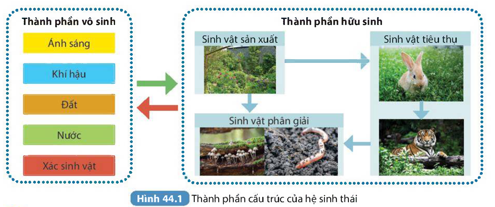
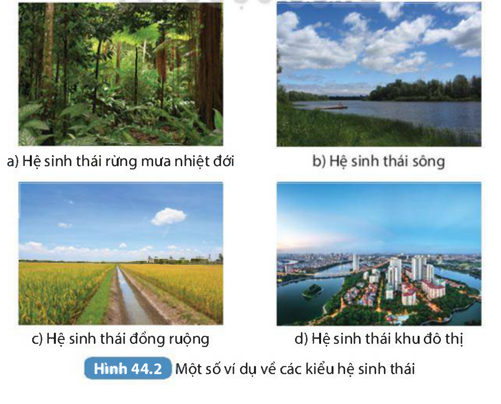
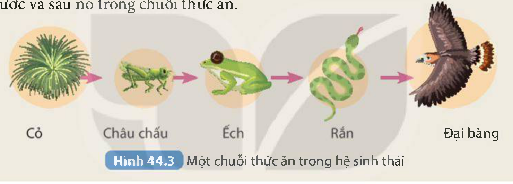
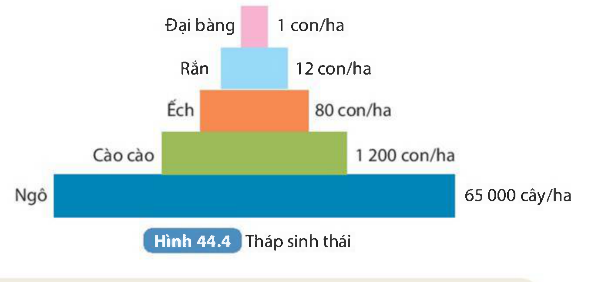
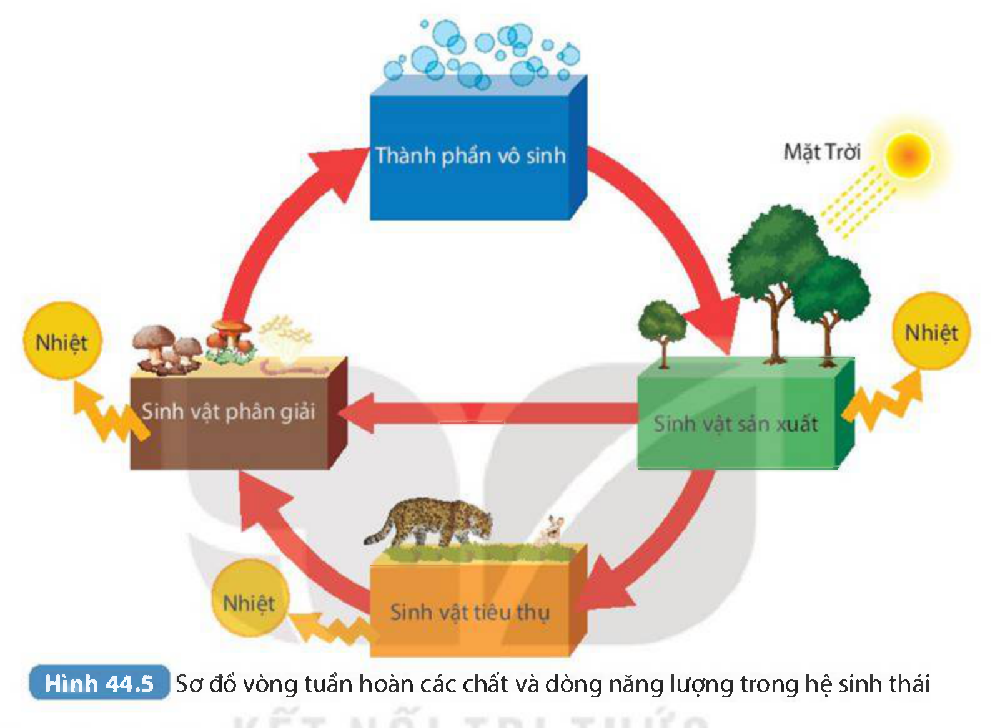

<!-- pdf:182 -->

# BÀI 44: HỆ SINH THÁI

## 🎯 Mục tiêu

- Phát biểu được khái niệm hệ sinh thái. Lấy được ví dụ về các kiểu hệ sinh thái.
- Nêu được khái niệm chuỗi, lưới thức ăn; sinh vật sản xuất, sinh vật tiêu thụ, sinh vật phân giải, tháp sinh thái. Lấy được ví dụ chuỗi thức ăn, lưới thức ăn trong quần xã.
- Trình bày được khái quát quá trình trao đổi chất và chuyển hoá năng lượng trong hệ sinh thái.
- Nêu được tầm quan trọng của việc bảo vệ một số hệ sinh thái điển hình tại Việt Nam.
- Thực hành: Điều tra thành phần quần xã sinh vật trong một hệ sinh thái.

## 🔴 Mở đầu

Một khu rừng hay bể cá cảnh trong hình bên đều được xem là một hệ sinh thái. Vậy, hệ sinh thái là gì?

## I. Hệ sinh thái

### 1. Khái niệm hệ sinh thái

**Hệ sinh thái** là một hệ thống bao gồm quần xã sinh vật và môi trường sống của chúng. Các loài sinh vật trong quần xã luôn tác động lẫn nhau, đồng thời tác động qua lại với các nhân tố vô sinh của môi trường mà chúng sống trong đó. Bất kì một sự tương tác nào giữa sinh vật với các yếu tố sinh thái của môi trường để tạo thành một chu trình sinh học, dù ở mức độ đơn giản nhất cũng được xem là một hệ sinh thái.

> ❓ Em hãy lấy ví dụ về hệ sinh thái.

### 2. Thành phần cấu trúc của hệ sinh thái

<!-- term: Thành phần vô sinh -->
<!-- term: Thành phần hữu sinh -->
Cấu trúc của một hệ sinh thái gồm thành phần vô sinh và thành phần hữu sinh (Hình 44.1). Thành phần vô sinh bao gồm các nhân tố vô sinh, thành phần hữu sinh bao gồm nhiều loài sinh vật trong quần xã, được chia thành ba nhóm:

- **Sinh vật sản xuất**: là các sinh vật có khả năng sử dụng quang năng để tổng hợp nên chất hữu cơ. Ví dụ: các loài thực vật, tảo,...

- **Sinh vật tiêu thụ**: là những sinh vật không có khả năng tự tổng hợp chất hữu cơ, chúng lấy chất hữu cơ từ thức ăn. Ví dụ: động vật ăn thực vật, động vật ăn động vật, động vật ăn tạp,...

- **Sinh vật phân giải**: là những sinh vật có chức năng phân giải xác và chất thải của sinh vật thành chất vô cơ. Ví dụ: nấm, hầu hết vi khuẩn,...

<!-- pdf:183 -->

Hình 44.1. Thành phần cấu trúc của hệ sinh thái

> ✋ 1. Đọc thông tin trên và quan sát Hình 44.1, phân tích thành phần của một hệ sinh thái.
>
> 2. Em hãy lấy ví dụ các loài sinh vật thuộc nhóm sinh vật sản xuất, sinh vật tiêu thụ và sinh vật phân giải trong một hệ sinh thái.

### 3. Các kiểu hệ sinh thái

<!-- term: Hệ sinh thái tự nhiên -->
<!-- term: Hệ sinh thái nhân tạo -->
Trên Trái Đất có rất nhiều hệ sinh thái, có thể phân chia thành hai nhóm: hệ sinh thái tự nhiên và hệ sinh thái nhân tạo.

<!-- term: Hệ sinh thái tự nhiên -->
Các hệ sinh thái tự nhiên bao gồm hệ sinh thái trên cạn và hệ sinh thái dưới nước. Hệ sinh thái trên cạn như hệ sinh thái rừng mưa nhiệt đới, hệ sinh thái sa mạc,... Hệ sinh thái dưới nước được chia thành hệ sinh thái nước ngọt và hệ sinh thái nước mặn. Hệ sinh thái nước ngọt như hệ sinh thái hồ, hệ sinh thái sông,... Hệ sinh thái nước mặn điển hình là hệ sinh thái biển khơi.

<!-- term: Hệ sinh thái nhân tạo -->
Các hệ sinh thái nhân tạo được hình thành nhờ hoạt động của con người. Một số hệ sinh thái nhân tạo như hệ sinh thái đồng ruộng, hệ sinh thái rừng trồng, hệ sinh thái khu dân cư, hệ sinh thái khu đô thị, hệ sinh thái ao nuôi cá,...

- *a) Hệ sinh thái rừng mưa nhiệt đới*
- *b) Hệ sinh thái sông*
- *c) Hệ sinh thái đồng ruộng*
- *d) Hệ sinh thái khu đô thị*

Hình 44.2. Một số ví dụ về các kiểu hệ sinh thái

<!-- pdf:184 -->

> ❓ Cho các hệ sinh thái sau: hệ sinh thái đồng cỏ, hệ sinh thái suối, hệ sinh thái rừng lá rộng ôn đới, hệ sinh thái rừng ngập mặn, hệ sinh thái ruộng bậc thang, hệ sinh thái rạn san hô. Em hãy xếp các hệ sinh thái trên vào kiểu hệ sinh thái phù hợp.

## II. Trao đổi chất và chuyển hoá năng lượng trong hệ sinh thái

Trao đổi chất trong hệ sinh thái được thực hiện trong phạm vi quần xã sinh vật và giữa quần xã sinh vật với môi trường sống.

### 1. Trao đổi chất trong quần xã sinh vật

Trao đổi chất trong quần xã sinh vật được thực hiện qua chuỗi và lưới thức ăn.

**a) Chuỗi thức ăn**

**Chuỗi thức ăn** gồm nhiều loài có quan hệ dinh dưỡng với nhau.

> ❓ Quan sát Hình 44.3, phân tích mối quan hệ dinh dưỡng giữa châu chấu và các sinh vật đứng trước và sau nó trong chuỗi thức ăn.

Hình 44.3. Một chuỗi thức ăn trong hệ sinh thái

**b) Lưới thức ăn**

Trong quần xã sinh vật, một loài không chỉ tham gia vào một chuỗi thức ăn mà có thể tham gia vào nhiều chuỗi thức ăn khác nhau, loài đó là mắt xích chung giữa các chuỗi thức ăn. Tập hợp các chuỗi thức ăn có nhiều mắt xích chung tạo thành **lưới thức ăn**.

> ❓ Lấy ví dụ và vẽ sơ đồ về lưới thức ăn.

**c) Tháp sinh thái**

Để đánh giá mức độ dinh dưỡng trong chuỗi và lưới thức ăn của quần xã sinh vật, người ta đã xây dựng tháp sinh thái. Có ba loại tháp sinh thái là tháp số lượng, tháp sinh khối, tháp năng lượng.

Hình 44.4. Tháp sinh thái

> ❓ Quan sát Hình 44.4, cho biết đây là loại tháp sinh thái nào?

<!-- pdf:185 -->

### 2. Trao đổi chất và chuyển hoá năng lượng trong hệ sinh thái

Trong hệ sinh thái, các chất vô cơ từ môi trường ngoài truyền vào cơ thể sinh vật, qua các mắt xích của chuỗi và lưới thức ăn rồi trả lại môi trường. Nguồn năng lượng trong hệ sinh thái phần lớn được lấy từ năng lượng ánh sáng mặt trời. Năng lượng từ ánh sáng mặt trời được truyền vào quần xã ở mắt xích đầu tiên là sinh vật sản xuất, sau đó truyền theo một chiều qua các bậc dinh dưỡng. Trong quá trình đó, năng lượng giảm dần do sinh vật sử dụng và trả lại môi trường dưới dạng nhiệt (Hình 44.5).

Hình 44.5. Sơ đồ vòng tuần hoàn các chất và dòng năng lượng trong hệ sinh thái

## III. Bảo vệ các hệ sinh thái

Bảo vệ các hệ sinh thái chính là bảo vệ cuộc sống của con người. Toàn bộ các hệ sinh thái luôn cần được bảo vệ, đặc biệt cần chú trọng bảo vệ hệ sinh thái rừng, hệ sinh thái biển và ven biển cũng như hệ sinh thái nông nghiệp.

Rừng là môi trường sống của rất nhiều loài sinh vật. Bảo vệ hệ sinh thái rừng góp phần bảo vệ các loài sinh vật, điều hoà không khí,... từ đó hạn chế sự biến đổi khí hậu và thiên tai. Chiến lược bảo vệ hệ sinh thái rừng tập trung vào các vấn đề chính là ngăn chặn nạn phá rừng, khai thác tài nguyên rừng hợp lí,...

Hệ sinh thái biển và ven biển có vai trò quan trọng đối với tự nhiên và con người. Biển tham gia điều hoà khí hậu, là nơi sống của nhiều loài sinh vật; đối với con người, biển cung cấp nhiều sản phẩm có giá trị,... Do đó, cần thực hiện các biện pháp bảo vệ hệ sinh thái biển và ven biển như quản lí chất thải và kiểm soát ô nhiễm môi trường biển, khai thác tài nguyên hợp lí,...

Hệ sinh thái nông nghiệp có vai trò hết sức quan trọng đối với con người. Sản xuất nông nghiệp tạo ra lương thực, thực phẩm nuôi sống con người và cung cấp nguyên liệu cho công nghiệp. Để bảo vệ hệ sinh thái nông nghiệp, cần tập trung bảo vệ tài nguyên đất, chống xói mòn, khô hạn, chống mặn cho đất,...

<!-- pdf:186 -->

## IV. Thực hành: Điều tra thành phần quần xã sinh vật trong hệ sinh thái

### 1. Mục tiêu

Điều tra được thành phần quần xã sinh vật trong hệ sinh thái.

### 2. Chuẩn bị

**a) Địa điểm điều tra**

Địa điểm điều tra có thể là hệ sinh thái rừng, hệ sinh thái ao, hệ sinh thái đồng ruộng hay hệ sinh thái đồng cỏ,...

Lưu ý: Việc lựa chọn địa điểm điều tra tuỳ theo điều kiện ở các trường, điều kiện thời tiết,...

**b) Dụng cụ, thiết bị**

Sổ ghi chép, bút viết, kính lúp, ống nhòm.

### 3. Cách tiến hành

Bước 1: Xác định hệ sinh thái tiến hành điều tra thuộc kiểu hệ sinh thái nào.

Bước 2: Quan sát, ghi chép các thành phần vô sinh của hệ sinh thái.

Bước 3: Quan sát, ghi chép thành phần hữu sinh của hệ sinh thái (quần xã sinh vật).

### 4. Kết quả

Từ kết quả điều tra, hoàn thành bảng ghi thành phần quần xã sinh vật của hệ sinh thái theo mẫu Bảng 44.1.

Bảng 44.1. Thành phần quần xã của hệ sinh thái

| Nhóm sinh vật | Sinh vật trong quần xã |
|---|---|
| Sinh vật sản xuất | ? |
| Sinh vật tiêu thụ | ? |
| Sinh vật phân giải | ? |

> Trả lời câu hỏi sau:
>
> Phân tích mối quan hệ giữa các sinh vật quan sát được trong hệ sinh thái.

## 📌 Em đã học

- Hệ sinh thái là một hệ thống bao gồm quần xã sinh vật và môi trường sống của chúng.
- Các hệ sinh thái được chia thành hai nhóm: hệ sinh thái tự nhiên và hệ sinh thái nhân tạo.
- Chuỗi thức ăn và lưới thức ăn thể hiện mối quan hệ dinh dưỡng giữa các loài sinh vật trong quần xã.
- Trao đổi chất và chuyển hoá năng lượng trong hệ sinh thái được thực hiện trong phạm vi quần xã sinh vật và giữa quần xã với môi trường sống.
- Các hệ sinh thái trong tự nhiên giúp bảo vệ tài nguyên đất, nước và sinh vật. Bảo vệ sự bền vững của các hệ sinh thái chính là bảo vệ cuộc sống của con người.

## ✏️ Em có thể

Tuyên truyền cho mọi người các hành động nhằm bảo vệ hệ sinh thái.

## 📷 Danh sách hình trong bài

| Mã hình | Trang PDF | Trang sách | Chú thích |
|---|---|---|---|
| H8-khoa_hoc_tu_nhien-b44-01 | 183 | 181 | Hình 44.1. Thành phần cấu trúc của hệ sinh thái |
| H8-khoa_hoc_tu_nhien-b44-02 | 183 | 181 | Hình 44.2. Một số ví dụ về các kiểu hệ sinh thái |
| H8-khoa_hoc_tu_nhien-b44-03 | 184 | 182 | Hình 44.3. Một chuỗi thức ăn trong hệ sinh thái |
| H8-khoa_hoc_tu_nhien-b44-04 | 184 | 182 | Hình 44.4. Tháp sinh thái |
| H8-khoa_hoc_tu_nhien-b44-05 | 185 | 183 | Hình 44.5. Sơ đồ vòng tuần hoàn các chất và dòng năng lượng trong hệ sinh thái |
