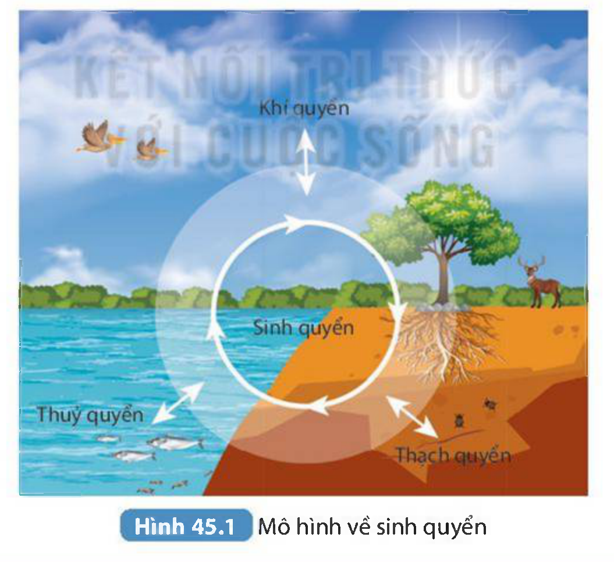
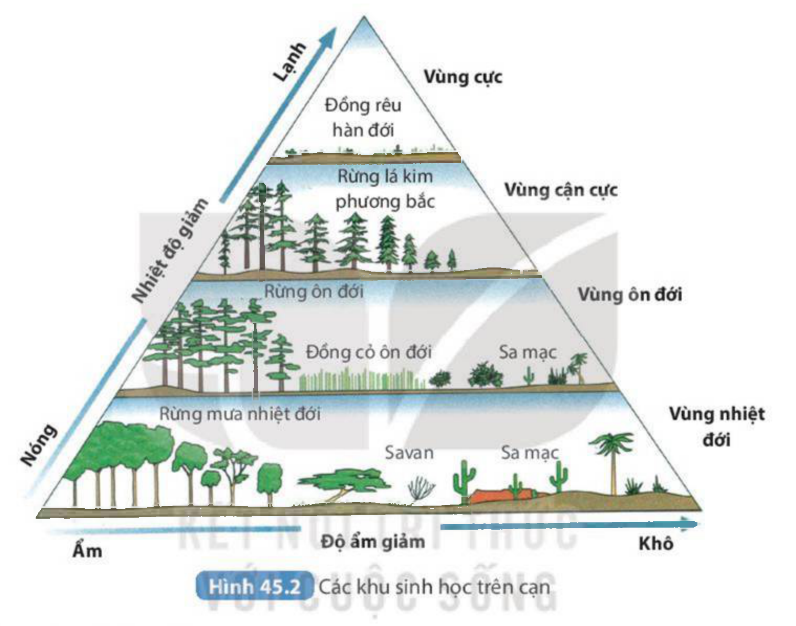
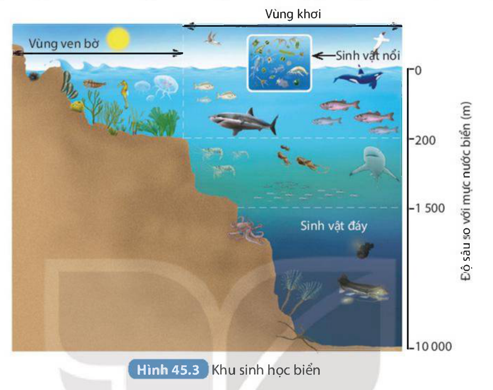

<!-- pdf:187 -->

# BÀI 45: SINH QUYỂN

## 🎯 Mục tiêu

- Nêu được khái niệm sinh quyển.
- Nhận biết được các khu sinh học trên Trái Đất.

## 🔴 Mở đầu

Trái Đất là ngôi nhà chung của hàng triệu loài sinh vật. Cho đến nay, Trái Đất là nơi duy nhất trong vũ trụ được biết đến là có sự sống. Các loài sinh vật sinh sống ở đâu trên Trái Đất?

## I. Khái niệm sinh quyển

**Sinh quyển** là toàn bộ sinh vật sống trên Trái Đất cùng với các nhân tố vô sinh của môi trường.

Sinh quyển là một hệ sinh thái khổng lồ, bao gồm lớp đất (thuộc thạch quyển), lớp không khí (thuộc khí quyển) và lớp nước đại dương (thuộc thuỷ quyển) (Hình 45.1).

Trong sinh quyển, sinh vật và những nhân tố vô sinh liên quan chặt chẽ với nhau thông qua các quá trình trao đổi chất và chuyển hoá năng lượng, hình thành nên hệ thống tự nhiên trên phạm vi toàn cầu. Sinh quyển cung cấp các nhân tố vô sinh cần thiết cho sự tồn tại của sinh vật, các sinh vật muốn tồn tại cần phải thích nghi với điều kiện môi trường của sinh quyển.

Hình 45.1. Mô hình về sinh quyển

> ❓ Nêu khái niệm và các thành phần cấu tạo chính của sinh quyển.

<!-- pdf:188 -->

## II. Các khu sinh học chủ yếu

Trên Trái Đất, ở các vùng địa lí khác nhau, điều kiện khí hậu không đồng nhất đã hình thành các hệ sinh thái đặc trưng cho vùng gọi là **khu sinh học**. Các khu sinh học được chia thành khu sinh học trên cạn, khu sinh học nước ngọt và khu sinh học biển.

### 1. Khu sinh học trên cạn

<!-- term: Khu sinh học trên cạn -->
Trên cạn, những đặc tính khí hậu của mỗi vùng địa lí đã xác định các khu sinh học khác nhau, tại đó có những sinh vật đặc trưng thích nghi với điều kiện của khu vực.

<!-- term: Khu sinh học trên cạn -->
Từ vùng cực đến vùng nhiệt đới có các khu sinh học: đồng rêu hàn đới, rừng lá kim phương bắc, rừng ôn đới, rừng mưa nhiệt đới.

Hình 45.2. Các khu sinh học trên cạn

### 2. Khu sinh học nước ngọt

<!-- term: Khu sinh học nước ngọt -->
Khu sinh học nước ngọt được chia thành hai nhóm chính là khu vực nước đứng và khu vực nước chảy. Khu vực nước đứng là các ao, hồ, đầm,... Khu vực nước chảy là các sông, suối,...

> ❓ Quan sát Hình 45.2, cho biết việc hình thành các khu sinh học trên cạn khác nhau do những yếu tố nào quyết định.

### 3. Khu sinh học biển

<!-- term: Khu sinh học biển -->
Ở các khu sinh học biển, sinh vật có sự khác nhau theo chiều thẳng đứng (chiều sâu) và chiều ngang.

<!-- pdf:189 -->

<!-- term: Khu sinh học biển -->
Sinh vật có sự phân tầng rõ rệt theo chiều sâu. Tầng nước mặt là nơi sống của nhiều sinh vật nổi, tầng giữa có nhiều sinh vật tự bơi, tầng dưới cùng có nhiều động vật đáy sinh sống.

<!-- term: Khu sinh học biển -->
Theo chiều ngang, khu sinh học biển được chia thành vùng ven bờ và vùng khơi (Hình 45.3). Vùng ven bờ thường có thành phần sinh vật phong phú hơn so với vùng khơi.

Hình 45.3. Khu sinh học biển

> ✋ Thảo luận nhóm, lấy ví dụ về sinh vật ở các khu sinh học.

> 🔍 Tính đa dạng của sinh vật là đặc trưng của sinh quyển. Hiện nay, chưa có số liệu chính xác về số loài sinh vật đang tồn tại và đã tuyệt chủng trên Trái Đất. Theo ước tính, có khoảng 3 triệu đến 12 triệu loài sinh vật đang tồn tại và khoảng 70 triệu đến 100 triệu loài đã tuyệt chủng. Đến nay, khoa học đã định tên được khoảng 1,5 triệu loài động vật và khoảng 0,4 triệu đến 0,5 triệu loài thực vật đang sống. Nhiều nhóm phân loại lớn nhưng còn biết rất ít như vi sinh vật, côn trùng và động vật không xương sống.
>
> Thực vật phân bố trên Trái Đất tạo thành “tấm thảm thực vật”, còn động vật phân bố rải rác trong thảm thực vật đó. Tuy nhiên, khoảng không gian mà động vật chiếm cứ nhiều gấp 5 lần so với thực vật vì ở nhiều nơi có động vật sinh sống nhưng lại không có hoặc có rất ít thực vật như dưới đáy biển sâu. $^{(*)}$

## 📌 Em đã học

- Sinh quyển là toàn bộ sinh vật sống trên Trái Đất cùng với các nhân tố vô sinh của môi trường.
- Trên Trái Đất, ở các vùng địa lí khác nhau, điều kiện khí hậu không đồng nhất đã hình thành các hệ sinh thái đặc trưng cho vùng gọi là khu sinh học, bao gồm các khu sinh học trên cạn, khu sinh học nước ngọt và khu sinh học biển.

## ✏️ Em có thể

Nhận biết được các khu sinh học chủ yếu trên Trái Đất.

> (\*) Dẫn theo: Địa lý sinh vật – Lê Vũ Khôi, Nguyễn Nghĩa Thìn – NXB ĐHQGHN năm 2001

## 📷 Danh sách hình trong bài

| Mã hình | Trang PDF | Trang sách | Chú thích |
|---|---|---|---|
| H8-khoa_hoc_tu_nhien-b45-01 | 187 | 185 | Hình 45.1. Mô hình về sinh quyển |
| H8-khoa_hoc_tu_nhien-b45-02 | 188 | 186 | Hình 45.2. Các khu sinh học trên cạn |
| H8-khoa_hoc_tu_nhien-b45-03 | 189 | 187 | Hình 45.3. Khu sinh học biển |
