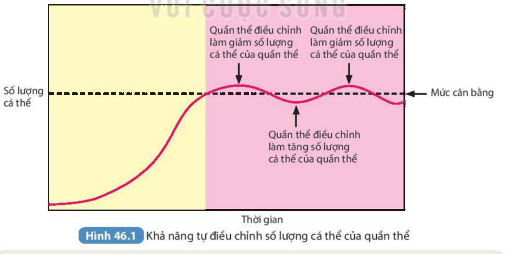
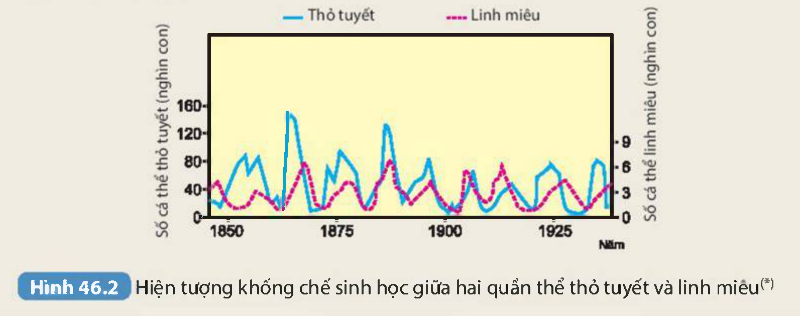
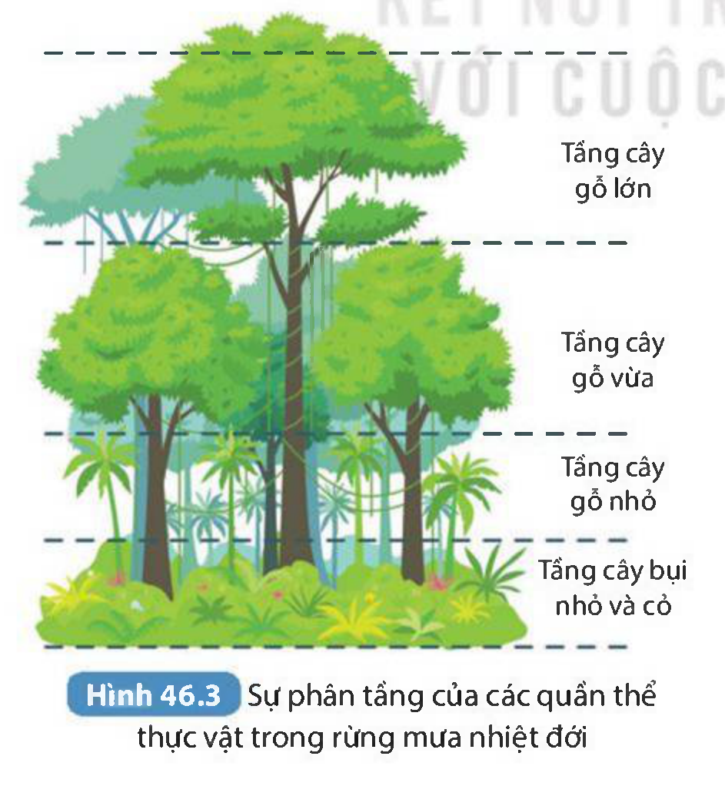
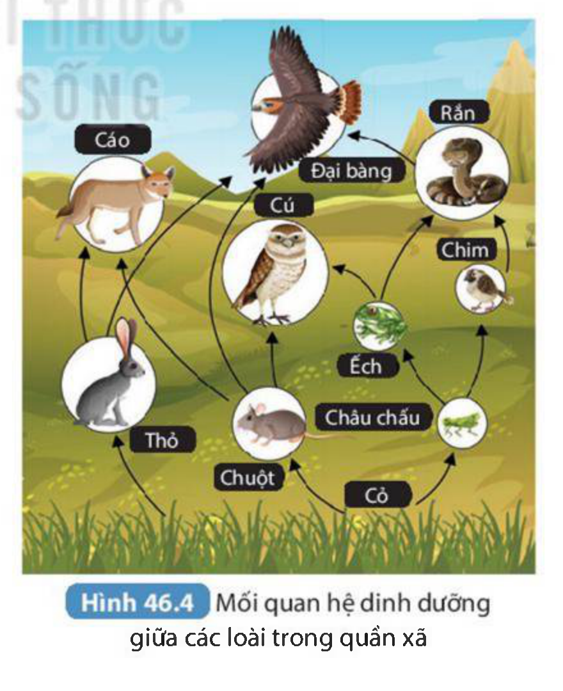

<!-- pdf:190 -->

# BÀI 46: CÂN BẰNG TỰ NHIÊN

## 🎯 Mục tiêu

- Nêu được khái niệm cân bằng tự nhiên.
- Trình bày được các nguyên nhân gây mất cân bằng tự nhiên.
- Phân tích được một số biện pháp bảo vệ, duy trì cân bằng tự nhiên.

## 🔴 Mở đầu

Cơ thể có quá trình tự điều chỉnh thích ứng với môi trường, ví dụ: quá trình điều hoà thân nhiệt ở động vật hằng nhiệt. Ở cấp độ tổ chức sống trên cơ thể cũng có quá trình tự điều chỉnh để đạt được trạng thái cân bằng tự nhiên. Cân bằng tự nhiên là gì? Cân bằng tự nhiên biểu hiện như thế nào và có ý nghĩa ra sao đối với việc duy trì sự sống?

## I. Khái niệm cân bằng tự nhiên

**Cân bằng tự nhiên** là trạng thái ổn định tự nhiên của các cấp độ tổ chức sống, hướng tới sự thích nghi cao nhất với điều kiện sống.

Cân bằng tự nhiên biểu hiện ở trạng thái cân bằng của quần thể, hiện tượng khống chế sinh học trong quần xã, trạng thái ổn định tự nhiên của hệ sinh thái,...

### 1. Trạng thái cân bằng của quần thể

<!-- term: Trạng thái cân bằng của quần thể -->
Quần thể có khả năng tự điều chỉnh số lượng cá thể của quần thể khi số cá thể giảm xuống quá thấp hoặc tăng lên quá cao, dẫn tới trạng thái cân bằng của quần thể. Khi đó, quần thể có số lượng cá thể ổn định và phù hợp với khả năng cung cấp nguồn sống của môi trường (Hình 46.1).

Hình 46.1. Khả năng tự điều chỉnh số lượng cá thể của quần thể

> ❓ Khi số lượng cá thể của quần thể tăng lên quá mức, quần thể sẽ tự điều chỉnh như thế nào để đưa số lượng cá thể trở về mức cân bằng?

<!-- pdf:191 -->

### 2. Khống chế sinh học trong quần xã

Số lượng cá thể của quần thể này được khống chế ở mức nhất định bởi quần thể kia và ngược lại, hiện tượng này được gọi là **khống chế sinh học**.

> ❓ Quan sát Hình 46.2, em hãy cho biết số lượng cá thể thỏ tuyết và linh miêu khống chế lẫn nhau như thế nào.

Hình 46.2. Hiện tượng khống chế sinh học giữa hai quần thể thỏ tuyết và linh miêu$^{(*)}$

<!-- term: Thiên địch -->
Trong nông nghiệp, việc sử dụng thiên địch để phòng trừ sinh vật gây hại hay dịch bệnh thay cho thuốc hoá học là ứng dụng hiện tượng khống chế sinh học.

### 3. Cân bằng tự nhiên trong hệ sinh thái

**Cân bằng tự nhiên trong hệ sinh thái** là trạng thái ổn định tự nhiên của hệ sinh thái, thể hiện ở sự phân bố các quần thể trong hệ sinh thái phù hợp với điều kiện sống (Hình 46.3), mối quan hệ dinh dưỡng giữa các loài trong quần xã (Hình 46.4), đảm bảo sự ổn định và cân bằng với môi trường. Bên cạnh đó, cân bằng tự nhiên trong hệ sinh thái còn thể hiện ở sự thay đổi của quần xã sinh vật theo chu kì mùa và chu kì ngày đêm.

Hình 46.3. Sự phân tầng của các quần thể thực vật trong rừng mưa nhiệt đới

Hình 46.4. Mối quan hệ dinh dưỡng giữa các loài trong quần xã

> (\*) Dẫn theo: Sinh học (Campbell và các cộng sự) năm 2020

<!-- pdf:192 -->

> ❓ 1. Quan sát Hình 46.3, cho biết sự phân tầng của các quần thể thực vật trong hình phù hợp như thế nào với điều kiện môi trường.
>
> 2. Quan sát Hình 46.4, phân tích một số mối quan hệ về dinh dưỡng giữa các loài và cho biết loài sinh vật nào có ảnh hưởng lớn nhất đến sự tồn tại của các loài khác trong quần xã. Tại sao?

## II. Nguyên nhân mất cân bằng tự nhiên và các biện pháp bảo vệ, duy trì cân bằng tự nhiên

Khả năng tự điều chỉnh của quần thể và quần xã là có hạn. Nếu bị tác động quá mạnh, quần thể và quần xã sẽ không phục hồi được, khiến cho toàn hệ sinh thái mất cân bằng và suy thoái.

Nguyên nhân gây mất cân bằng tự nhiên chủ yếu do các hoạt động của con người như phá rừng và săn bắt động vật hoang dã, khai thác tài nguyên quá mức, chất thải sinh hoạt và công nghiệp gây ô nhiễm môi trường,... Ngoài ra, các thảm hoạ thiên nhiên như động đất, núi lửa hoạt động,... cũng góp phần gây mất cân bằng tự nhiên.

Để bảo vệ và duy trì cân bằng tự nhiên, cần thực hiện các biện pháp hạn chế ô nhiễm môi trường, điều tiết cấu trúc thành phần trong hệ sinh thái, thích ứng với biến đổi khí hậu, khai thác hợp lí tài nguyên thiên nhiên,...

> ✋ Đọc thông tin trên kết hợp thảo luận nhóm để thực hiện các yêu cầu sau:
>
> 1. Trong các nguyên nhân trên, hãy cho biết những nguyên nhân nào có tác động mạnh gây mất cân bằng tự nhiên ở Việt Nam.
> 2. Tìm hiểu và nêu thêm các biện pháp bảo vệ, duy trì cân bằng tự nhiên.

> 🔍 **Loài ngoại lai** là loài sinh vật xuất hiện và phát triển ở khu vực vốn không phải là khu vực sống tự nhiên của chúng$^{(*)}$, đe doạ nghiêm trọng đến hệ sinh thái bản địa và đa dạng sinh học.

## 📌 Em đã học

- Cân bằng tự nhiên là trạng thái ổn định tự nhiên của các cấp độ tổ chức sống. Ở cấp độ trên cơ thể, cân bằng tự nhiên biểu hiện ở trạng thái cân bằng của quần thể, sự khống chế sinh học trong quần xã và cân bằng tự nhiên trong hệ sinh thái.
- Cân bằng tự nhiên là trạng thái động, phù hợp với sự biến đổi của môi trường.

## ✏️ Em có thể

Vận dụng kiến thức về cân bằng tự nhiên vào việc duy trì cân bằng tự nhiên, bảo vệ đa dạng sinh học.

> (\*) Dẫn theo: Luật Đa dạng sinh học

## 📷 Danh sách hình trong bài

| Mã hình | Trang PDF | Trang sách | Chú thích |
|---|---|---|---|
| H8-khoa_hoc_tu_nhien-b46-01 | 190 | 188 | Hình 46.1. Khả năng tự điều chỉnh số lượng cá thể của quần thể |
| H8-khoa_hoc_tu_nhien-b46-02 | 191 | 189 | Hình 46.2. Hiện tượng khống chế sinh học giữa hai quần thể thỏ tuyết và linh miêu |
| H8-khoa_hoc_tu_nhien-b46-03 | 191 | 189 | Hình 46.3. Sự phân tầng của các quần thể thực vật trong rừng mưa nhiệt đới |
| H8-khoa_hoc_tu_nhien-b46-04 | 191 | 189 | Hình 46.4. Mối quan hệ dinh dưỡng giữa các loài trong quần xã |
