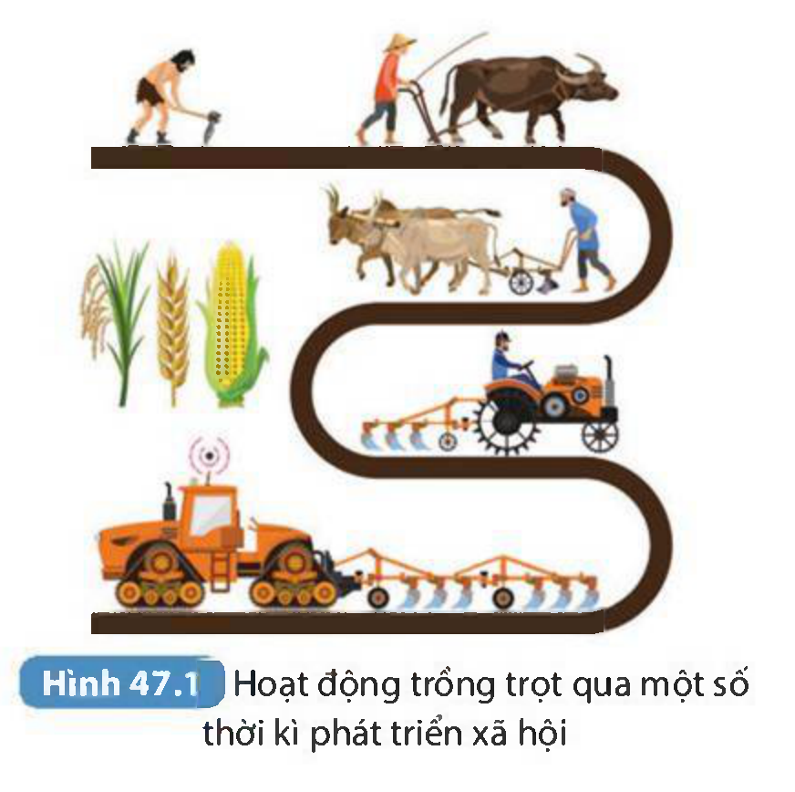
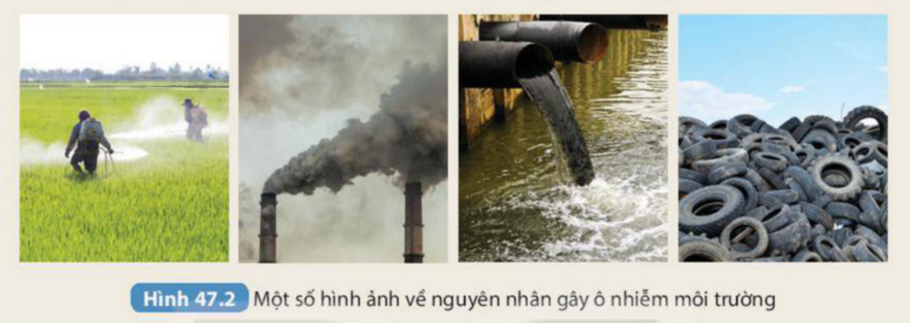

<!-- pdf:193 -->

# BÀI 47: BẢO VỆ MÔI TRƯỜNG

## 🎯 Mục tiêu

- Trình bày được tác động của con người đối với môi trường qua các thời kì phát triển xã hội; tác động của con người làm suy thoái môi trường tự nhiên và vai trò của con người trong bảo vệ, cải tạo môi trường tự nhiên.
- Nêu được khái niệm ô nhiễm môi trường. Trình bày được một số nguyên nhân và biện pháp hạn chế ô nhiễm môi trường.
- Nêu được khái niệm khái quát về biến đổi khí hậu và biện pháp thích ứng.
- Trình bày được sự cần thiết phải bảo vệ động vật hoang dã có nguy cơ tuyệt chủng.
- Điều tra được hiện trạng ô nhiễm môi trường ở địa phương.

## 🔴 Mở đầu

Năm 1972, lần đầu tiên Liên hợp quốc tổ chức Hội nghị về Môi trường con người phản ánh tính cấp bách đối với một số vấn đề môi trường trên toàn cầu. Môi trường sống của con người đang bị đe doạ như thế nào? Cần có những biện pháp gì để bảo vệ môi trường?

## I. Tác động của con người đối với môi trường qua các thời kì phát triển xã hội

### 1. Thời kì nguyên thuỷ

Con người chủ yếu khai thác thiên nhiên thông qua hình thức hái lượm và săn bắn. Con người đã biết dùng lửa để nấu chín thức ăn, xua đuổi thú dữ, sưởi ấm và đốt rừng để săn thú.

### 2. Thời kì xã hội nông nghiệp

Con người bắt đầu biết trồng cây lương thực như lúa nước, lúa mì, ngô,... và chăn nuôi trâu, bò, dê, cừu,...

> ❓ Phân tích tác động của các hoạt động dưới đây đến môi trường trong thời kì xã hội nông nghiệp.
>
> a) Cày, xới đất canh tác.
> b) Định cư tại một khu vực nhất định.
> c) Thuần hoá cây dại, thú hoang thành cây trồng, vật nuôi.
> d) Xây dựng hệ thống kênh, mương,... để tưới tiêu nước.

### 3. Thời kì xã hội công nghiệp và hậu công nghiệp

Trong thời kì cách mạng công nghiệp, con người đã bắt đầu cơ giới hoá sản xuất dựa vào các loại máy móc; nguồn nguyên, nhiên, vật liệu như sắt, than đá,... và năng lượng mới là hơi nước. Sự thay đổi này đã tác động mạnh mẽ tới môi trường sống. Đặc biệt, việc sử dụng năng lượng điện và sự ra đời của các dây chuyền sản xuất hàng loạt quy mô lớn,

<!-- pdf:194 -->

công nghiệp sản xuất phát triển mạnh mẽ, con người đã đẩy mạnh khai thác các loại tài nguyên khoáng sản để phục vụ cho sản xuất, kéo theo sự gia tăng các loại khí thải từ hoạt động sản xuất công nghiệp.

Từ nửa sau thế kỉ XX, điện tử và công nghệ thông tin được ứng dụng để tự động hoá sản xuất đã tạo điều kiện tiết kiệm tài nguyên thiên nhiên và các nguồn lực xã hội trong việc tạo ra cùng một khối lượng hàng hoá tiêu dùng. Hiện nay, Cách mạng công nghiệp lần thứ tư (còn gọi là Cách mạng 4.0) có sự kết hợp các công nghệ với nhau. Trong lĩnh vực Sinh học, Cách mạng 4.0 tập trung nghiên cứu để tạo ra bước nhảy vọt trong nông nghiệp, thuỷ sản, y dược, chế biến thực phẩm, bảo vệ môi trường, năng lượng tái tạo,...

Hình 47.1. Hoạt động trồng trọt qua một số thời kì phát triển xã hội

> ✋ Đọc các thông tin trên và quan sát Hình 47.1, thảo luận để thực hiện các yêu cầu sau:
>
> 1. Trình bày tác động của hoạt động trồng trọt đến môi trường qua các thời kì phát triển xã hội.
> 2. Liệt kê một số hoạt động của con người trong các thời kì phát triển xã hội làm suy thoái hoặc có tác dụng bảo vệ, cải tạo môi trường tự nhiên.

## II. Ô nhiễm môi trường

### 1. Khái niệm ô nhiễm môi trường

**Ô nhiễm môi trường** là sự biến đổi tính chất vật lí, hoá học, sinh học của thành phần môi trường không phù hợp với quy chuẩn kĩ thuật môi trường, tiêu chuẩn môi trường gây ảnh hưởng xấu đến sức khoẻ con người, sinh vật và tự nhiên.

### 2. Một số nguyên nhân gây ô nhiễm môi trường

**a) Ô nhiễm do chất thải từ hoạt động công nghiệp và sinh hoạt**

<!-- term: Hiệu ứng nhà kính -->
Các chất khí thải ra từ hoạt động công nghiệp và sinh hoạt như $\ce{CO}$, $\ce{SO2}$, $\ce{CO2}$, $\ce{NO2}$,... có ảnh hưởng không tốt tới cơ thể sinh vật. Bên cạnh đó, chúng là một trong những nguyên nhân gây hiệu ứng nhà kính.

**b) Ô nhiễm do hoá chất bảo vệ thực vật**

Sản xuất nông nghiệp sử dụng hoá chất bảo vệ thực vật như thuốc trừ sâu, thuốc diệt cỏ,... Những hoá chất này góp phần làm tăng năng suất cây trồng nhưng có thể gây hại cho sức khoẻ con người và ảnh hưởng đến toàn bộ hệ sinh thái nếu sử dụng không đúng cách.

**c) Ô nhiễm do các chất phóng xạ**

Nguồn ô nhiễm phóng xạ chủ yếu đến từ các hoạt động thử và sản xuất vũ khí hạt nhân, các nhà máy điện nguyên tử,... Các chất phóng xạ có khả năng gây biến đổi vật chất di truyền ở người và các loài sinh vật, từ đó làm phát sinh một số bệnh, tật di truyền.

<!-- pdf:195 -->

**d) Ô nhiễm do vi sinh vật gây bệnh**

Vi sinh vật gây bệnh cho người và động vật có thể phát triển mạnh trong môi trường chứa các chất thải như phân động vật, rác, nước thải sinh hoạt, rác thải từ các bệnh viện,... không được thu gom và xử lí đúng cách.

> ❓ 1. Đọc thông tin và quan sát Hình 47.2, chỉ ra một số nguyên nhân gây ô nhiễm môi trường.

Hình 47.2. Một số hình ảnh về nguyên nhân gây ô nhiễm môi trường

> 2. Những hoạt động nào tại trường học, gia đình và địa phương em có thể gây ô nhiễm môi trường?

### 3. Một số biện pháp hạn chế ô nhiễm môi trường

Ô nhiễm môi trường gây ảnh hưởng không tốt đến sức khoẻ của con người và sự phát triển của sinh vật. Để hạn chế ô nhiễm môi trường, cần đồng thời kết hợp nhiều biện pháp như xử lí chất thải công nghiệp và sinh hoạt; sử dụng các nguồn năng lượng tái tạo như năng lượng gió, năng lượng mặt trời; trồng nhiều cây xanh; ứng dụng khoa học kĩ thuật trong sản xuất;... Đặc biệt, cần tăng cường công tác tuyên truyền và giáo dục để nâng cao hiểu biết và ý thức của mọi người trong việc bảo vệ môi trường.

> ✋ Đọc thông tin, thảo luận và làm việc theo nhóm để thực hiện các yêu cầu sau:
>
> 1. Điều tra về tình trạng ô nhiễm môi trường ở địa phương, nêu các biểu hiện và tìm hiểu nguyên nhân gây ra tình trạng đó rồi hoàn thành thông tin theo mẫu Bảng 47.1.
>
> Bảng 47.1. Tình trạng ô nhiễm một số loại môi trường ở địa phương
>
> | Môi trường ô nhiễm | Biểu hiện | Nguyên nhân |
> |---|---|---|
> | Môi trường nước | ? | ? |
> | Môi trường đất | ? | ? |
> | Môi trường không khí | ? | ? |
>
> 2. Dựa vào kết quả điều tra và những kiến thức đã học, em hãy đề xuất các biện pháp hạn chế ô nhiễm môi trường ở địa phương và cho biết việc phân loại rác thải từ gia đình giúp ích gì trong việc hạn chế ô nhiễm môi trường.

<!-- pdf:196 -->

## III. Biến đổi khí hậu

### 1. Khái niệm

**Biến đổi khí hậu** là sự thay đổi giá trị trung bình của các yếu tố khí hậu như nhiệt độ, độ ẩm, lượng mưa,... giữa các giai đoạn, mỗi giai đoạn từ vài thập kỉ đến hàng thế kỉ. Tác động của con người là nguyên nhân chủ yếu gây biến đổi khí hậu.

### 2. Các biện pháp thích ứng với biến đổi khí hậu

Để thích ứng với biến đổi khí hậu, con người có thể chủ động xây dựng hệ thống đê điều kiên cố, trồng rừng phòng hộ chắn sóng, chống xói lở ở bờ biển, bờ sông, chuyển đổi cơ cấu cây trồng và vật nuôi phù hợp, xây nhà chống lũ,...

> ❓ Em hãy đề xuất thêm các biện pháp thích ứng với biến đổi khí hậu có thể thực hiện ở địa phương.

## IV. Bảo vệ động vật hoang dã

Mỗi loài sinh vật là một mắt xích trong hệ sinh thái. Vì một nguyên nhân nào đó, nếu một loài bị biến mất sẽ ảnh hưởng đến toàn bộ hệ sinh thái, làm giảm đa dạng nguồn gene, giảm đa dạng sinh học, gây mất cân bằng sinh thái.

Hiện nay, nhiều loài động vật hoang dã đang có nguy cơ tuyệt chủng do bị săn bắt quá mức như voi, tê giác, hổ,... Để duy trì cân bằng sinh thái và phát triển bền vững, các loài động vật này cần được bảo vệ theo Công ước quốc tế về buôn bán các loài động, thực vật hoang dã (CITES), bảo vệ và phục hồi môi trường sống của chúng cũng như gìn giữ thiên nhiên hoang dã.

<!-- term: Tầng ozone -->
> 🔍 Trong tầng bình lưu của khí quyển Trái Đất (độ cao từ 15 km đến 35 km) tồn tại tầng ozone ($\ce{O3}$), có tác dụng hấp thụ phần lớn các tia cực tím (UV) từ Mặt Trời. Tia cực tím có thể gây bỏng giác mạc, ung thư da, ức chế miễn dịch, gây lão hoá,... Trong vài chục năm trở lại đây, đã có bằng chứng về sự suy giảm tầng ozone, chủ yếu do hoạt động của con người đã tạo ra nhiều chất ODS (Ozone Depleting Substance) làm cạn kiệt ozone. Đại hội đồng Liên hợp quốc đã lấy ngày 16 tháng 9 là Ngày quốc tế bảo tồn tầng ozone.

## 📌 Em đã học

- Môi trường luôn chịu tác động của con người qua các thời kì phát triển của xã hội.
- Ô nhiễm môi trường chủ yếu do hoạt động của con người gây ra như đốt cháy nhiên liệu, sử dụng thuốc bảo vệ thực vật trong nông nghiệp, thử và sản xuất các loại vũ khí hạt nhân,...
- Ô nhiễm môi trường là nguyên nhân chính dẫn đến biến đổi khí hậu. Để hạn chế ô nhiễm môi trường cần thực hiện các biện pháp như kiểm soát nguồn chất thải công nghiệp và sinh hoạt, tăng cường trồng cây xanh, bảo vệ rừng,...
- Để phát triển bền vững, cần phải bảo vệ môi trường, bảo vệ các loài động vật quý hiếm.

## ✏️ Em có thể

Thực hiện các hành động góp phần hạn chế ô nhiễm môi trường như không xả rác bừa bãi, tích cực trồng và chăm sóc cây xanh,...

## 📷 Danh sách hình trong bài

| Mã hình | Trang PDF | Trang sách | Chú thích |
|---|---|---|---|
| H8-khoa_hoc_tu_nhien-b47-01 | 194 | 192 | Hình 47.1. Hoạt động trồng trọt qua một số thời kì phát triển xã hội |
| H8-khoa_hoc_tu_nhien-b47-02 | 195 | 193 | Hình 47.2. Một số hình ảnh về nguyên nhân gây ô nhiễm môi trường |
