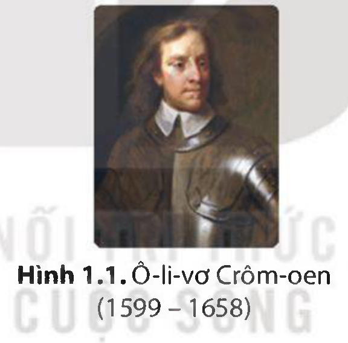
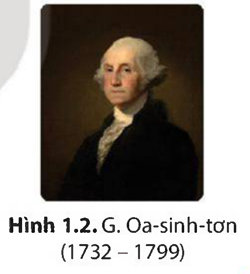
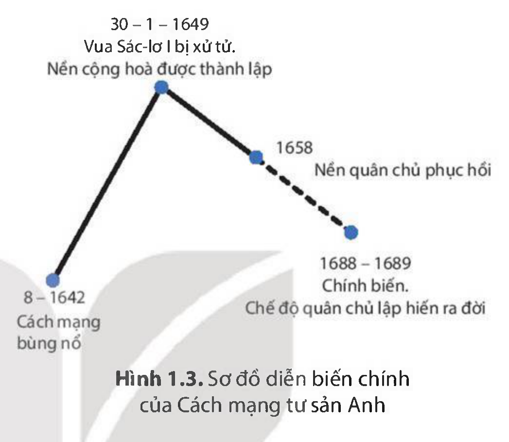
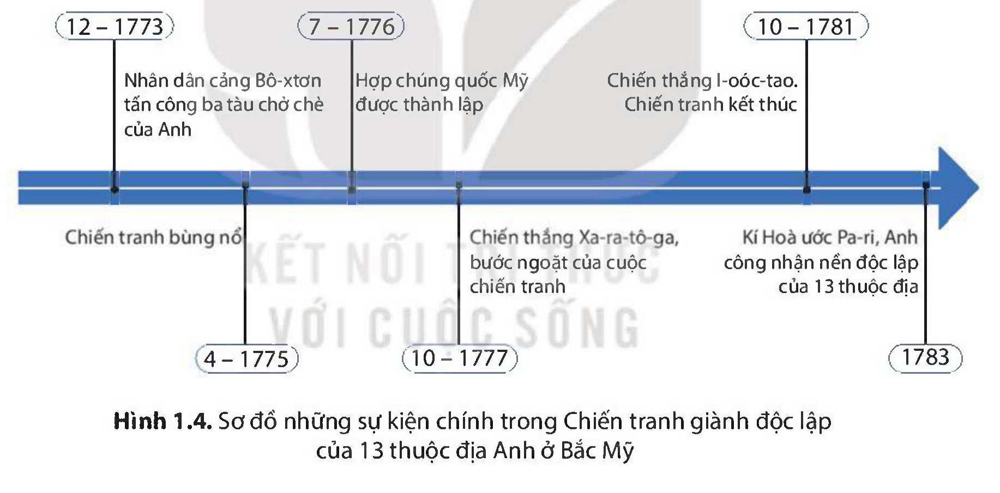
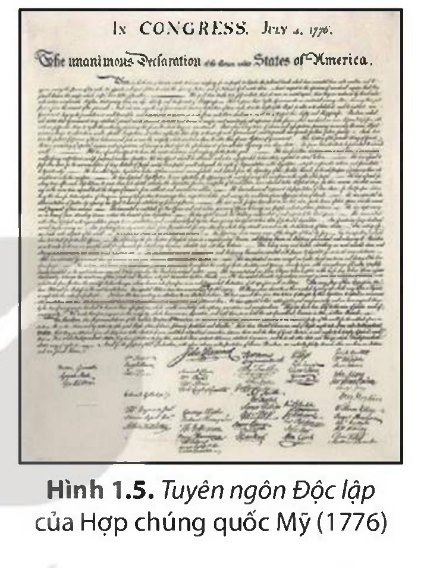

<!-- pdf:10 -->

# BÀI 1: CÁCH MẠNG TƯ SẢN ANH VÀ CHIẾN TRANH GIÀNH ĐỘC LẬP CỦA 13 THUỘC ĐỊA ANH Ở BẮC MỸ

## 🎯 Học xong bài này, em sẽ:

- Xác định được trên bản đồ thế giới địa điểm diễn ra Cách mạng tư sản Anh và Chiến tranh giành độc lập của 13 thuộc địa Anh ở Bắc Mỹ.
- Trình bày được những nét chung về nguyên nhân, kết quả, ý nghĩa, tính chất của Cách mạng tư sản Anh, Chiến tranh giành độc lập của 13 thuộc địa Anh ở Bắc Mỹ.
- Nêu được một số đặc điểm chính của Cách mạng tư sản Anh, Chiến tranh giành độc lập của 13 thuộc địa Anh ở Bắc Mỹ.

## 🔴 Mở đầu

Em biết gì về hai nhân vật lịch sử ở các hình bên? Hãy chia sẻ hiểu biết của em về những sự kiện lịch sử liên quan đến các nhân vật đó.

*Hình 1.1. Ô-li-vơ Crôm-oen (1599 – 1658)*
<!-- ocr-ok: đã đối chiếu p010.png, chú thích nằm đè lên logo chìm nền nên OCR dính từ "Ô-livơ" -->

*Hình 1.2. G. Oa-sinh-tơn (1732 – 1799)*

## 1. Cách mạng tư sản Anh

### a) Nguyên nhân

<!-- term: Tầng lớp quý tộc mới -->
Vào đầu thế kỉ XVII, nước Anh có nền kinh tế phát triển nhất châu Âu. Công nghiệp len dạ phát triển đã dẫn đến nghề nuôi cừu trở nên có lợi nhất. Số đông quý tộc vừa và nhỏ chuyển sang kinh doanh theo lối tư bản chủ nghĩa, đuổi tá điền, rào đất, biến ruộng đất thành đồng cỏ để chăn nuôi cừu,... Họ trở thành tầng lớp quý tộc mới. Nông dân không có đất để trồng trọt, chăn nuôi, cuộc sống vô cùng khổ cực.

<!-- term: Tầng lớp quý tộc mới -->
> 💡 **Em có biết?**
>
> Tầng lớp quý tộc mới có quyền lợi kinh tế gắn liền với giai cấp tư sản, muốn xoá bỏ những trở ngại của quan hệ sản xuất phong kiến, nhưng quyền lợi chính trị, địa vị xã hội của họ lại gắn bó với chế độ phong kiến.

<!-- pdf:11 -->

Xã hội dần dần phân hoá thành những giai cấp có địa vị kinh tế, chính trị khác nhau và chia thành hai phe đối lập: một bên là vua và các thế lực phong kiến; một bên là giai cấp tư sản, tầng lớp quý tộc mới, nông dân và bình dân thành thị.

Sự thay đổi về kinh tế, những mâu thuẫn gay gắt giữa tư sản, quý tộc mới với chế độ quân chủ chuyên chế (bên cạnh mâu thuẫn cũ giữa nông dân với địa chủ, quý tộc) dẫn tới cuộc cách mạng lật đổ chế độ phong kiến, xác lập quan hệ sản xuất tư bản chủ nghĩa.

Năm 1640, do cần tiền để đàn áp cuộc khởi nghĩa của người Xcốt-len, vua Sác-lơ I phải triệu tập Quốc hội, gồm đa số đại biểu là quý tộc mới và tư sản, nhằm tăng thêm các khoản thuế mới. Mâu thuẫn giữa tư sản, quý tộc mới với thế lực phong kiến phản động ngày càng gay gắt. Đầu năm 1642, vua Sác-lơ I chạy lên phía bắc Luân Đôn, chuẩn bị lực lượng. Tháng 8 – 1642, vua tuyên chiến với Quốc hội, cách mạng bùng nổ.

*Hình 1.3. Sơ đồ diễn biến chính của Cách mạng tư sản Anh*

> **Sơ đồ diễn biến chính của Cách mạng tư sản Anh:**
> - **8 – 1642:** Cách mạng bùng nổ.
> - **30 – 1 – 1649:** Vua Sác-lơ I bị xử tử. Nền cộng hoà được thành lập.
> - **1658:** Nền quân chủ phục hồi.
> - **1688 – 1689:** Chính biến. Chế độ quân chủ lập hiến ra đời.

> ❓ 1. Nguyên nhân nào dẫn tới sự bùng nổ Cách mạng tư sản Anh?
>
> 2. Hãy xác định trên lược đồ (tr. 7) địa điểm diễn ra Cách mạng tư sản Anh.

### b) Kết quả, ý nghĩa, tính chất và đặc điểm chính

<!-- term: Cách mạng tư sản Anh -->
Cách mạng tư sản Anh đã lật đổ chế độ quân chủ chuyên chế, mở đường cho chủ nghĩa tư bản ở Anh phát triển nhanh chóng.

Đánh giá về thắng lợi của Cách mạng tư sản Anh, C. Mác cho rằng: Thắng lợi của giai cấp tư sản có nghĩa là thắng lợi của chế độ xã hội mới, thắng lợi của chế độ tư hữu tư bản chủ nghĩa đối với chế độ phong kiến.

<!-- term: Cách mạng tư sản Anh -->
Tuy nhiên, cuộc cách mạng này mang tính chất không triệt để vì đã không xoá bỏ tận gốc chế độ phong kiến và giải quyết vấn đề ruộng đất của nông dân.

<!-- term: Cách mạng tư sản Anh -->
Đặc điểm chính của Cách mạng tư sản Anh là do tầng lớp quý tộc mới và tư sản lãnh đạo, diễn ra dưới hình thức một cuộc nội chiến, thiết lập chế độ quân chủ lập hiến.

> ❓ 1. Trình bày kết quả, ý nghĩa và tính chất của Cách mạng tư sản Anh.
>
> 2. Nêu đặc điểm chính của Cách mạng tư sản Anh.

<!-- pdf:12 -->

## 2. Chiến tranh giành độc lập của 13 thuộc địa Anh ở Bắc Mỹ

### a) Nguyên nhân chiến tranh và sự thành lập Hợp chúng quốc Mỹ

Sau khi phát hiện ra châu Mỹ, nhiều nước châu Âu đã tiến hành xâm chiếm lục địa này. Đến đầu thế kỉ XVIII, thực dân Anh đã thành lập 13 thuộc địa ở Bắc Mỹ.

Sự phát triển kinh tế theo con đường tư bản chủ nghĩa ở 13 thuộc địa đã làm sâu sắc hơn mâu thuẫn giữa các thuộc địa với chính quốc. Các tầng lớp nhân dân thuộc địa bao gồm tư sản, chủ nô, công nhân, nô lệ đều đấu tranh chống ách thống trị của thực dân Anh, đòi giải phóng, tự do phát triển kinh tế và văn hoá.

Tháng 12 – 1773, để phản đối chế độ thuế vô lí của thực dân Anh, nhân dân cảng Bô-xtơn tấn công ba tàu chở chè (trà) của Anh.

Đại biểu các thuộc địa Bắc Mỹ đã họp, đòi vua Anh xoá bỏ các luật cấm vô lí. Vua Anh không chấp nhận yêu cầu đó và tuyên bố sẽ trừng trị nếu các thuộc địa “nổi loạn”. Tháng 4 – 1775, cuộc chiến tranh bùng nổ giữa thực dân Anh và 13 thuộc địa Anh ở Bắc Mỹ.

*Hình 1.4. Sơ đồ những sự kiện chính trong Chiến tranh giành độc lập của 13 thuộc địa Anh ở Bắc Mỹ*

> **Sơ đồ những sự kiện chính trong Chiến tranh giành độc lập của 13 thuộc địa Anh ở Bắc Mỹ:**
> - **12 – 1773:** Nhân dân cảng Bô-xtơn tấn công ba tàu chở chè của Anh.
> - **4 – 1775:** Chiến tranh bùng nổ.
> - **7 – 1776:** Hợp chúng quốc Mỹ được thành lập.
> - **10 – 1777:** Chiến thắng Xa-ra-tô-ga, bước ngoặt của cuộc chiến tranh.
> - **10 – 1781:** Chiến thắng I-oóc-tao. Chiến tranh kết thúc.
> - **1783:** Kí Hoà ước Pa-ri, Anh công nhận nền độc lập của 13 thuộc địa.

> ❓ 1. Nguyên nhân nào dẫn tới Chiến tranh giành độc lập của 13 thuộc địa Anh ở Bắc Mỹ?
>
> 2. Hãy xác định trên lược đồ (tr. 7) địa điểm diễn ra Chiến tranh giành độc lập của 13 thuộc địa Anh ở Bắc Mỹ.

### b) Kết quả, ý nghĩa, tính chất và đặc điểm chính

<!-- term: Chiến tranh giành độc lập của 13 thuộc địa Anh ở Bắc Mỹ -->
Chiến tranh giành độc lập của 13 thuộc địa Anh ở Bắc Mỹ đã lật đổ ách thống trị của thực dân Anh, đưa đến sự thành lập Hợp chúng quốc Mỹ và mở đường cho kinh tế tư bản chủ nghĩa phát triển.

<!-- pdf:13 -->

> 📜 **Tư liệu**
>
> - V. I. Lê-nin đã khẳng định: Chiến tranh giành độc lập của các thuộc địa Anh ở Bắc Mỹ là cuộc “chiến tranh vĩ đại, chiến tranh thực sự giải phóng, thực sự cách mạng”.
>
> (Theo V. I. Lê-nin, *Toàn tập*, NXB Sự thật, 1971, tr. 70)

<!-- term: Tuyên ngôn Độc lập của Hợp chúng quốc Mỹ -->
> 💡 **Em có biết?**
>
> *Tuyên ngôn Độc lập* của Hợp chúng quốc Mỹ có đoạn: “Chúng tôi cho rằng, những sự thật sau đây là hiển nhiên. Mọi người sinh ra đều có quyền bình đẳng. Tạo hoá ban cho họ những quyền không thể tước bỏ. Trong số những quyền ấy có quyền được sống, quyền được tự do và quyền mưu cầu hạnh phúc”.

<!-- term: Chiến tranh giành độc lập của 13 thuộc địa Anh ở Bắc Mỹ -->
Chiến tranh giành độc lập của 13 thuộc địa Anh ở Bắc Mỹ mang tính chất là một cuộc cách mạng tư sản, có ảnh hưởng đến phong trào đấu tranh giành độc lập ở nhiều nước vào cuối thế kỉ XVIII – đầu thế kỉ XIX.

<!-- term: Chiến tranh giành độc lập của 13 thuộc địa Anh ở Bắc Mỹ -->
Đặc điểm chính của Chiến tranh giành độc lập của 13 thuộc địa Anh là do tầng lớp chủ nô và tư sản lãnh đạo, diễn ra dưới hình thức cuộc chiến tranh giải phóng, thiết lập chế độ cộng hoà tổng thống.

*Hình 1.5. *Tuyên ngôn Độc lập* của Hợp chúng quốc Mỹ (1776)*

> ❓ 1. Khai thác tư liệu trên và thông tin trong mục, hãy cho biết kết quả, ý nghĩa, tính chất của Chiến tranh giành độc lập của 13 thuộc địa Anh ở Bắc Mỹ.
>
> 2. Nêu đặc điểm chính của Chiến tranh giành độc lập của 13 thuộc địa Anh ở Bắc Mỹ.

## ✏️ Luyện tập – Vận dụng

**Luyện tập:**

1. Sự tham gia lãnh đạo của tầng lớp quý tộc mới có ảnh hưởng như thế nào đến kết quả của Cách mạng tư sản Anh?

2. Lập bảng hệ thống về nguyên nhân, giai cấp lãnh đạo, kết quả, ý nghĩa, tính chất của Cách mạng tư sản Anh và Chiến tranh giành độc lập của 13 thuộc địa Anh ở Bắc Mỹ.

**Vận dụng:**

1. Tìm hiểu thêm và cho biết: Câu nào trong bản *Tuyên ngôn Độc lập* của Hợp chúng quốc Mỹ được Chủ tịch Hồ Chí Minh trích dẫn cho bản *Tuyên ngôn Độc lập* của nước Việt Nam Dân chủ Cộng hoà (2 – 9 – 1945)?

2. Tìm hiểu thông tin từ sách, báo, internet và cho biết: Mặt sau của đồng 2 đô-la Mỹ (USD) in hình ảnh của sự kiện nào trong Chiến tranh giành độc lập của 13 thuộc địa Anh ở Bắc Mỹ? Ý nghĩa của điều này là gì?

## 📷 Danh sách hình trong bài

| Mã hình | Trang PDF | Vị trí | Chú thích |
| --- | --- | --- | --- |
| H8-lich_su_va_dia_ly-ls-b01-01 | 10 | Mở đầu (trang 8) | Hình 1.1. Ô-li-vơ Crôm-oen (1599 – 1658) |
| H8-lich_su_va_dia_ly-ls-b01-02 | 10 | Mở đầu (trang 8) | Hình 1.2. G. Oa-sinh-tơn (1732 – 1799) |
| H8-lich_su_va_dia_ly-ls-b01-03 | 11 | Mục 1.a (trang 9) | Hình 1.3. Sơ đồ diễn biến chính của Cách mạng tư sản Anh |
| H8-lich_su_va_dia_ly-ls-b01-04 | 12 | Mục 2.a (trang 10) | Hình 1.4. Sơ đồ những sự kiện chính trong Chiến tranh giành độc lập của 13 thuộc địa Anh ở Bắc Mỹ |
| H8-lich_su_va_dia_ly-ls-b01-05 | 13 | Mục 2.b (trang 11) | Hình 1.5. Tuyên ngôn Độc lập của Hợp chúng quốc Mỹ (1776) |
