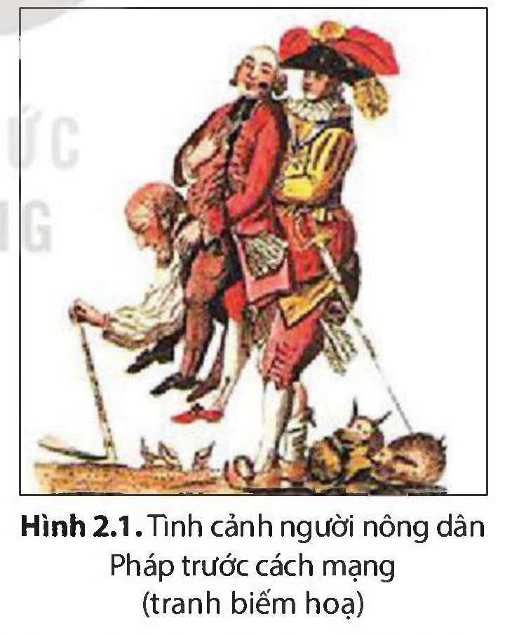
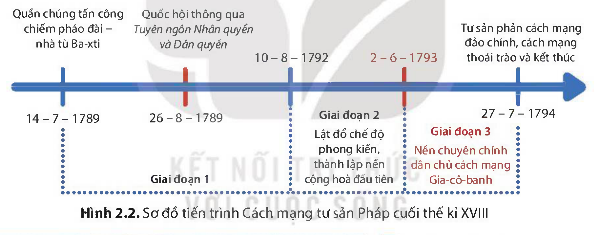
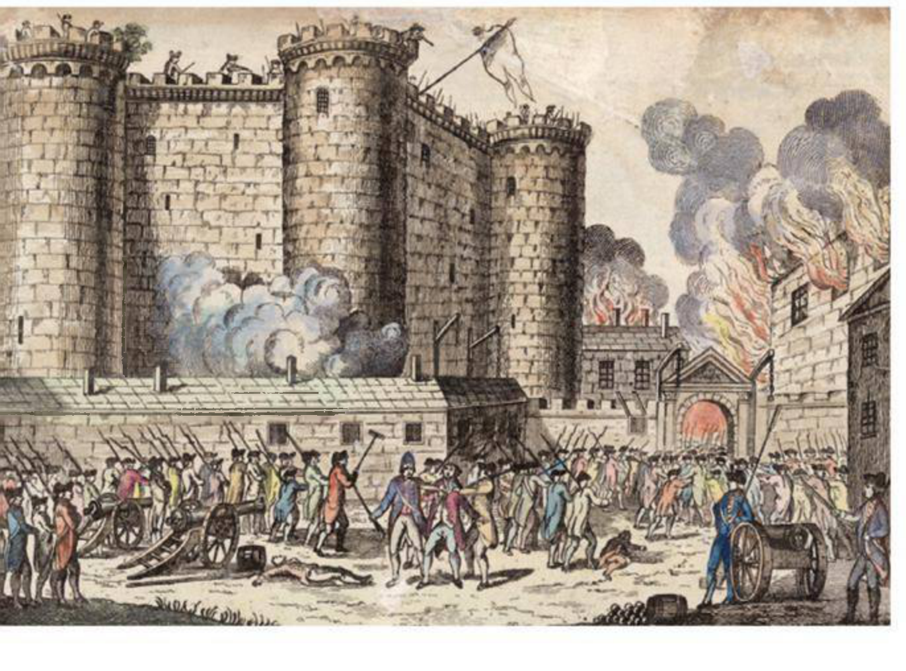

<!-- pdf:14 -->

# BÀI 2: CÁCH MẠNG TƯ SẢN PHÁP CUỐI THẾ KỈ XVIII

## 🎯 Học xong bài này, em sẽ:

- Xác định được trên bản đồ thế giới địa điểm diễn ra Cách mạng tư sản Pháp cuối thế kỉ XVIII.
- Trình bày được nguyên nhân, kết quả, ý nghĩa, tính chất của Cách mạng tư sản Pháp cuối thế kỉ XVIII.
- Nêu được một số đặc điểm chính của Cách mạng tư sản Pháp cuối thế kỉ XVIII.

## 🔴 Mở đầu

Trong các cuộc cách mạng tư sản từ thế kỉ XVI đến thế kỉ XVIII, Cách mạng tư sản Pháp cuối thế kỉ XVIII được ví như "cái chổi khổng lồ quét sạch mọi rác rưởi của chế độ phong kiến châu Âu". Em biết những thông tin gì về Cách mạng tư sản Pháp cuối thế kỉ XVIII? Vì sao cuộc cách mạng này lại được đánh giá như vậy?

## 1. Tình hình nước Pháp trước cách mạng

*Về kinh tế:* Cuối thế kỉ XVIII, Pháp vẫn là nước nông nghiệp lạc hậu. Nền công, thương nghiệp tuy kém nước Anh song cũng có bước phát triển.

Công cụ và phương thức canh tác thô sơ, năng suất thấp. Ruộng đất bị bỏ hoang nhiều, nạn mất mùa, đói kém thường xuyên xảy ra. Máy móc được sử dụng trong sản xuất. Nhiều trung tâm công nghiệp ra đời. Các hải cảng lớn như: Mác-xây, Boóc-đô,... tấp nập tàu buôn ra vào.

Tuy nhiên, những quy định ngặt nghèo của chế độ phường hội đã kìm hãm nền sản xuất công nghiệp, hạn chế tự do kinh doanh và cải tiến sản xuất.

*Hình 2.1. Tình cảnh người nông dân Pháp trước cách mạng (tranh biếm hoạ)*

*Về chính trị, xã hội:* Vào nửa sau thế kỉ XVIII, chế độ quân chủ chuyên chế đã lâm vào tình trạng khủng hoảng. Vua Lu-i XVI (lên ngôi năm 1774) nắm mọi quyền hành. Sự quan liêu, tham nhũng của tầng lớp quan lại trở thành gánh nặng đối với đời sống của đông đảo người dân.

Xã hội Pháp phân chia thành ba đẳng cấp: Quý tộc, Tăng lữ và Đẳng cấp thứ ba (giai cấp tư sản, nông dân và bình dân thành thị).

<!-- pdf:15 -->

<!-- term: Quý tộc và Tăng lữ -->
Quý tộc và Tăng lữ là hai đẳng cấp nắm mọi chức vụ cao nhất trong bộ máy nhà nước, quân đội, Giáo hội; có mọi đặc quyền, được miễn các loại thuế.

Giai cấp tư sản đứng đầu Đẳng cấp thứ ba, có thế lực về kinh tế song không có quyền lực chính trị. Nông dân, bình dân thành thị chiếm hơn 90% dân số, chịu nhiều ách áp bức, bóc lột, sẵn sàng đi theo giai cấp tư sản trong cuộc đấu tranh chống phong kiến, là động lực quyết định thắng lợi của cách mạng.

*Về tư tưởng:* Các nhà tư tưởng của giai cấp tư sản, tiêu biểu là S. Mông-te-xki-ơ, Ph. Vôn-te, G. G. Rút-xô đã đả phá chế độ phong kiến và Giáo hội thông qua trào lưu Triết học Ánh sáng thế kỉ XVIII, mở đường cho cách mạng bùng nổ.

S. Mông-te-xki-ơ (1689 – 1755) chủ trương hạn chế quyền của vua, đảm bảo quyền tự do của công dân. Ph. Vôn-te (1694 – 1778) chủ trương xây dựng chính quyền quân chủ sáng suốt, bảo vệ quyền tự do tín ngưỡng, khẳng định quyền tư hữu. G. G. Rút-xô (1712 – 1778) cho rằng phải xoá bỏ triệt để nền quân chủ, thành lập chế độ cộng hoà.

Do số nợ Nhà nước vay của tư sản không thể trả được nên nhà vua phải tăng thuế. Đời sống của nhân dân vì thế ngày càng cơ cực. Điều đó đã thôi thúc họ nổi dậy đấu tranh chống chế độ phong kiến. Ngày 14 – 7 – 1789, cách mạng bùng nổ.

*Hình 2.2. Sơ đồ tiến trình Cách mạng tư sản Pháp cuối thế kỉ XVIII*

> **Sơ đồ tiến trình Cách mạng tư sản Pháp cuối thế kỉ XVIII:**
> - **Giai đoạn 1 (14 – 7 – 1789 đến 10 – 8 – 1792):**
>   - **14 – 7 – 1789:** Quần chúng tấn công chiếm pháo đài – nhà tù Ba-xti.
>   - **26 – 8 – 1789:** Quốc hội thông qua *Tuyên ngôn Nhân quyền và Dân quyền*.
> - **Giai đoạn 2 (10 – 8 – 1792 đến 2 – 6 – 1793):** Lật đổ chế độ phong kiến, thành lập nền cộng hoà đầu tiên.
> - **Giai đoạn 3 (2 – 6 – 1793 đến 27 – 7 – 1794):** Nền chuyên chính dân chủ cách mạng Gia-cô-banh.
> - **27 – 7 – 1794:** Tư sản phản cách mạng đảo chính, cách mạng thoái trào và kết thúc.

*Hình 2.3. Tấn công pháo đài – nhà tù Ba-xti*

> 💡 **Em có biết?**
>
> Sau này, ngày 14 – 7, mở đầu Cách mạng tư sản Pháp được chọn là ngày Quốc khánh của nước Pháp. Lá cờ với ba màu: xanh lam – trắng – đỏ (là Quốc kì của nước Pháp hiện nay) xuất hiện lần đầu tiên trong cuộc tấn công nhà tù Ba-xti.

<!-- pdf:16 -->

> ❓ 1. Khai thác hình 2.1 và thông tin trong mục, hãy nêu nguyên nhân sâu xa và nguyên nhân trực tiếp dẫn tới sự bùng nổ Cách mạng tư sản Pháp cuối thế kỉ XVIII.
>
> 2. Hãy xác định trên lược đồ (tr. 7) địa điểm diễn ra Cách mạng tư sản Pháp cuối thế kỉ XVIII.

## 2. Kết quả, ý nghĩa, tính chất và đặc điểm chính của Cách mạng tư sản Pháp

<!-- term: Tuyên ngôn Nhân quyền và Dân quyền -->
> 💡 **Em có biết?**
>
> *Tuyên ngôn Nhân quyền và Dân quyền* là văn kiện công bố công khai về quyền con người và quyền công dân. Trong bản *Tuyên ngôn Độc lập* của nước Việt Nam Dân chủ Cộng hoà, Chủ tịch Hồ Chí Minh đã trích dẫn một câu trong bản *Tuyên ngôn* này của nước Pháp: “Người ta sinh ra tự do và bình đẳng về quyền lợi và phải luôn luôn được tự do và bình đẳng về quyền lợi”.

<!-- term: Cách mạng tư sản Pháp -->
Cách mạng tư sản Pháp cuối thế kỉ XVIII đã lật đổ chế độ phong kiến, thành lập chế độ cộng hoà, đưa giai cấp tư sản lên cầm quyền, xoá bỏ nhiều trở ngại trên con đường phát triển của chủ nghĩa tư bản.

Cách mạng tư sản Pháp là sự kiện lịch sử trọng đại, có ý nghĩa to lớn không chỉ đối với nước Pháp mà còn ảnh hưởng sâu sắc đến nhiều nước trên thế giới, nhất là ở châu Âu; đồng thời để lại nhiều bài học kinh nghiệm cho phong trào cách mạng các nước. Tư tưởng *Tự do, Bình đẳng, Bác ái* được truyền bá rộng rãi.

<!-- term: Cách mạng tư sản Pháp -->
Đây là cuộc cách mạng dân chủ tư sản điển hình, đã thiết lập chế độ cộng hoà cùng các quyền tự do, dân chủ, giải quyết vấn đề ruộng đất cho người nông dân, xoá bỏ chế độ đẳng cấp và quan hệ sản xuất phong kiến.

<!-- term: Cách mạng tư sản Pháp -->
Cách mạng tư sản Pháp với đặc điểm nổi bật là diễn ra dưới hình thức cuộc đấu tranh giai cấp quyết liệt do giai cấp tư sản lãnh đạo, lật đổ chế độ quân chủ chuyên chế và bảo vệ Tổ quốc.

> ❓ 1. Hãy nêu kết quả của Cách mạng tư sản Pháp.
>
> 2. Hãy cho biết ý nghĩa, tính chất, đặc điểm chính của Cách mạng tư sản Pháp.

## ✏️ Luyện tập – Vận dụng

**Luyện tập:**

1. Lập bảng so sánh điểm giống và khác nhau của Cách mạng tư sản Anh, Chiến tranh giành độc lập của 13 thuộc địa Anh ở Bắc Mỹ, Cách mạng tư sản Pháp cuối thế kỉ XVIII về: nguyên nhân, kết quả, tính chất, ý nghĩa, đặc điểm chính.

2. Có ý kiến cho rằng: Cách mạng tư sản Pháp cuối thế kỉ XVIII là một cuộc đại cách mạng. Em đồng ý với ý kiến đó không? Vì sao?

**Vận dụng:**

Tìm hiểu thông tin từ sách, báo và internet, em hãy viết một đoạn văn ngắn (khoảng 5 – 7 dòng) giới thiệu về sự liên quan của Quốc kì, Quốc ca nước Pháp hiện nay với Cách mạng tư sản Pháp cuối thế kỉ XVIII và ý nghĩa của điều này.

## 📷 Danh sách hình trong bài

| Mã hình | Trang PDF | Vị trí | Chú thích |
| --- | --- | --- | --- |
| H8-lich_su_va_dia_ly-ls-b02-01 | 14 | Mục 1 (trang 12) | Hình 2.1. Tình cảnh người nông dân Pháp trước cách mạng (tranh biếm hoạ) |
| H8-lich_su_va_dia_ly-ls-b02-02 | 15 | Mục 1 (trang 13) | Hình 2.2. Sơ đồ tiến trình Cách mạng tư sản Pháp cuối thế kỉ XVIII |
| H8-lich_su_va_dia_ly-ls-b02-03 | 15 | Mục 1, tràn sát mép trái trang sách; chú thích in bên phải dưới hộp Em có biết? (trang 13) | Hình 2.3. Tấn công pháo đài – nhà tù Ba-xti |
