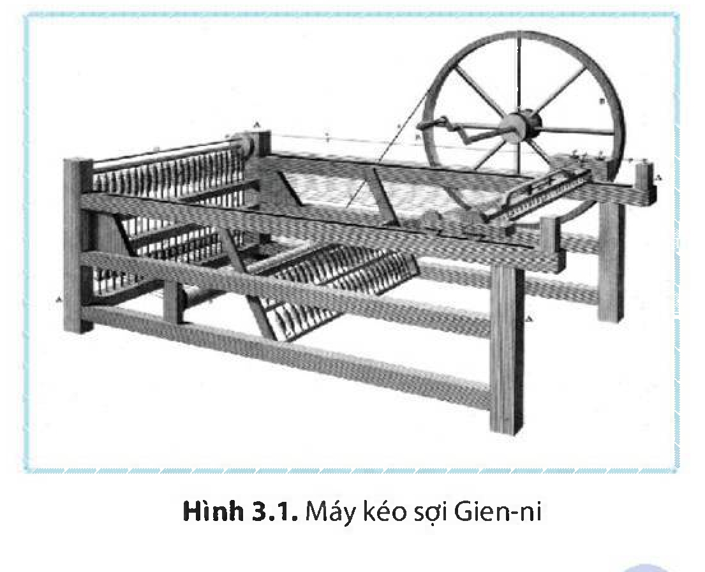
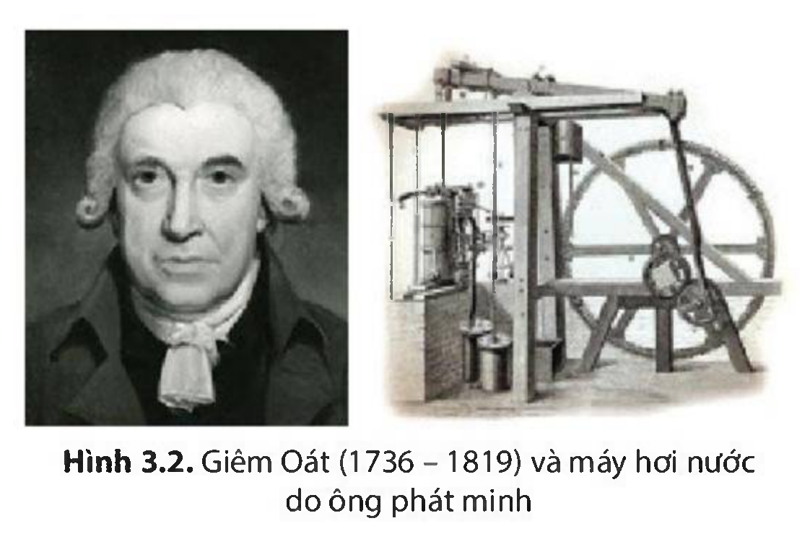
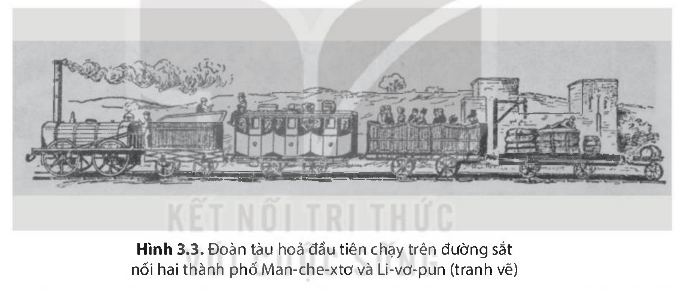
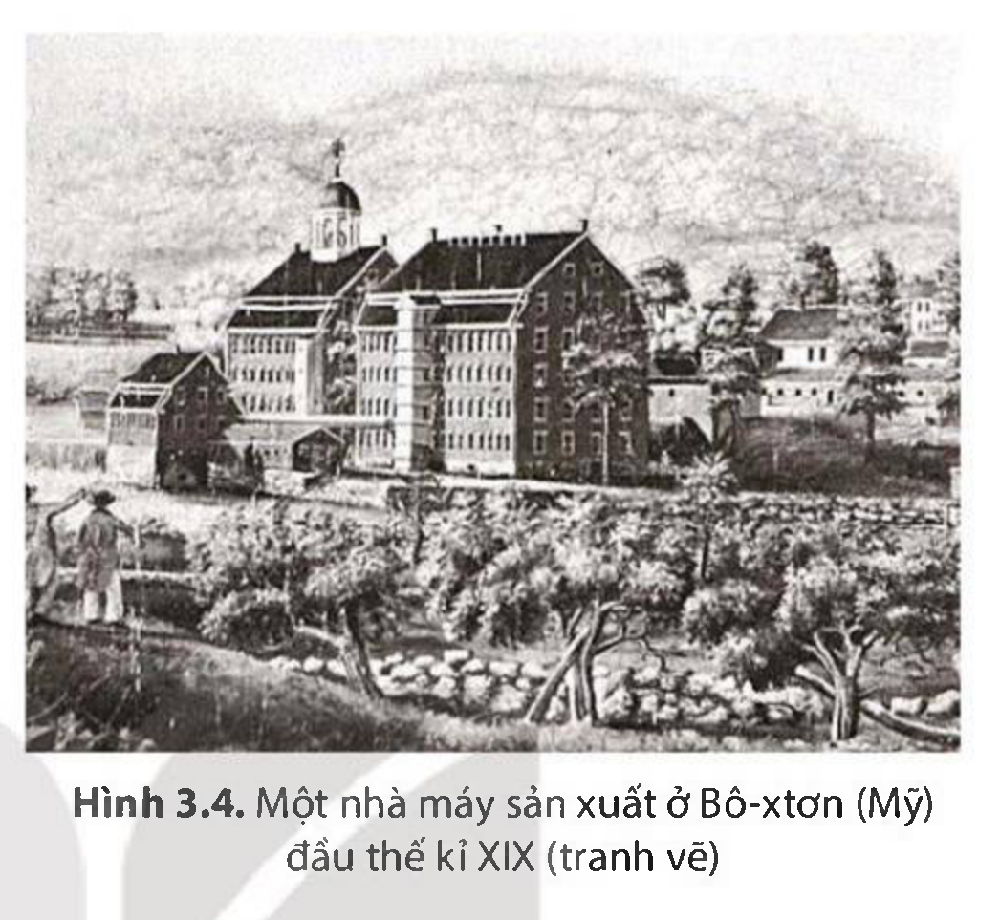
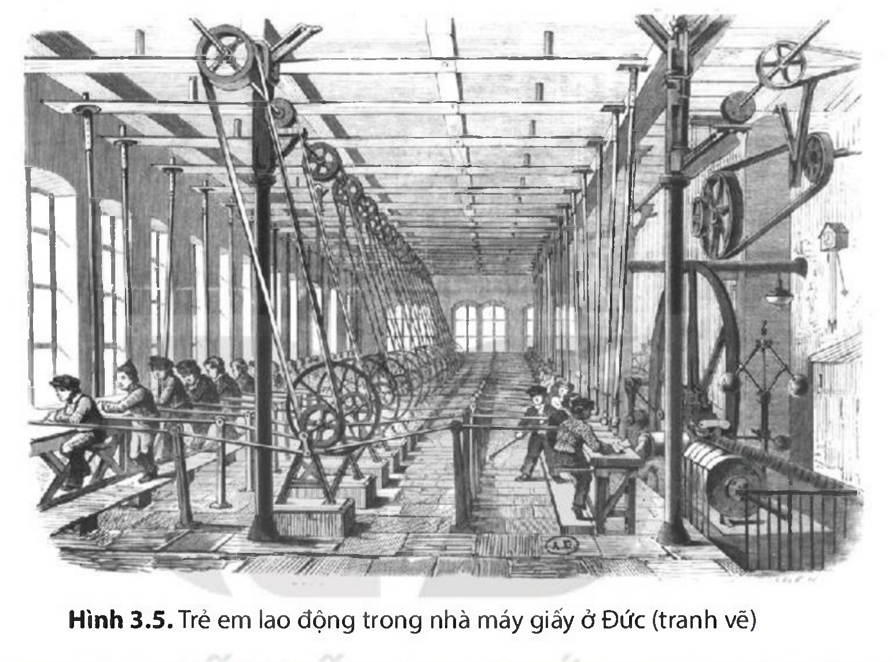

<!-- pdf:17 -->

# BÀI 3: CÁCH MẠNG CÔNG NGHIỆP (NỬA SAU THẾ KỈ XVIII – GIỮA THẾ KỈ XIX)

## 🎯 Học xong bài này, em sẽ:

- Trình bày được những thành tựu tiêu biểu của cách mạng công nghiệp.
- Nêu được những tác động quan trọng của cách mạng công nghiệp đối với sản xuất và đời sống xã hội.

## 🔴 Mở đầu

C. Mác đã từng khẳng định: Năng suất lao động là cái đảm bảo cho sự thắng lợi của trật tự xã hội này đối với một trật tự xã hội khác. Cách mạng công nghiệp diễn ra vào nửa sau thế kỉ XVIII – giữa thế kỉ XIX có ý nghĩa quyết định đến thắng lợi của chủ nghĩa tư bản đối với chế độ phong kiến. Vậy cuộc cách mạng công nghiệp đạt được những thành tựu nổi bật nào và tác động ra sao đến quá trình sản xuất và đời sống xã hội?

## 1. Cách mạng công nghiệp Anh

Vào giữa thế kỉ XVIII, nước Anh hội tụ đủ những tiền đề để tiến hành cách mạng công nghiệp: vốn (tư bản), nhân công và sự phát triển kĩ thuật. Vì vậy, cách mạng công nghiệp diễn ra đầu tiên ở Anh, trước hết là trong ngành dệt với sự ra đời của máy kéo sợi Gien-ni (năm 1764), sau đó lan ra các ngành khác như giao thông vận tải, luyện kim,...

Năm 1769, R. Ác-rai phát minh ra máy kéo sợi chạy bằng sức nước. Đến năm 1771, ông đã xây dựng xưởng dệt đầu tiên ở nước Anh bên bờ sông chảy xiết ở thành phố Man-che-xtơ.

<!-- term: Máy hơi nước -->
Năm 1784, Giêm Oát đã phát minh ra máy hơi nước. Từ đó, các nhà máy có thể xây dựng ở bất cứ nơi nào thuận lợi.

*Hình 3.1. Máy kéo sợi Gien-ni*

<!-- pdf:18 -->

<!-- term: Máy hơi nước -->
> 💡 **Em có biết?**
>
> Việc phát minh ra máy hơi nước đã mở đầu cho cuộc cách mạng công nghiệp. Để tưởng nhớ công lao của Giêm Oát, người ta đã dựng tượng kỉ niệm tại Oét-xmin-tơ (Anh) khi ông qua đời năm 1819 với dòng chữ “Người đã nhân lên gấp bội sức mạnh của con người”.

*Hình 3.2. Giêm Oát (1736 – 1819) và máy hơi nước do ông phát minh*

Năm 1785, E. Các-rai phát minh ra máy dệt, đưa tốc độ sản xuất tăng lên 39 lần.

Năm 1814, Xti-phen-xơn chế tạo thành công đầu máy xe lửa chạy bằng hơi nước. Năm 1825, nước Anh khánh thành đoạn đường sắt đầu tiên nối liền Man-che-xtơ với Li-vơ-pun. Đến năm 1850, ở Anh đã có khoảng 10 000 km đường sắt.

*Hình 3.3. Đoàn tàu hoả đầu tiên chạy trên đường sắt nối hai thành phố Man-che-xtơ và Li-vơ-pun (tranh vẽ)*

<!-- term: Công xưởng của thế giới -->
Cách mạng công nghiệp ở Anh đã biến nước này từ một nước nông nghiệp thành nước công nghiệp phát triển nhất thế giới lúc bấy giờ. Nước Anh được mệnh danh là “công xưởng của thế giới”.

> ❓ Trình bày những thành tựu tiêu biểu của cách mạng công nghiệp ở Anh. Theo em, thành tựu nào là tiêu biểu nhất? Vì sao?

## 2. Cách mạng công nghiệp lan ra các nước châu Âu và Mỹ

Ảnh hưởng của cách mạng công nghiệp Anh nhanh chóng lan đến nhiều nước khác ở châu Âu và Mỹ.

Ở Pháp, cách mạng công nghiệp bắt đầu từ năm 1830, trước tiên trong công nghiệp nhẹ, rồi lan sang công nghiệp nặng vào những năm 1850 – 1870. Kinh tế Pháp nhanh chóng phát triển, đứng thứ hai thế giới (sau Anh).

<!-- pdf:19 -->

Ở Đức, cách mạng công nghiệp bắt đầu từ những năm 40 của thế kỉ XIX, phát triển dựa trên một nền công nghiệp nặng, hiện đại và tập trung, trong đó công nghiệp luyện kim, hoá chất đóng vai trò chủ đạo. Giữa thế kỉ XIX, kinh tế Đức phát triển với tốc độ rất cao. Đến khi thống nhất đất nước (1871), Đức đã trở thành một nước công nghiệp.

Ở Mỹ, do có sự liên hệ mật thiết với nước Anh, quá trình công nghiệp hoá diễn ra khá sớm, bắt đầu từ công nghiệp nhẹ.

Hai phát minh lớn của Mỹ là máy tách hạt bông (1793) và máy thu hoạch bông (1831) đã góp phần tạo ra năng suất lao động cao hơn nhiều lần so với cách làm thủ công.

Công nghiệp đường sắt, khai mỏ, luyện kim, đóng tàu,... rất phát triển. Đến giữa thế kỉ XIX, nước Mỹ đã đứng hàng thứ tư trên thế giới về giá trị sản xuất công nghiệp (sau Anh, Pháp, Đức).

*Hình 3.4. Một nhà máy sản xuất ở Bô-xtơn (Mỹ) đầu thế kỉ XIX (tranh vẽ)*

> ❓ Hãy nêu những thành tựu tiêu biểu của cách mạng công nghiệp ở Pháp, Đức và Mỹ.

## 3. Những tác động của cách mạng công nghiệp đối với sản xuất và xã hội

<!-- term: Cách mạng công nghiệp -->
Cách mạng công nghiệp đã làm thay đổi căn bản quá trình sản xuất, nâng cao năng suất lao động, thúc đẩy nhiều ngành kinh tế khác phát triển, tạo ra nguồn của cải dồi dào cho xã hội. Bộ mặt của các nước tư bản thay đổi với nhiều khu công nghiệp lớn và thành phố đông dân mọc lên,...

<!-- term: Cách mạng công nghiệp -->
Cuộc cách mạng này đã chuyển xã hội loài người từ văn minh nông nghiệp sang văn minh công nghiệp.

<!-- term: Cách mạng công nghiệp -->
Về mặt xã hội, tác động quan trọng nhất của cách mạng công nghiệp là hình thành hai giai cấp cơ bản của xã hội tư bản, đó là tư sản và vô sản.

<!-- term: Giai cấp tư sản -->
<!-- term: Giai cấp vô sản -->
Giai cấp tư sản nhờ công nghiệp hoá đã giàu lên nhanh chóng, trở thành giai cấp thống trị trong xã hội. Giai cấp vô sản ngày càng đông đảo và tập trung. Với thân phận là người lao động làm thuê, chịu áp bức, bóc lột, giai cấp vô sản mâu thuẫn về quyền lợi với giai cấp tư sản. Họ đã đứng lên đấu tranh chống lại sự áp bức, bóc lột đó.

<!-- term: Cách mạng công nghiệp -->
Cách mạng công nghiệp cũng tạo ra một số tác động tiêu cực như: tình trạng ô nhiễm môi trường, sự bóc lột sức lao động của phụ nữ và trẻ em, sự xâm chiếm và tranh giành thuộc địa,...

<!-- pdf:20 -->

> 📜 **Tư liệu**
>
> - Không khí trong xưởng đặc quánh những bụi là bụi, một lớp bụi dày màu trắng phủ kín máy móc, đường đi lối lại được phủ một lớp dầu, bụi bông vụn. Trong các xưởng dệt, cả đàn ông, đàn bà, trẻ em đều là công nhân. Trẻ em được sử dụng vào việc nối sợi bị đứt vì các em dễ chui dưới máy móc. Nhờ nối kịp thời, máy dệt không phải dừng lại,...
>
> (Theo Phlo-ri-an Ox-bớt, *Khám phá Lịch sử 8*, NXB D. Phrank-phớt, Đức, 1998 (bản dịch))

*Hình 3.5. Trẻ em lao động trong nhà máy giấy ở Đức (tranh vẽ)*

> ❓ 1. Khai thác tư liệu trên và hình 3.5 cho em biết mặt trái của cách mạng công nghiệp là gì?
>
> 2. Hãy trình bày những tác động của cách mạng công nghiệp đối với sản xuất và xã hội.

## ✏️ Luyện tập – Vận dụng

**Luyện tập:**

1. Lập bảng hệ thống những thành tựu tiêu biểu của cách mạng công nghiệp từ nửa sau thế kỉ XVIII đến giữa thế kỉ XIX ở các nước châu Âu và Mỹ.

2. Có ý kiến cho rằng: "Xã hội loài người chuyển từ văn minh nông nghiệp sang văn minh công nghiệp là nhờ cách mạng công nghiệp". Em đồng ý với ý kiến đó không? Vì sao?

**Vận dụng:**

1. Theo em, nếu con người không sáng tạo ra những loại máy móc dùng trong sản xuất hoặc những phương tiện giao thông hiện đại như tàu hoả, tàu thuỷ,... thì hoạt động sản xuất và cuộc sống của chúng ta sẽ thế nào?

2. Sưu tầm tư liệu từ sách, báo, internet về một thành tựu tiêu biểu của cách mạng công nghiệp từ nửa sau thế kỉ XVIII đến giữa thế kỉ XIX và viết bài giới thiệu (khoảng 200 chữ) về thành tựu đó.

## 📷 Danh sách hình trong bài

| Mã hình | Trang PDF | Vị trí | Chú thích |
| --- | --- | --- | --- |
| H8-lich_su_va_dia_ly-ls-b03-01 | 17 | Mục 1 (trang 15) | Hình 3.1. Máy kéo sợi Gien-ni |
| H8-lich_su_va_dia_ly-ls-b03-02 | 18 | Mục 1 (trang 16) | Hình 3.2. Giêm Oát (1736 – 1819) và máy hơi nước do ông phát minh |
| H8-lich_su_va_dia_ly-ls-b03-03 | 18 | Mục 1 (trang 16) | Hình 3.3. Đoàn tàu hoả đầu tiên chạy trên đường sắt nối hai thành phố Man-che-xtơ và Li-vơ-pun (tranh vẽ) |
| H8-lich_su_va_dia_ly-ls-b03-04 | 19 | Mục 2 (trang 17) | Hình 3.4. Một nhà máy sản xuất ở Bô-xtơn (Mỹ) đầu thế kỉ XIX (tranh vẽ) |
| H8-lich_su_va_dia_ly-ls-b03-05 | 20 | Mục 3 (trang 18) | Hình 3.5. Trẻ em lao động trong nhà máy giấy ở Đức (tranh vẽ) |
