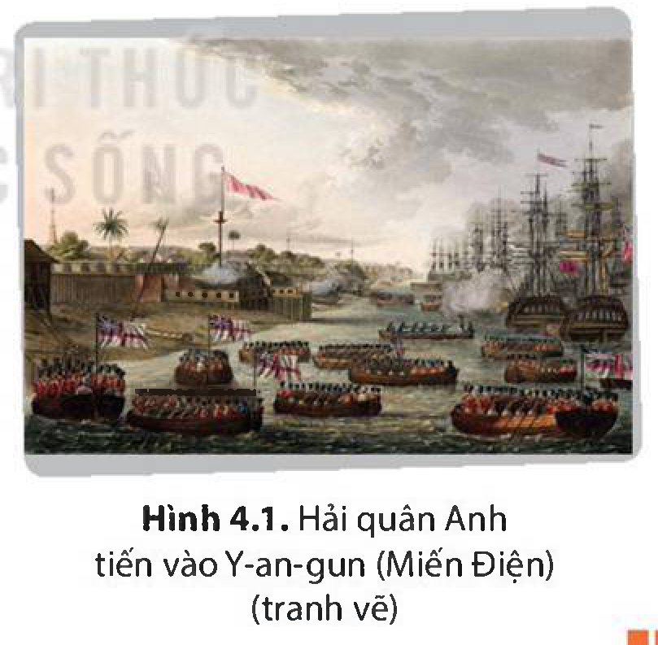
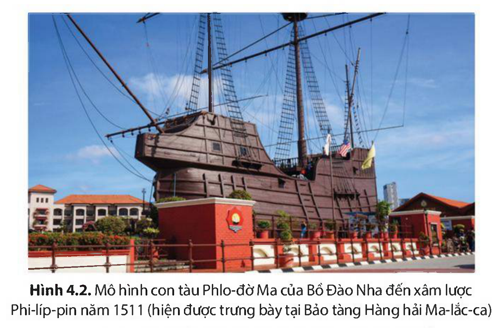
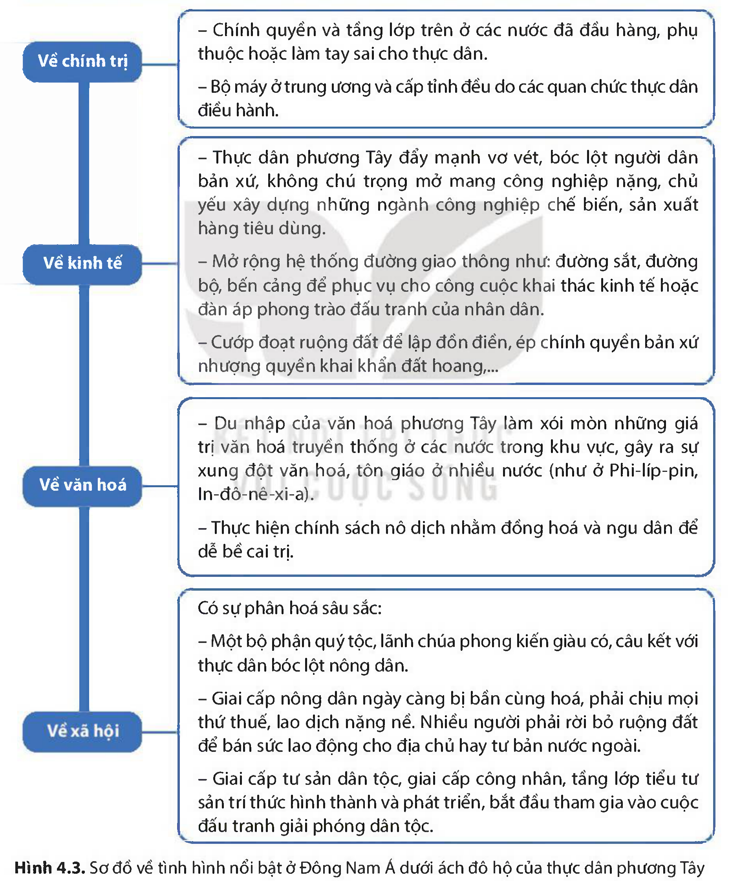
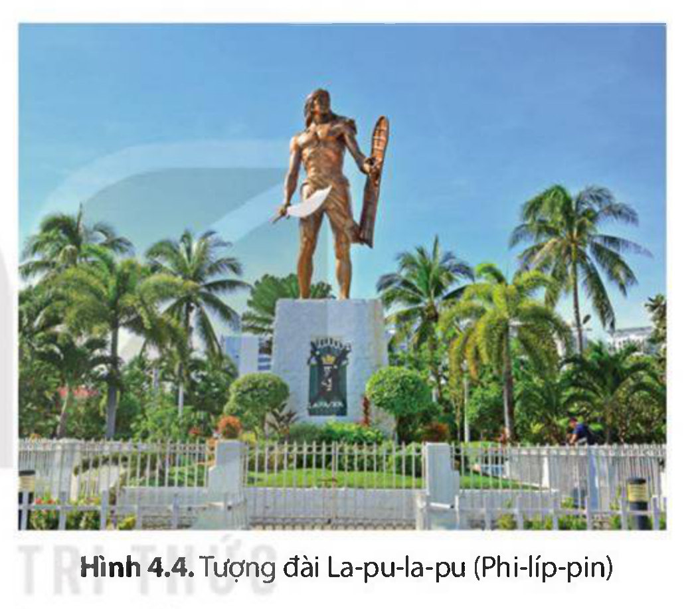

<!-- pdf:21 -->

# BÀI 4: ĐÔNG NAM Á TỪ NỬA SAU THẾ KỈ XVI ĐẾN GIỮA THẾ KỈ XIX

## 🎯 Học xong bài này, em sẽ:

- Trình bày được những nét chính về quá trình xâm nhập của thực dân phương Tây vào các nước Đông Nam Á.
- Nêu được những nét nổi bật về tình hình chính trị, kinh tế, văn hoá, xã hội ở các nước Đông Nam Á dưới ách đô hộ của thực dân phương Tây.
- Mô tả được những nét cơ bản của cuộc đấu tranh ở các nước Đông Nam Á chống ách đô hộ của thực dân phương Tây.

## 🔴 Mở đầu

Từ nửa sau thế kỉ XVI đến giữa thế kỉ XIX, trong khi các nước châu Âu và Bắc Mỹ đã căn bản hoàn thành cuộc cách mạng tư sản, sau đó là cách mạng công nghiệp thì các nước châu Á nói chung, khu vực Đông Nam Á nói riêng vẫn chìm đắm dưới chế độ phong kiến với nền kinh tế nông nghiệp lạc hậu. Vì vậy, Đông Nam Á sớm trở thành đối tượng xâm lược của thực dân phương Tây. Em biết gì về quá trình xâm nhập của thực dân phương Tây vào các nước Đông Nam Á và cuộc đấu tranh chống ách đô hộ thực dân của nhân dân các nước này?

*Hình 4.1. Hải quân Anh tiến vào Y-an-gun (Miến Điện) (tranh vẽ)*

## 1. Khái quát quá trình xâm nhập Đông Nam Á của thực dân phương Tây

Do Đông Nam Á có vị trí địa lí quan trọng, lại giàu tài nguyên khoáng sản nên sớm trở thành mục tiêu xâm lược của các nước tư bản phương Tây.

<!-- pdf:22 -->

*Hình 4.2. Mô hình con tàu Phlo-đờ Ma của Bồ Đào Nha đến xâm lược Phi-líp-pin năm 1511 (hiện được trưng bày tại Bảo tàng Hàng hải Ma-lắc-ca)*

*Bảng tóm tắt quá trình xâm nhập Đông Nam Á của thực dân phương Tây (từ nửa sau thế kỉ XVI đến giữa thế kỉ XIX)*

| Tên nước | Quá trình thực dân phương Tây xâm nhập |
| --- | --- |
| In-đô-nê-xi-a | – Thế kỉ XVI, Bồ Đào Nha chiếm một số đảo ở phía đông. – Sau đó, thực dân Hà Lan, Tây Ban Nha, Anh cũng xâm nhập vào In-đô-nê-xi-a. – Giữa thế kỉ XIX, Hà Lan hoàn thành việc xâm chiếm nước này. |
| Mã Lai (Ma-lai-xi-a) và Miến Điện (Mi-an-ma) | Từ nửa sau thế kỉ XVI, thực dân Anh, Hà Lan, Pháp tranh chấp ảnh hưởng tại Mã Lai và Miến Điện. |
| Phi-líp-pin | Giữa thế kỉ XVI, thực dân Tây Ban Nha đã xâm chiếm hầu hết quần đảo này và áp đặt ách thống trị suốt 350 năm. |
| Ba nước Đông Dương (Việt Nam, Lào, Cam-pu-chia) | Từ thế kỉ XVI, các nước thực dân Bồ Đào Nha, Tây Ban Nha, Anh, Pháp tìm mọi cách tranh giành phạm vi ảnh hưởng. |
| Xiêm (Thái Lan) | – Thế kỉ XVI, thương nhân châu Âu đã xâm nhập vào nước này. – Giữa thế kỉ XIX, sau khi đã hoàn thành xâm chiếm Ấn Độ, một phần Mã Lai và Miến Điện, thực dân Anh bắt đầu xâm nhập vào Xiêm. |

> ❓ Nêu những nét chính về quá trình xâm nhập của thực dân phương Tây vào các nước Đông Nam Á từ nửa sau thế kỉ XVI đến giữa thế kỉ XIX.

## 2. Tình hình Đông Nam Á dưới ách đô hộ của thực dân phương Tây

Sự thống trị của thực dân phương Tây đã dẫn tới những chuyển biến lớn lao ở các nước trong khu vực Đông Nam Á.

<!-- pdf:23 -->

<!-- term: Chính sách chia để trị -->
> 📜 **Tư liệu**
>
> - Chính quyền thực dân thường chia một nước hoặc vùng thuộc địa thành các vùng miền với các hình thức cai trị khác nhau và do đó, dân cư mỗi vùng trong một nước lại chịu nhiều hình thức cai trị khác nhau, tạo ra sự mâu thuẫn giữa họ với nhau để thực dân dễ bề cai trị... Ví dụ, khi thống trị ở Ma-lai-xi-a, Xin-ga-po và Bru-nây, thực dân Anh đã hoà trộn ba khu vực này vào nhau, sau đó chia thành bốn khu vực mới với chế độ cai trị khác nhau.
>
> (Theo Lương Ninh (Chủ biên), *Lịch sử Đông Nam Á*, NXB Giáo dục, 2005, tr. 233 – 234)

*Hình 4.3. Sơ đồ về tình hình nổi bật ở Đông Nam Á dưới ách đô hộ của thực dân phương Tây*

<!-- term: Chính sách nô dịch văn hoá -->
<!-- term: Giai cấp tư sản dân tộc -->
> **Sơ đồ về tình hình nổi bật ở Đông Nam Á dưới ách đô hộ của thực dân phương Tây:**
> - **Về chính trị:**
>   - Chính quyền và tầng lớp trên ở các nước đã đầu hàng, phụ thuộc hoặc làm tay sai cho thực dân.
>   - Bộ máy ở trung ương và cấp tỉnh đều do các quan chức thực dân điều hành.
> - **Về kinh tế:**
>   - Thực dân phương Tây đẩy mạnh vơ vét, bóc lột người dân bản xứ, không chú trọng mở mang công nghiệp nặng, chủ yếu xây dựng những ngành công nghiệp chế biến, sản xuất hàng tiêu dùng.
>   - Mở rộng hệ thống đường giao thông như: đường sắt, đường bộ, bến cảng để phục vụ cho công cuộc khai thác kinh tế hoặc đàn áp phong trào đấu tranh của nhân dân.
>   - Cướp đoạt ruộng đất để lập đồn điền, ép chính quyền bản xứ nhượng quyền khai khẩn đất hoang,...
> - **Về văn hoá:**
>   - Du nhập của văn hoá phương Tây làm xói mòn những giá trị văn hoá truyền thống ở các nước trong khu vực, gây ra sự xung đột văn hoá, tôn giáo ở nhiều nước (như ở Phi-líp-pin, In-đô-nê-xi-a).
>   - Thực hiện chính sách nô dịch nhằm đồng hoá và ngu dân để dễ bề cai trị.
> - **Về xã hội:** Có sự phân hoá sâu sắc:
>   - Một bộ phận quý tộc, lãnh chúa phong kiến giàu có, câu kết với thực dân bóc lột nông dân.
>   - Giai cấp nông dân ngày càng bị bần cùng hoá, phải chịu mọi thứ thuế, lao dịch nặng nề. Nhiều người phải rời bỏ ruộng đất để bán sức lao động cho địa chủ hay tư bản nước ngoài.
>   - Giai cấp tư sản dân tộc, giai cấp công nhân, tầng lớp tiểu tư sản trí thức hình thành và phát triển, bắt đầu tham gia vào cuộc đấu tranh giải phóng dân tộc.

<!-- pdf:24 -->

> ❓ 1. Khai thác tư liệu (tr. 21) giúp em biết điều gì về chính sách cai trị của chính quyền thực dân ở một số nước Đông Nam Á.
>
> 2. Hãy trình bày những nét chính về tình hình chính trị, kinh tế, văn hoá, xã hội của các nước Đông Nam Á dưới ách đô hộ của thực dân phương Tây.

## 3. Cuộc đấu tranh của nhân dân các nước Đông Nam Á chống thực dân phương Tây từ nửa sau thế kỉ XVI đến giữa thế kỉ XIX

<!-- term: Khởi nghĩa Đi-pô-nê-gô-rô -->
Ở In-đô-nê-xi-a, sau khi bị thực dân Hà Lan đô hộ, nhiều cuộc khởi nghĩa tiêu biểu đã nổ ra như: khởi nghĩa Tơ-ru-nô Giê-giô (1675), khởi nghĩa Su-ra-pa-tít (1683 – 1719), khởi nghĩa Đi-pô-nê-gô-rô (1825 – 1830),... nhưng đều thất bại.

<!-- term: Cuộc chống trả của thổ dân đảo Mác-tan -->
Tại Phi-líp-pin, ngay khi thực dân Tây Ban Nha xâm nhập đã vấp phải sự chống trả quyết liệt của thổ dân đảo Mác-tan (1521) với thủ lĩnh là La-pu-la-pu. Đến đầu thế kỉ XIX, phong trào đấu tranh đã có bước tiến rõ rệt, tiêu biểu là khởi nghĩa của Nô-va-lét (1823), khởi nghĩa Khơ-rút-xơ (1844),...

<!-- term: Cuộc kháng chiến chống Anh ở Miến Điện -->
Ở Miến Điện, ngay từ cuộc xâm lược đầu tiên (1824 – 1826), quân Anh đã vấp phải sự kháng cự của quân đội Miến Điện do tướng Ban-đu-la chỉ huy. Đến năm 1825, Ban-đu-la hi sinh, cuộc kháng chiến thất bại.

*Hình 4.4. Tượng đài La-pu-la-pu (Phi-líp-pin)*

> ❓ Mô tả một số nét chính về cuộc đấu tranh tiêu biểu ở Đông Nam Á chống ách đô hộ của thực dân phương Tây từ nửa sau thế kỉ XVI đến giữa thế kỉ XIX.

## ✏️ Luyện tập – Vận dụng

**Luyện tập:**

Em có nhận xét gì về chính sách đô hộ của thực dân phương Tây đối với các nước Đông Nam Á?

**Vận dụng:**

Có ý kiến cho rằng: Các nước tư bản phương Tây xâm chiếm Đông Nam Á là để giúp đỡ những nước này thoát khỏi nghèo nàn, lạc hậu. Em đồng ý với ý kiến đó không? Hãy sưu tầm một số tư liệu từ sách, báo và internet để chứng minh cho ý kiến của em.

## 📷 Danh sách hình trong bài

| Mã hình | Trang PDF | Vị trí | Chú thích |
| --- | --- | --- | --- |
| H8-lich_su_va_dia_ly-ls-b04-01 | 21 | Mở đầu, góc dưới phải khung chạm đỉnh kí hiệu gạch đôi màu cam (trang 19) | Hình 4.1. Hải quân Anh tiến vào Y-an-gun (Miến Điện) (tranh vẽ) |
| H8-lich_su_va_dia_ly-ls-b04-02 | 22 | Mục 1 (trang 20) | Hình 4.2. Mô hình con tàu Phlo-đờ Ma của Bồ Đào Nha đến xâm lược Phi-líp-pin năm 1511 (hiện được trưng bày tại Bảo tàng Hàng hải Ma-lắc-ca) |
| H8-lich_su_va_dia_ly-ls-b04-03 | 23 | Mục 2 (trang 21) | Hình 4.3. Sơ đồ về tình hình nổi bật ở Đông Nam Á dưới ách đô hộ của thực dân phương Tây |
| H8-lich_su_va_dia_ly-ls-b04-04 | 24 | Mục 3 (trang 22) | Hình 4.4. Tượng đài La-pu-la-pu (Phi-líp-pin) |
