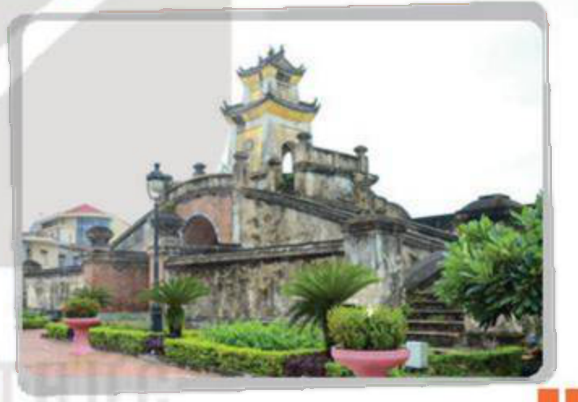
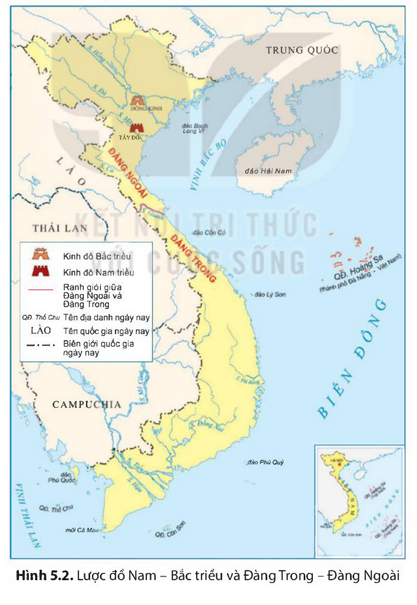
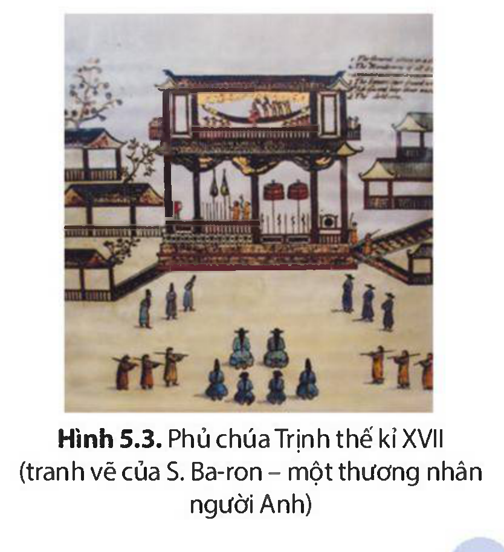

<!-- pdf:25 -->

# BÀI 5: CUỘC XUNG ĐỘT NAM – BẮC TRIỀU VÀ TRỊNH – NGUYỄN

## 🎯 Học xong bài này, em sẽ:

- Nêu được những nét chính về sự ra đời của Vương triều Mạc.
- Giải thích được nguyên nhân bùng nổ xung đột Nam – Bắc triều, Trịnh – Nguyễn.
- Nêu được hệ quả của xung đột Nam – Bắc triều, Trịnh – Nguyễn.

## 🔴 Mở đầu

Di tích thành nhà Mạc (Cao Bằng, Lạng Sơn), Luỹ Thầy (Quảng Bình),... gợi cho em nhớ đến những cuộc xung đột nào trong các thế kỉ XVI – XVII? Những cuộc xung đột đó đã để lại hệ quả như thế nào đối với lịch sử dân tộc?

*Hình 5.1. Quảng Bình Quan (thuộc hệ thống di tích Luỹ Thầy, Quảng Bình)*

## 1. Sự ra đời Vương triều Mạc

Đến đầu thế kỉ XVI, nhà Lê lâm vào tình trạng khủng hoảng. Sự tranh chấp giữa các phe phái phong kiến diễn ra ngày càng quyết liệt. Các cuộc khởi nghĩa nông dân nổ ra ở nhiều nơi trong cả nước. Trong bối cảnh ấy, Mạc Đăng Dung, một võ quan trong triều Lê đã lợi dụng xung đột giữa các phe phái để tiêu diệt các thế lực đối địch và thâu tóm mọi quyền hành.

> 💡 **Em có biết?**
>
> Mạc Đăng Dung quê ở làng Cổ Trai (Kiến Thuỵ, Hải Phòng), là cháu bảy đời của Trạng nguyên Mạc Đĩnh Chi (thời Trần).
>
> Là người có sức khoẻ và giỏi võ, thi đỗ lực sĩ và được sung vào đội Túc vệ, ông dần được thăng các chức quan trong triều Lê và được trọng dụng. Đến năm 1527, ông được phong là An Hưng Vương.

> 📜 **Tư liệu**
>
> 1. • “Quân lực của Đăng Dung ngày càng nhiều, công danh ngày càng thịnh, triều đình ai cũng phục.”
>
> (Lê Quý Đôn, *Đại Việt thông sử*, NXB Khoa học xã hội, 1978, tr. 36)
>
> • “Đăng Dung uy quyền ngày một lớn, lòng người đều hướng theo.”
>
> (Ngô Sỹ Liên, *Đại Việt sử ký toàn thư*, Tập III, NXB Khoa học xã hội, 1993, tr. 96)

<!-- pdf:26 -->

<!-- term: Vương triều Mạc -->
Nhận thấy sự bất lực của nhà Lê, năm 1527, Mạc Đăng Dung ép vua Lê nhường ngôi, lập ra triều Mạc, thực hiện một số chính sách về chính trị, kinh tế, xã hội nhằm ổn định và phát triển đất nước.

> ❓ Khai thác tư liệu 1 và thông tin trong mục, hãy trình bày những nét chính về sự ra đời của Vương triều Mạc.

## 2. Xung đột Nam – Bắc triều

### a) Nguyên nhân bùng nổ

<!-- term: Nam triều và Bắc triều -->
Nhà Mạc được thành lập nhưng một bộ phận quan lại trung thành với triều Lê ra sức chống lại nhằm khôi phục vương triều này. Năm 1533, Nguyễn Kim (một quan võ trong triều Lê) vào Thanh Hoá, lấy danh nghĩa “phù Lê diệt Mạc” đưa một người con của vua Lê lên ngôi, thiết lập lại vương triều, sử cũ gọi là *Nam triều* để phân biệt với *Bắc triều* (của nhà Mạc ở phía bắc).

*Hình 5.2. Lược đồ Nam – Bắc triều và Đàng Trong – Đàng Ngoài*

<!-- pdf:27 -->

<!-- term: Xung đột Nam – Bắc triều -->
Mâu thuẫn giữa Nam – Bắc triều dẫn đến cuộc xung đột trong gần 60 năm (1533 – 1592). Cuối cùng, Nam triều chiếm được Thăng Long (Đông Kinh), nhà Mạc phải chạy lên Cao Bằng, xung đột Nam – Bắc triều chấm dứt.

### b) Hệ quả

<!-- term: Xung đột Nam – Bắc triều -->
Cuộc xung đột diễn ra trong một thời gian dài, đất nước bị chia cắt. Cả vùng Thanh – Nghệ và đồng bằng Bắc Bộ đều là chiến trường. Làng mạc bị tàn phá; sản xuất nông nghiệp, thủ công nghiệp bị đình trệ; trao đổi buôn bán giữa các vùng gặp nhiều khó khăn. Đời sống nhân dân khốn cùng vì đói, vì bị bắt đi lính, đi phu và nhiều gia đình phải li tán.

> 🔗 **Kết nối với văn học**
>
> Trong bài thơ *Thương loạn*, Nguyễn Bỉnh Khiêm đã miêu tả:
>
> *Cả một vùng từ đông sang tây*
> *Đồng ruộng chẳng có gì cày cấy*
> *Chiến tranh cứ nối tiếp nhau*
> *Tai hoạ thật là cùng cực.*

> ❓ 1. Hãy giải thích nguyên nhân bùng nổ cuộc xung đột Nam – Bắc triều.
>
> 2. Hãy tóm tắt nét chính về hệ quả của cuộc xung đột Nam – Bắc triều.

## 3. Xung đột Trịnh – Nguyễn

### a) Nguyên nhân bùng nổ

Năm 1545, Nguyễn Kim chết, con rể là Trịnh Kiểm lên thay, nắm toàn bộ binh quyền. Từ đây, mâu thuẫn giữa hai dòng họ Trịnh – Nguyễn dần bộc lộ và ngày càng trở nên gay gắt.

> 💡 **Em có biết?**
>
> Trịnh Kiểm vốn là người có tài thao lược và có sức khoẻ hơn người, từng theo Nguyễn Kim đánh dẹp nhà Mạc, lập được nhiều chiến công nên được trao binh quyền. Từ đây, Trịnh Kiểm bắt đầu thực hiện việc loại bỏ dần thế lực của họ Nguyễn để tập trung quyền lực cho họ Trịnh.

Trong bối cảnh ấy, người con thứ của Nguyễn Kim là Nguyễn Hoàng đã xin vào trấn thủ ở Thuận Hoá để tìm cách gây dựng sự nghiệp. Sau khi Nguyễn Hoàng mất, con trai là Nguyễn Phúc Nguyên lên thay, tiếp tục củng cố địa vị, dần dần cắt đứt quan hệ lệ thuộc với họ Trịnh. Năm 1627, cuộc xung đột giữa hai thế lực Trịnh – Nguyễn bùng nổ.

> 📜 **Tư liệu**
>
> 2. Hai dòng họ Trịnh – Nguyễn đều mượn danh vua Lê để lấn át, tiêu diệt lẫn nhau. Họ Trịnh bắt họ Nguyễn phải nộp thuế đều đặn và phải thần phục triều đình Trung ương, trong khi thực quyền lại nằm trong tay họ Trịnh. Họ Nguyễn thì tuyên bố chống lại họ Trịnh, mong tiêu diệt họ Trịnh để khôi phục quyền lợi cho vua Lê.
>
> (Theo Trần Thị Vinh (Chủ biên), *Lịch sử Việt Nam*, Tập 4, NXB Khoa học xã hội, 2017, tr. 43)

*Hình 5.3. Phủ chúa Trịnh thế kỉ XVII (tranh vẽ của S. Ba-ron – một thương nhân người Anh)*

<!-- pdf:28 -->

### b) Hệ quả

<!-- term: Luỹ Thầy -->
> 💡 **Em có biết?**
>
> Luỹ Thầy (hay luỹ Đào Duy Từ – gọi theo tên của nhà quân sự đã chỉ huy xây dựng) là thành luỹ được xây dựng kiên cố giúp chúa Nguyễn chống lại các cuộc tấn công của chúa Trịnh. Hiện nay, dưới chân luỹ sát cửa sông Nhật Lệ (thuộc tỉnh Quảng Bình) còn một tấm bia khắc dòng chữ: “Nơi đây đã từng diễn ra các cuộc giao tranh quyết liệt giữa hai thế lực phong kiến Trịnh – Nguyễn trong gần 50 năm của cuộc nội chiến”.

Trong gần nửa thế kỉ (1627 – 1672), hai thế lực Trịnh và Nguyễn trải qua bảy lần giao chiến, cuốn cả nước vào vòng binh đao khói lửa. Toàn bộ vùng đất Quảng Bình, Hà Tĩnh ngày nay trở thành chiến trường ác liệt.

<!-- term: Đàng Ngoài và Đàng Trong -->
Cuối cùng, hai bên lấy sông Gianh (Quảng Bình) làm ranh giới, chia cắt đất nước thành Đàng Ngoài (từ sông Gianh trở ra Bắc) và Đàng Trong (từ sông Gianh trở vào Nam). Luỹ Thầy ở phía nam như một bức tường thành vững chắc ngăn đôi đất nước.

> *Khôn ngoan qua được Thanh Hà,*
> *Dẫu rằng có cánh khó qua Luỹ Thầy*
>
> (Ca dao)

<!-- term: Cục diện vua Lê – chúa Trịnh -->
<!-- term: Chúa Nguyễn -->
Ở Đàng Ngoài, Trịnh Tùng xây dựng vương phủ bên cạnh triều đình vua Lê. Tuy nắm toàn quyền thống trị, nhưng họ Trịnh vẫn phải dựa vào danh nghĩa vua Lê, nên hình thành cục diện “vua Lê – chúa Trịnh”. Ở Đàng Trong, con cháu họ Nguyễn cũng nối nhau cầm quyền, gọi là “chúa Nguyễn”.

Cuộc xung đột kéo dài giữa hai tập đoàn phong kiến Trịnh – Nguyễn kéo dài làm suy kiệt sức người, sức của; tàn phá đồng ruộng, xóm làng; giết hại nhiều người dân vô tội; chia cắt đất nước và làm ảnh hưởng đến sự phát triển chung của quốc gia – dân tộc.

> ❓ 1. Khai thác tư liệu 2 và thông tin trong mục, hãy giải thích nguyên nhân dẫn đến cuộc xung đột Trịnh – Nguyễn.
>
> 2. Hãy nêu hệ quả của cuộc xung đột Trịnh – Nguyễn.

## ✏️ Luyện tập – Vận dụng

**Luyện tập:**

Hãy lập và hoàn thành bảng hệ thống (theo gợi ý dưới đây) về các cuộc xung đột Nam – Bắc triều và Trịnh – Nguyễn.

| Nội dung | Xung đột Nam – Bắc triều | Xung đột Trịnh – Nguyễn |
| --- | --- | --- |
| Người đứng đầu | | |
| Nguyên nhân | | |
| Thời gian | | |
| Hệ quả | | |

**Vận dụng:**

1. Giả sử là một người dân sống ở thế kỉ XVI – XVII, em hãy đưa ra ít nhất một lí do phản đối các cuộc xung đột Nam – Bắc triều và Trịnh – Nguyễn.

2. Tìm hiểu thông tin từ sách, báo, internet về di tích Luỹ Thầy và sông Gianh (Quảng Bình), hãy viết đoạn văn ngắn (khoảng 7 – 10 dòng) về cuộc xung đột Trịnh – Nguyễn.

## 📷 Danh sách hình trong bài

| Mã hình | Trang PDF | Vị trí | Chú thích |
| --- | --- | --- | --- |
| H8-lich_su_va_dia_ly-ls-b05-01 | 25 | Mở đầu, góc dưới phải khung ảnh chạm đỉnh kí hiệu gạch đôi màu cam; chú thích in bên trái dưới đoạn Mở đầu (trang 23) | Hình 5.1. Quảng Bình Quan (thuộc hệ thống di tích Luỹ Thầy, Quảng Bình) |
| H8-lich_su_va_dia_ly-ls-b05-02 | 26 | Mục 2.a (trang 24) | Hình 5.2. Lược đồ Nam – Bắc triều và Đàng Trong – Đàng Ngoài |
| H8-lich_su_va_dia_ly-ls-b05-03 | 27 | Mục 3.a (trang 25) | Hình 5.3. Phủ chúa Trịnh thế kỉ XVII (tranh vẽ của S. Ba-ron – một thương nhân người Anh) |
