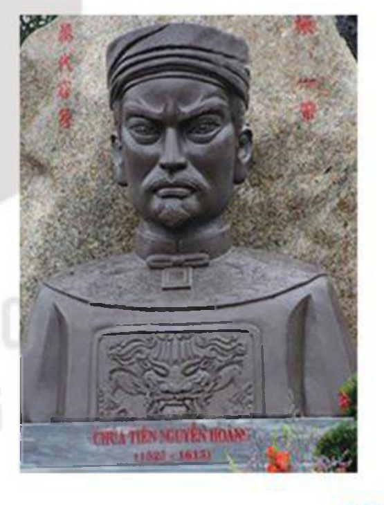
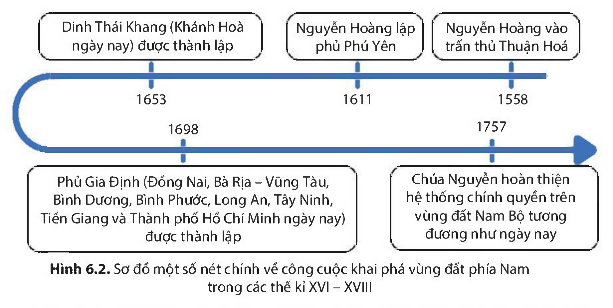
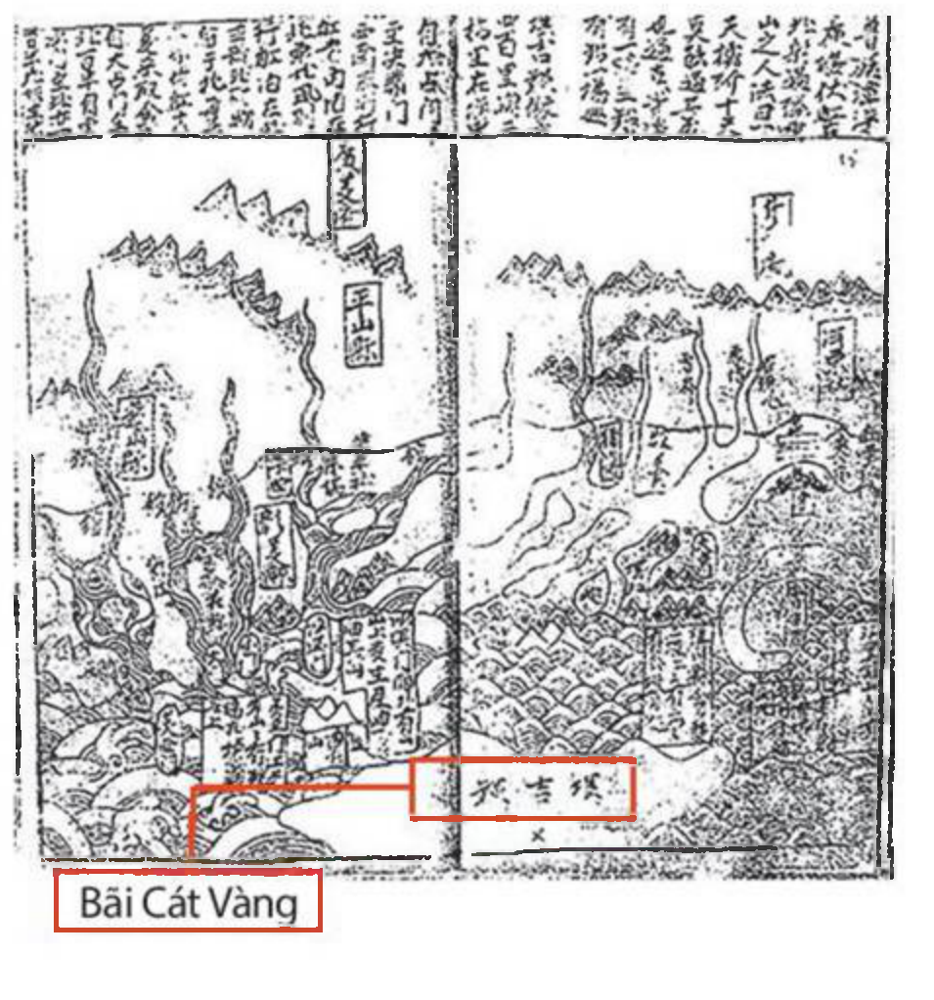

<!-- pdf:29 -->

# BÀI 6: CÔNG CUỘC KHAI PHÁ VÙNG ĐẤT PHÍA NAM TỪ THẾ KỈ XVI ĐẾN THẾ KỈ XVIII

## 🎯 Học xong bài này, em sẽ:

- Trình bày được khái quát công cuộc khai phá vùng đất phía Nam trong các thế kỉ XVI – XVIII.
- Mô tả và nêu được ý nghĩa của quá trình thực thi chủ quyền đối với quần đảo Hoàng Sa và quần đảo Trường Sa của các chúa Nguyễn.

## 🔴 Mở đầu

Đánh giá về chúa Nguyễn Hoàng – người có công rất lớn trong quá trình khai phá, mở mang vùng đất Đàng Trong từ nửa cuối thế kỉ XVI, sử triều Nguyễn có chép: “Chúa vỗ về quân dân, thu dùng hào kiệt... được dân mến phục... Nghiệp đế dựng lên từ đấy” (Quốc sử quán triều Nguyễn, *Đại Nam thực lục*, Tập I, NXB Giáo dục, 2002, tr. 28). Hãy chia sẻ những hiểu biết của em về chúa Nguyễn Hoàng và công cuộc khai phá vùng đất Đàng Trong cũng như quá trình thực thi chủ quyền biển đảo của các chúa Nguyễn.

*Hình 6.1. Tượng chúa Nguyễn Hoàng (Điện Bàn, Quảng Nam)*

## 1. Công cuộc khai phá vùng đất phía Nam trong các thế kỉ XVI – XVIII

Năm 1558, Nguyễn Hoàng vào trấn thủ Thuận Hoá. Quá trình di dân, khai phá vùng đất phía Nam được đẩy mạnh. Đến cuối thế kỉ XVI, cả vùng Thuận – Quảng đã có khoảng 1 226 xã, thôn.

Kế nghiệp Nguyễn Hoàng, các chúa Nguyễn tiếp tục xây dựng bộ máy chính quyền phong kiến ở Đàng Trong, vừa củng cố việc phòng thủ đất Thuận – Quảng, vừa thực hiện chính sách khai hoang, đẩy mạnh việc khai phá các vùng đất mới.

<!-- pdf:30 -->

*Hình 6.2. Sơ đồ một số nét chính về công cuộc khai phá vùng đất phía Nam trong các thế kỉ XVI – XVIII*

> **Sơ đồ một số nét chính về công cuộc khai phá vùng đất phía Nam trong các thế kỉ XVI – XVIII:**
> - **1558:** Nguyễn Hoàng vào trấn thủ Thuận Hoá.
> - **1611:** Nguyễn Hoàng lập phủ Phú Yên.
> - **1653:** Dinh Thái Khang (Khánh Hoà ngày nay) được thành lập.
> - **1698:** Phủ Gia Định (Đồng Nai, Bà Rịa – Vũng Tàu, Bình Dương, Bình Phước, Long An, Tây Ninh, Tiền Giang và Thành phố Hồ Chí Minh ngày nay) được thành lập.
> - **1757:** Chúa Nguyễn hoàn thiện hệ thống chính quyền trên vùng đất Nam Bộ tương đương như ngày nay.

Đến cuối thế kỉ XVIII, chúa Nguyễn đã làm chủ một vùng đất rộng lớn từ phía nam dải Hoành Sơn đến mũi Cà Mau, bao gồm cả các đảo, quần đảo ở Biển Đông và vịnh Thái Lan. Các chúa Nguyễn đã tổ chức đơn vị hành chính, tổ chức bộ máy cai trị, lập sổ sách quản lí dân đinh, ruộng đất và đặt ra các loại thuế.

> ❓ Khai thác sơ đồ hình 6.2 và thông tin trong mục, hãy trình bày khái quát công cuộc khai phá vùng đất phía Nam trong các thế kỉ XVI – XVIII.

## 2. Quá trình thực thi chủ quyền đối với quần đảo Hoàng Sa và quần đảo Trường Sa của các chúa Nguyễn

Cùng với công cuộc khai phá vùng đất phía Nam, các chúa Nguyễn cũng thực thi chủ quyền đối với các đảo, quần đảo ở Biển Đông, trong đó có hai quần đảo lớn là quần đảo Hoàng Sa và quần đảo Trường Sa.

<!-- term: Bãi Cát Vàng -->
> 📜 **Tư liệu**
>
> 1. Bãi Cát Vàng (quần đảo Hoàng Sa) dài khoảng 400 dặm, rộng 20 dặm... Họ Nguyễn, mỗi năm vào cuối mùa đông, cử 18 chiếc thuyền đến đó lấy hàng hoá.
>
> (Theo Hãn Nguyên Nguyễn Nhã, *Những bằng chứng về chủ quyền của Việt Nam đối với hai quần đảo Hoàng Sa, Trường Sa*, NXB Giáo dục Việt Nam, 2013, tr. 40)

*Hình 6.3. Bản đồ do Đỗ Bá vẽ vào thế kỉ XVII in trong *Toàn tập An Nam lộ**

<!-- pdf:31 -->

<!-- term: Đội Hoàng Sa và đội Bắc Hải -->
Hoạt động khai thác và xác lập chủ quyền của chúa Nguyễn tại quần đảo Hoàng Sa và quần đảo Trường Sa được thực hiện có tổ chức, hệ thống và liên tục thông qua đội Hoàng Sa và đội Bắc Hải.

<!-- term: Đội Hoàng Sa và đội Bắc Hải -->
> 📜 **Tư liệu**
>
> 2. Họ Nguyễn lại đặt đội Bắc Hải, ai tình nguyện đi thì cấp giấy sai đi, miễn cho tiền sưu cùng các tiền tuần đò, cho đi thuyền câu nhỏ ra các xứ Bắc Hải, cù lao Côn Lôn và các đảo ở Hà Tiên...
>
> (Theo Lê Quý Đôn, *Phủ biên tạp lục*, NXB Văn hoá thông tin, Hà Nội, 1987, tr. 155)

<!-- term: Đội Hoàng Sa và đội Bắc Hải -->
Đội Hoàng Sa và Bắc Hải là hai tổ chức dân binh độc đáo vừa có chức năng kinh tế (khai thác tài nguyên biển) vừa có chức năng kiểm soát, quản lí biển, đảo. Nhiệm vụ của họ là thu lượm hàng hoá của những con tàu bị đắm (gươm, súng, vàng, bạc, đồ đồng, thiếc, chì,...), các hải sản quý (đồi mồi, ba ba, hải sâm,...), từng bước xác lập chủ quyền đối với hai quần đảo này.

> 💡 **Em có biết?**
>
> Những chuyến đi ra đảo của đội Hoàng Sa thường gặp nhiều rủi ro, nguy hiểm. Cho đến nay, người dân Lý Sơn vẫn còn lưu truyền những câu ca như:
>
> *Hoàng Sa trời nước mênh mông*
> *Người đi thì có mà không thấy về*
> *Hoàng Sa mây nước bốn bề*
> *Tháng hai/ba Khao lề thế lính Hoàng Sa.*

Đội Hoàng Sa và đội Bắc Hải tiếp tục duy trì hoạt động ở thời Tây Sơn (cuối thế kỉ XVIII). Sự quan tâm của các chính quyền phong kiến và hoạt động liên tục của các đội dân binh này trong suốt các thế kỉ XVII – XVIII đã khẳng định quá trình khai thác, thực thi chủ quyền từ rất sớm của người Việt Nam đối với quần đảo Hoàng Sa và quần đảo Trường Sa.

> ❓ Khai thác tư liệu 1, 2 và thông tin trong mục, hãy mô tả quá trình thực thi chủ quyền đối với quần đảo Hoàng Sa và quần đảo Trường Sa của người Việt Nam trong các thế kỉ XVII – XVIII. Những việc làm đó có ý nghĩa như thế nào?

## ✏️ Luyện tập – Vận dụng

**Luyện tập:**

Hãy lập bảng tóm tắt về công cuộc khai phá vùng đất phía Nam trong các thế kỉ XVI – XVIII theo các tiêu chí: thời gian, sự kiện chính.

**Vận dụng:**

1. Sưu tầm tư liệu từ sách, báo, internet, hãy giới thiệu về công cuộc khai phá vùng đất phía Nam và thực thi chủ quyền đối với quần đảo Hoàng Sa, quần đảo Trường Sa trong các thế kỉ XVI – XVIII.

2. Tìm hiểu thông tin trên internet, em hãy giới thiệu về nguồn gốc của Lễ Khao lề thế lính trên đảo Lý Sơn. Theo em, việc duy trì tổ chức Lễ Khao lề thế lính trên đảo Lý Sơn ngày nay có ý nghĩa gì?

## 📷 Danh sách hình trong bài

| Mã hình | Trang PDF | Vị trí | Chú thích |
| --- | --- | --- | --- |
| H8-lich_su_va_dia_ly-ls-b06-01 | 29 | Mở đầu, chú thích in bên trái dưới đoạn Mở đầu (trang 27) | Hình 6.1. Tượng chúa Nguyễn Hoàng (Điện Bàn, Quảng Nam) |
| H8-lich_su_va_dia_ly-ls-b06-02 | 30 | Mục 1 (trang 28) | Hình 6.2. Sơ đồ một số nét chính về công cuộc khai phá vùng đất phía Nam trong các thế kỉ XVI – XVIII |
| H8-lich_su_va_dia_ly-ls-b06-03 | 30 | Mục 2, chú thích in bên trái dưới hộp Tư liệu 1 (trang 28) | Hình 6.3. Bản đồ do Đỗ Bá vẽ vào thế kỉ XVII in trong Toàn tập An Nam lộ |
