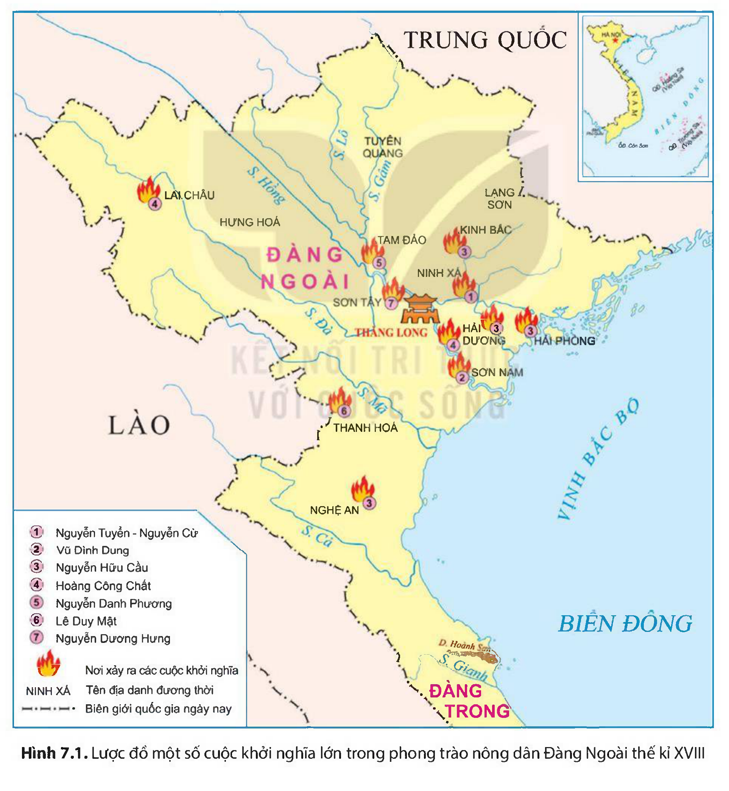
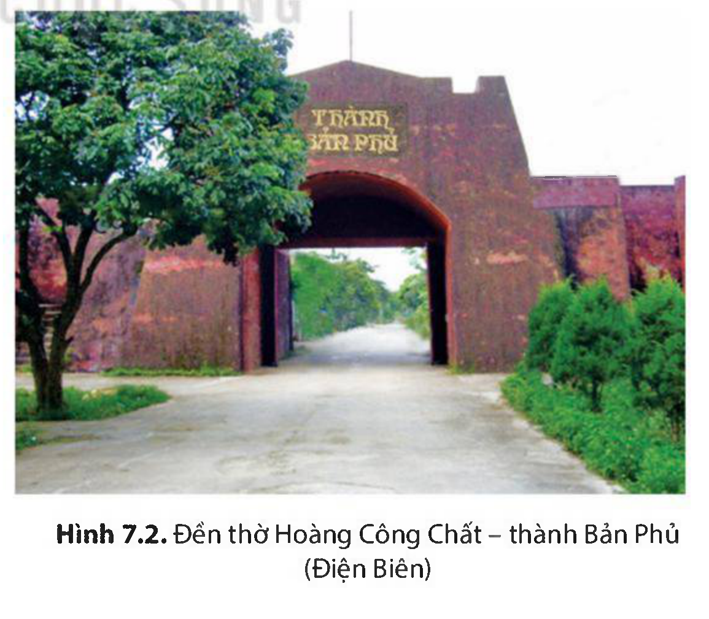

<!-- pdf:32 -->

# BÀI 7: KHỞI NGHĨA NÔNG DÂN Ở ĐÀNG NGOÀI THẾ KỈ XVIII

## 🎯 Học xong bài này, em sẽ:

- Nêu được một số nét chính (bối cảnh lịch sử, diễn biến, kết quả và ý nghĩa) của phong trào nông dân ở Đàng Ngoài thế kỉ XVIII.
- Nêu được tác động của phong trào nông dân ở Đàng Ngoài đối với xã hội Đại Việt thế kỉ XVIII.

## 🔴 Mở đầu

Vào thế kỉ XVIII, nhiều cuộc khởi nghĩa nông dân ở Đàng Ngoài đã diễn ra, tiêu biểu là các cuộc khởi nghĩa do Nguyễn Danh Phương, Nguyễn Hữu Cầu và Hoàng Công Chất,... lãnh đạo. Theo em, các cuộc khởi nghĩa đó đã có tác động như thế nào đến tình hình Đại Việt?

## 1. Bối cảnh lịch sử

Vào giữa thế kỉ XVIII, chính quyền phong kiến Đàng Ngoài lâm vào khủng hoảng sâu sắc. Vua Lê chỉ còn là “cái bóng mờ” trong cung cấm. Phủ chúa giữ mọi quyền hành, quanh năm tổ chức hội hè, yến tiệc, phung phí tiền của.

> 📜 **Tư liệu**
>
> 1. • Chúa Trịnh Giang cho xây nhiều chùa lớn. Năm 1730, hàng vạn dân ở Hải Dương phải đi đào sông, kéo gỗ và đắp đường, chở gạch đá để tu sửa hai chùa Quỳnh Lâm và Sùng Nghiêm.
>
> (Theo *Khâm định Việt sử thông giám cương mục*, Quyển 37, Tập hai, NXB Giáo dục, 1998, tr. 814)
>
> • Trong phủ chúa có đến bốn, năm trăm hoạn quan, ngạo mạn hách dịch..., cả nước căm ghét và kinh sợ chúng.
>
> (Trích *Thông sức của Ngự sử đài năm 1719*, Phan Ngọc Liên (Tổng Chủ biên), *Lịch sử 7*, NXB Giáo dục Việt Nam, 2019, tr. 116)

Ruộng đất của nông dân bị địa chủ, quan lại lấn chiếm. Tình trạng hạn hán, lụt lội dẫn đến nạn mất mùa liên tiếp xảy ra. Đê sông Hồng, sông Mã nhiều năm bị vỡ làm cho nhà cửa bị ngập, sản xuất nông nghiệp đình đốn. Thủ công nghiệp, thương nghiệp ngày càng sa sút, điêu tàn.

> 📜 **Tư liệu**
>
> 2. • Để có tiền giải quyết khó khăn, phủ chúa có lệnh “ai có nghề gì cũng đều phải nộp thuế”. Vì trưng thu quá mức nên “có người vì thuế sơn sống mà chặt cây sơn; vì thuế vải lụa mà phá khung cửi; vì thu cá tôm mà phải cất giấu chài lưới,...”.
>
> • Nạn đói khủng khiếp ở Đàng Ngoài làm cho “dân phiêu tán dắt díu nhau đi kiếm ăn đầy đường. Giá gạo cao vọt, một trăm đồng tiền không được một bữa no...”.
>
> (Theo *Khâm định Việt sử thông giám cương mục*, Quyển 37 – 39, Tập hai, Sđd, tr. 817, 852)

<!-- pdf:33 -->

Cuộc sống khó khăn về mọi mặt đã thúc đẩy nông dân Đàng Ngoài vùng lên khởi nghĩa chống lại chính quyền phong kiến.

> ❓ Khai thác tư liệu 1, 2 và thông tin trong mục, hãy nêu một số nét chính về bối cảnh lịch sử dẫn đến phong trào nông dân Đàng Ngoài.

## 2. Một số cuộc khởi nghĩa lớn của phong trào nông dân Đàng Ngoài

Giữa thế kỉ XVIII, phong trào nông dân Đàng Ngoài bùng nổ ở khắp các trấn đồng bằng và vùng Thanh – Nghệ.

*Hình 7.1. Lược đồ một số cuộc khởi nghĩa lớn trong phong trào nông dân Đàng Ngoài thế kỉ XVIII*

<!-- pdf:34 -->

*Bảng tóm tắt một số cuộc khởi nghĩa nông dân tiêu biểu ở Đàng Ngoài*

<!-- term: Khởi nghĩa Hoàng Công Chất -->
<!-- term: Khởi nghĩa Nguyễn Danh Phương -->
<!-- term: Khởi nghĩa Nguyễn Hữu Cầu -->
| Các cuộc khởi nghĩa tiêu biểu/Thời gian diễn ra | Diễn biến chính |
| --- | --- |
| Hoàng Công Chất (1739 – 1769) | Hoàng Công Chất tập hợp dân nghèo ở Sơn Nam khởi nghĩa. Ông xây dựng căn cứ ở Điện Biên và được nhân dân Tây Bắc hết lòng ủng hộ. Ông có công bảo vệ vùng biên giới và giúp dân ổn định cuộc sống. Sau khi ông mất, con trai ông tiếp tục chỉ huy cuộc khởi nghĩa kéo dài đến năm 1769 thì bị dập tắt. |
| Nguyễn Danh Phương (1740 – 1751) | Nguyễn Danh Phương tập hợp nghĩa quân xây dựng căn cứ ở Tam Đảo (Vĩnh Phúc), rồi mở rộng hoạt động ra các trấn Sơn Tây, Tuyên Quang. Uy thế của nghĩa quân ngày một lên cao. Năm 1751, trước sự tấn công ồ ạt của quân Trịnh, Nguyễn Danh Phương bị bắt. Khởi nghĩa thất bại. |
| Nguyễn Hữu Cầu (1741 – 1751) | Địa bàn hoạt động chính của cuộc khởi nghĩa Nguyễn Hữu Cầu là ở Đồ Sơn, Vân Đồn,... Sau đó, nghĩa quân đánh lên Kinh Bắc, uy hiếp kinh thành Thăng Long, rồi mở rộng hoạt động xuống Sơn Nam, vào Thanh Hoá, Nghệ An. Cuộc khởi nghĩa nhận được sự ủng hộ đông đảo của nhân dân. Năm 1751, quân Trịnh tấn công dồn dập, khởi nghĩa thất bại. |

<!-- term: Khởi nghĩa Nguyễn Hữu Cầu -->
> 💡 **Em có biết?**
>
> Nguyễn Hữu Cầu còn được gọi là Quận He, vì ông bơi lội rất giỏi nên người dân ví ông với cá he, một loại cá có sức mạnh và không bao giờ làm hại người đi biển. Nghĩa quân của ông đã gây cho quân Trịnh nhiều phen khốn đốn. Hiện nay, ở một số địa phương thuộc Hải Phòng vẫn còn những di tích và truyền thuyết dân gian về hoạt động của nghĩa quân Nguyễn Hữu Cầu.

*Hình 7.2. Đền thờ Hoàng Công Chất – thành Bản Phủ (Điện Biên)*

<!-- pdf:35 -->

> ❓ Khai thác lược đồ hình 7.1 và thông tin trong mục, hãy cho biết thời gian bùng nổ, diễn biến chính của một số cuộc khởi nghĩa tiêu biểu trong phong trào nông dân Đàng Ngoài thế kỉ XVIII.

## 3. Kết quả, ý nghĩa lịch sử và tác động của phong trào nông dân ở Đàng Ngoài thế kỉ XVIII

<!-- term: Phong trào nông dân ở Đàng Ngoài -->
Phong trào nông dân ở Đàng Ngoài kéo dài hàng chục năm nhưng cuối cùng đều thất bại, nhiều thủ lĩnh bị bắt, bị xử tử.

<!-- term: Phong trào nông dân ở Đàng Ngoài -->
Phong trào đã thu hút đông đảo các tầng lớp nhân dân tham gia, thể hiện ý chí đấu tranh chống áp bức, bất công; đồng thời đã buộc chúa Trịnh phải thực hiện một số chính sách như: khuyến khích khai hoang, đưa nông dân lưu tán về quê làm ăn,...

<!-- term: Phong trào nông dân ở Đàng Ngoài -->
Phong trào đã giáng đòn mạnh mẽ và đẩy chính quyền Lê – Trịnh lún sâu vào cuộc khủng hoảng sâu sắc, toàn diện, chuẩn bị "mảnh đất" thuận lợi cho phong trào Tây Sơn phát triển mạnh mẽ ra Đàng Ngoài vào cuối thế kỉ XVIII.

> ❓ Hãy cho biết kết quả, ý nghĩa và tác động của phong trào nông dân Đàng Ngoài đối với xã hội Đại Việt thế kỉ XVIII.

## ✏️ Luyện tập – Vận dụng

**Luyện tập:**

Lập sơ đồ tư duy về một số cuộc khởi nghĩa lớn trong phong trào nông dân Đàng Ngoài thế kỉ XVIII.

**Vận dụng:**

Tìm hiểu thông tin từ sách, báo và internet, hãy viết đoạn văn (khoảng 5 – 7 dòng) giới thiệu về một di tích hoặc lễ hội còn tồn tại đến ngày nay gắn với tên tuổi một thủ lĩnh của cuộc khởi nghĩa nông dân ở Đàng Ngoài thế kỉ XVIII.

## 📷 Danh sách hình trong bài

| Mã hình | Trang PDF | Vị trí | Chú thích |
| --- | --- | --- | --- |
| H8-lich_su_va_dia_ly-ls-b07-01 | 33 | Mục 2 (trang 31) | Hình 7.1. Lược đồ một số cuộc khởi nghĩa lớn trong phong trào nông dân Đàng Ngoài thế kỉ XVIII |
| H8-lich_su_va_dia_ly-ls-b07-02 | 34 | Mục 2 (trang 32) | Hình 7.2. Đền thờ Hoàng Công Chất – thành Bản Phủ (Điện Biên) |
