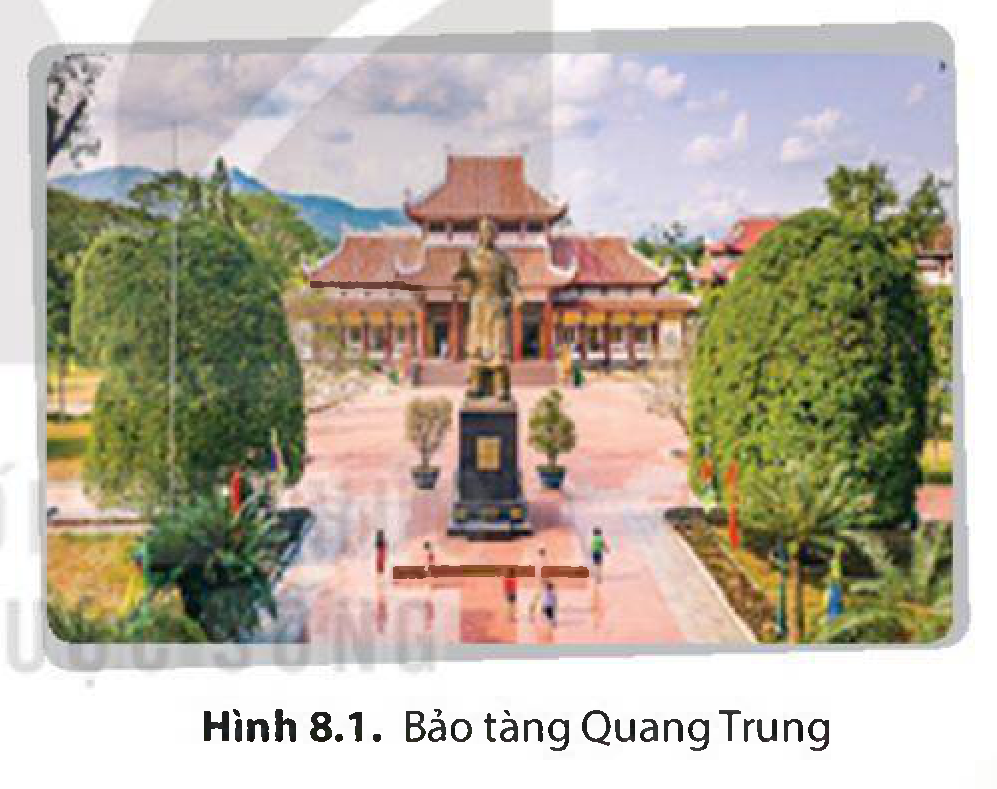
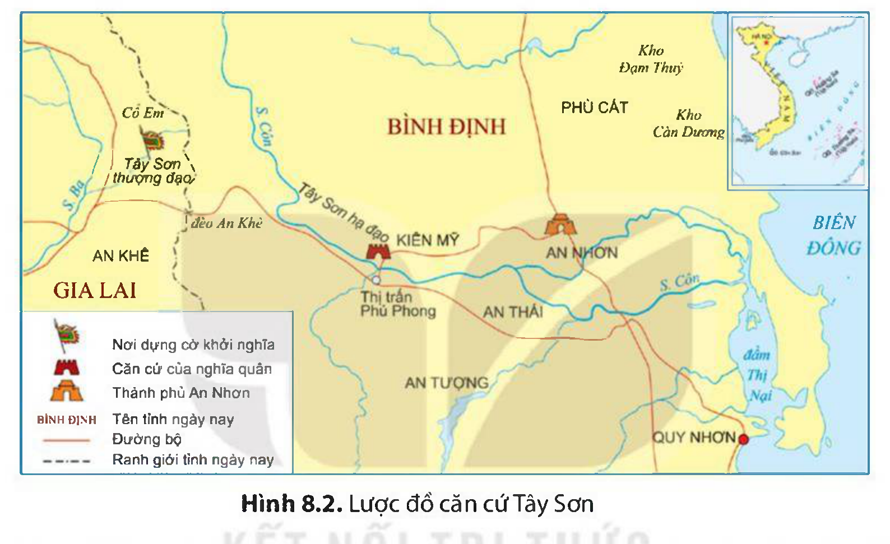
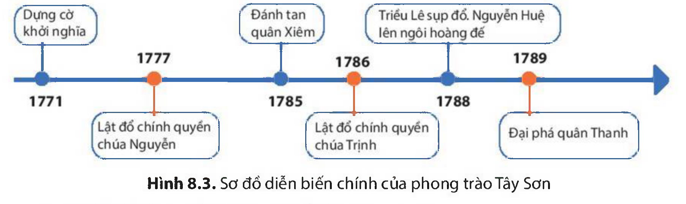
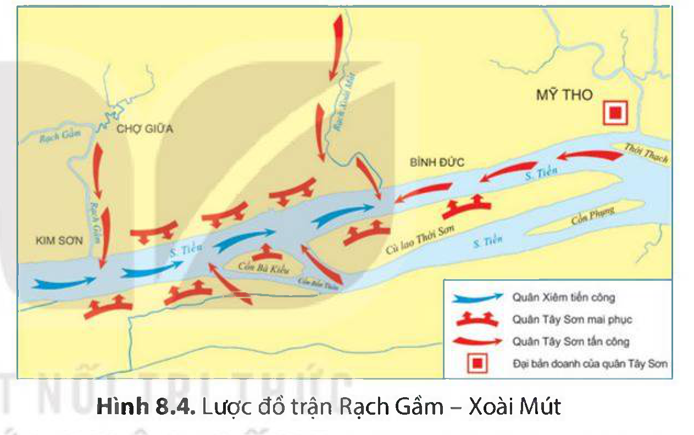
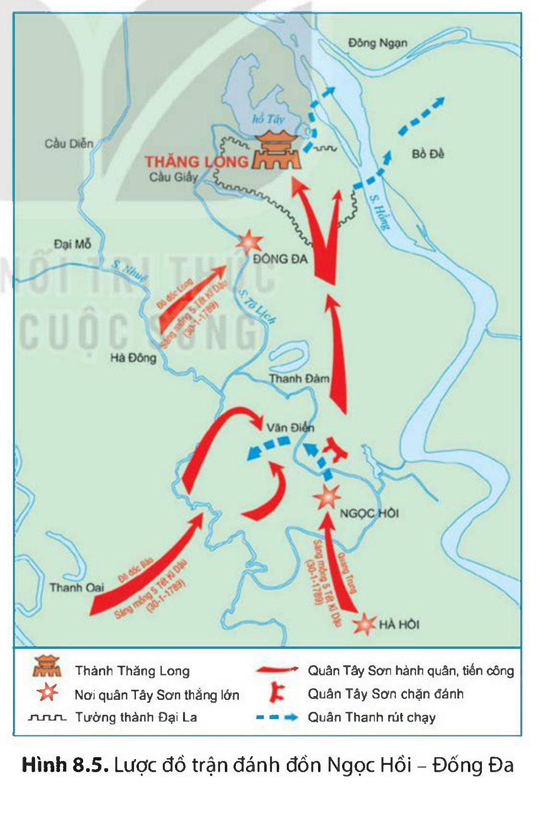
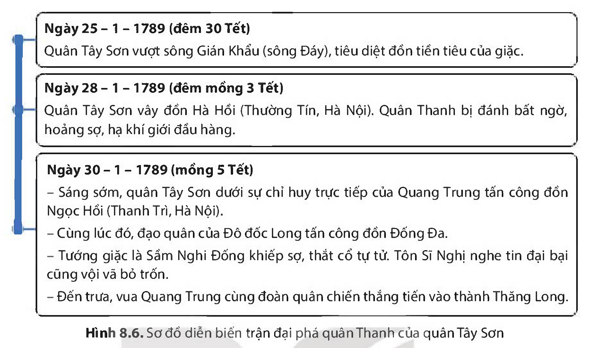
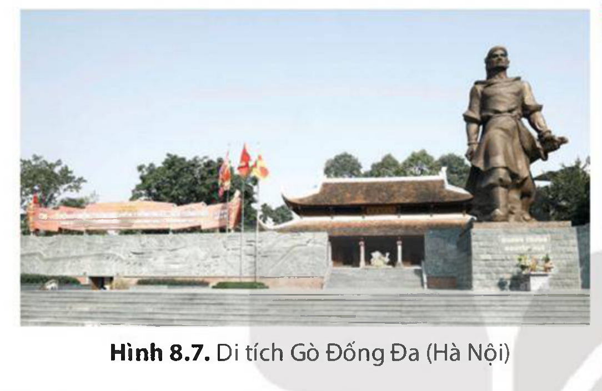

<!-- pdf:36 -->

# BÀI 8: PHONG TRÀO TÂY SƠN

## 🎯 Học xong bài này, em sẽ:

- Trình bày được nét chính về nguyên nhân bùng nổ khởi nghĩa Tây Sơn.
- Mô tả được một số thắng lợi tiêu biểu của phong trào Tây Sơn: lật đổ chính quyền chúa Nguyễn, chúa Trịnh – vua Lê; đánh bại quân Xiêm xâm lược (1785) và đại phá quân Thanh xâm lược (1789),...
- Nêu được nguyên nhân thắng lợi, ý nghĩa lịch sử của phong trào Tây Sơn.
- Đánh giá được vai trò của Nguyễn Huệ – Quang Trung trong phong trào Tây Sơn.

## 🔴 Mở đầu

Bảo tàng Quang Trung ở huyện Tây Sơn, tỉnh Bình Định hiện đang lưu trữ nhiều tư liệu, hiện vật xuyên suốt các thời kì phát triển của phong trào Tây Sơn và Hoàng đế Quang Trung. Em biết phong trào Tây Sơn, Hoàng đế Quang Trung đã có những đóng góp gì đối với lịch sử dân tộc? Việc xây dựng Bảo tàng Quang Trung phản ánh điều gì?

*Hình 8.1. Bảo tàng Quang Trung*

## 1. Khởi nghĩa Tây Sơn bùng nổ

Từ giữa thế kỉ XVIII, chính quyền phong kiến Đàng Trong ngày càng suy yếu. Bộ máy quan lại các cấp rất cồng kềnh và tham nhũng. Ở các thôn, ấp, ruộng đất của nông dân bị địa chủ, cường hào lấn chiếm. Chế độ tô thuế, lao dịch đè nặng lên đời sống nhân dân.

> 📜 **Tư liệu**
>
> 1. Chúa Nguyễn [Phúc Thuần] lên nối ngôi lúc mới 12 tuổi, chỉ “thích chơi bời, múa hát”, quyền hành tập trung hết vào tay quyền thần Trương Phúc Loan. Ông ta tự xưng là Quốc phó, chuyên quyền hơn 30 năm; là người “bán quan, buôn ngục”, rất tham lam và tàn nhẫn, giết hại nhiều người; ruộng vườn, nhà cửa, vàng bạc, châu ngọc, tôi tớ, ngựa trâu,... không biết bao nhiêu mà kể.
>
> (Theo Phan Huy Lê (Chủ biên), *Lịch sử Việt Nam*, Tập II, Sđd, tr. 540)

<!-- pdf:37 -->

Do cuộc sống ngày càng cơ cực nên nỗi bất bình, oán hận của các tầng lớp xã hội đối với chính quyền chúa Nguyễn ở Đàng Trong dâng cao đến đỉnh điểm.

<!-- term: Khởi nghĩa Tây Sơn -->
Năm 1771, ba anh em Nguyễn Nhạc, Nguyễn Huệ, Nguyễn Lữ dựng cờ khởi nghĩa. Ban đầu, căn cứ của nghĩa quân ở vùng Tây Sơn thượng đạo (nay thuộc An Khê, Gia Lai). Với khẩu hiệu “lấy của người giàu chia cho người nghèo”, cuộc khởi nghĩa nhanh chóng thu hút các tầng lớp nhân dân tham gia.

> 💡 **Em có biết?**
>
> Tổ tiên anh em Nguyễn Nhạc, Nguyễn Huệ, Nguyễn Lữ vốn quê ở Nghệ An, bị chúa Nguyễn bắt đưa vào Đàng Trong khai hoang. Trong ba anh em, Nguyễn Huệ là người có vóc dáng đặc biệt, vừa khoẻ mạnh lại can đảm, mắt sáng như chớp, tiếng vang như chuông.

*Hình 8.2. Lược đồ căn cứ Tây Sơn*

> ❓ Khai thác tư liệu 1 và thông tin trong mục, hãy trình bày nguyên nhân bùng nổ khởi nghĩa Tây Sơn.

## 2. Những thắng lợi tiêu biểu của phong trào Tây Sơn

*Hình 8.3. Sơ đồ diễn biến chính của phong trào Tây Sơn*

> **Sơ đồ diễn biến chính của phong trào Tây Sơn:**
> - **1771:** Dựng cờ khởi nghĩa.
> - **1777:** Lật đổ chính quyền chúa Nguyễn.
> - **1785:** Đánh tan quân Xiêm.
> - **1786:** Lật đổ chính quyền chúa Trịnh.
> - **1788:** Triều Lê sụp đổ. Nguyễn Huệ lên ngôi hoàng đế.
> - **1789:** Đại phá quân Thanh.

### a) Lật đổ chính quyền chúa Nguyễn ở Đàng Trong

Đến năm 1774, nghĩa quân Tây Sơn đã làm chủ được một vùng rộng lớn từ Quảng Nam đến Bình Thuận. Tuy nhiên, nghĩa quân lại phải đối mặt với tình thế bất lợi: phía bắc có quân của chúa Trịnh từ Đàng Ngoài đánh vào, đã chiếm được Phú Xuân (Huế), phía nam là quân chúa Nguyễn.

<!-- pdf:38 -->

Trước tình hình đó, Nguyễn Nhạc buộc phải tạm hoà hoãn với quân Trịnh để dồn sức đánh quân Nguyễn. Nghĩa quân Tây Sơn đã bốn lần đánh vào Gia Định. Trong lần tiến quân năm 1777, chúa Nguyễn bị bắt, giết, chỉ còn Nguyễn Ánh chạy thoát. Chính quyền chúa Nguyễn ở Đàng Trong bị lật đổ.

> ❓ Hãy mô tả thắng lợi đầu tiên của nghĩa quân Tây Sơn.

### b) Đánh tan quân Xiêm xâm lược

Thất bại trước quân Tây Sơn, Nguyễn Ánh cầu cứu vua Xiêm. Cuối tháng 7 – 1784, khoảng 5 vạn quân Xiêm theo hai đường thuỷ, bộ kéo sang nước ta. Cuối năm đó, quân Xiêm đã chiếm hết miền Tây Gia Định (miền Tây Nam Bộ ngày nay).

<!-- term: Trận Rạch Gầm – Xoài Mút -->
Tháng 1 – 1785, Nguyễn Huệ được lệnh tiến quân vào Gia Định. Ông đóng đại bản doanh ở Mỹ Tho, chọn khúc sông Tiền, đoạn từ Rạch Gầm đến Xoài Mút (nay thuộc tỉnh Tiền Giang) làm trận địa quyết chiến.

> 🔗 **Kết nối với địa lí**
>
> Đoạn sông từ Rạch Gầm đến Xoài Mút dài khoảng 6 km, rộng hơn 1 km, có chỗ gần 2 km. Về địa thế, giữa dòng có cù lao Thới Sơn, hai bên bờ sông có cây cối rậm rạp và nhiều kênh rạch nhỏ, rất phù hợp cho việc bố trí trận địa mai phục thuỷ – bộ.

*Hình 8.4. Lược đồ trận Rạch Gầm – Xoài Mút*

<!-- term: Trận Rạch Gầm – Xoài Mút -->
Trận Rạch Gầm – Xoài Mút diễn ra ngày 19 – 1 – 1785. Chọn cách đánh nghi binh, nhử quân Xiêm vào trận địa mai phục, nghĩa quân bất ngờ chặn đánh, kết hợp dùng thuyền, bè lửa đốt cháy thuyền giặc, khiến quân Xiêm bị tiêu diệt gần hết. Chỉ trong một ngày, quân Tây Sơn giành thắng lợi hoàn toàn.

<!-- term: Trận Rạch Gầm – Xoài Mút -->
Trận Rạch Gầm – Xoài Mút là một trong những trận thuỷ chiến lớn trong lịch sử chống ngoại xâm của nhân dân ta. Từ đây, cuộc khởi nghĩa Tây Sơn trở thành phong trào dân tộc.

> 📜 **Tư liệu**
>
> 2. Sử triều Nguyễn cũng phải ghi nhận: “Người Xiêm từ sau bại trận năm Giáp Thìn, miệng tuy nói khoác mà trong lòng thì sợ quân Tây Sơn như sợ cọp”.
>
> (Quốc sử quán triều Nguyễn, *Đại Nam thực lục*, Tập một, Sđd, tr. 227 – 228)

> ❓ 1. Quan sát lược đồ hình 8.4 và cho biết vì sao Nguyễn Huệ chọn khúc sông từ Rạch Gầm đến Xoài Mút làm trận địa quyết chiến?
>
> 2. Mô tả những nét chính (thời gian, người lãnh đạo, địa điểm, cách đánh, kết quả) về trận Rạch Gầm – Xoài Mút trên lược đồ. Thắng lợi này có ý nghĩa quan trọng như thế nào?

<!-- pdf:39 -->

### c) Lật đổ chính quyền chúa Trịnh. Triều Lê sụp đổ

Tháng 5 – 1786, Nguyễn Huệ chỉ huy đạo quân tiến đánh Phú Xuân và nhanh chóng hạ thành. Thừa thắng, quân Tây Sơn tiến ra phía nam sông Gianh, giải phóng toàn bộ vùng đất Đàng Trong, rồi tiến thẳng ra Đàng Ngoài.

Với danh nghĩa “phù Lê diệt Trịnh”, nhận được sự ủng hộ của nhân dân, quân Tây Sơn tiến vào thành Thăng Long (tháng 7 – 1786), lật đổ chúa Trịnh, rồi giao lại chính quyền cho vua Lê. Tuy nhiên, sau khi quân Tây Sơn rút về Nam thì tình hình Bắc Hà lại trở nên rối loạn. Năm 1788, Nguyễn Huệ tiến quân ra Bắc lần thứ hai. Vua Lê Chiêu Thống bỏ trốn. Đến đây, chính quyền phong kiến Lê – Trịnh hoàn toàn sụp đổ.

> ❓ Hãy cho biết các cuộc tiến quân của Nguyễn Huệ ra Bắc trong những năm 1786 – 1788 đạt được kết quả như thế nào?

### d) Đại phá quân Thanh xâm lược

Nhân cơ hội vua Lê Chiêu Thống cầu cứu, cuối năm 1788, nhà Thanh cử Tôn Sĩ Nghị chỉ huy 29 vạn quân Thanh tiến vào xâm lược nước ta.

Trước thế mạnh của giặc, quân Tây Sơn thực hiện kế hoạch rút khỏi Thăng Long, lui về phòng thủ phía nam. Quân thuỷ đóng ở Biện Sơn (Thanh Hoá), quân bộ đóng ở Tam Điệp (Ninh Bình) tạo thành phòng tuyến thuỷ – bộ liên hoàn.

Tháng 12 – 1788, Nguyễn Huệ lên ngôi hoàng đế lấy niên hiệu là Quang Trung, chỉ huy năm đạo quân Tây Sơn tiến ra Thăng Long.

*Hình 8.5. Lược đồ trận đánh đồn Ngọc Hồi – Đống Đa*

<!-- pdf:40 -->

*Hình 8.6. Sơ đồ diễn biến trận đại phá quân Thanh của quân Tây Sơn*

<!-- term: Trận Ngọc Hồi – Đống Đa -->
> **Sơ đồ diễn biến trận đại phá quân Thanh của quân Tây Sơn:**
> - **Ngày 25 – 1 – 1789 (đêm 30 Tết):** Quân Tây Sơn vượt sông Gián Khẩu (sông Đáy), tiêu diệt đồn tiền tiêu của giặc.
> - **Ngày 28 – 1 – 1789 (đêm mồng 3 Tết):** Quân Tây Sơn vây đồn Hà Hồi (Thường Tín, Hà Nội). Quân Thanh bị đánh bất ngờ, hoảng sợ, hạ khí giới đầu hàng.
> - **Ngày 30 – 1 – 1789 (mồng 5 Tết):**
>   - Sáng sớm, quân Tây Sơn dưới sự chỉ huy trực tiếp của Quang Trung tấn công đồn Ngọc Hồi (Thanh Trì, Hà Nội).
>   - Cùng lúc đó, đạo quân của Đô đốc Long tấn công đồn Đống Đa.
>   - Tướng giặc là Sầm Nghi Đống khiếp sợ, thắt cổ tự tử. Tôn Sĩ Nghị nghe tin đại bại cũng vội vã bỏ trốn.
>   - Đến trưa, vua Quang Trung cùng đoàn quân chiến thắng tiến vào thành Thăng Long.

<!-- term: Trận Ngọc Hồi – Đống Đa -->
Chỉ trong vòng 5 ngày (từ đêm 30 đến mồng 5 Tết Kỉ Dậu), quân Tây Sơn đã giải phóng kinh thành Thăng Long, quét sạch quân xâm lược Thanh, bảo vệ được nền độc lập của đất nước. Đây là một trong những chiến công vĩ đại và hiển hách nhất trong lịch sử chống ngoại xâm của dân tộc ta.

> ❓ Khai thác hình 8.5, 8.6, hãy mô tả trận đại phá quân Thanh xâm lược năm 1789 của quân Tây Sơn.

## 3. Nguyên nhân thắng lợi và ý nghĩa lịch sử của phong trào Tây Sơn

<!-- term: Phong trào Tây Sơn -->
Phong trào Tây Sơn giành được thắng lợi trước hết là nhờ tinh thần yêu nước, sự đồng lòng và ý chí chiến đấu dũng cảm của quân dân ta. Sự lãnh đạo tài tình, sáng suốt của Quang Trung – Nguyễn Huệ và bộ chỉ huy nghĩa quân đã góp phần quan trọng vào thắng lợi.

> 📜 **Tư liệu**
>
> 3. Trong buổi lễ tuyên thệ, Quang Trung đã đọc lời dụ tướng sĩ, thể hiện rõ quyết tâm đánh giặc ngoại xâm, bảo vệ độc lập dân tộc:
>
> *Đánh cho để tóc dài,*
> *Đánh cho để răng đen,*
> *Đánh cho nó chích luân bất phản*
> *Đánh cho nó phiến giáp bất hoàn,*
> *Đánh cho sử tri Nam quốc anh hùng chi hữu chủ.*
>
> (Theo Phan Huy Lê (Chủ biên), *Lịch sử Việt Nam*, Tập II, NXB Giáo dục Việt Nam, 2012, tr. 615)

<!-- pdf:41 -->

<!-- term: Phong trào Tây Sơn -->
Phong trào Tây Sơn đã có nhiều đóng góp lớn đối với lịch sử dân tộc: lật đổ các chính quyền phong kiến Nguyễn – Trịnh, xoá bỏ tình trạng chia cắt đất nước, đặt cơ sở cho việc khôi phục nền thống nhất quốc gia. Đồng thời, phong trào này còn đánh tan các cuộc xâm lược của quân Xiêm, quân Thanh, bảo vệ vững chắc nền độc lập và chủ quyền lãnh thổ của Tổ quốc.

Ca ngợi công lao của vua Quang Trung, công chúa Ngọc Hân đã viết:

*Mà nay áo vải cờ đào,*
*Giúp dân dựng nước, xiết bao công trình.*

*Hình 8.7. Di tích Gò Đống Đa (Hà Nội)*

<!-- term: Di tích Gò Đống Đa -->
> 💡 **Em có biết?**
>
> Di tích Gò Đống Đa xây dựng vào năm 1989 nhân kỉ niệm 200 năm chiến thắng Ngọc Hồi – Đống Đa, được Chính phủ công nhận là Di tích quốc gia đặc biệt. Vào mồng 5 Tết hằng năm, lễ hội kỉ niệm chiến thắng Ngọc Hồi – Đống Đa và tưởng nhớ công lao của vị anh hùng dân tộc Quang Trung được tổ chức ở đây.

> ❓ 1. Khai thác tư liệu 3 và thông tin trong mục, hãy cho biết nguyên nhân thắng lợi và ý nghĩa lịch sử của phong trào Tây Sơn.
>
> 2. Hãy cho biết đánh giá của em về vai trò của Quang Trung – Nguyễn Huệ trong phong trào Tây Sơn và lịch sử dân tộc.

## ✏️ Luyện tập – Vận dụng

**Luyện tập:**

1. Hãy lập bảng về những sự kiện chính của phong trào Tây Sơn từ năm 1771 đến năm 1789 theo các tiêu chí: thời gian, thắng lợi tiêu biểu.

2. Có ý kiến cho rằng: Quyết định tiêu diệt quân Thanh vào dịp Tết Kỉ Dậu (1789) thể hiện thiên tài quân sự của vua Quang Trung. Em đồng ý với ý kiến đó không? Vì sao?

**Vận dụng:**

1. Tìm hiểu thông tin từ sách, báo và internet, em hãy viết bài giới thiệu (khoảng 7 – 10 câu) về vị anh hùng dân tộc Quang Trung theo gợi ý sau:
   - Vai trò.
   - Điều khiến em ấn tượng nhất về ông.
   - Những con đường, ngôi trường, di tích lịch sử mang tên ông.

2. Nếu được tham gia học tập tại một trong các địa điểm sau: Bảo tàng Quang Trung (Bình Định), di tích Rạch Gầm – Xoài Mút (Tiền Giang), di tích Gò Đống Đa (Hà Nội), em chọn địa điểm nào? Vì sao em chọn địa điểm đó?

## 📷 Danh sách hình trong bài

| Mã hình | Trang PDF | Vị trí | Chú thích |
| --- | --- | --- | --- |
| H8-lich_su_va_dia_ly-ls-b08-01 | 36 | Mở đầu (trang 34) | Hình 8.1. Bảo tàng Quang Trung |
| H8-lich_su_va_dia_ly-ls-b08-02 | 37 | Mục 1 (trang 35) | Hình 8.2. Lược đồ căn cứ Tây Sơn |
| H8-lich_su_va_dia_ly-ls-b08-03 | 37 | Mục 2 (trang 35) | Hình 8.3. Sơ đồ diễn biến chính của phong trào Tây Sơn |
| H8-lich_su_va_dia_ly-ls-b08-04 | 38 | Mục 2.b (trang 36) | Hình 8.4. Lược đồ trận Rạch Gầm – Xoài Mút |
| H8-lich_su_va_dia_ly-ls-b08-05 | 39 | Mục 2.d (trang 37) | Hình 8.5. Lược đồ trận đánh đồn Ngọc Hồi – Đống Đa |
| H8-lich_su_va_dia_ly-ls-b08-06 | 40 | Mục 2.d (trang 38) | Hình 8.6. Sơ đồ diễn biến trận đại phá quân Thanh của quân Tây Sơn |
| H8-lich_su_va_dia_ly-ls-b08-07 | 41 | Mục 3 (trang 39) | Hình 8.7. Di tích Gò Đống Đa (Hà Nội) |
