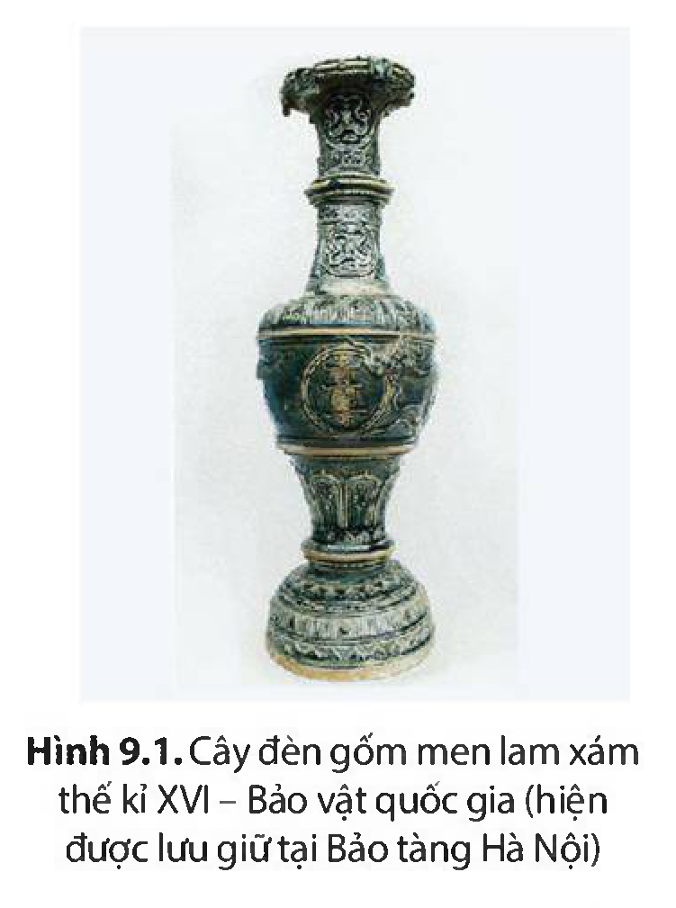
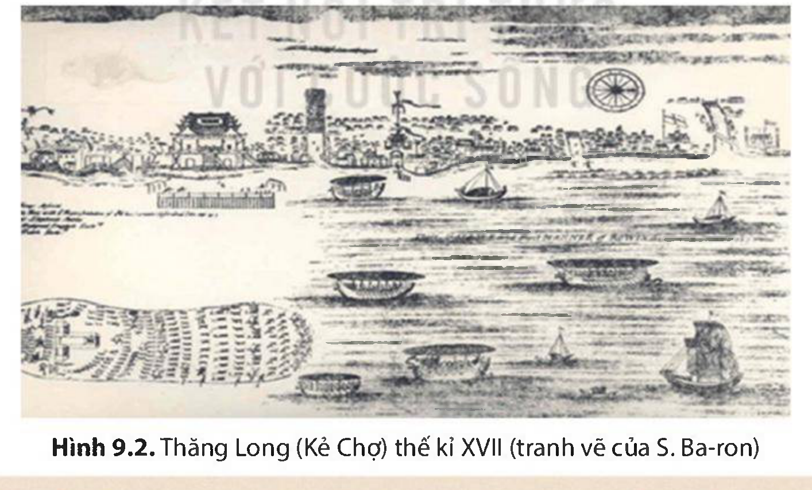
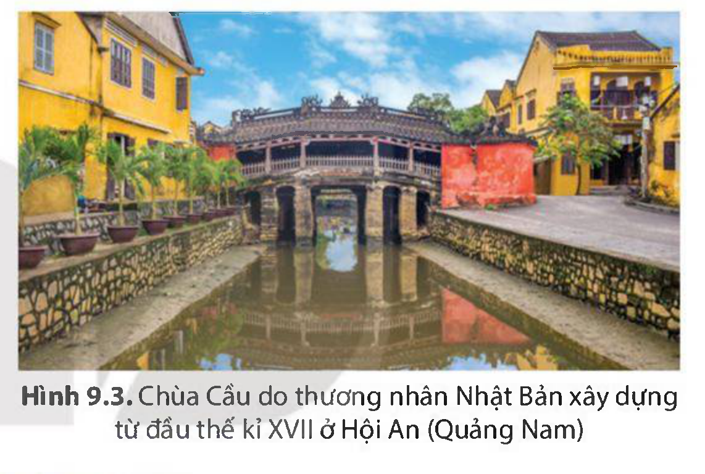
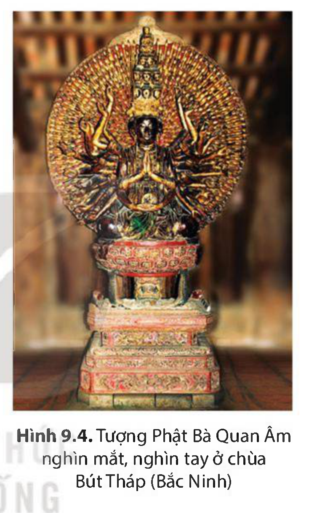

<!-- pdf:42 -->

# BÀI 9: TÌNH HÌNH KINH TẾ, VĂN HOÁ, TÔN GIÁO TRONG CÁC THẾ KỈ XVI – XVIII

## 🎯 Học xong bài này, em sẽ:

- Nêu được những nét chính về tình hình kinh tế ở Đại Việt trong các thế kỉ XVI – XVIII.
- Mô tả và nhận xét được những nét chính về sự chuyển biến văn hoá và tôn giáo ở Đại Việt trong các thế kỉ XVI – XVIII.

## 🔴 Mở đầu

Ở các thế kỉ XVI – XVIII, trong dân gian phổ biến những câu sau:

*Ước gì anh lấy được nàng,*
*Để anh mua gạch Bát Tràng về xây;*
<!-- ocr-ok: đã đối chiếu p042.png, câu ca dao in chữ nghiêng có chân nên OCR nhầm thành "Liớc", "lấu", "Đê", "tề xâu" -->

*Thứ nhất Kinh Kì,*
*Thứ nhì Phố Hiến.*

Những câu trên nhắc đến các địa danh nào và phản ánh nội dung gì? Từ đó, hãy chia sẻ thêm những hiểu biết của em về tình hình kinh tế, văn hoá Đại Việt trong các thế kỉ XVI – XVIII.

## 1. Tình hình kinh tế trong các thế kỉ XVI – XVIII

### a) Nông nghiệp

*Ở Đàng Ngoài,* do những cuộc xung đột kéo dài làm cho sản xuất nông nghiệp bị sa sút nghiêm trọng. Tình trạng biến ruộng công thành ruộng tư ngày càng phổ biến.

Người nông dân mất ruộng đất, buộc phải lĩnh canh, nộp tô cho địa chủ, nộp thuế cho Nhà nước và thực hiện nhiều nghĩa vụ khác. Bên cạnh đó, tình trạng thiên tai, mất mùa, đói kém,... khiến nông dân nghèo ở nhiều địa phương phải bỏ làng đi phiêu tán.

*Ở Đàng Trong,* nhờ khai hoang và điều kiện tự nhiên thuận lợi nên nông nghiệp phát triển rõ rệt, nhất là ở vùng đồng bằng sông Cửu Long. Sự phát triển của nông nghiệp Đàng Trong dần đưa đến sự hình thành tầng lớp địa chủ lớn. Song, tình trạng nông dân bị bần cùng hoá do mất ruộng đất chưa nghiêm trọng như ở Đàng Ngoài.

> ❓ Hãy giới thiệu nét chính về tình hình nông nghiệp ở Đàng Ngoài và Đàng Trong trong các thế kỉ XVI – XVIII.

<!-- pdf:43 -->

### b) Thủ công nghiệp

<!-- term: Quan xưởng -->
Thời kì này, ở cả Đàng Trong và Đàng Ngoài, các chính quyền vẫn duy trì hoạt động của các quan xưởng để sản xuất vũ khí cho quân đội, may trang phục, làm đồ trang sức cho quan lại và đúc tiền,...

Các nghề thủ công trong nhân dân phát triển mạnh mẽ hơn như: dệt vải lụa, đồ gốm, rèn sắt, đúc đồng, dệt chiếu, làm giấy,... Nhiều làng nghề thủ công nổi tiếng như: làng gốm Thổ Hà (Bắc Giang), Bát Tràng (Hà Nội); làng dệt La Khê (Hà Nội); các làng rèn sắt ở Nho Lâm (Nghệ An), Hiền Lương, Phú Bài (Huế); làng làm đường mía ở Quảng Nam;...

*Hình 9.1. Cây đèn gốm men lam xám thế kỉ XVI – Bảo vật quốc gia (hiện được lưu giữ tại Bảo tàng Hà Nội)*

> ❓ Nêu dẫn chứng thể hiện sự phát triển của thủ công nghiệp Đại Việt trong các thế kỉ XVI – XVIII.

### c) Thương nghiệp

<!-- term: Phố Hiến -->
Sự phát triển của thủ công nghiệp đã thúc đẩy buôn bán mở rộng. Mạng lưới chợ được hình thành ở cả vùng đồng bằng và ven biển. Nhiều đô thị xuất hiện ở những thời điểm khác nhau và khởi sắc trong các thế kỉ XVII – XVIII. Ở Đàng Ngoài, bên cạnh Thăng Long (Kẻ Chợ) với 36 phố phường, Phố Hiến (Hưng Yên) cũng trở thành một trung tâm buôn bán lớn.

*Hình 9.2. Thăng Long (Kẻ Chợ) thế kỉ XVII (tranh vẽ của S. Ba-ron)*

<!-- term: Phố Hiến -->
> 📜 **Tư liệu**
>
> 1. Phố Hiến và vùng ngoại vi có trên 20 phường, trong đó có 8 phường thủ công và một số phường chuyên buôn bán. Điểm đặc biệt của Phố Hiến là có khá nhiều người nước ngoài đến đây sinh sống hoặc qua lại buôn bán.
>
> (Theo Trần Thị Vinh (Chủ biên), *Lịch sử Việt Nam*, Tập 4, Sđd, tr. 224)

<!-- pdf:44 -->

Ở Đàng Trong, hầu hết các trung tâm buôn bán lớn hình thành và phát triển trong các thế kỉ XVII – XVIII như: Thanh Hà (Thừa Thiên Huế), Hội An (Quảng Nam), Gia Định (Thành phố Hồ Chí Minh),... đều gắn với hoạt động ngoại thương.

<!-- term: Hội An -->
> 📜 **Tư liệu**
>
> 2. Hội An là cảng thị lớn nhất Đàng Trong và là nơi cập bến của nhiều thuyền buôn nước ngoài. Ngoài người Nhật, người Hoa, thương nhân Bồ Đào Nha, Hà Lan, Anh, Pháp cũng thường xuyên lui tới Hội An. Họ bán vũ khí, hàng mĩ nghệ, thực phẩm đã chế biến, kẽm, bạc,... và mua đủ thứ như: tơ lụa, lâm sản quý, yến sào, nông sản.
>
> (Theo Trương Hữu Quýnh, *Đại cương Lịch sử Việt Nam*, Toàn tập, NXB Giáo dục, 2001, tr. 379)

Đến nửa sau thế kỉ XVIII, các thành thị dần suy tàn do các chính quyền Đàng Ngoài và Đàng Trong thi hành chính sách hạn chế ngoại thương.

*Hình 9.3. Chùa Cầu do thương nhân Nhật Bản xây dựng từ đầu thế kỉ XVII ở Hội An (Quảng Nam)*

> ❓ Khai thác tư liệu 1, 2 và thông tin trong mục, hãy nêu những nét chính về tình hình thương nghiệp của Đại Việt trong các thế kỉ XVI – XVIII.

## 2. Tình hình văn hoá trong các thế kỉ XVI – XVIII

- *Tư tưởng, tín ngưỡng, tôn giáo:*
<!-- ocr-ok: đã đối chiếu p044.png, OCR dính liền chữ nghiêng "Tưtưởng" -->

Nho giáo vẫn được chính quyền phong kiến đề cao trong học tập, thi cử và tuyển chọn quan lại. Phật giáo và Đạo giáo được phục hồi ở các thế kỉ này.

Năm 1533, Công giáo được truyền bá vào nước ta, đến thế kỉ XVIII được lan truyền trong cả nước.

Tại các làng xã, nhân dân vẫn giữ nếp sinh hoạt truyền thống như: thờ Thành hoàng, thờ cúng tổ tiên, tổ chức lễ hội hằng năm,... thể hiện tinh thần đoàn kết, yêu quê hương, đất nước.

<!-- term: Chữ Quốc ngữ -->
- *Chữ viết:* Cùng với sự truyền bá của Công giáo, chữ Quốc ngữ theo mẫu tự La-tinh cũng được sáng tạo. Ban đầu, các giáo sĩ phương Tây học tiếng Việt để truyền đạo. Trong quá trình đó, họ dùng chữ cái La-tinh để ghi âm tiếng Việt, tạo ra chữ Quốc ngữ. Loại chữ này dần dần được sử dụng phổ biến vì rất tiện lợi và khoa học.

- *Văn học:* Tuy văn học chữ Hán vẫn chiếm ưu thế, nhưng văn học chữ Nôm đã phát triển mạnh hơn trước. Thơ Nôm và truyện Nôm xuất hiện ngày càng nhiều hơn với một số tác giả và tác phẩm nổi tiếng.

<!-- pdf:45 -->

<!-- term: Thiên Nam ngữ lục -->
<!-- term: Nguyễn Bỉnh Khiêm -->
Bộ diễn ca *Thiên Nam ngữ lục* là truyện Nôm tiêu biểu, có giá trị cả về văn học và sử học. Các nhà thơ nổi tiếng thời kì này như Nguyễn Bỉnh Khiêm, Phùng Khắc Khoan, Đào Duy Từ,... đều có những bài thơ hay bằng chữ Nôm. Nguyễn Bỉnh Khiêm sáng tác tập thơ Nôm *Bạch Vân quốc ngữ thi tập* có giá trị cao về nội dung và nghệ thuật.

<!-- term: Nguyễn Bỉnh Khiêm -->
> 💡 **Em có biết?**
>
> Nguyễn Bỉnh Khiêm đỗ Trạng nguyên thời Mạc, được phong tước Trình Quốc Công nên dân gian quen gọi là Trạng Trình. Ông có nhiều đóng góp cho văn học cũng như sự nghiệp giáo dục nước nhà thời kì này.

Văn học dân gian phát triển với nhiều thể loại như: truyện tiếu lâm, truyện Trạng Quỳnh, Trạng Lợn,... Thể thơ lục bát và song thất lục bát được sử dụng rộng rãi.

- *Nghệ thuật dân gian:*

Nghệ thuật dân gian phát triển, tiêu biểu là nghệ thuật điêu khắc trong các đình, chùa với nét chạm khắc mềm mại, mô tả cảnh sinh hoạt thường ngày và tượng Phật rất đặc sắc.

Nghệ thuật sân khấu đa dạng với các loại hình như hát chèo, hát ả đào, hát tuồng,... Ngoài ra còn có các điệu múa như: múa trên dây, múa đèn,...

*Hình 9.4. Tượng Phật Bà Quan Âm nghìn mắt, nghìn tay ở chùa Bút Tháp (Bắc Ninh)*

> ❓ 1. Trình bày những nét chính về sự chuyển biến văn hoá, tôn giáo ở Đại Việt trong các thế kỉ XVI – XVIII.
>
> 2. Hãy nêu nhận xét về sự chuyển biến đó trong các thế kỉ XVI – XVIII. Em ấn tượng với thành tựu nào nhất? Vì sao?

## ✏️ Luyện tập – Vận dụng

**Luyện tập:**

Hãy lập bảng tóm tắt nét chính về tình hình kinh tế, văn hoá, tôn giáo ở Đại Việt trong các thế kỉ XVI – XVIII theo các tiêu chí sau: lĩnh vực, sự chuyển biến.

**Vận dụng:**

1. Tìm hiểu thông tin từ sách, báo và internet, em hãy cho biết: Làng thủ công nào ở Việt Nam được hình thành từ các thế kỉ XVI – XVIII và vẫn tồn tại, phát triển đến ngày nay? Hãy đề xuất ít nhất một giải pháp để bảo tồn các làng nghề đó.

2. Em biết những con đường, ngôi trường,... nào mang tên những danh nhân tiêu biểu của Đại Việt trong các thế kỉ XVI – XVIII?

## 📷 Danh sách hình trong bài

| Mã hình | Trang PDF | Vị trí | Chú thích |
| --- | --- | --- | --- |
| H8-lich_su_va_dia_ly-ls-b09-01 | 43 | Mục 1.b (trang 41) | Hình 9.1. Cây đèn gốm men lam xám thế kỉ XVI – Bảo vật quốc gia (hiện được lưu giữ tại Bảo tàng Hà Nội) |
| H8-lich_su_va_dia_ly-ls-b09-02 | 43 | Mục 1.c (trang 41) | Hình 9.2. Thăng Long (Kẻ Chợ) thế kỉ XVII (tranh vẽ của S. Ba-ron) |
| H8-lich_su_va_dia_ly-ls-b09-03 | 44 | Mục 1.c (trang 42) | Hình 9.3. Chùa Cầu do thương nhân Nhật Bản xây dựng từ đầu thế kỉ XVII ở Hội An (Quảng Nam) |
| H8-lich_su_va_dia_ly-ls-b09-04 | 45 | Mục 2 (trang 43) | Hình 9.4. Tượng Phật Bà Quan Âm nghìn mắt, nghìn tay ở chùa Bút Tháp (Bắc Ninh) |
