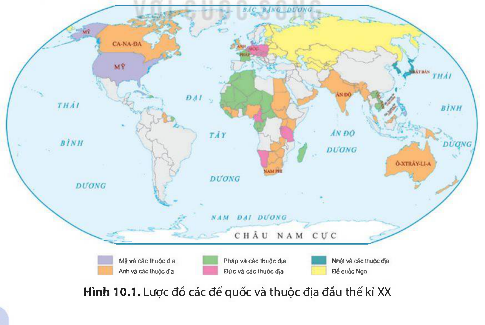
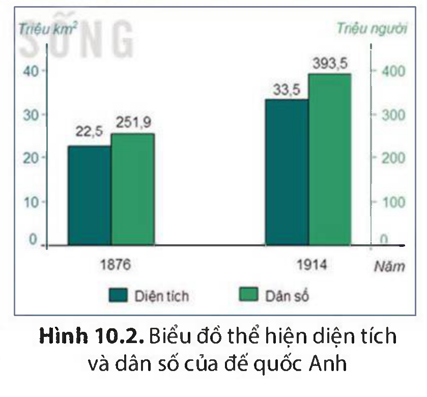
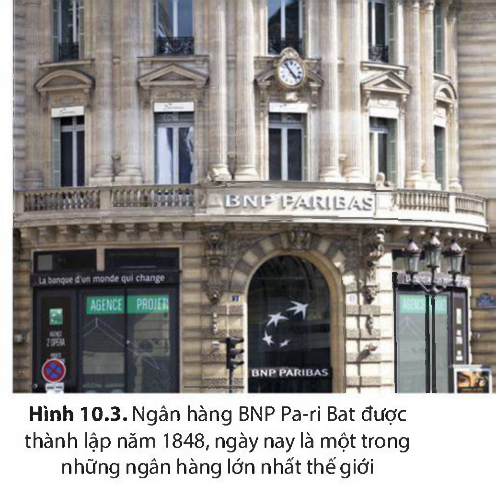
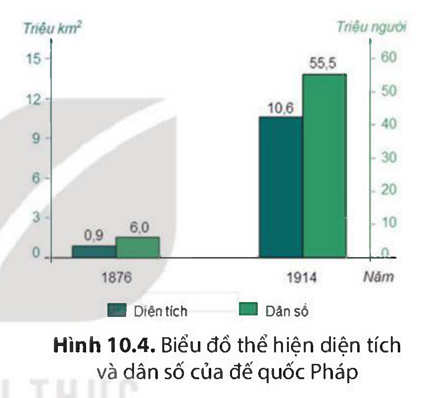

<!-- pdf:46 -->

# BÀI 10: SỰ HÌNH THÀNH CHỦ NGHĨA ĐẾ QUỐC Ở CÁC NƯỚC ÂU – MỸ (CUỐI THẾ KỈ XIX – ĐẦU THẾ KỈ XX)

## 🎯 Học xong bài này, em sẽ:

- Mô tả được những nét chính về quá trình hình thành chủ nghĩa đế quốc.
- Nhận biết được những chuyển biến lớn về kinh tế, chính sách đối nội và đối ngoại của các đế quốc Anh, Pháp, Đức, Mỹ từ cuối thế kỉ XIX đến đầu thế kỉ XX.

## 🔴 Mở đầu

Sau gần một thế kỉ phát triển mạnh mẽ ở giai đoạn tự do cạnh tranh, vào cuối thế kỉ XIX – đầu thế kỉ XX, chủ nghĩa tư bản chuyển sang giai đoạn đế quốc chủ nghĩa. Em hiểu thế nào về chủ nghĩa đế quốc? Hãy kể tên một số nước đế quốc và chia sẻ những điều em biết về các nước đế quốc đó.

## 1. Những nét chính về quá trình hình thành chủ nghĩa đế quốc

*Hình 10.1. Lược đồ các đế quốc và thuộc địa đầu thế kỉ XX*

<!-- pdf:47 -->

<!-- term: Chủ nghĩa đế quốc -->
Khoảng 30 năm cuối của thế kỉ XIX, trong điều kiện tương đối hoà bình, nền kinh tế tư bản chủ nghĩa phát triển với tốc độ nhanh chóng chưa từng thấy. Những phát minh khoa học, kĩ thuật nở rộ đã tạo ra động lực cho những chuyển biến lớn trong sản xuất và đời sống xã hội ở Tây Âu và Bắc Mỹ.

<!-- term: Chủ nghĩa đế quốc -->
Sự cạnh tranh gay gắt dẫn tới quá trình tập trung sản xuất và tư bản, dần hình thành các công ti độc quyền lớn dưới những hình thức khác nhau như: các-ten, xanh-đi-ca (Anh, Pháp, Đức,...), tơ-rớt (Mỹ),... Các công ti độc quyền đã lũng đoạn thị trường và nền kinh tế, chi phối đời sống chính trị và xã hội ở mỗi nước. Tư bản công nghiệp và tư bản ngân hàng đã có sự dung hợp, hình thành nên tư bản tài chính. Mặt khác, các nước tư bản phương Tây đều đẩy mạnh xâm lược, khai thác và bóc lột thuộc địa. Chủ nghĩa đế quốc ra đời.

> ❓ Hãy mô tả nét chính về quá trình hình thành chủ nghĩa đế quốc vào cuối thế kỉ XIX – đầu thế kỉ XX.

## 2. Các nước đế quốc Anh, Pháp, Đức, Mỹ từ cuối thế kỉ XIX đến đầu thế kỉ XX

### a) Anh

Về *kinh tế*, từ vị trí dẫn đầu thế giới về công nghiệp, cuối thế kỉ XIX, Anh phát triển chậm lại, tụt xuống vị trí thứ ba, sau Mỹ và Đức.

> • Năm 1871 và cả năm 1880, Anh sản xuất nhiều than hơn của Mỹ và Đức cộng lại; năm 1913, sản xuất than chỉ bằng 1/2 của Mỹ. Về thép cũng rất nhanh chóng bị Mỹ rồi Đức vượt qua từ năm 1900. Phần của Anh trong sản xuất công nghiệp thế giới từ 32% năm 1870 rơi xuống 14% trước Đại chiến (1914), còn phần của Mỹ từ 23% tăng lên 38%.
>
> (Theo Mi-xen Bô, *Lịch sử chủ nghĩa tư bản từ 1500 đến 2000*, NXB Thế giới, 2002, tr. 218, 235)

Tuy nhiên, Anh vẫn là nước dẫn đầu thế giới về xuất khẩu tư bản, thương mại và thuộc địa. Đầu thế kỉ XX, nhiều công ti độc quyền về công nghiệp và tài chính ra đời, từng bước thao túng nền kinh tế.

Về *đối nội*, Anh là nước quân chủ lập hiến. Hai đảng Tự do và Bảo thủ thay nhau nắm quyền, đều bảo vệ quyền lợi của giai cấp tư sản.

Về *đối ngoại*, Anh tiếp tục đẩy mạnh xâm lược thuộc địa và trở thành đế quốc có nhiều thuộc địa nhất thế giới.

*Hình 10.2. Biểu đồ thể hiện diện tích và dân số của đế quốc Anh*

> ❓ 1. Khai thác tư liệu trên và thông tin trong mục, hãy nêu chuyển biến lớn về kinh tế của đế quốc Anh trong những năm cuối thế kỉ XIX – đầu thế kỉ XX.
>
> 2. Khai thác biểu đồ hình 10.2 và thông tin trong mục, hãy nêu những chuyển biến về chính sách đối nội, đối ngoại của đế quốc Anh trong những năm cuối thế kỉ XIX – đầu thế kỉ XX.

<!-- pdf:48 -->

### b) Pháp

Về *kinh tế*, do hậu quả nặng nề của Chiến tranh Pháp – Phổ (1870 – 1871), tốc độ phát triển của kinh tế Pháp chậm lại. Đến cuối thế kỉ XIX, công nghiệp Pháp tụt xuống thứ tư (sau Mỹ, Đức, Anh); nông nghiệp thì trong tình trạng sản xuất nhỏ. Tuy nhiên, các công ti độc quyền vẫn ra đời và dần chi phối nền kinh tế Pháp, đặc biệt là trong lĩnh vực ngân hàng. Pháp là nước đứng thứ hai (sau Anh) về xuất khẩu tư bản.

*Hình 10.3. Ngân hàng BNP Pa-ri Bat được thành lập năm 1848, ngày nay là một trong những ngân hàng lớn nhất thế giới*

Về *đối nội*, nền Cộng hoà thứ ba ở Pháp được thành lập nhưng thường xuyên xảy ra khủng hoảng nội các. Chính phủ Cộng hoà thi hành chính sách đàn áp nhân dân và các cuộc đấu tranh của giai cấp công nhân.

Về *đối ngoại*, Pháp đẩy mạnh xâm lược, bóc lột thuộc địa, là nước có hệ thống thuộc địa lớn thứ hai thế giới, chỉ sau Anh. Đó là các thuộc địa ở châu Phi (An-giê-ri, Ma-rốc,...), châu Á (Việt Nam, Cam-pu-chia, Lào),...

*Hình 10.4. Biểu đồ thể hiện diện tích và dân số của đế quốc Pháp*

> ❓ 1. Hãy nêu những chuyển biến về kinh tế của đế quốc Pháp trong những năm cuối thế kỉ XIX – đầu thế kỉ XX.
>
> 2. Khai thác biểu đồ hình 10.4 và thông tin trong mục, hãy nêu những chuyển biến lớn về chính sách đối nội, đối ngoại của đế quốc Pháp.

### c) Đức

Về *kinh tế*, sau khi hoàn thành thống nhất đất nước (1871), Đức phát triển nhanh trên con đường tư bản chủ nghĩa. Đến cuối thế kỉ XIX, Đức vươn lên đứng đầu châu Âu và thứ hai thế giới (sau Mỹ) về công nghiệp.

Đồng thời, quá trình tập trung sản xuất và tư bản diễn ra mạnh mẽ ở Đức, dẫn đến việc hình thành các công ti độc quyền.

Về *đối nội*, Đức là một nước liên bang theo chế độ quân chủ lập hiến, quý tộc địa chủ liên kết chặt chẽ với tư bản độc quyền để thống trị nhân dân.

Về *đối ngoại*, Đức chuyển sang giai đoạn đế quốc chủ nghĩa khi phần lớn đất đai trên thế giới đã trở thành thuộc địa của Anh, Pháp,... Vì thế, giới cầm quyền Đức chủ trương chạy đua vũ trang, dùng vũ lực để chia lại thuộc địa trên thế giới.

<!-- pdf:49 -->

> ❓ Nêu những chuyển biến về kinh tế, chính sách đối nội, đối ngoại của đế quốc Đức trong những năm cuối thế kỉ XIX – đầu thế kỉ XX.

### d) Mỹ

Về *kinh tế*, trong 30 năm cuối thế kỉ XIX, từ vị trí thứ tư (sau Anh, Pháp, Đức), Mỹ vươn lên đứng đầu thế giới về sản xuất công nghiệp. Năm 1894, sản phẩm công nghiệp của Mỹ đã gấp đôi Anh.

Ở Mỹ, có những công ti độc quyền khổng lồ đồng thời là những đế chế tài chính như: “vua dầu mỏ” Rốc-phe-lơ, “vua thép” Moóc-gân, “vua ô tô” Pho,...

Nông nghiệp cũng đạt được nhiều thành tựu lớn. Nhờ điều kiện tự nhiên thuận lợi, sử dụng phương thức canh tác hiện đại (trang trại, chuyên canh, cơ giới hoá, sử dụng phân bón, phát triển công nghiệp chế biến thực phẩm), hàng nông sản giá rẻ của Mỹ có sức cạnh tranh tốt, đánh bại các đối thủ châu Âu. Mỹ trở thành nguồn cung cấp chủ yếu lương thực, thực phẩm cho châu Âu.

Về *đối nội*, chế độ Cộng hoà đề cao vai trò của tổng thống. Hai đảng Cộng hoà và Dân chủ thay nhau nắm quyền, đều thi hành các chính sách phục vụ quyền lợi của giai cấp tư sản.

Về *đối ngoại*, đến thập kỉ cuối thế kỉ XIX, Mỹ tăng cường bành trướng ở khu vực châu Á – Thái Bình Dương, gây chiến với Tây Ban Nha (chiếm Phi-líp-pin và Cu-ba). Thông qua viện trợ kinh tế, đầu tư, can thiệp quân sự, Mỹ đã biến Trung và Nam Mỹ thành khu vực độc quyền ảnh hưởng của mình.

> 💡 **Em có biết?**
>
> Đảng Cộng hoà (biểu tượng con voi) đại diện cho những "ông trùm" công nghiệp và tài chính. Đảng Dân chủ (biểu tượng là con lừa) đại diện cho quyền lợi của đại địa chủ, phú nông, tư sản miền Nam và một bộ phận tư bản tài chính miền Bắc.

> ❓ Trình bày những chuyển biến lớn về kinh tế, chính sách đối nội, đối ngoại của đế quốc Mỹ trong những năm cuối thế kỉ XIX – đầu thế kỉ XX.

## ✏️ Luyện tập – Vận dụng

1. Chỉ ra những đặc trưng cơ bản của chủ nghĩa đế quốc. Theo em, đặc trưng nào là quan trọng nhất? Vì sao?

2. Hãy lập bảng so sánh (điểm giống và khác nhau) về kinh tế, chính sách đối ngoại nổi bật của các đế quốc Anh, Pháp, Đức, Mỹ.

Tìm hiểu thông tin từ sách, báo và internet, hãy kể tên một số công ti đa quốc gia có phạm vi ảnh hưởng lớn đối với nền kinh tế nhiều nước trên thế giới hiện nay.

## 📷 Danh sách hình trong bài

| Mã hình | Trang PDF | Trang sách | Chú thích |
| --- | --- | --- | --- |
| H8-lich_su_va_dia_ly-ls-b10-01 | 46 | 44 | Hình 10.1. Lược đồ các đế quốc và thuộc địa đầu thế kỉ XX |
| H8-lich_su_va_dia_ly-ls-b10-02 | 47 | 45 | Hình 10.2. Biểu đồ thể hiện diện tích và dân số của đế quốc Anh |
| H8-lich_su_va_dia_ly-ls-b10-03 | 48 | 46 | Hình 10.3. Ngân hàng BNP Pa-ri Bat được thành lập năm 1848, ngày nay là một trong những ngân hàng lớn nhất thế giới |
| H8-lich_su_va_dia_ly-ls-b10-04 | 48 | 46 | Hình 10.4. Biểu đồ thể hiện diện tích và dân số của đế quốc Pháp |
