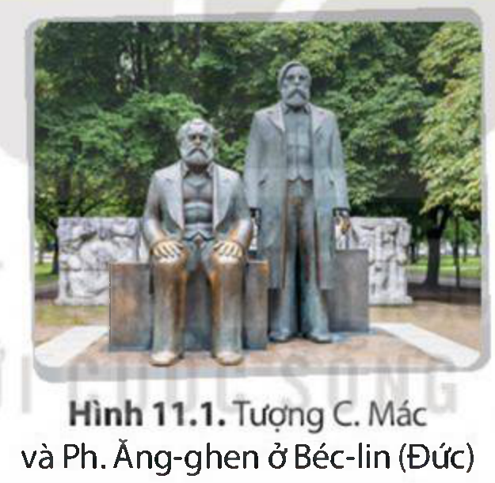
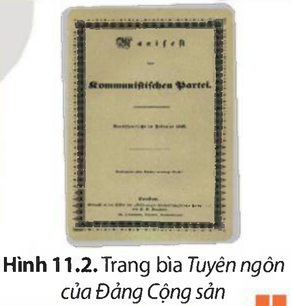
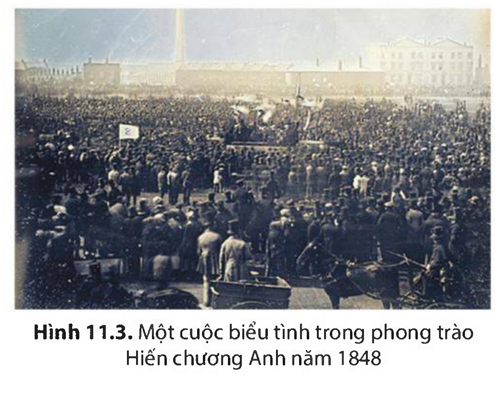
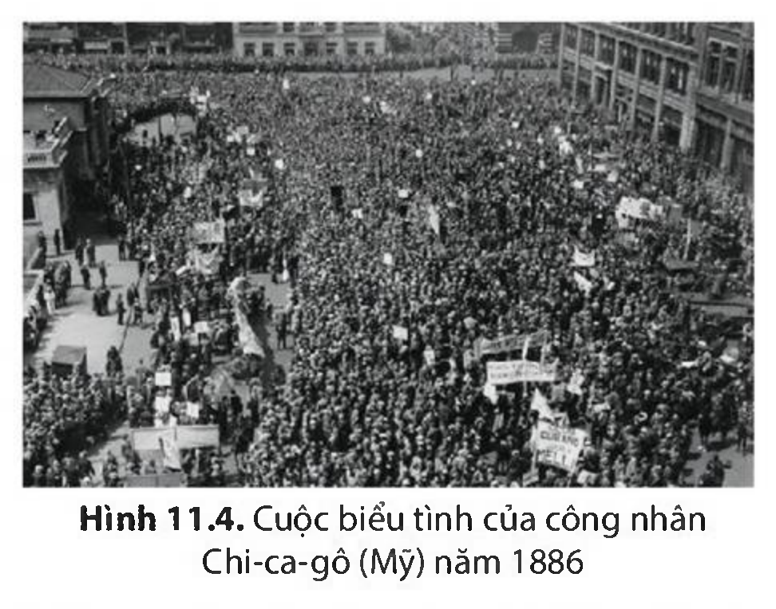

<!-- pdf:50 -->

# BÀI 11: PHONG TRÀO CÔNG NHÂN TỪ CUỐI THẾ KỈ XVIII ĐẾN ĐẦU THẾ KỈ XX VÀ SỰ RA ĐỜI CỦA CHỦ NGHĨA XÃ HỘI KHOA HỌC

## 🎯 Học xong bài này, em sẽ:

- Nêu được sự ra đời của giai cấp công nhân.
- Trình bày được một số hoạt động chính của C. Mác, Ph. Ăng-ghen và sự ra đời của chủ nghĩa xã hội khoa học.
- Trình bày được những nét chính về Công xã Pa-ri (1871) và ý nghĩa lịch sử của việc thành lập nhà nước kiểu mới – nhà nước của giai cấp vô sản đầu tiên trên thế giới.
- Mô tả được một số hoạt động tiêu biểu của phong trào cộng sản và công nhân quốc tế cuối thế kỉ XIX – đầu thế kỉ XX (phong trào công nhân, sự ra đời và hoạt động của các đảng và các tổ chức cộng sản,...).

## 🔴 Mở đầu

Quan sát hình 1 và hình 2, hãy chia sẻ những hiểu biết của em về các nhân vật cũng như những sự kiện lịch sử liên quan đến nhân vật và tác phẩm đó.

*Hình 11.1. Tượng C. Mác và Ph. Ăng-ghen ở Béc-lin (Đức)*

*Hình 11.2. Trang bìa Tuyên ngôn của Đảng Cộng sản*

## 1. Sự ra đời của giai cấp công nhân

<!-- term: Giai cấp công nhân -->
Cách mạng công nghiệp đã làm thay đổi bộ mặt của các nước tư bản, nhiều khu công nghiệp, thành thị lớn xuất hiện. Đông đảo nông dân bị mất ruộng đất buộc phải ra thành thị làm thuê trong các nhà máy, hầm mỏ,... Giai cấp công nhân đã dần hình thành trong bối cảnh đó và cùng với giai cấp tư sản, trở thành hai giai cấp cơ bản trong xã hội tư bản chủ nghĩa.

*Hình 11.3. Một cuộc biểu tình trong phong trào Hiến chương Anh năm 1848*

<!-- pdf:51 -->

<!-- term: Giai cấp công nhân -->
Trong những năm 30 – 40 của thế kỉ XIX, giai cấp công nhân ngày càng đông đảo về đội ngũ, trưởng thành về nhận thức.

> ❓ Hãy cho biết giai cấp công nhân ra đời như thế nào?

## 2. Những hoạt động chính của C. Mác, Ph. Ăng-ghen và sự ra đời của chủ nghĩa xã hội khoa học

C. Mác (1818 – 1883) sinh ra trong một gia đình trí thức gốc Do Thái ở Ti-ri-ơ (Đức). Từ nhỏ ông đã nổi tiếng thông minh, năm 23 tuổi đỗ Tiến sĩ và sớm có khuynh hướng cách mạng nên bị trục xuất khỏi Đức. Ông đã sang Pa-ri (Pháp) tiếp tục nghiên cứu và tham gia phong trào công nhân.

Ph. Ăng-ghen (1820 – 1895) sinh ra trong một gia đình chủ xưởng giàu có ở thành phố Bác-men (Đức). Do hiểu rõ thủ đoạn làm giàu của giai cấp tư sản nên ông tỏ ra khinh ghét họ. Ông có nhiều công trình nghiên cứu về giai cấp công nhân Anh.

Từ những năm 40 của thế kỉ XIX, C. Mác và Ph. Ăng-ghen dần trở thành lãnh tụ của phong trào công nhân quốc tế.

*Bảng tóm tắt một số hoạt động chính của C. Mác và Ph. Ăng-ghen*

<!-- term: Đồng minh những người cộng sản -->
| Thời gian | Hoạt động |
| --- | --- |
| Năm 1842 | Ph. Ăng-ghen sang Anh, tìm hiểu thực tế phong trào công nhân ở đây và biên soạn nhiều tài liệu, trong đó có cuốn *Tình cảnh giai cấp công nhân Anh*. |
| Năm 1843 | Sau khi bị trục xuất khỏi Đức, C. Mác sang Pa-ri (Pháp) và tham gia phong trào cách mạng ở Pháp. |
| Năm 1844 | Ph. Ăng-ghen từ Anh sang Pháp và gặp C. Mác. Hai ông đã thành lập Đồng minh những người cộng sản – chính đảng độc lập đầu tiên của vô sản quốc tế. |
| Đầu năm 1848 | C. Mác và Ph. Ăng-ghen soạn thảo và công bố *Tuyên ngôn của Đảng Cộng sản* – Cương lĩnh của Đồng minh những người cộng sản. |
| Năm 1864 | Quốc tế thứ nhất được thành lập, C. Mác tham gia Ban lãnh đạo và trở thành linh hồn của tổ chức này. |
| Năm 1889 | Quốc tế thứ hai ra đời ở Pa-ri gắn với vai trò quan trọng của Ph. Ăng-ghen. |

<!-- term: Tuyên ngôn của Đảng Cộng sản -->
*Tuyên ngôn của Đảng Cộng sản* trình bày những luận điểm cơ bản về sự phát triển của xã hội loài người và sứ mệnh của giai cấp công nhân. Việc công bố văn kiện này đánh dấu sự ra đời của chủ nghĩa xã hội khoa học.

> ❓ Lập trục thời gian thể hiện những hoạt động chính của C. Mác, Ph. Ăng-ghen và sự ra đời của chủ nghĩa xã hội khoa học.

## 3. Công xã Pa-ri (1871)

Sau khi Pháp thất bại thảm hại trong chiến tranh Pháp – Phổ (1870 – 1871), nhân dân Pa-ri, phần lớn là công nhân và tiểu tư sản đã khởi nghĩa, lật đổ chính quyền Na-pô-lê-ông III. Chính phủ lâm thời tư sản được thành lập nhưng lại tìm cách thoả hiệp với Phổ, kí hoà ước chấp nhận những điều kiện nhục nhã. Trong khi đó, nhân dân Pa-ri vẫn kiên quyết chiến đấu bảo vệ Tổ quốc.

<!-- pdf:52 -->

<!-- term: Công xã Pa-ri -->
Ngày 18 – 3, dưới sự lãnh đạo của Uỷ ban Trung ương Vệ quốc quân, các tiểu đoàn Vệ quốc quân cùng nhân dân Pa-ri từ các ngả tiến vào trung tâm Thủ đô, chiếm các cơ quan chính phủ. Khởi nghĩa giành thắng lợi hoàn toàn. Đây là cuộc cách mạng vô sản đầu tiên trên thế giới, dẫn tới sự ra đời của một chế độ mới, xã hội mới.

<!-- term: Công xã Pa-ri -->
Để thay thế cho chính quyền tư sản, chính quyền cách mạng – Công xã Pa-ri được bầu ra theo nguyên tắc phổ thông đầu phiếu. Cơ quan quyền lực cao nhất là Hội đồng công xã.

Hội đồng Công xã ra sắc lệnh giải tán quân đội và bộ máy cảnh sát của chế độ cũ, thành lập lực lượng vũ trang và lực lượng an ninh nhân dân, ban bố và thi hành nhiều sắc lệnh đem lại quyền lợi cho nhân dân.

> • Công xã tách Nhà thờ khỏi Nhà nước, quyết định không dạy giáo lí trong nhà trường.
>
> Công xã giao cho công nhân tất cả những xí nghiệp của bọn chủ trốn khỏi Pa-ri. Công nhân cộng tác chặt chẽ với chính quyền, đặt kế hoạch sản xuất và lập nội quy trong xưởng. Công nhân kiểm soát chế độ tiền lương và cấm cúp phạt.
>
> (Theo Phạm Gia Hải (Chủ biên), *Lịch sử thế giới cận đại (1871 – 1918)*, NXB Giáo dục, 1992, tr. 13 – 15)

<!-- term: Công xã Pa-ri -->
Tuy chỉ tồn tại trong vòng 72 ngày (từ ngày 18 – 3 – 1871 đến ngày 28 – 5 – 1871), nhưng Công xã Pa-ri là hình ảnh của một nhà nước kiểu mới, chăm lo đến quyền lợi của giai cấp công nhân và nhân dân lao động; là sự cổ vũ những người lao động trên toàn thế giới trong sự nghiệp đấu tranh lâu dài cho một tương lai tốt đẹp hơn.

> ❓ 1. Nêu những nét chính về Công xã Pa-ri (1871).
>
> 2. Khai thác tư liệu trên và thông tin trong mục, hãy cho biết những biểu hiện chứng tỏ Công xã Pa-ri là nhà nước kiểu mới. Ý nghĩa lịch sử của việc thành lập Công xã Pa-ri là gì?

## 4. Một số hoạt động tiêu biểu của phong trào cộng sản và công nhân quốc tế

### a) Sự thành lập và hoạt động của Quốc tế thứ nhất (1864 – 1876)

<!-- term: Quốc tế thứ nhất -->
Do sự lớn mạnh của phong trào công nhân, tháng 9 – 1864, C. Mác và Ph. Ăng-ghen thành lập Hội Liên hiệp lao động quốc tế (còn gọi là Quốc tế thứ nhất).

<!-- term: Quốc tế thứ nhất -->
Quốc tế thứ nhất đã tổ chức 5 kì đại hội. Cùng với những hoạt động truyền bá chủ nghĩa xã hội khoa học, Quốc tế thứ nhất chống những tư tưởng lệch lạc trong phong trào công nhân quốc tế; thông qua những nghị quyết có ý nghĩa chính trị và kinh tế quan trọng như: tiến hành bãi công, thành lập công đoàn, ngày làm 8 giờ,...

### b) Sự ra đời của các đảng công nhân

Trong 30 năm cuối thế kỉ XIX, mâu thuẫn giữa vô sản và tư sản ngày càng sâu sắc. Giai cấp công nhân sử dụng nhiều hình thức đấu tranh khác nhau để chống lại giới chủ.

<!-- pdf:53 -->

<!-- term: Ngày Quốc tế Lao động -->
Ở Mỹ, ngày 1 – 5 – 1886, hàng chục vạn công nhân đình công đòi ngày làm 8 giờ. Cuộc đình công lan ra nhiều nhà máy, xí nghiệp; đặc biệt là cuộc tổng bãi công của gần 40 vạn công nhân Chi-ca-gô. Tuy các cuộc đấu tranh bị đàn áp, nhưng vẫn có hơn 5 vạn công nhân được hưởng quyền làm việc 8 giờ/ngày. Từ năm 1889, ngày 1 – 5 trở thành ngày Quốc tế Lao động.

*Hình 11.4. Cuộc biểu tình của công nhân Chi-ca-gô (Mỹ) năm 1886*
<!-- ocr-ok: đã đối chiếu p053.png, dòng đầu chú thích Hình 11.4 nằm sát mép dưới ảnh đen trắng nên OCR bỏ sót -->

Sự xâm nhập của chủ nghĩa Mác kết hợp với sự phát triển của phong trào công nhân đã dẫn tới sự ra đời của một số đảng và tổ chức cộng sản như: Đảng Xã hội Đức (1875), Đảng Công nhân Pháp (1879), nhóm Giải phóng lao động Nga (1883).

### c) Sự thành lập và hoạt động của Quốc tế thứ hai (1889 – 1914)

<!-- term: Quốc tế thứ hai -->
Ngày 14 – 7 – 1889, Quốc tế thứ hai ra đời ở Pa-ri (Pháp) thay thế cho Quốc tế thứ nhất.

<!-- term: Quốc tế thứ hai -->
Nhờ sự hoạt động tích cực của Ph. Ăng-ghen, Quốc tế thứ hai đã có những đóng góp quan trọng trong sự phát triển của phong trào công nhân thế giới cuối thế kỉ XIX. Tuy nhiên, sau khi Ph. Ăng-ghen mất, những phần tử cơ hội chủ nghĩa chống lại chủ nghĩa Mác dần chiếm ưu thế trong Quốc tế thứ hai.

Kế tục sự nghiệp của C. Mác – Ph. Ăng-ghen là V. I. Lê-nin, lãnh tụ của giai cấp công nhân Nga. Ông đã vạch trần những sai lầm của chủ nghĩa xét lại, tác hại của nó đối với sự nghiệp của giai cấp công nhân, phát triển chủ nghĩa Mác thành chủ nghĩa Mác – Lê-nin.

> ❓ Mô tả một số hoạt động tiêu biểu của phong trào cộng sản và công nhân quốc tế cuối thế kỉ XIX – đầu thế kỉ XX.

## ✏️ Luyện tập – Vận dụng

1. Lập và hoàn thành bảng (theo gợi ý dưới đây) về những hoạt động tiêu biểu của phong trào cộng sản và công nhân quốc tế cuối thế kỉ XIX – đầu thế kỉ XX.

| STT | Thời gian | Địa bàn | Hoạt động tiêu biểu |
| --- | --- | --- | --- |
| | | | |

2. C. Mác và Ph. Ăng-ghen có vai trò như thế nào trong phong trào công nhân và cộng sản quốc tế cuối thế kỉ XIX – đầu thế kỉ XX?

Tìm hiểu thêm về ngày Quốc tế Lao động 1 – 5 và ý nghĩa của sự kiện này trong cuộc sống hiện tại.

## 📷 Danh sách hình trong bài

| Mã hình | Trang PDF | Trang sách | Chú thích |
| --- | --- | --- | --- |
| H8-lich_su_va_dia_ly-ls-b11-01 | 50 | 48 | Hình 11.1. Tượng C. Mác và Ph. Ăng-ghen ở Béc-lin (Đức) |
| H8-lich_su_va_dia_ly-ls-b11-02 | 50 | 48 | Hình 11.2. Trang bìa Tuyên ngôn của Đảng Cộng sản |
| H8-lich_su_va_dia_ly-ls-b11-03 | 50 | 48 | Hình 11.3. Một cuộc biểu tình trong phong trào Hiến chương Anh năm 1848 |
| H8-lich_su_va_dia_ly-ls-b11-04 | 53 | 51 | Hình 11.4. Cuộc biểu tình của công nhân Chi-ca-gô (Mỹ) năm 1886 |
