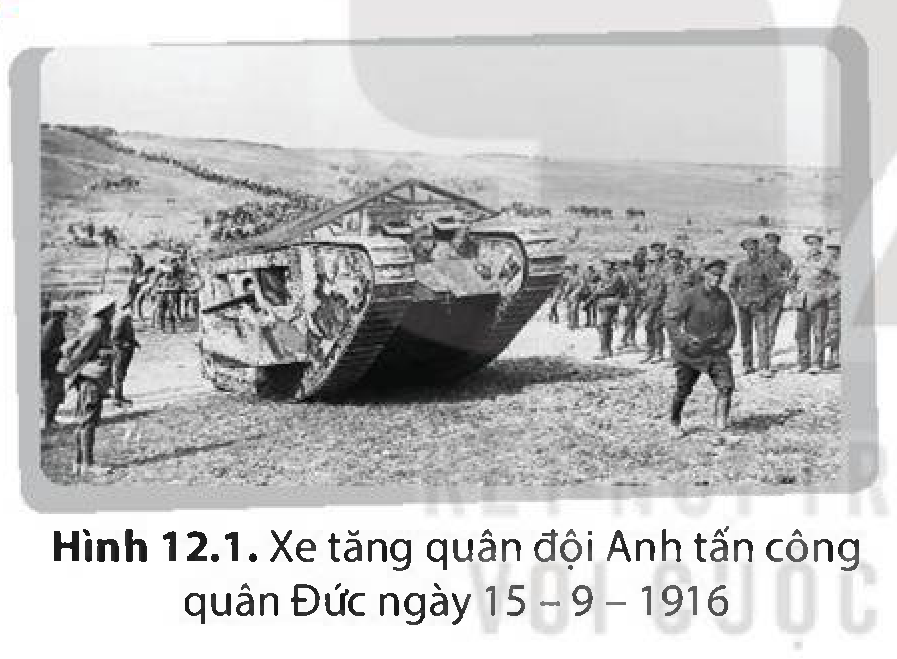
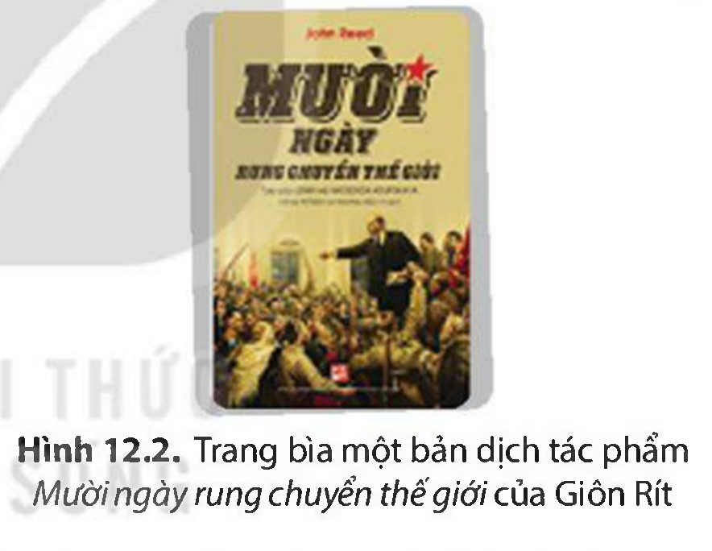
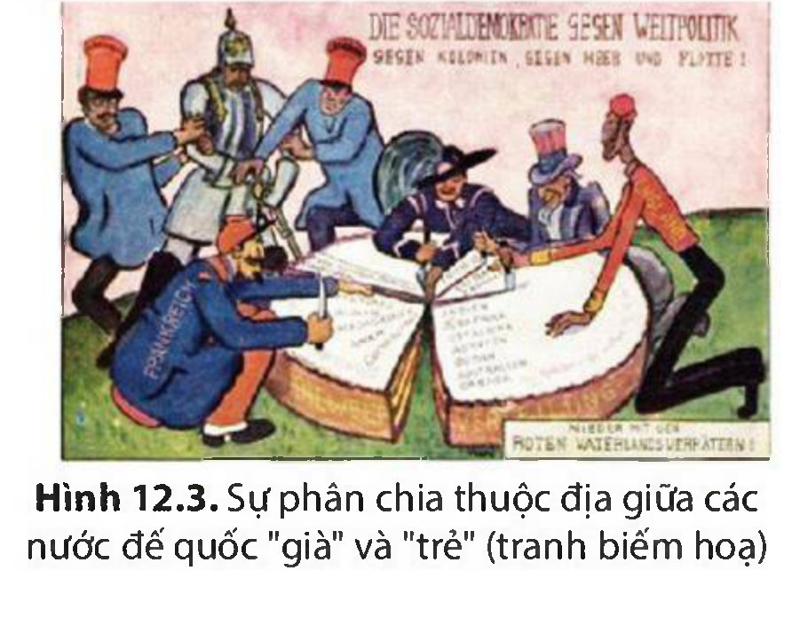
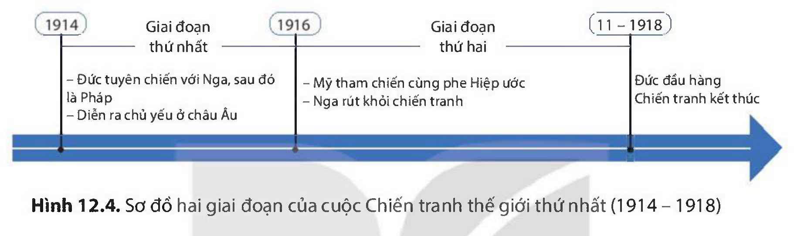
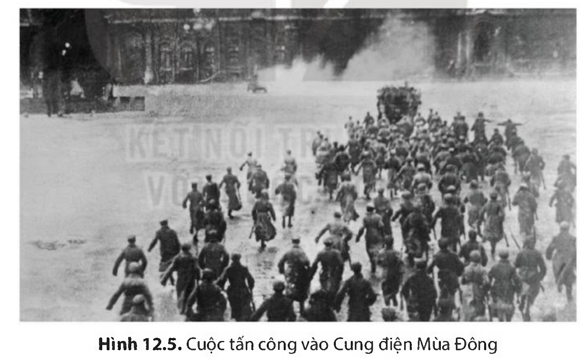

<!-- pdf:54 -->

# BÀI 12: CHIẾN TRANH THẾ GIỚI THỨ NHẤT (1914 – 1918) VÀ CÁCH MẠNG THÁNG MƯỜI NGA NĂM 1917

## 🎯 Học xong bài này, em sẽ:

- Nêu được nguyên nhân bùng nổ Chiến tranh thế giới thứ nhất.
- Phân tích, đánh giá được hậu quả và tác động của Chiến tranh thế giới thứ nhất (1914 – 1918) đối với lịch sử nhân loại.
- Nêu được một số nét chính (nguyên nhân, diễn biến, tác động và ý nghĩa lịch sử) của Cách mạng tháng Mười Nga năm 1917.

## 🔴 Mở đầu

*Hình 12.1. Xe tăng quân đội Anh tấn công quân Đức ngày 15 – 9 – 1916*

*Hình 12.2. Trang bìa một bản dịch tác phẩm Mười ngày rung chuyển thế giới của Giôn Rít*

Quan sát và cho biết những hình ảnh trên liên quan đến các sự kiện lịch sử nào của thế giới? Hãy chia sẻ những điều em biết về các sự kiện đó.

## 1. Chiến tranh thế giới thứ nhất (1914 – 1918)

### a) Nguyên nhân

Đến cuối thế kỉ XIX – đầu thế kỉ XX, sự phát triển không đều về kinh tế đã làm thay đổi sâu sắc so sánh lực lượng giữa các nước đế quốc. Mâu thuẫn giữa đế quốc với đế quốc về vấn đề thuộc địa trở nên vô cùng gay gắt. Những nước đế quốc “già” như Anh, Pháp chiếm phần thuộc địa lớn nhất; những đế quốc “trẻ” có tiềm lực kinh tế như Đức lại có quá ít thuộc địa. Tình trạng đó dẫn đến sự hình thành hai khối quân sự đối lập nhau: khối Liên minh (Đức, Áo – Hung, I-ta-li-a) ra đời năm 1882, khối Hiệp ước (Anh, Pháp, Nga) ra đời năm 1907.

*Hình 12.3. Sự phân chia thuộc địa giữa các nước đế quốc "già" và "trẻ" (tranh biếm hoạ)*

<!-- pdf:55 -->

<!-- term: Chiến tranh thế giới thứ nhất -->
Tình hình căng thẳng ở Ban-căng trong những năm 1912 – 1913 đã châm ngòi cho cuộc chiến tranh. Ngày 28 – 6 – 1914, Thái tử kế vị Áo – Hung bị ám sát ở Xéc-bi. Nhân sự kiện này, Áo – Hung tuyên chiến với Xéc-bi, Đức tuyên chiến với Nga ngày 1 – 8 – 1914. Chiến tranh bùng nổ và nhanh chóng lan rộng thành chiến tranh thế giới.

*Hình 12.4. Sơ đồ hai giai đoạn của cuộc Chiến tranh thế giới thứ nhất (1914 – 1918)*

> **Sơ đồ hai giai đoạn của cuộc Chiến tranh thế giới thứ nhất (1914 – 1918):**
> - Giai đoạn thứ nhất (1914 – 1916): Đức tuyên chiến với Nga, sau đó là Pháp; diễn ra chủ yếu ở châu Âu.
> - Giai đoạn thứ hai (1916 – 11/1918): Mỹ tham chiến cùng phe Hiệp ước; Nga rút khỏi chiến tranh; 11 – 1918: Đức đầu hàng, chiến tranh kết thúc.

> ❓ Trình bày nguyên nhân sâu xa và nguyên nhân trực tiếp dẫn tới Chiến tranh thế giới thứ nhất.

### b) Hậu quả và tác động

<!-- term: Chiến tranh thế giới thứ nhất -->
Chiến tranh thế giới thứ nhất là cuộc chiến tranh đế quốc phi nghĩa đối với cả hai bên tham chiến. Chiến tranh kết thúc với thắng lợi của khối Hiệp ước, song đã gây ra những thảm hoạ hết sức nặng nề đối với nhân loại.

Nhiều thành phố, làng mạc, đường sá, cầu cống, nhà máy bị phá huỷ. Các nước châu Âu đều biến thành con nợ của Mỹ. Riêng Mỹ được hưởng lợi trong chiến tranh nhờ buôn bán vũ khí, đất nước không bị tàn phá, thu nhập quốc dân tăng gấp đôi, vốn đầu tư ra nước ngoài tăng 4 lần. Nhật Bản chiếm lại một số đảo của Đức, nâng cao vị thế ở khu vực Đông Á và Thái Bình Dương.

*Bảng số liệu tổn thất về người và của trong Chiến tranh thế giới thứ nhất*

| Số nước tham gia | Số người chết | Số người bị thương | Tổn thất về kinh tế |
| --- | --- | --- | --- |
| 38 nước | 10 triệu người | 20 triệu người | 85 tỉ đô la Mỹ |

Trong quá trình chiến tranh, Cách mạng tháng Mười Nga và việc thành lập nhà nước Xô viết đánh dấu bước chuyển lớn trong cục diện chính trị thế giới.

> ❓ Hãy phân tích hậu quả và tác động của Chiến tranh thế giới thứ nhất đối với lịch sử nhân loại.

<!-- pdf:56 -->

## 2. Cách mạng tháng Mười Nga năm 1917

### a) Nguyên nhân và diễn biến chính

Sau Cách mạng tháng Hai năm 1917, chế độ quân chủ chuyên chế Nga hoàng đã bị lật đổ, nhưng nỗi khổ cực vẫn đè nặng lên các tầng lớp nhân dân, đặc biệt là nông dân, công nhân. Một tình hình chính trị chưa từng có đã diễn ra ở Nga, đó là tình trạng hai chính quyền song song tồn tại: Chính phủ tư sản lâm thời và các Xô viết đại biểu công nhân, binh lính. Hai chính quyền này đại diện cho các giai cấp có lợi ích đối lập nhau nên không thể cùng tồn tại.

> 1. “Đặc điểm của tình hình hiện nay ở Nga là... phải đem lại chính quyền cho giai cấp vô sản, những tầng lớp nghèo và cho nông dân."
>
> (V. I. Lê-nin, *Toàn tập*, Tập 31, NXB Chính trị quốc gia – Sự thật, 2005, tr. 137)

Trước tình hình đó, V. I. Lê-nin và Đảng Bôn-sê-vích Nga đã chuẩn bị kế hoạch tiếp tục làm cách mạng, lật đổ Chính phủ tư sản lâm thời.

Tháng 7 – 1917, khi Chính phủ tư sản lâm thời công khai đàn áp các phong trào quần chúng, khủng bố các xô viết, Đảng Bôn-sê-vích đã lãnh đạo giai cấp công nhân, nông dân, binh lính chuẩn bị đấu tranh vũ trang giành chính quyền.

*Hình 12.5. Cuộc tấn công vào Cung điện Mùa Đông*

<!-- term: Cách mạng tháng Mười Nga -->
Đêm 24 – 10 (6 – 11 theo dương lịch), quân khởi nghĩa đã chiếm được Pê-trô-grát (Xanh Pê-téc-bua) và bao vây Cung điện Mùa Đông – nơi ẩn náu cuối cùng của chính quyền tư sản. Đêm 25 – 10 (7 – 11), Cung điện Mùa Đông bị chiếm, Chính phủ tư sản lâm thời sụp đổ. Đầu năm 1918, Cách mạng xã hội chủ nghĩa tháng Mười đã giành được thắng lợi hoàn toàn.

> ❓ 1. Trình bày nguyên nhân dẫn tới sự bùng nổ Cách mạng tháng Mười Nga năm 1917.
>
> 2. Nêu diễn biến chính của Cách mạng tháng Mười Nga năm 1917.

<!-- pdf:57 -->

### b) Ý nghĩa lịch sử và tác động

<!-- term: Cách mạng tháng Mười Nga -->
Thắng lợi của Cách mạng tháng Mười Nga đã đập tan bộ máy nhà nước cũ của giai cấp tư sản và địa chủ, thành lập bộ máy nhà nước mới của giai cấp công nhân và nông dân Nga.

<!-- term: Cách mạng tháng Mười Nga -->
Cách mạng tháng Mười Nga đã cổ vũ mạnh mẽ phong trào cách mạng của giai cấp công nhân quốc tế, chỉ ra cho họ con đường đi tới thắng lợi trong cuộc đấu tranh chống chủ nghĩa tư bản, đồng thời mở ra con đường giải phóng cho các dân tộc bị áp bức trên toàn thế giới.

<!-- term: Cách mạng tháng Mười Nga -->
Cách mạng tháng Mười Nga có tác động sâu sắc đến tiến trình lịch sử và cục diện thế giới, đã chặt đứt một khâu yếu nhất trong hệ thống đế quốc chủ nghĩa, tạo ra chế độ xã hội đối lập với xã hội tư bản chủ nghĩa.

> 2. “Giống như Mặt Trời chói lọi, Cách mạng tháng Mười chiếu sáng khắp năm châu, thức tỉnh hàng triệu, hàng triệu người bị áp bức, bóc lột trên Trái Đất. Trong lịch sử loài người chưa từng có cuộc cách mạng nào có ý nghĩa to lớn và sâu xa như thế.”
>
> (Hồ Chí Minh, *Toàn tập*, Tập 12, NXB Chính trị quốc gia, 1996, tr. 300)

> 💡 **Em có biết?**
>
> *Mười ngày rung chuyển thế giới* là tác phẩm của Giôn Rít (người Mỹ), xuất bản năm 1919 tại Niu Oóc, gồm 12 chương, diễn giải nguyên nhân dẫn đến cuộc Cách mạng tháng Mười Nga và quá trình diễn ra sự kiện này. Tác phẩm đã đem đến cho độc giả một cảm nhận hết sức chân thực và toàn cảnh về cuộc cách mạng này: “Kể lại lịch sử những ngày vĩ đại ấy bằng con mắt của một người ghi chép có lương tâm, cố gắng ghi lại sự thật”.

> ❓ 1. Hãy trình bày ý nghĩa lịch sử và tác động của Cách mạng tháng Mười Nga đối với lịch sử nhân loại.
>
> 2. Khai thác tư liệu 2 và cho biết Hồ Chí Minh đã đánh giá thế nào về vai trò của Cách mạng tháng Mười Nga?

## ✏️ Luyện tập – Vận dụng

1. Vì sao nói Chiến tranh thế giới thứ nhất là chiến tranh đế quốc phi nghĩa?

2. Hãy lập và hoàn thành bảng về diễn biến, ý nghĩa và tác động của Cách mạng tháng Mười Nga năm 1917.

Tìm hiểu từ sách, báo, internet và cho biết Cách mạng tháng Mười Nga năm 1917 có ảnh hưởng như thế nào đối với cách mạng Việt Nam?

## 📷 Danh sách hình trong bài

| Mã hình | Trang PDF | Trang sách | Chú thích |
| --- | --- | --- | --- |
| H8-lich_su_va_dia_ly-ls-b12-01 | 54 | 52 | Hình 12.1. Xe tăng quân đội Anh tấn công quân Đức ngày 15 – 9 – 1916 |
| H8-lich_su_va_dia_ly-ls-b12-02 | 54 | 52 | Hình 12.2. Trang bìa một bản dịch tác phẩm Mười ngày rung chuyển thế giới của Giôn Rít |
| H8-lich_su_va_dia_ly-ls-b12-03 | 54 | 52 | Hình 12.3. Sự phân chia thuộc địa giữa các nước đế quốc "già" và "trẻ" (tranh biếm hoạ) |
| H8-lich_su_va_dia_ly-ls-b12-04 | 55 | 53 | Hình 12.4. Sơ đồ hai giai đoạn của cuộc Chiến tranh thế giới thứ nhất (1914 – 1918) |
| H8-lich_su_va_dia_ly-ls-b12-05 | 56 | 54 | Hình 12.5. Cuộc tấn công vào Cung điện Mùa Đông |
