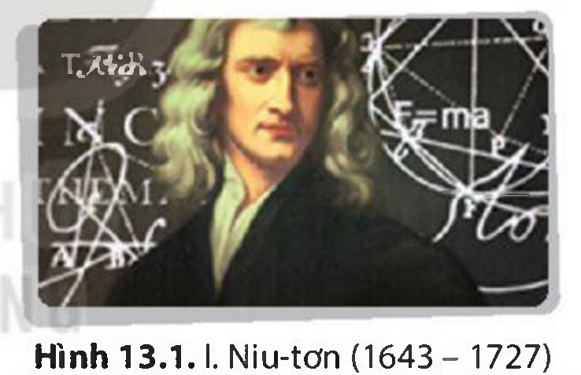
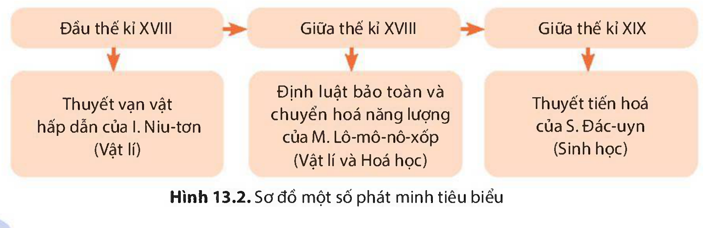
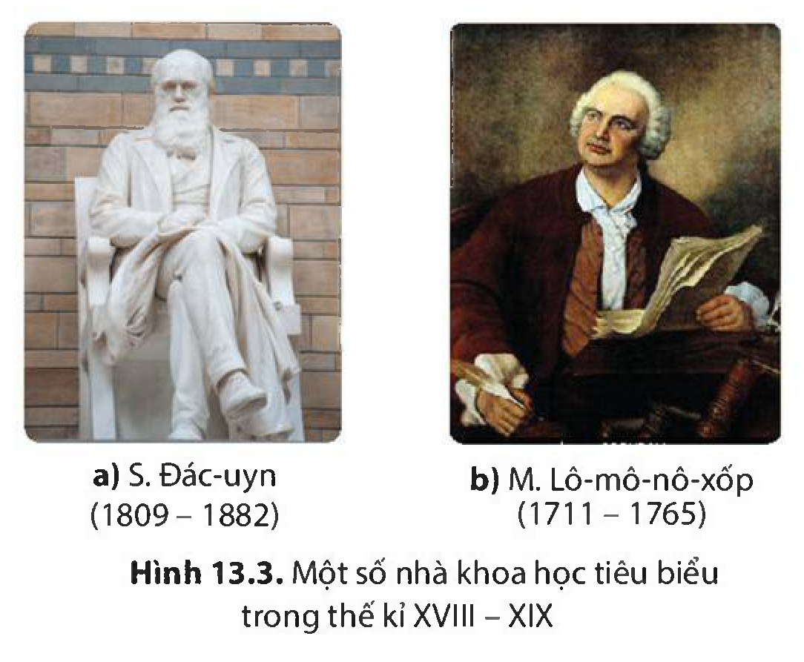
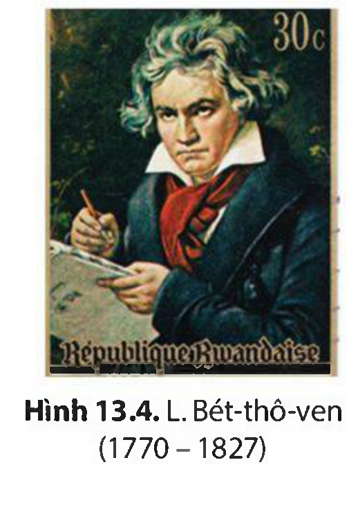
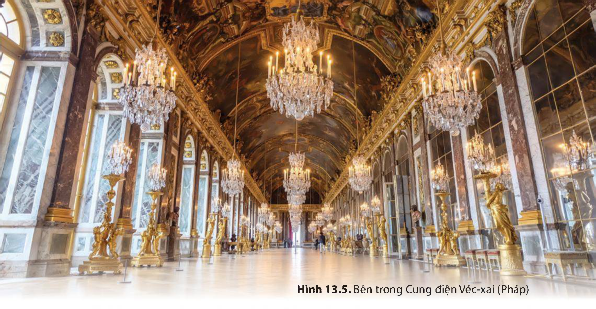
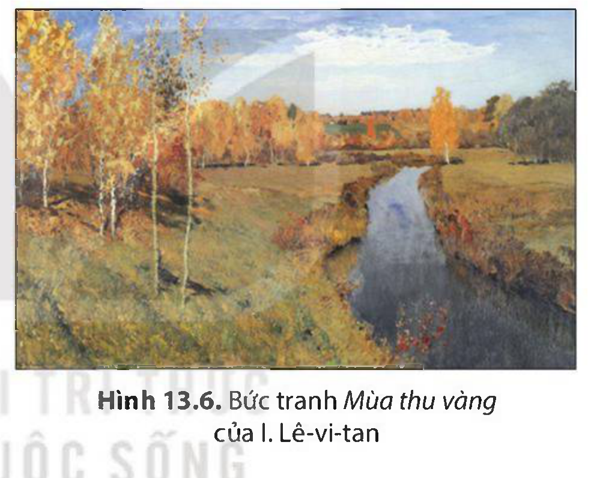

<!-- pdf:58 -->

# BÀI 13: SỰ PHÁT TRIỂN CỦA KHOA HỌC, KĨ THUẬT, VĂN HỌC, NGHỆ THUẬT TRONG CÁC THẾ KỈ XVIII – XIX

## 🎯 Học xong bài này, em sẽ:

- Mô tả được một số thành tựu tiêu biểu về khoa học, kĩ thuật, văn học, nghệ thuật trong các thế kỉ XVIII – XIX.
- Phân tích được tác động của sự phát triển khoa học, kĩ thuật, văn học, nghệ thuật trong các thế kỉ XVIII – XIX.

## 🔴 Mở đầu

Trong các thế kỉ XVIII – XIX, xã hội loài người đã có những thành tựu lớn về khoa học, kĩ thuật và văn học, nghệ thuật. Hình ảnh bên là I. Niu-tơn – người có phát minh khoa học vĩ đại trong thời kì lịch sử này. Theo em, đó là phát minh nào? Hãy chia sẻ những điều em biết về những thành tựu khoa học, kĩ thuật mang dấu ấn thời đại, cũng như tác động của các thành tựu đó đối với đời sống con người.

*Hình 13.1. I. Niu-tơn (1643 – 1727)*

## 1. Những thành tựu tiêu biểu về khoa học và kĩ thuật

### a) Khoa học

*Khoa học tự nhiên* đạt được những tiến bộ vượt bậc với nhiều phát minh lớn của các nhà khoa học.

*Hình 13.2. Sơ đồ một số phát minh tiêu biểu*

<!-- term: Thuyết vạn vật hấp dẫn -->
<!-- term: Định luật bảo toàn và chuyển hoá năng lượng -->
<!-- term: Thuyết tiến hoá -->
> **Sơ đồ một số phát minh tiêu biểu:**
> - Đầu thế kỉ XVIII: Thuyết vạn vật hấp dẫn của I. Niu-tơn (Vật lí).
> - Giữa thế kỉ XVIII: Định luật bảo toàn và chuyển hoá năng lượng của M. Lô-mô-nô-xốp (Vật lí và Hoá học).
> - Giữa thế kỉ XIX: Thuyết tiến hoá của S. Đác-uyn (Sinh học).

<!-- pdf:59 -->

*Hình 13.3. Một số nhà khoa học tiêu biểu trong thế kỉ XVIII – XIX*

<!-- term: Thuyết vạn vật hấp dẫn -->
> 💡 **Em có biết?**
>
> Trong một lần ngồi uống trà dưới bóng cây táo trong khu vườn của gia đình, Niu-tơn chỉ vào một quả táo trên cành cây làm ví dụ. Ông tự hỏi tại sao quả táo luôn rơi xuống mặt đất khi rụng khỏi cành cây, thay vì rơi ngang hoặc bay ngược lên. Niu-tơn nói rằng: Trái Đất hút quả táo bằng một lực chưa được biết đến.

<!-- term: Thuyết vạn vật hấp dẫn -->
<!-- term: Định luật bảo toàn và chuyển hoá năng lượng -->
<!-- term: Thuyết tiến hoá -->
Những thành tựu về khoa học tự nhiên đã tạo ra sự thay đổi lớn trong nhận thức của con người về vạn vật biến chuyển, vận động theo quy luật, đặt cơ sở cho cuộc cách mạng vĩ đại trong kĩ thuật và công nghiệp.

*Các ngành khoa học xã hội* gắn liền với sự xuất hiện của nhiều trào lưu tư tưởng tiến bộ.

<!-- term: Chủ nghĩa duy vật và phép biện chứng -->
<!-- term: Kinh tế chính trị học tư sản -->
<!-- term: Chủ nghĩa xã hội không tưởng -->
Ở Đức, chủ nghĩa duy vật và phép biện chứng được xây dựng tương đối hoàn thiện với những đại diện xuất sắc là L. Phoi-ơ-bách và G. Hê-ghen. Ở Anh, kinh tế chính trị học tư sản ra đời với những tác phẩm nổi tiếng của A. Xmít và D. Ri-các-đô. Chủ nghĩa xã hội không tưởng gắn liền với tên tuổi của C. H. Xanh Xi-mông, S. Phu-ri-ê (Pháp) và R. Ô-oen (Anh).

<!-- term: Chủ nghĩa xã hội khoa học -->
Giữa thế kỉ XIX, chủ nghĩa xã hội khoa học ra đời, do C. Mác và Ph. Ăng-ghen sáng lập, là cuộc cách mạng trong lịch sử tư tưởng của loài người.

<!-- term: Chủ nghĩa xã hội không tưởng -->
Những trào lưu tư tưởng tiến bộ đã lên án mặt trái của chủ nghĩa tư bản, phản ánh khát vọng xây dựng một xã hội mới không có chế độ tư hữu, không có bóc lột, từng bước hình thành cương lĩnh của giai cấp công nhân trong cuộc đấu tranh chống chủ nghĩa tư bản.

> ❓ Nêu những thành tựu tiêu biểu về khoa học. Phân tích tác động của các thành tựu đó đối với đời sống xã hội loài người trong các thế kỉ XVIII – XIX.

### b) Kĩ thuật

Ứng dụng những thành tựu khoa học, nhiều phát minh, cải tiến kĩ thuật ra đời trong thế kỉ XIX như: cải tiến kĩ thuật luyện kim, tìm ra nhiều nguồn nguyên liệu, nhiên liệu mới, chế tạo máy công cụ,... Ngành giao thông vận tải có những tiến bộ vượt bậc.

<!-- term: Tàu thuỷ chạy bằng động cơ hơi nước -->
Năm 1807, Phơn-tơn (người Mỹ) đã chế tạo được tàu thuỷ chạy bằng động cơ hơi nước đầu tiên. Đến năm 1836, có hơn 500 tàu thuỷ hoạt động ở các hải cảng nước Anh.

<!-- term: Phương pháp sử dụng lò cao trong luyện kim -->
Với việc phát minh ra phương pháp sử dụng lò cao trong luyện kim đã dẫn đến sự ra đời của các nguyên liệu mới (thép, nhôm,...).

<!-- pdf:60 -->

Những khám phá về điện là cơ sở cho sự ra đời và phát triển của động cơ điện, điện thoại, vô tuyến điện và thúc đẩy việc ứng dụng nguồn năng lượng điện vào cuộc sống.

<!-- term: Động cơ đốt trong -->
Việc phát minh ra động cơ đốt trong tạo tiền đề cho sự ra đời và phát triển của ô tô, máy bay, đồng thời thúc đẩy ngành khai thác dầu mỏ.

Trong nông nghiệp, cũng có nhiều tiến bộ về kĩ thuật và phương pháp canh tác. Sang thế kỉ XIX, phân hoá học, máy kéo chạy bằng hơi nước, máy cày nhiều lưỡi, máy gặt đập được sử dụng rộng rãi.

Những thành tựu đó đã tạo nên cuộc cách mạng công nghiệp, làm tăng năng suất lao động, nhiều trung tâm công nghiệp xuất hiện, giao thông vận tải phát triển nhanh chóng.

> ❓ Nêu những thành tựu chủ yếu về kĩ thuật trong thế kỉ XIX. Phân tích tác động của những thành tựu đó đối với xã hội loài người.

## 2. Sự phát triển của văn học và nghệ thuật

*Văn học* trong các thế kỉ XVIII – XIX phát triển rực rỡ với sự xuất hiện nhiều nhà văn, nhà thơ lớn mà các tác phẩm của họ đã phản ánh khá đầy đủ, toàn diện hiện thực xã hội, đặt nền móng cho văn học hiện đại. Tiêu biểu là: *Tấn trò đời* của H. Ban-dắc; *Nhà thờ Đức Bà Pa-ri*, *Những người khốn khổ* của Vích-to Huy-gô (Pháp); *Chiến tranh và hoà bình* của Lép Tôn-xtôi (Nga);... Ngoài ra còn có nhiều nhà văn, nhà thơ lớn khác để lại dấu ấn sâu sắc trong thời kì này như: A. Pu-skin (Nga); Ph. Si-lơ, Giô-han Gớt (Đức); W. Thác-cơ-rê, S. Đích-ken (Anh);...

> 🔗 **Kết nối với văn học**
>
> Tác phẩm *Những người khốn khổ* của Vích-to Huy-gô được xuất bản năm 1862, là tiểu thuyết miêu tả thế giới của những con người nghèo khổ một cách chân thực và cũng là bài ca về tình yêu. Tác phẩm được đánh giá là một trong những tiểu thuyết nổi tiếng nhất của nền văn học thế giới thế kỉ XIX.

*Nghệ thuật* phát triển theo nhiều thể loại, phản ánh cuộc sống chứa chan tình nhân ái, ca ngợi cuộc đấu tranh cho tự do.

Thế kỉ XVIII, âm nhạc ghi lại dấu ấn sâu sắc của các nhạc sĩ W. Mô-da (Áo), S. Bách (Đức) với những tác phẩm được coi là mẫu mực cổ điển thì thế kỉ XIX, âm nhạc tràn đầy tính lãng mạn với tên tuổi của L. Bét-thô-ven (Đức), Ph. Sô-panh (Ba Lan), P. I. Trai-cốp-xki (Nga),...

*Hình 13.4. L. Bét-thô-ven (1770 – 1827)*

<!-- term: Cung điện Véc-xai -->
Cung điện Véc-xai (Pháp) được hoàn thành đầu thế kỉ XVIII, sau đó tiếp tục được hoàn chỉnh và trở thành một công trình kiến trúc cực kì đồ sộ và lộng lẫy.

<!-- pdf:61 -->

*Hình 13.5. Bên trong Cung điện Véc-xai (Pháp)*
<!-- ocr-ok: đã đối chiếu p061.png, chú thích Hình 13.5 nằm trên dải mờ chân ảnh tràn lề nên OCR bỏ sót -->

Thế kỉ XVIII – XIX đã xuất hiện nhiều danh hoạ với các tác phẩm nổi tiếng, gắn bó với cuộc sống hiện thực. Tiêu biểu là Gi. Đa-vít, Ơ. Đơ-la-croa (Pháp); Ph. Gôi-a (Tây Ban Nha); I. Lê-vi-tan (Nga); V. Van Gốc (Hà Lan);...

Sự phát triển của văn học, nghệ thuật đã góp phần lên án và vạch trần những tệ nạn, bất công trong xã hội đương thời; thức tỉnh, khích lệ người dân nhất là người lao động nghèo khổ đấu tranh cho cuộc sống tự do, hạnh phúc.

*Hình 13.6. Bức tranh Mùa thu vàng của I. Lê-vi-tan*

> ❓ 1. Hãy trình bày những thành tựu tiêu biểu về văn học, nghệ thuật trong các thế kỉ XVIII – XIX.
>
> 2. Phân tích tác động của những thành tựu văn học, nghệ thuật trong các thế kỉ XVIII – XIX đối với xã hội loài người.

## ✏️ Luyện tập – Vận dụng

Lập bảng thống kê những thành tựu và tác động chủ yếu của khoa học, kĩ thuật, văn học, nghệ thuật trong các thế kỉ XVIII – XIX.

Sưu tầm tư liệu từ sách, báo và internet, em hãy viết một đoạn văn ngắn (khoảng 7 – 10 câu) giới thiệu về một thành tựu tiêu biểu hoặc một danh nhân văn hoá có nhiều đóng góp trong các thế kỉ XVIII – XIX.

## 📷 Danh sách hình trong bài

| Mã hình | Trang PDF | Trang sách | Chú thích |
| --- | --- | --- | --- |
| H8-lich_su_va_dia_ly-ls-b13-01 | 58 | 56 | Hình 13.1. I. Niu-tơn (1643 – 1727) |
| H8-lich_su_va_dia_ly-ls-b13-02 | 58 | 56 | Hình 13.2. Sơ đồ một số phát minh tiêu biểu |
| H8-lich_su_va_dia_ly-ls-b13-03 | 59 | 57 | Hình 13.3. Một số nhà khoa học tiêu biểu trong thế kỉ XVIII – XIX |
| H8-lich_su_va_dia_ly-ls-b13-04 | 60 | 58 | Hình 13.4. L. Bét-thô-ven (1770 – 1827) |
| H8-lich_su_va_dia_ly-ls-b13-05 | 61 | 59 | Hình 13.5. Bên trong Cung điện Véc-xai (Pháp) |
| H8-lich_su_va_dia_ly-ls-b13-06 | 61 | 59 | Hình 13.6. Bức tranh Mùa thu vàng của I. Lê-vi-tan |
