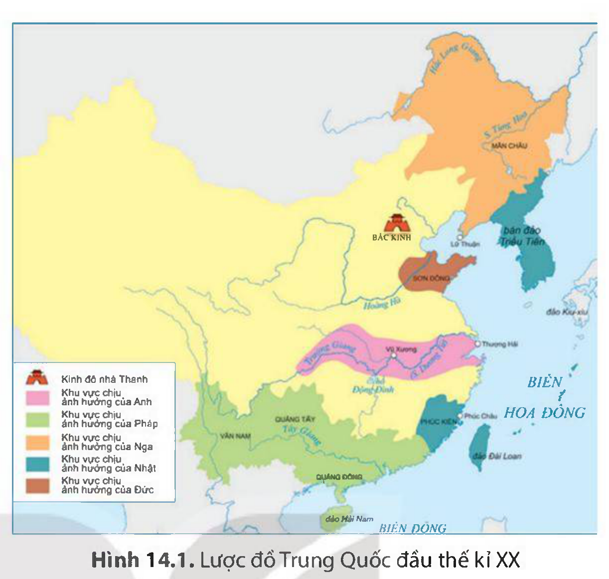
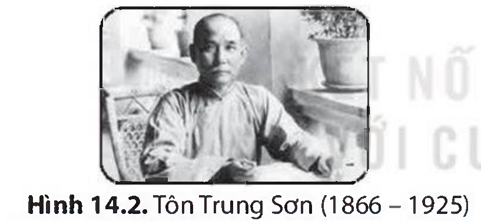
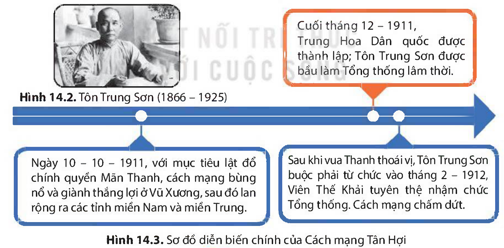
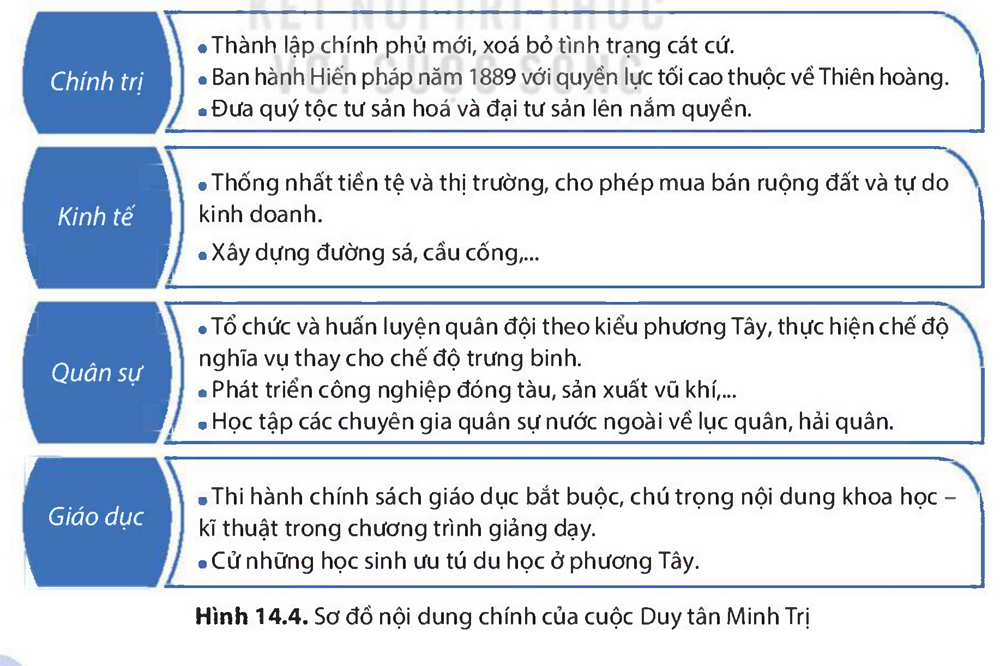
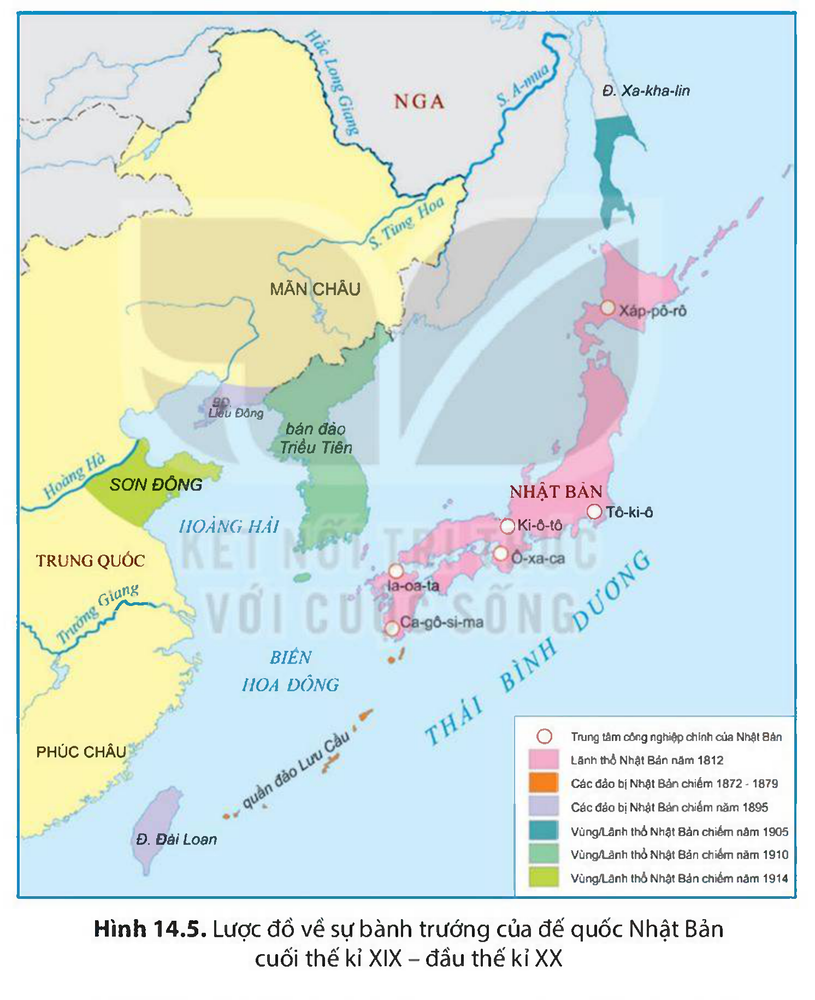

<!-- pdf:62 -->

# BÀI 14: TRUNG QUỐC VÀ NHẬT BẢN TỪ NỬA SAU THẾ KỈ XIX ĐẾN ĐẦU THẾ KỈ XX

## 🎯 Học xong bài này, em sẽ:

- Mô tả được quá trình xâm lược Trung Quốc của các nước đế quốc.
- Trình bày được sơ lược về Cách mạng Tân Hợi; nhận biết được nguyên nhân thắng lợi và nêu được ý nghĩa của Cách mạng Tân Hợi.
- Nêu được những nội dung chính, ý nghĩa lịch sử của cuộc Duy tân Minh Trị.
- Trình bày được những biểu hiện của sự hình thành chủ nghĩa đế quốc ở Nhật Bản vào cuối thế kỉ XIX – đầu thế kỉ XX.

## 🔴 Mở đầu

Nếu lịch sử Nhật Bản từ giữa thế kỉ XIX đến đầu thế kỉ XX gắn với Thiên hoàng Minh Trị và cuộc Duy tân (1868) thì lịch sử Trung Quốc thời kì này không thể không nhắc đến nhân vật Tôn Trung Sơn với cuộc Cách mạng Tân Hợi (1911). Em hãy chia sẻ hiểu biết của mình về hai nhân vật lịch sử và hai sự kiện nêu trên.

## 1. Trung Quốc từ nửa sau thế kỉ XIX đến đầu thế kỉ XX

### a) Quá trình xâm lược của các nước đế quốc

Vào giữa thế kỉ XIX, Trung Quốc cũng trở thành “miếng mồi” cho các nước đế quốc phân chia, xâu xé.

<!-- term: Chiến tranh thuốc phiện -->
<!-- term: Hiệp ước Nam Kinh -->
Năm 1840, lấy cớ chính quyền Mãn Thanh tịch thu và thiêu huỷ toàn bộ thuốc phiện của thương nhân Anh, thực dân Anh đã gây chiến với Trung Quốc, thường gọi là Chiến tranh thuốc phiện, kéo dài đến năm 1842. Kết cục, chính quyền Mãn Thanh phải kí Hiệp ước Nam Kinh đầu hàng và chấp nhận những điều khoản có lợi cho thực dân Anh.

<!-- term: Hiệp ước Nam Kinh -->
Hiệp ước Nam Kinh quy định: Trung Quốc phải mở năm cửa biển cho thương nhân người Anh vào buôn bán, phải bồi thường chiến tranh và nhượng cho Anh vùng đất Hồng Công,...

Vào nửa sau thế kỉ XIX, các nước đế quốc từng bước nhảy vào xâu xé Trung Quốc. Đức chiếm vùng Sơn Đông; Anh chiếm vùng châu thổ sông Dương Tử; Nga, Nhật Bản chiếm vùng Đông Bắc; Pháp chiếm vùng Vân Nam, Quảng Tây, Quảng Đông;...

<!-- pdf:63 -->

<!-- term: Hiệp ước Tân Sửu -->
Năm 1901, sau khi kí Hiệp ước Tân Sửu với các nước đế quốc, Trung Quốc trở thành một nước phong kiến, nửa thuộc địa.

*Hình 14.1. Lược đồ Trung Quốc đầu thế kỉ XX*

> ❓ 1. Thực chất của Chiến tranh thuốc phiện (1840 – 1842) là gì?
>
> 2. Khai thác lược đồ hình 14.1 và thông tin trong mục, hãy mô tả quá trình các nước đế quốc xâm lược Trung Quốc.

### b) Cách mạng Tân Hợi (1911)

<!-- term: Cách mạng Tân Hợi -->
Tháng 5 – 1911, chính quyền Mãn Thanh ra Sắc lệnh “Quốc hữu hoá đường sắt” nhưng thực chất là trao quyền kinh doanh đường sắt cho các nước đế quốc, bán rẻ quyền lợi dân tộc. Sự kiện này đã gây ra làn sóng căm phẫn trong quần chúng nhân dân, châm ngòi cho sự bùng nổ của Cách mạng Tân Hợi (1911).

*Hình 14.2. Tôn Trung Sơn (1866 – 1925)*

*Hình 14.3. Sơ đồ diễn biến chính của Cách mạng Tân Hợi*

<!-- term: Cách mạng Tân Hợi -->
> **Sơ đồ diễn biến chính của Cách mạng Tân Hợi:**
> - Ngày 10 – 10 – 1911, với mục tiêu lật đổ chính quyền Mãn Thanh, cách mạng bùng nổ và giành thắng lợi ở Vũ Xương, sau đó lan rộng ra các tỉnh miền Nam và miền Trung.
> - Cuối tháng 12 – 1911, Trung Hoa Dân quốc được thành lập; Tôn Trung Sơn được bầu làm Tổng thống lâm thời.
> - Sau khi vua Thanh thoái vị, Tôn Trung Sơn buộc phải từ chức vào tháng 2 – 1912, Viên Thế Khải tuyên thệ nhậm chức Tổng thống. Cách mạng chấm dứt.

> 💡 **Em có biết?**
>
> Tôn Trung Sơn sinh ra trong một gia đình nông dân ở Quảng Đông. Năm 13 tuổi, ông được người anh là tư sản Hoa kiều cho đi du học ở Nhật Bản, Mỹ, Anh. Vì thế, ông sớm có điều kiện tiếp xúc với tư tưởng dân chủ Âu – Mỹ.

<!-- term: Cách mạng Tân Hợi -->
Cách mạng Tân Hợi giành được thắng lợi bước đầu là do có sự lãnh đạo của giai cấp tư sản, đứng đầu là Tôn Trung Sơn với cương lĩnh “Dân tộc độc lập, dân quyền tự do, dân sinh hạnh phúc”, tiến tới một nước Trung Hoa dân chủ, phát triển theo con đường tư bản chủ nghĩa. Chính vì thế cách mạng nhận được sự tham gia đông đảo của các tầng lớp nhân dân.

<!-- pdf:64 -->

<!-- term: Cách mạng Tân Hợi -->
> 1. Cách mạng Tân Hợi đã kết thúc nền thống trị mấy nghìn năm của chế độ phong kiến Trung Quốc, mở đường cho chủ nghĩa tư bản ở nước này phát triển.
>
> Cuộc cách mạng xã hội và nhất là tư tưởng của Tôn Trung Sơn có ảnh hưởng nhất định đến nhiều nước Đông Nam Á, trong đó có Việt Nam.
>
> (Theo Vũ Dương Ninh, Nguyễn Văn Hồng, *Lịch sử thế giới cận đại*, Sđd, tr. 370)

Tuy nhiên, cuộc cách mạng này đã không xoá bỏ triệt để giai cấp phong kiến, cũng như không giải quyết được vấn đề ruộng đất cho nông dân, không chống lại các nước đế quốc xâm lược.

> ❓ 1. Hãy trình bày diễn biến chính, nguyên nhân thắng lợi của Cách mạng Tân Hợi.
>
> 2. Khai thác tư liệu 1 và thông tin trong mục, em hãy cho biết ý nghĩa lịch sử và một số hạn chế của Cách mạng Tân Hợi.

## 2. Nhật Bản từ nửa sau thế kỉ XIX đến đầu thế kỉ XX

### a) Cuộc Duy tân Minh Trị (1868)

> 💡 **Em có biết?**
>
> Mút-su-hi-tô là con thứ của Thiên hoàng Kô-mây, được kế vị lúc mới 15 tuổi, khi vua cha qua đời, lấy hiệu là Minh Trị. Ông là một vị vua có tư tưởng duy tân, chủ trương nắm lại quyền lực và tiến hành cải cách.

<!-- term: Duy tân Minh Trị -->
Tháng 1 – 1868, sau khi lên ngôi, Thiên hoàng Minh Trị tiến hành một loạt cải cách mà lịch sử gọi là cuộc Duy tân Minh Trị.

*Hình 14.4. Sơ đồ nội dung chính của cuộc Duy tân Minh Trị*

<!-- term: Duy tân Minh Trị -->
> **Sơ đồ nội dung chính của cuộc Duy tân Minh Trị:**
> - *Chính trị:* Thành lập chính phủ mới, xoá bỏ tình trạng cát cứ; Ban hành Hiến pháp năm 1889 với quyền lực tối cao thuộc về Thiên hoàng; Đưa quý tộc tư sản hoá và đại tư sản lên nắm quyền.
> - *Kinh tế:* Thống nhất tiền tệ và thị trường, cho phép mua bán ruộng đất và tự do kinh doanh; Xây dựng đường sá, cầu cống,...
> - *Quân sự:* Tổ chức và huấn luyện quân đội theo kiểu phương Tây, thực hiện chế độ nghĩa vụ thay cho chế độ trưng binh; Phát triển công nghiệp đóng tàu, sản xuất vũ khí,...; Học tập các chuyên gia quân sự nước ngoài về lục quân, hải quân.
> - *Giáo dục:* Thi hành chính sách giáo dục bắt buộc, chú trọng nội dung khoa học – kĩ thuật trong chương trình giảng dạy; Cử những học sinh ưu tú du học ở phương Tây.

<!-- pdf:65 -->

<!-- term: Duy tân Minh Trị -->
Cuộc Duy tân Minh Trị có ý nghĩa như một cuộc cách mạng tư sản, đưa Nhật Bản phát triển vượt bậc về kinh tế, chính trị, giáo dục, khoa học – kĩ thuật. Nhờ đó, Nhật Bản giữ vững được nền độc lập và trở thành một nước tư bản chủ nghĩa.

> ❓ 1. Hãy trình bày nội dung chính và kết quả của cuộc Duy tân Minh Trị.
>
> 2. Hãy cho biết ý nghĩa của cuộc Duy tân Minh Trị.

### b) Nhật Bản chuyển sang giai đoạn đế quốc chủ nghĩa

*Hình 14.5. Lược đồ về sự bành trướng của đế quốc Nhật Bản cuối thế kỉ XIX – đầu thế kỉ XX*

Bước sang thế kỉ XX, nhờ tiền bồi thường sau cuộc Chiến tranh Trung – Nhật (1894 – 1895), kinh tế Nhật Bản ngày càng phát triển mạnh mẽ, đặc biệt là về công nghiệp.

<!-- pdf:66 -->

> 2. Công nghiệp đóng tàu, sản xuất vũ khí và quân trang trở thành ngành mũi nhọn nhằm xây dựng lực lượng quân sự mạnh để cạnh tranh và bành trướng.
>
> Công nghiệp gang thép và công nghiệp điện tăng trưởng mạnh.
>
> Những tập đoàn tư bản Nhật Bản đã tăng cường xuất vốn ra nước ngoài, lập các nhà máy và kinh doanh ở Trung Quốc, Triều Tiên,...
>
> (Theo Vũ Dương Ninh, Nguyễn Văn Hồng, *Lịch sử thế giới cận đại*, Sđd, tr. 313 – 314)

Việc đẩy mạnh công nghiệp hoá đã kéo theo sự tập trung trong sản xuất, thương nghiệp và ngân hàng. Nhiều công ti độc quyền xuất hiện như Mít-xưi, Mít-su-bi-si, Su-mi-tô-mô,... giữ vai trò to lớn, bao trùm lên đời sống kinh tế, chính trị của nước Nhật.

Nhật Bản đã thi hành chính sách xâm lược và giành thắng lợi trong Chiến tranh Nga – Nhật (1904 – 1905). Thuộc địa của đế quốc Nhật Bản mở rộng ra bán đảo Liêu Đông, phía nam đảo Xa-kha-lin, Đài Loan, cảng Lữ Thuận, Sơn Đông,...

> ❓ 1. Khai thác tư liệu 2 giúp em biết thông tin gì về tình hình Nhật Bản vào cuối thế kỉ XIX – đầu thế kỉ XX?
>
> 2. Hãy trình bày những biểu hiện của sự hình thành chủ nghĩa đế quốc ở Nhật Bản vào cuối thế kỉ XIX – đầu thế kỉ XX.

## ✏️ Luyện tập – Vận dụng

1. Vì sao nói Cách mạng Tân Hợi (1911) là cuộc cách mạng dân chủ tư sản?

2. Lập và hoàn thành bảng hệ thống (theo gợi ý dưới đây) về những lĩnh vực cải cách trong cuộc Duy tân Minh Trị.

| Lĩnh vực cải cách | Nội dung | Ý nghĩa |
| --- | --- | --- |
| Chính trị | | |
| Kinh tế | | |
| Khoa học, giáo dục | | |
| Quân sự | | |

Tìm hiểu và cho biết cuộc Duy tân Minh Trị và Cách mạng Tân Hợi có ảnh hưởng như thế nào đến tình hình Việt Nam vào cuối thế kỉ XIX – đầu thế kỉ XX?

## 📷 Danh sách hình trong bài

| Mã hình | Trang PDF | Trang sách | Chú thích |
| --- | --- | --- | --- |
| H8-lich_su_va_dia_ly-ls-b14-01 | 63 | 61 | Hình 14.1. Lược đồ Trung Quốc đầu thế kỉ XX |
| H8-lich_su_va_dia_ly-ls-b14-02 | 63 | 61 | Hình 14.2. Tôn Trung Sơn (1866 – 1925) |
| H8-lich_su_va_dia_ly-ls-b14-03 | 63 | 61 | Hình 14.3. Sơ đồ diễn biến chính của Cách mạng Tân Hợi |
| H8-lich_su_va_dia_ly-ls-b14-04 | 64 | 62 | Hình 14.4. Sơ đồ nội dung chính của cuộc Duy tân Minh Trị |
| H8-lich_su_va_dia_ly-ls-b14-05 | 65 | 63 | Hình 14.5. Lược đồ về sự bành trướng của đế quốc Nhật Bản cuối thế kỉ XIX – đầu thế kỉ XX |
