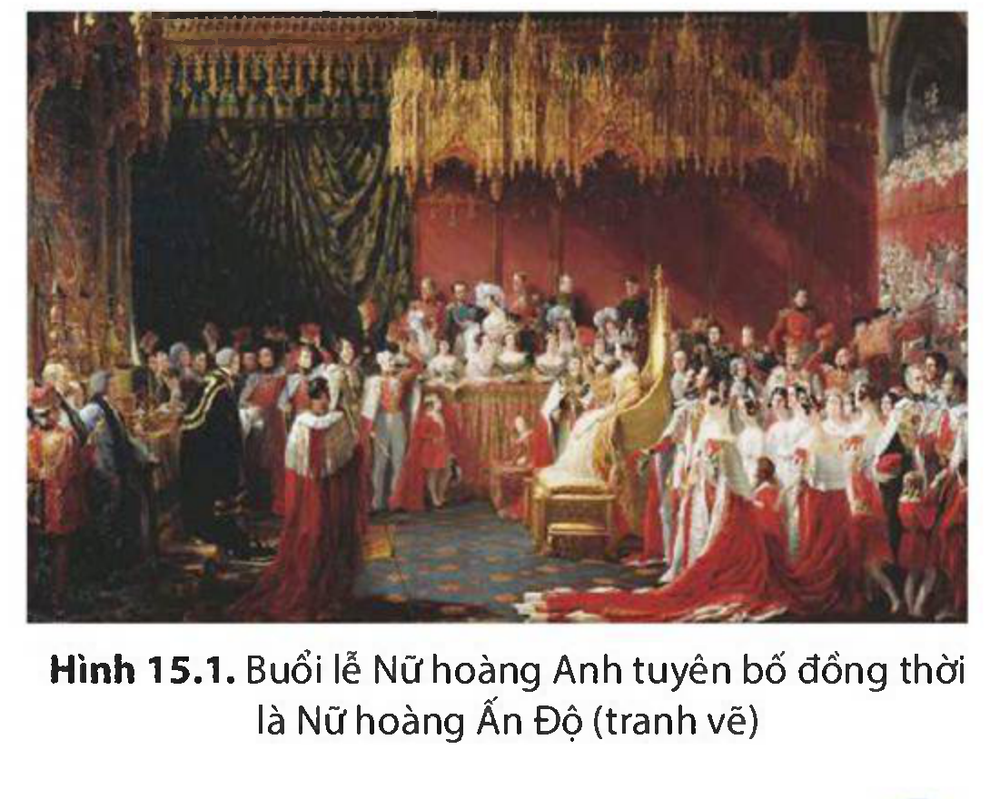
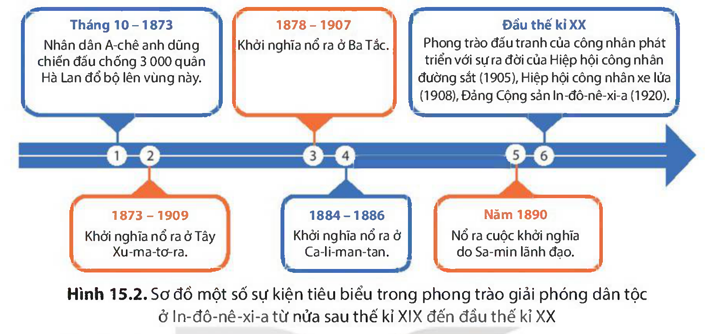
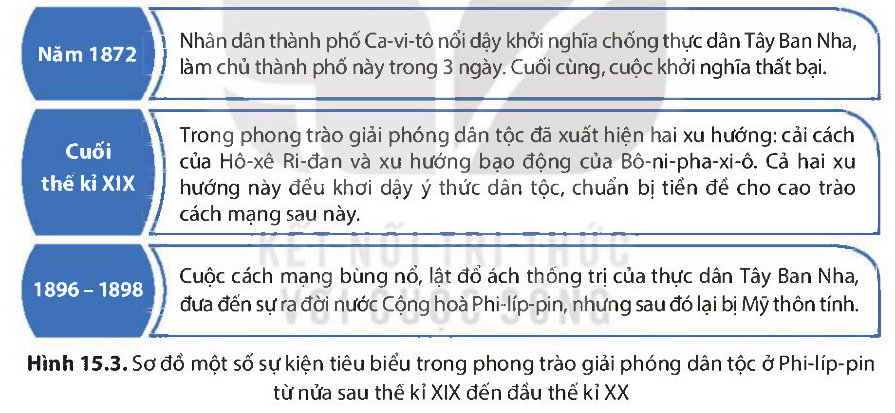
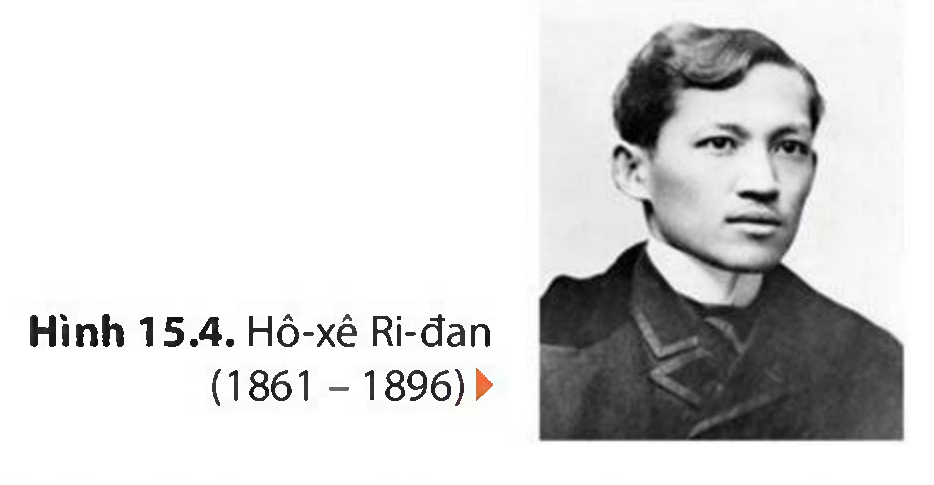

<!-- pdf:67 -->

# BÀI 15: ẤN ĐỘ VÀ ĐÔNG NAM Á TỪ NỬA SAU THẾ KỈ XIX ĐẾN ĐẦU THẾ KỈ XX

## 🎯 Học xong bài này, em sẽ:

- Trình bày được tình hình chính trị, kinh tế, xã hội Ấn Độ nửa sau thế kỉ XIX.
- Nêu được một số sự kiện về phong trào giải phóng dân tộc ở Đông Nam Á từ nửa sau thế kỉ XIX đến đầu thế kỉ XX.

## 🔴 Mở đầu

Vào nửa sau thế kỉ XIX – đầu thế kỉ XX, Ấn Độ và hầu hết các nước trong khu vực Đông Nam Á đã bị thực dân phương Tây xâm chiếm. Theo em, mục đích các nước phương Tây đến vùng đất này là gì? Phải chăng là để “khai hoá văn minh” và giúp phát triển nền công nghiệp? Nhân dân Ấn Độ và Đông Nam Á đã tỏ thái độ và có hành động như thế nào trước làn sóng xâm lược của các nước phương Tây?

## 1. Ấn Độ nửa sau thế kỉ XIX

Từ đầu thế kỉ XVIII, cuộc tranh giành quyền lực giữa các chúa phong kiến trong nước đã làm cho Ấn Độ suy yếu. Lợi dụng cơ hội này, Anh và Pháp đua tranh xâm lược Ấn Độ. Đến giữa thế kỉ XIX, thực dân Anh hoàn thành việc xâm chiếm và áp đặt ách cai trị ở nước này.

*Về chính trị*, thực dân Anh thi hành nhiều biện pháp để áp đặt và củng cố quyền cai trị trực tiếp ở Ấn Độ.

<!-- term: Phó vương -->
Thay mặt Chính phủ Anh ở Ấn Độ là một Phó vương và một hội đồng điều hành gồm 5 uỷ viên, có quyền lực như một chính phủ. Ngày 1 – 1 – 1877, Nữ hoàng Anh Vích-to-ri-a tuyên bố đồng thời là Nữ hoàng Ấn Độ, đánh dấu bước hoàn thành việc chinh phục Ấn Độ của thực dân Anh.

*Hình 15.1. Buổi lễ Nữ hoàng Anh tuyên bố đồng thời là Nữ hoàng Ấn Độ (tranh vẽ)*

<!-- pdf:68 -->

Để tạo chỗ dựa vững chắc cho nền thống trị, thực dân Anh thực hiện chính sách nhượng bộ tầng lớp trên của phong kiến bản xứ, biến bộ phận này thành tay sai; tìm cách khơi sâu sự cách biệt về chủng tộc, tôn giáo,... ở Ấn Độ.

*Về kinh tế*, thực dân Anh tiến hành cuộc khai thác Ấn Độ một cách quy mô, ra sức vơ vét nguồn nguyên liệu và bóc lột nhân công để thu lợi nhuận tối đa.

Trong nông nghiệp, chính quyền thực dân tăng cường chiếm đoạt ruộng đất để lập đồn điền. Người nông dân bị bần cùng và chết đói ngày càng nhiều.

Công nghiệp cũng có những chuyển biến nhất định như: đẩy mạnh khai thác hầm mỏ, phát triển công nghiệp chế biến, mở mang hệ thống đường giao thông, nhiều thành phố và hải cảng mới xuất hiện.

<!-- term: Chính sách "ngu dân" -->
*Về xã hội*, thực dân Anh thi hành chính sách "ngu dân", khuyến khích những tập quán lạc hậu và phản động.

<!-- term: Khởi nghĩa Xi-pay -->
Mâu thuẫn giữa nhân dân Ấn Độ với thực dân Anh là mâu thuẫn cơ bản trong xã hội. Đó là nguyên nhân dẫn tới các cuộc đấu tranh giành độc lập dân tộc, tiêu biểu là cuộc khởi nghĩa Xi-pay (1857 – 1859) và phong trào đấu tranh dưới sự lãnh đạo của Đảng Quốc đại trong những năm 1905 – 1908.

> ❓ Trình bày những nét nổi bật về tình hình chính trị, kinh tế, xã hội ở Ấn Độ nửa sau thế kỉ XIX.

## 2. Phong trào giải phóng dân tộc ở Đông Nam Á từ nửa sau thế kỉ XIX đến đầu thế kỉ XX

Vào nửa sau thế kỉ XIX, ngoài Xiêm vẫn giữ được nền độc lập tương đối thì các nước khác trong khu vực Đông Nam Á đều trở thành thuộc địa của các nước tư bản phương Tây.

Năm 1885, Anh hoàn thành quá trình xâm chiếm Miến Điện, biến nước này thành một tỉnh của Ấn Độ (thuộc Anh). Đầu thế kỉ XX, Mã Lai cũng trở thành thuộc địa của Anh.

Từ nửa sau thế kỉ XIX, thực dân Tây Ban Nha tiếp tục củng cố ách thống trị ở Phi-líp-pin. Tuy nhiên, đến năm 1898, đế quốc Mỹ xâm lược và biến nước này thành thuộc địa.

Giữa thế kỉ XIX, thực dân Pháp xâm lược Việt Nam. Đến cuối thế kỉ XIX, Việt Nam, Cam-pu-chia và sau đó là Lào chính thức trở thành thuộc địa của thực dân Pháp.

Sự xâm lược và đô hộ của đế quốc, thực dân đã dẫn tới phong trào đấu tranh mạnh mẽ của nhân dân Đông Nam Á giành độc lập và tiến bộ xã hội.

<!-- pdf:69 -->

### a) In-đô-nê-xi-a và Phi-líp-pin

- *Ở In-đô-nê-xi-a*

*Hình 15.2. Sơ đồ một số sự kiện tiêu biểu trong phong trào giải phóng dân tộc ở In-đô-nê-xi-a từ nửa sau thế kỉ XIX đến đầu thế kỉ XX*

> **Sơ đồ một số sự kiện tiêu biểu trong phong trào giải phóng dân tộc ở In-đô-nê-xi-a từ nửa sau thế kỉ XIX đến đầu thế kỉ XX:**
> - Tháng 10 – 1873: Nhân dân A-chê anh dũng chiến đấu chống 3 000 quân Hà Lan đổ bộ lên vùng này.
> - 1873 – 1909: Khởi nghĩa nổ ra ở Tây Xu-ma-tơ-ra.
> - 1878 – 1907: Khởi nghĩa nổ ra ở Ba Tắc.
> - 1884 – 1886: Khởi nghĩa nổ ra ở Ca-li-man-tan.
> - Đầu thế kỉ XX: Phong trào đấu tranh của công nhân phát triển với sự ra đời của Hiệp hội công nhân đường sắt (1905), Hiệp hội công nhân xe lửa (1908), Đảng Cộng sản In-đô-nê-xi-a (1920).
> - Năm 1890: Nổ ra cuộc khởi nghĩa do Sa-min lãnh đạo.

- *Ở Phi-líp-pin*

*Hình 15.3. Sơ đồ một số sự kiện tiêu biểu trong phong trào giải phóng dân tộc ở Phi-líp-pin từ nửa sau thế kỉ XIX đến đầu thế kỉ XX*

<!-- term: Nước Cộng hoà Phi-líp-pin -->
> **Sơ đồ một số sự kiện tiêu biểu trong phong trào giải phóng dân tộc ở Phi-líp-pin từ nửa sau thế kỉ XIX đến đầu thế kỉ XX:**
> - Năm 1872: Nhân dân thành phố Ca-vi-tô nổi dậy khởi nghĩa chống thực dân Tây Ban Nha, làm chủ thành phố này trong 3 ngày. Cuối cùng, cuộc khởi nghĩa thất bại.
> - Cuối thế kỉ XIX: Trong phong trào giải phóng dân tộc đã xuất hiện hai xu hướng: cải cách của Hô-xê Ri-đan và xu hướng bạo động của Bô-ni-pha-xi-ô. Cả hai xu hướng này đều khơi dậy ý thức dân tộc, chuẩn bị tiền đề cho cao trào cách mạng sau này.
> - 1896 – 1898: Cuộc cách mạng bùng nổ, lật đổ ách thống trị của thực dân Tây Ban Nha, đưa đến sự ra đời nước Cộng hoà Phi-líp-pin, nhưng sau đó lại bị Mỹ thôn tính.

*Hình 15.4. Hô-xê Ri-đan (1861 – 1896)*

> 💡 **Em có biết?**
>
> Hô-xê Ri-đan là người lãnh đạo Liên minh Phi-líp-pin, bị thực dân Tây Ban Nha bắt giam và xử tử năm 1896. Ngày nay, ở Thủ đô Ma-ni-la, tại nơi ông bị xử tử, người ta đã xây dựng quảng trường Hô-xê Ri-đan.

> ❓ 1. Nêu những sự kiện tiêu biểu trong phong trào giải phóng dân tộc ở In-đô-nê-xi-a từ nửa sau thế kỉ XIX đến đầu thế kỉ XX.
>
> 2. Phong trào giải phóng dân tộc ở Phi-líp-pin từ nửa sau thế kỉ XIX đến đầu thế kỉ XX có điểm gì nổi bật?

<!-- pdf:70 -->

### b) Ba nước Đông Dương

*Ở Việt Nam*, cuộc kháng chiến chống Pháp xâm lược nổ ra ngay từ giữa thế kỉ XIX, nổi bật là phong trào Cần vương (1885 – 1896), khởi nghĩa nông dân Yên Thế (1884 – 1913). Sang đầu thế kỉ XX, phong trào giải phóng dân tộc theo khuynh hướng dân chủ tư sản với hai xu hướng chính là bạo động và cải cách.

*Ở Cam-pu-chia*, nhiều cuộc khởi nghĩa của nhân dân đã nổ ra, tiêu biểu là cuộc khởi nghĩa do A-cha Xoa lãnh đạo (1864 – 1865), cuộc khởi nghĩa dưới sự chỉ huy của nhà sư Pu-côm-bô (1866 – 1867),... Đặc biệt, cuộc khởi nghĩa do Hoàng thân Xi-vô-tha đứng đầu (1885 – 1895) đã gây cho Pháp nhiều thiệt hại lớn.

*Ở Lào*, nhân dân đã nổi dậy đấu tranh chống Pháp, tiêu biểu là cuộc khởi nghĩa của nhân dân Xa-van-na-khét do Pha-ca-đuốc lãnh đạo (1901), cuộc khởi nghĩa ở cao nguyên Bô-lô-ven (1901 – 1907).

<!-- term: Liên minh chiến đấu ba dân tộc -->
Nhân dân Việt Nam ở Nam Bộ và Tây Nguyên đã đoàn kết, phối hợp chiến đấu với nhân dân Cam-pu-chia, Lào chống Pháp. Đây là những biểu hiện bước đầu của liên minh chiến đấu ba dân tộc chống kẻ thù chung.

> ❓ Hãy nêu những nét chính trong phong trào đấu tranh giành độc lập của ba nước Đông Dương từ nửa sau thế kỉ XIX đến đầu thế kỉ XX.

## ✏️ Luyện tập – Vận dụng

1. Hãy lập và hoàn thành bảng thống kê (theo gợi ý dưới đây) về một số cuộc đấu tranh tiêu biểu của nhân dân Đông Nam Á chống chủ nghĩa thực dân.

| Nước | Cuộc đấu tranh tiêu biểu | Thời gian diễn ra |
| --- | --- | --- |
| In-đô-nê-xi-a | | |
| Phi-líp-pin | | |
| Việt Nam | | |
| Lào | | |
| Cam-pu-chia | | |

2. Theo em, vì sao liên minh chiến đấu giữa nhân dân ba nước Việt Nam – Lào – Cam-pu-chia được hình thành ngay từ cuối thế kỉ XIX – đầu thế kỉ XX?

Có ý kiến cho rằng: Vào nửa sau thế kỉ XIX, thực dân phương Tây đến Ấn Độ và các nước Đông Nam Á là để “khai hoá văn minh”? Em đồng ý với ý kiến đó không? Vì sao?

## 📷 Danh sách hình trong bài

| Mã hình | Trang PDF | Trang sách | Chú thích |
| --- | --- | --- | --- |
| H8-lich_su_va_dia_ly-ls-b15-01 | 67 | 65 | Hình 15.1. Buổi lễ Nữ hoàng Anh tuyên bố đồng thời là Nữ hoàng Ấn Độ (tranh vẽ) |
| H8-lich_su_va_dia_ly-ls-b15-02 | 69 | 67 | Hình 15.2. Sơ đồ một số sự kiện tiêu biểu trong phong trào giải phóng dân tộc ở In-đô-nê-xi-a từ nửa sau thế kỉ XIX đến đầu thế kỉ XX |
| H8-lich_su_va_dia_ly-ls-b15-03 | 69 | 67 | Hình 15.3. Sơ đồ một số sự kiện tiêu biểu trong phong trào giải phóng dân tộc ở Phi-líp-pin từ nửa sau thế kỉ XIX đến đầu thế kỉ XX |
| H8-lich_su_va_dia_ly-ls-b15-04 | 69 | 67 | Hình 15.4. Hô-xê Ri-đan (1861 – 1896) |
