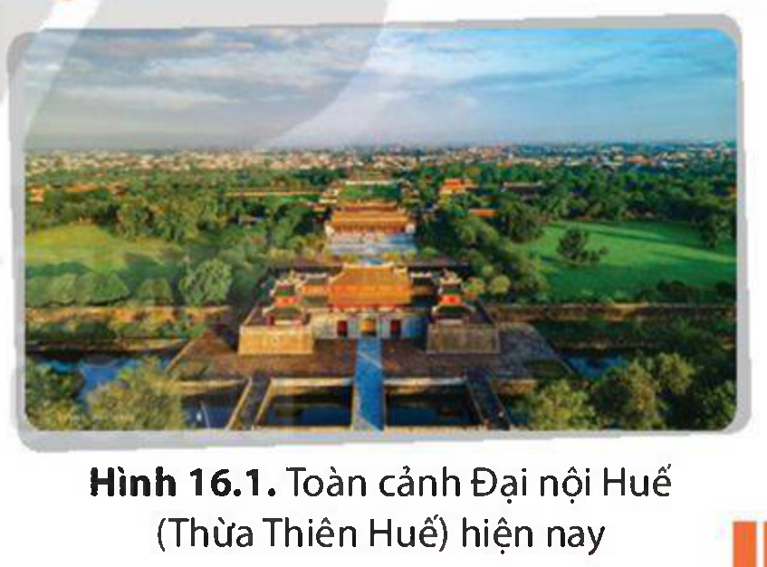
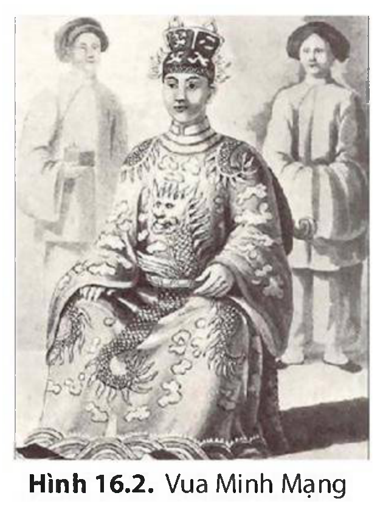
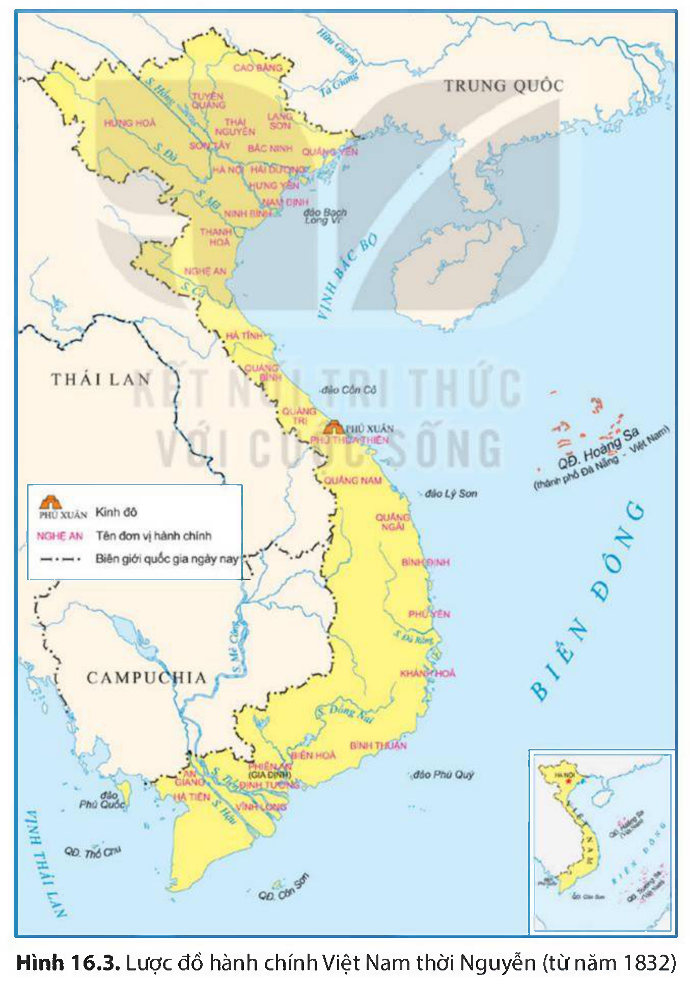
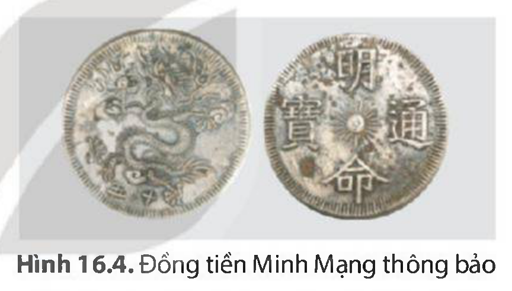
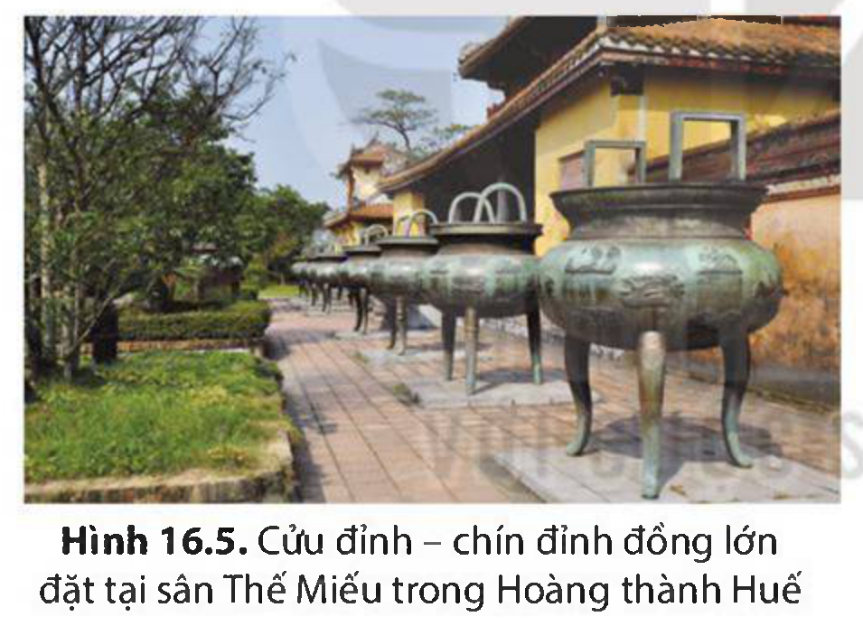
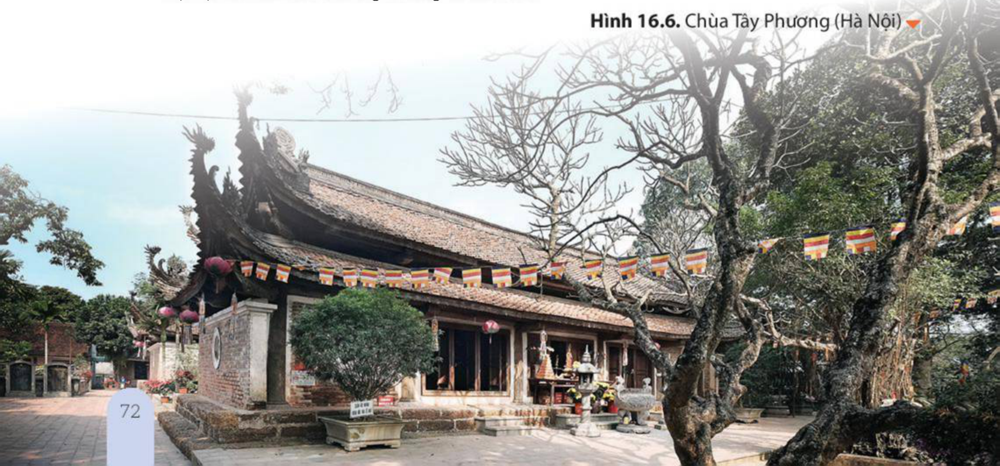
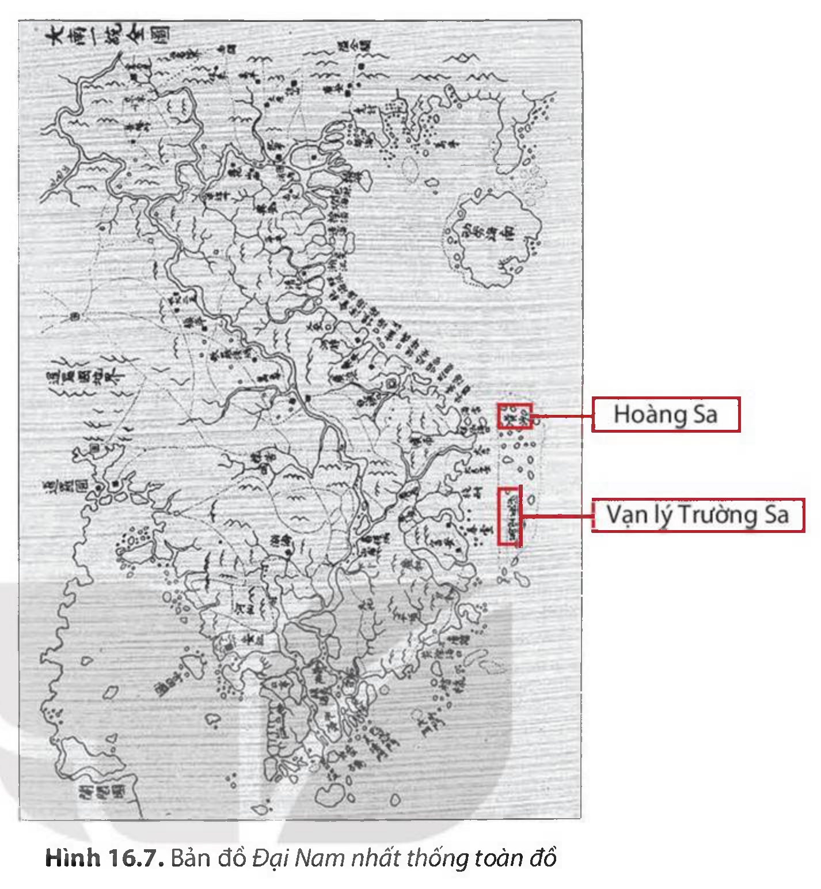

<!-- pdf:71 -->

# BÀI 16: VIỆT NAM DƯỚI THỜI NGUYỄN (NỬA ĐẦU THẾ KỈ XIX)

## 🎯 Học xong bài này, em sẽ:

- Mô tả được sự ra đời của nhà Nguyễn.
- Trình bày được những nét chính về tình hình chính trị, sự phát triển kinh tế, văn hoá, xã hội thời Nguyễn.
- Mô tả được quá trình thực thi chủ quyền đối với quần đảo Hoàng Sa và quần đảo Trường Sa của các vua Nguyễn.

## 🔴 Mở đầu

Khu Đại nội Huế thuộc cụm quần thể Di tích Cố đô Huế, nơi lưu giữ nhiều dấu ấn đặc sắc của một vương triều phong kiến trong lịch sử Việt Nam, được UNESCO ghi danh là Di sản văn hoá thế giới (1993). Vương triều nào được đề cập ở trên? Hãy chia sẻ những điều em biết về vương triều đó.

*Hình 16.1. Toàn cảnh Đại nội Huế (Thừa Thiên Huế) hiện nay*

## 1. Nhà Nguyễn thành lập và củng cố quyền thống trị

### a) Sự thành lập Vương triều Nguyễn

<!-- term: Vương triều Nguyễn -->
Năm 1792, vua Quang Trung qua đời. Triều Tây Sơn mất đi một trụ cột quan trọng, mâu thuẫn nội bộ ngày càng sâu sắc, uy tín bị giảm sút, lực lượng suy yếu. Năm 1802, được sự ủng hộ của địa chủ ở Gia Định, Nguyễn Ánh đã đánh bại triều Tây Sơn, lập ra triều Nguyễn, lấy niên hiệu là Gia Long, đặt kinh đô ở Phú Xuân (Huế).

> ❓ Hãy cho biết Vương triều Nguyễn được thành lập như thế nào?

### b) Nhà Nguyễn củng cố quyền thống trị

<!-- term: Vương triều Nguyễn -->
Sau khi lên ngôi hoàng đế, Nguyễn Ánh thâu tóm mọi quyền lực, từng bước củng cố chế độ quân chủ trung ương tập quyền, lãnh thổ đất nước được thống nhất.

<!-- pdf:72 -->

<!-- term: Hoàng Việt luật lệ -->
Để đặt cơ sở pháp lí cho nhà nước quân chủ, năm 1815, nhà Nguyễn ban hành bộ *Hoàng Việt luật lệ* (Luật Gia Long), với các điều luật bảo vệ quyền uy tuyệt đối của nhà vua, củng cố trật tự phong kiến, trấn áp mọi âm mưu chống lại chính quyền.

<!-- term: Cải cách Minh Mạng -->
Với cuộc Cải cách Minh Mạng, bộ máy quản lí nhà nước từ Trung ương xuống địa phương càng được hoàn thiện. Cả nước được chia thành 30 tỉnh và 1 phủ (Thừa Thiên).

<!-- term: Cải cách Minh Mạng -->
Minh Mạng (1791 – 1841) là con trai thứ tư của vua Gia Long, trị vì đất nước trong 20 năm (1820 – 1840), là một vị vua tài năng của triều Nguyễn. Trong những năm 1831 – 1832, ông tiến hành một cuộc cải cách, thường gọi là Cải cách Minh Mạng.

*Hình 16.2. Vua Minh Mạng*
<!-- ocr-ok: đã đối chiếu p072.png, chú thích Hình 16.2 đặt sát dưới chân dung cột phải nên OCR bỏ sót -->

*Hình 16.3. Lược đồ hành chính Việt Nam thời Nguyễn (từ năm 1832)*

<!-- pdf:73 -->

<!-- term: Chính sách bế quan toả cảng -->
Về đối ngoại, nhà Nguyễn thực hiện chính sách ngoại giao mềm dẻo với nhà Thanh, nhưng lại khước từ quan hệ và giao thương với các nước Âu – Mỹ, kể cả Pháp; thi hành chính sách cấm đạo gay gắt (bắt đầu từ thời Minh Mạng), gây nhiều hệ luỵ về sau.

> ❓ 1. Khai thác lược đồ hình 16.3, em có nhận xét gì về đơn vị hành chính thời Nguyễn?
>
> 2. Trình bày nét chính về tình hình chính trị dưới thời Nguyễn.

## 2. Tình hình kinh tế, xã hội Việt Nam nửa đầu thế kỉ XIX

### a) Kinh tế

*Về nông nghiệp,* nhà Nguyễn đã quan tâm đến việc tổ chức khai hoang, di dân lập ấp, lập đồn điền ở nhiều tỉnh phía bắc và phía nam,...

Ở vùng hạ lưu sông Hồng, với vai trò tổ chức của Nguyễn Công Trứ, hai huyện mới đã được lập, đó là: Tiền Hải (Thái Bình) và Kim Sơn (Ninh Bình).

Tuy nhiên, do địa chủ, cường hào bao chiếm ruộng đất nên nông dân vẫn không có ruộng để cày cấy, phải lưu vong. Ở các tỉnh phía bắc, lụt lội, hạn hán xảy ra thường xuyên.

*Thủ công nghiệp, thương nghiệp* có điều kiện phát triển. Thủ công nghiệp có những cải tiến nhất định về kĩ thuật. Nghề khai mỏ được đẩy mạnh. Hoạt động buôn bán trong nước và với nước ngoài ngày càng tăng.

*Hình 16.4. Đồng tiền Minh Mạng thông bảo*

<!-- term: Chính sách bế quan toả cảng -->
Tuy nhiên, do Nhà nước có những quy định ngặt nghèo (về thuế, mẫu mã,...) và thi hành chính sách bế quan toả cảng, thợ giỏi bị bắt vào làm trong các quan xưởng, nên một số ngành, nghề không phát triển được. Nhiều đô thị, trung tâm buôn bán nổi tiếng từ thời kì trước như Thăng Long, Phố Hiến, Thanh Hà, Hội An dần bị sa sút.

> ❓ Hãy nêu những nét chính về tình hình kinh tế thời Nguyễn.

### b) Xã hội

Cuộc sống cơ cực của người dân và các mâu thuẫn xã hội khác đã làm bùng nổ nhiều cuộc nổi dậy chống nhà Nguyễn. Lực lượng tham gia vào những cuộc đấu tranh này gồm nông dân, thợ thuyền, binh lính, nhà nho, nhân dân các dân tộc thiểu số. Tiêu biểu là cuộc khởi nghĩa của Phan Bá Vành (1821 – 1827) ở Thái Bình, của Lê Duy Lương (1833) ở Ninh Bình, của Nông Văn Vân (1833 – 1835) ở Cao Bằng, của Cao Bá Quát (1854 – 1856) ở Hà Nội,...

> 1. Tính chung từ đầu thời Gia Long (năm 1802) đến thời Tự Đức (1862) có khoảng 405 cuộc nổi dậy của nhân dân chống triều đình.
>
> (Theo Phan Huy Lê (Chủ biên), *Lịch sử Việt Nam*, Tập II, Sđd, tr. 754)

> ❓ Hãy nêu nét nổi bật về tình hình xã hội thời Nguyễn nửa đầu thế kỉ XIX. Số lượng cuộc khởi nghĩa nổ ra gợi cho em suy nghĩ gì?

<!-- pdf:74 -->

## 3. Sự phát triển của văn hoá Việt Nam nửa đầu thế kỉ XIX

### a) Văn học

Dòng văn học viết với nhiều tác phẩm có giá trị nhất phần lớn được sáng tác bằng chữ Nôm như: *Truyện Kiều* của Nguyễn Du; thơ Nôm của Hồ Xuân Hương, Bà Huyện Thanh Quan, Cao Bá Quát;... góp phần làm phong phú thêm nền văn học dân tộc.

Văn học dân gian được thể hiện dưới nhiều hình thức: tục ngữ, ca dao, dân ca, truyện Nôm dài, truyện tiếu lâm,...

Nội dung cơ bản của các tác phẩm văn học là phản ánh cuộc sống lao động và khát vọng của nhân dân, phê phán thói hư, tật xấu của xã hội phong kiến.

<!-- term: Nhã nhạc cung đình Việt Nam -->
> 💡 **Em có biết?**
>
> Nhã nhạc cung đình Việt Nam xuất hiện từ thời Lý – Trần, được bổ sung, phát triển dưới thời Nguyễn. Người sáng tạo và biểu diễn hầu hết là những nhạc sĩ, nghệ sĩ giỏi từ dân gian, được sung vào cung để phục vụ triều đình.
>
> UNESCO đã ghi danh Nhã nhạc là Di sản văn hoá phi vật thể đại diện của nhân loại (2008).

*Hình 16.5. Cửu đỉnh – chín đỉnh đồng lớn đặt tại sân Thế Miếu trong Hoàng thành Huế*

### b) Nghệ thuật

<!-- term: Nhã nhạc cung đình Việt Nam -->
Nhã nhạc (nhạc cung đình) đến thời Nguyễn phát triển đến đỉnh cao. Văn nghệ dân gian xuất hiện hàng loạt làn điệu dân ca như: quan họ, trống quân, hát ví, hát cò lả,...

Hội hoạ với nhiều dòng tranh dân gian, tiêu biểu là tranh Đông Hồ (Bắc Ninh), tranh Hàng Trống, tranh Kim Hoàng (Hà Nội),...

Kiến trúc, điêu khắc với các công trình nổi tiếng như: kinh thành Huế, chùa Thiên Mụ, Cửu đỉnh (Thừa Thiên Huế), chùa Tây Phương và tượng 18 vị La Hán (Hà Nội), đình làng Đình Bảng (Bắc Ninh),...

*Hình 16.6. Chùa Tây Phương (Hà Nội)*

<!-- pdf:75 -->

### c) Tôn giáo

Phật giáo thời kì này tiếp tục phát triển. Các giáo sĩ phương Tây tích cực truyền bá Công giáo. Số người theo Công giáo ngày càng đông, vì thế nhà thờ mọc lên ở khắp nơi.

### d) Khoa học

Nửa đầu thế kỉ XIX ghi nhận những bước đột phá trong việc biên soạn các công trình sử học. Tiêu biểu nhất phải kể đến *Khâm định Việt sử thông giám cương mục*, *Đại Nam thực lục* (Quốc sử quán triều Nguyễn), *Lịch triều hiến chương loại chí* (Phan Huy Chú),...

Một số bộ địa lí và địa lí lịch sử có giá trị như *Nhất thống địa dư chí* (Lê Quang Định), *Gia Định thành thông chí* (Trịnh Hoài Đức),... được biên soạn.

Y dược học nổi tiếng với bộ *Hải Thượng y tông tâm lĩnh* của danh y Lê Hữu Trác.

> ❓ Nêu những nét chính về tình hình văn hoá thời Nguyễn. Em có ấn tượng nhất với thành tựu nào? Vì sao?

## 4. Quá trình thực thi chủ quyền đối với quần đảo Hoàng Sa và quần đảo Trường Sa của nhà Nguyễn

<!-- term: Đội Hoàng Sa và đội Bắc Hải -->
Thời Gia Long, quần đảo Hoàng Sa và quần đảo Trường Sa thuộc tỉnh Quảng Ngãi. Triều đình lập lại hai đội Hoàng Sa và Bắc Hải, biên chế nằm trong lực lượng quân đội, với nhiệm vụ thực thi chủ quyền của Việt Nam trên cả hai quần đảo này.

> 2. Năm 1833, Giám mục Ta-be đã xác nhận: Quần đảo Pa-ra-xen, mà người Việt gọi là Cát Vàng hay Hoàng Sa đã được chiếm cứ bởi người Việt xứ Đàng Trong.
>
> Hoàng đế Gia Long xét thấy đúng lúc phải vượt biển để tiếp thâu quần đảo Hoàng Sa, vào năm 1816, Ngài đã long trọng treo tại đó lá cờ của xứ Đàng Trong.
>
> (Theo Hãn Nguyên Nguyễn Nhã, *Những bằng chứng về chủ quyền của Việt Nam đối với quần đảo Hoàng Sa, Trường Sa*, Sđd, tr. 61)

Đến thời Minh Mạng, hoạt động thực thi chủ quyền trên quần đảo Trường Sa và quần đảo Hoàng Sa tiếp tục được đẩy mạnh: việc đo đạc kết hợp với vẽ bản đồ được quan tâm thực hiện, nhà vua đã cho dựng miếu thờ và trồng cây xanh ở quần đảo Hoàng Sa,...

> 3. Bộ Công tâu nói: Cương giới mặt biển nước ta có xứ [đảo] Hoàng Sa rất là hiểm yếu. Hằng năm nên phái người đi dò xét để thuộc đường biển... Vua y lời tâu. Sai Phạm Hữu Nhật đem binh thuyền đi. Chuẩn cho mang theo mười bài gỗ đến nơi đó dựng làm dấu, ghi khắc những chữ: “Minh Mạng thứ 17, năm Bính Thân [1836], Thuỷ quân Chánh đội trưởng Suất đội Phạm Hữu Nhật, vâng mệnh đi Hoàng Sa trông nom đo đạc đến đây lưu dấu để ghi nhớ”.
>
> (Theo Quốc sử quán triều Nguyễn, *Đại Nam thực lục*, Tập bốn, NXB Giáo dục, 2004, tr. 851, 867)

<!-- term: Đại Nam nhất thống toàn đồ -->
Khoảng năm 1838, Quốc sử quán triều Nguyễn đã cho vẽ bản đồ *Đại Nam nhất thống toàn đồ* thể hiện quần đảo Hoàng Sa, quần đảo Trường Sa thuộc lãnh thổ Việt Nam.

<!-- pdf:76 -->

*Hình 16.7. Bản đồ Đại Nam nhất thống toàn đồ*

> ❓ 1. Khai thác tư liệu 2, 3, hãy nêu những đóng góp của vua Gia Long và vua Minh Mạng trong công cuộc thực thi chủ quyền ở quần đảo Hoàng Sa và quần đảo Trường Sa.
>
> 2. Hãy mô tả quá trình thực thi chủ quyền đối với quần đảo Hoàng Sa và quần đảo Trường Sa của nhà Nguyễn.

## ✏️ Luyện tập – Vận dụng

1. Lập và hoàn thành bảng hệ thống (theo gợi ý dưới đây) về một số thành tựu tiêu biểu dưới thời Nguyễn.

| Lĩnh vực | Thành tựu tiêu biểu |
| --- | --- |
| | |

2. Có quan điểm cho rằng: Nhà Nguyễn đã để lại di sản văn hoá đồ sộ. Em đồng ý với quan điểm đó không? Vì sao?

3. Nêu cảm nghĩ của em về quá trình thực thi chủ quyền của nhà Nguyễn đối với quần đảo Hoàng Sa và quần đảo Trường Sa.

### 🚀 Vận dụng

Lựa chọn một thành tựu tiêu biểu dưới thời Nguyễn, sưu tầm thêm tư liệu và xây dựng bài giới thiệu ngắn gọn về thành tựu đó theo ý tưởng của em.

## 📷 Danh sách hình trong bài

| Mã hình | Trang PDF | Trang sách | Chú thích |
| --- | --- | --- | --- |
| H8-lich_su_va_dia_ly-ls-b16-01 | 71 | 69 | Hình 16.1. Toàn cảnh Đại nội Huế (Thừa Thiên Huế) hiện nay |
| H8-lich_su_va_dia_ly-ls-b16-02 | 72 | 70 | Hình 16.2. Vua Minh Mạng |
| H8-lich_su_va_dia_ly-ls-b16-03 | 72 | 70 | Hình 16.3. Lược đồ hành chính Việt Nam thời Nguyễn (từ năm 1832) |
| H8-lich_su_va_dia_ly-ls-b16-04 | 73 | 71 | Hình 16.4. Đồng tiền Minh Mạng thông bảo |
| H8-lich_su_va_dia_ly-ls-b16-05 | 74 | 72 | Hình 16.5. Cửu đỉnh – chín đỉnh đồng lớn đặt tại sân Thế Miếu trong Hoàng thành Huế |
| H8-lich_su_va_dia_ly-ls-b16-06 | 74 | 72 | Hình 16.6. Chùa Tây Phương (Hà Nội) |
| H8-lich_su_va_dia_ly-ls-b16-07 | 76 | 74 | Hình 16.7. Bản đồ Đại Nam nhất thống toàn đồ |
