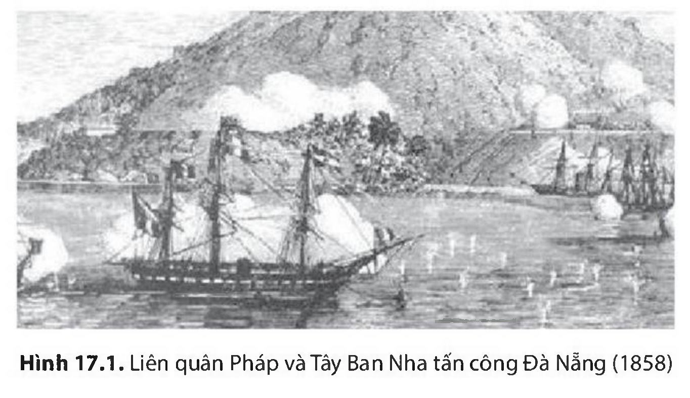
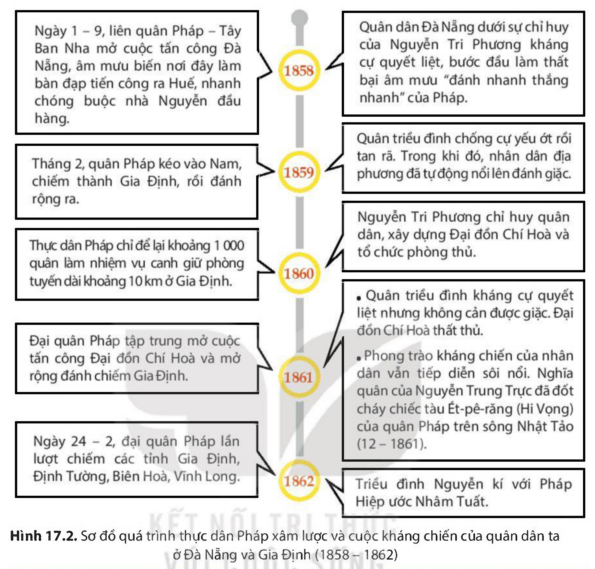
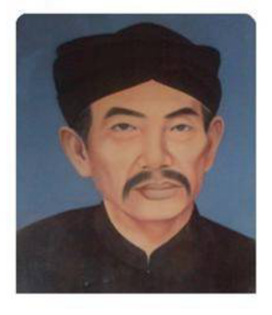
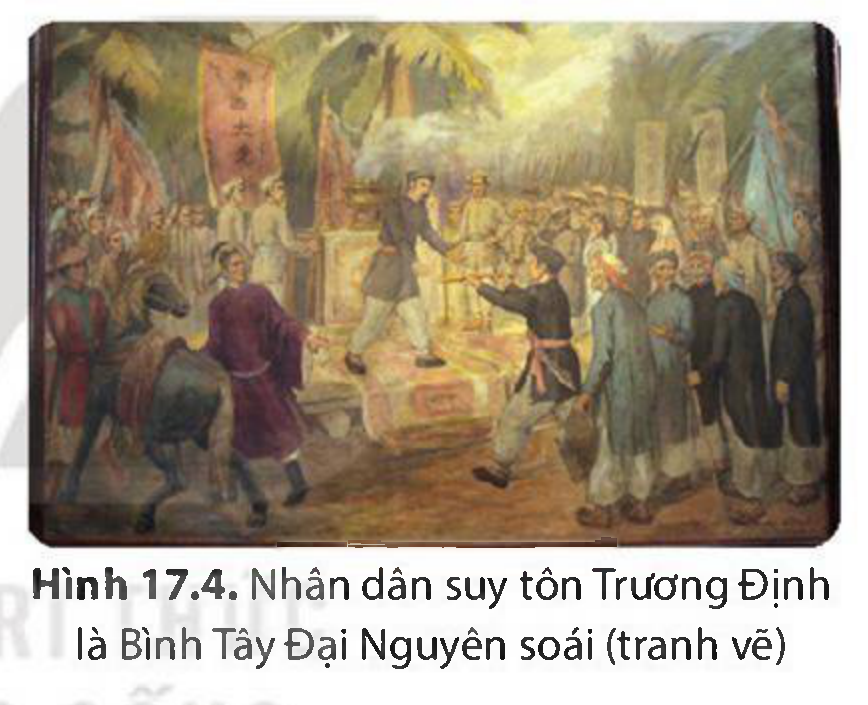
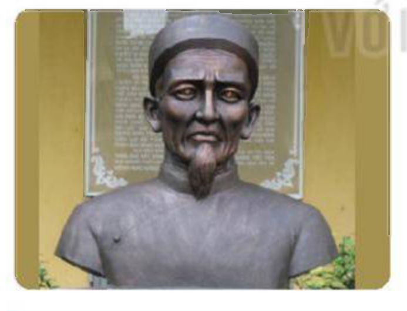
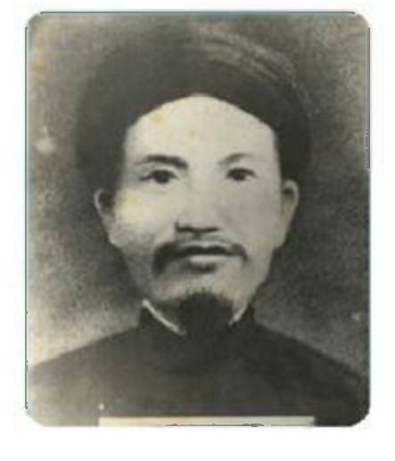
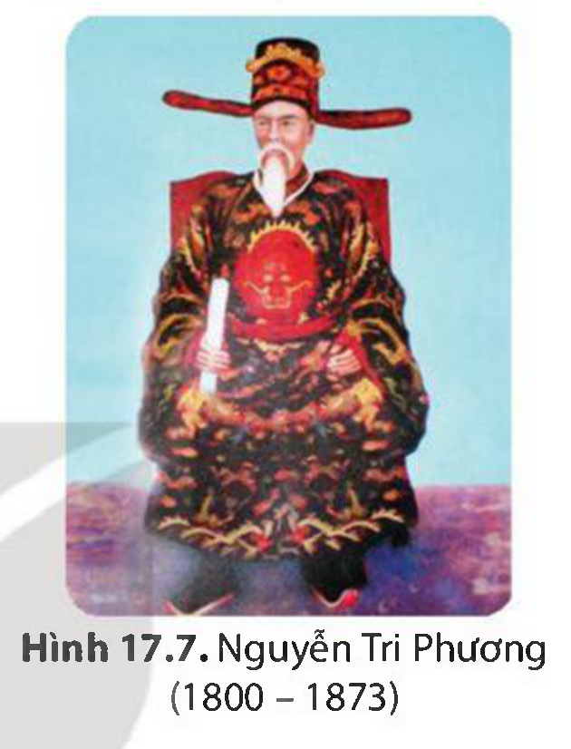
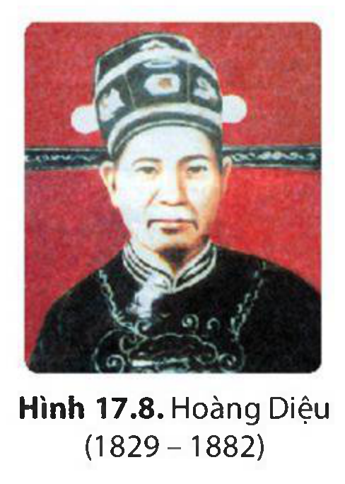
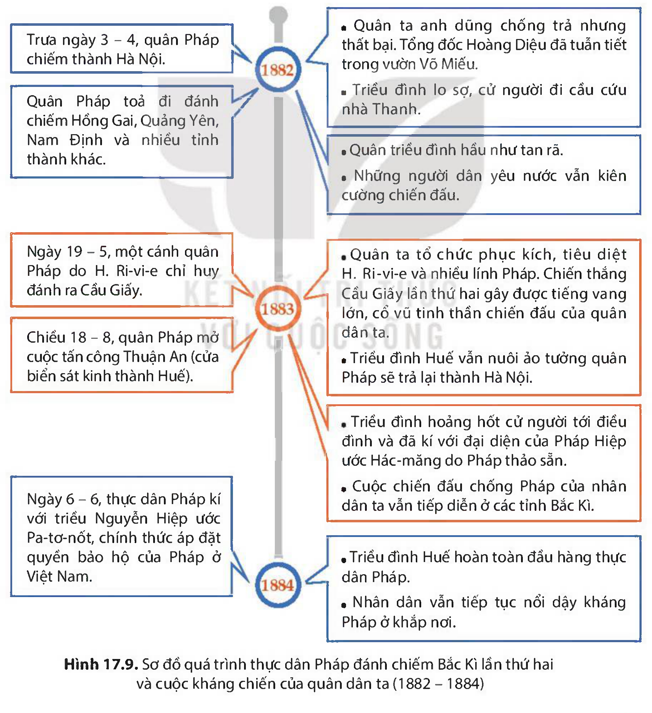
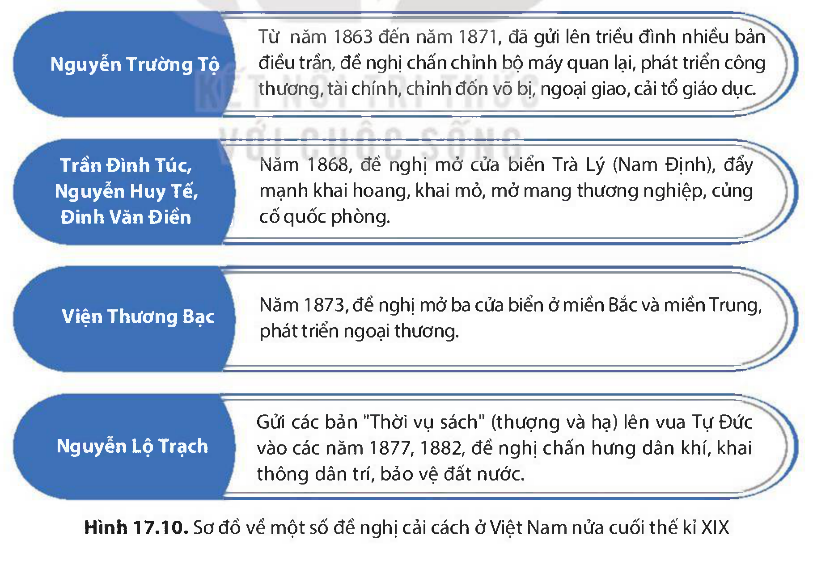

<!-- pdf:77 -->

# BÀI 17: CUỘC KHÁNG CHIẾN CHỐNG THỰC DÂN PHÁP XÂM LƯỢC TỪ NĂM 1858 ĐẾN NĂM 1884

## 🎯 Học xong bài này, em sẽ:

- Nêu được quá trình thực dân Pháp xâm lược Việt Nam và cuộc kháng chiến chống thực dân Pháp xâm lược của nhân dân Việt Nam (1858 – 1884).
- Nhận biết được nguyên nhân, một số nội dung chính trong các đề nghị cải cách của các quan lại, sĩ phu yêu nước.

## 🔴 Mở đầu

Sang thế kỉ XIX, tình hình châu Á và khu vực Đông Nam Á có nhiều biến động trước sự bành trướng của chủ nghĩa thực dân phương Tây. Trong bối cảnh đó, theo em, lịch sử Việt Nam sẽ chịu tác động và diễn ra theo chiều hướng nào? Nhà nước phong kiến có đối sách như thế nào, nhân dân ta có thái độ và hành động ra sao để đương đầu với những thử thách to lớn của lịch sử?

## 1. Cuộc kháng chiến chống thực dân Pháp xâm lược từ năm 1858 đến năm 1874

Từ giữa thế kỉ XIX, nền kinh tế tư bản chủ nghĩa ở các nước phương Tây phát triển mạnh. Nhu cầu về thị trường, nguyên liệu và nhân lực khiến các nước này đẩy mạnh việc xâm chiếm các nước phương Đông.

Lợi dụng các mối quan hệ đã có từ trước, lấy cớ bảo vệ đạo Gia-tô (Công giáo), thực dân Pháp đưa quân xâm lược Việt Nam.

### a) Cuộc kháng chiến ở Đà Nẵng và Nam Kì (1858 – 1862)
<!-- ocr-ok: đã đối chiếu p077.png, tiêu đề tiểu mục a) in nghiêng đậm ngay trên ảnh Hình 17.1 nên OCR bỏ sót -->

*Hình 17.1. Liên quân Pháp và Tây Ban Nha tấn công Đà Nẵng (1858)*

<!-- pdf:78 -->

*Hình 17.2. Sơ đồ quá trình thực dân Pháp xâm lược và cuộc kháng chiến của quân dân ta ở Đà Nẵng và Gia Định (1858 – 1862)*

<!-- term: Hiệp ước Nhâm Tuất -->
> **Sơ đồ quá trình thực dân Pháp xâm lược và cuộc kháng chiến của quân dân ta ở Đà Nẵng và Gia Định (1858 – 1862):**
> - **1858:**
>   - Ngày 1 – 9, liên quân Pháp – Tây Ban Nha mở cuộc tấn công Đà Nẵng, âm mưu biến nơi đây làm bàn đạp tiến công ra Huế, nhanh chóng buộc nhà Nguyễn đầu hàng.
>   - Quân dân Đà Nẵng dưới sự chỉ huy của Nguyễn Tri Phương kháng cự quyết liệt, bước đầu làm thất bại âm mưu “đánh nhanh thắng nhanh” của Pháp.
> - **1859:**
>   - Tháng 2, quân Pháp kéo vào Nam, chiếm thành Gia Định, rồi đánh rộng ra.
>   - Quân triều đình chống cự yếu ớt rồi tan rã. Trong khi đó, nhân dân địa phương đã tự động nổi lên đánh giặc.
> - **1860:**
>   - Thực dân Pháp chỉ để lại khoảng 1 000 quân làm nhiệm vụ canh giữ phòng tuyến dài khoảng 10 km ở Gia Định.
>   - Nguyễn Tri Phương chỉ huy quân dân, xây dựng Đại đồn Chí Hoà và tổ chức phòng thủ.
> - **1861:**
>   - Đại quân Pháp tập trung mở cuộc tấn công Đại đồn Chí Hoà và mở rộng đánh chiếm Gia Định.
>   - Quân triều đình kháng cự quyết liệt nhưng không cản được giặc. Đại đồn Chí Hoà thất thủ.
>   - Phong trào kháng chiến của nhân dân vẫn tiếp diễn sôi nổi. Nghĩa quân của Nguyễn Trung Trực đã đốt cháy chiếc tàu Ét-pê-răng (Hi Vọng) của quân Pháp trên sông Nhật Tảo (12 – 1861).
> - **1862:**
>   - Ngày 24 – 2, đại quân Pháp lần lượt chiếm các tỉnh Gia Định, Định Tường, Biên Hoà, Vĩnh Long.
>   - Triều đình Nguyễn kí với Pháp Hiệp ước Nhâm Tuất.

<!-- term: Hiệp ước Nhâm Tuất -->
> 1. Hiệp ước Nhâm Tuất thừa nhận việc cai quản của Pháp ở ba tỉnh miền Đông Nam Kì và đảo Côn Lôn; bồi thường cho Pháp 20 triệu phrăng (ước tính bằng 280 vạn lạng bạc),... Pháp sẽ “trả lại” tỉnh Vĩnh Long khi nào triều đình buộc dân chúng ngừng chống Pháp.
>
> (Theo Đinh Xuân Lâm (Chủ biên), *Đại cương Lịch sử Việt Nam*, Tập II, NXB Giáo dục Việt Nam, 2015, tr. 26)

> ❓ 1. Dựa vào sơ đồ hình 17.2, nêu nét chính về quá trình thực dân Pháp xâm lược Việt Nam và cuộc kháng chiến chống Pháp của quân dân ta từ năm 1858 đến năm 1862.
>
> 2. Khai thác tư liệu 1, nêu suy luận của em về hậu quả của Hiệp ước Nhâm Tuất đối với nền độc lập dân tộc.

<!-- pdf:79 -->

### b) Nhân dân Nam Kì tiếp tục kháng chiến (1862 – 1874)

Sau Hiệp ước Nhâm Tuất, triều đình Huế tập trung lực lượng đàn áp các cuộc khởi nghĩa của nông dân ở Bắc Kì và Trung Kì, ngăn cản phong trào kháng chiến của nhân dân ở Nam Kì. Lợi dụng sự bạc nhược đó, năm 1867, thực dân Pháp đánh chiếm ba tỉnh miền Tây Nam Kì, cuộc kháng chiến chống Pháp của nhân dân vẫn tiếp diễn ngày càng mạnh mẽ.

*Hình 17.3. Nguyễn Trung Trực (1838 – 1868)*

Nguyễn Trung Trực lãnh đạo nghĩa quân từ căn cứ Hòn Chông vượt biển tập kích đồn Kiên Giang. Khi bị giặc bắt, đưa ra chém, ông vẫn khảng khái tuyên bố: “Bao giờ người Tây nhổ hết cỏ nước Nam thì mới hết người Nam đánh Tây”.

Được sự ủng hộ của đông đảo nhân dân, Trương Định (1820 – 1864) đã lãnh đạo nghĩa quân lập căn cứ Gò Công, Tân Phước, anh dũng chiến đấu chống giặc. Do có chỉ điểm và bị tấn công bất ngờ, Trương Định bị thương, ông đã rút gươm tự sát để bảo toàn khí tiết. Con trai ông là Trương Quyền tiếp tục đưa quân lên Tây Ninh lập căn cứ, chiến đấu thêm một thời gian nữa.

*Hình 17.4. Nhân dân suy tôn Trương Định là Bình Tây Đại Nguyên soái (tranh vẽ)*

*Hình 17.5. Nguyễn Đình Chiểu (1822 – 1888)*

Một số nhà nho như Nguyễn Đình Chiểu, Phan Văn Trị,... đã dùng thơ văn lên án tội ác của giặc và chế giễu bọn tay sai bán nước, ca ngợi gương chiến đấu hi sinh của nghĩa quân.

Ở miền Đông, phong trào kháng chiến tiếp tục bùng nổ trở lại. Nguyễn Hữu Huân bị bắt đi đày, sau đó mới được thả về lại đứng lên chống Pháp. Khi bị giặc bắt lần thứ hai và đưa ra hành hình, ông vẫn ung dung làm thơ, khẳng định tinh thần yêu nước, bất khuất của mình.

*Hình 17.6. Nguyễn Hữu Huân (1813 – 1875)*

<!-- pdf:80 -->

> ❓ 1. Khai thác hình 17.4, hãy mô tả không khí buổi lễ suy tôn Trương Định.
>
> 2. Nêu khái quát cuộc kháng chiến chống Pháp của nhân dân Nam Kì từ năm 1862 đến năm 1874.

## 2. Phong trào kháng chiến chống thực dân pháp xâm lược lan rộng ra cả nước (1873 – 1884)

### a) Cuộc kháng chiến chống Pháp xâm lược Bắc Kì lần thứ nhất (1873 – 1874)

Sau khi chiếm được Nam Kì, thực dân Pháp tiếp tục chuẩn bị thực hiện kế hoạch đánh chiếm Bắc Kì, Trung Kì.

> 💡 **Em có biết?**
>
> Nguyễn Tri Phương quê ở huyện Phong Điền (Thừa Thiên Huế), làm quan ở cả ba triều vua Nguyễn. Ông được giao làm tổng chỉ huy lực lượng chống Pháp ở Đà Nẵng, Gia Định, sau đó được cử làm Kinh lược sứ Bắc Kì, trực tiếp chỉ huy trận chiến đấu ở cửa phía nam thành Hà Nội khi quân Pháp tấn công.

*Hình 17.7. Nguyễn Tri Phương (1800 – 1873)*

Cuối năm 1873, thực dân Pháp cử Ph. Gác-ni-ê đưa quân ra Bắc, dùng vũ lực chiếm thành Hà Nội.

Tổng đốc Nguyễn Tri Phương chỉ huy binh sĩ anh dũng chống cự. Ông bị thương, bị giặc bắt nhưng đã tuyệt thực để bảo toàn khí tiết.

Ph. Gác-ni-ê cho quân mở rộng đánh chiếm nhiều tỉnh thành vùng đồng bằng sông Hồng. Quân dân ta ở khắp nơi đã nổi lên kháng chiến như: các cuộc chiến đấu của binh sĩ triều đình ở cửa ô Thanh Hà (Hà Nội), của các đội nghĩa binh dưới sự lãnh đạo của cha con Nguyễn Mậu Kiến (Thái Bình), Phạm Văn Nghị (Nam Định),...

Ngày 20 – 11, quân Pháp tiến lên Sơn Tây, qua khu vực Cầu Giấy. Quân triều đình phối hợp với quân Cờ đen của Lưu Vĩnh Phúc phục kích địch ở đây, giết chết tên chỉ huy là Ph. Gác-ni-ê. Chiến thắng này đã cổ vũ tinh thần chiến đấu của quân dân ta, làm quân Pháp vô cùng hoang mang, dao động.

<!-- term: Hiệp ước Giáp Tuất -->
Năm 1874, triều đình Huế lại kí với Pháp bản Hiệp ước Giáp Tuất, thừa nhận chủ quyền của Pháp ở cả sáu tỉnh Nam Kì và nhiều điều khoản bất lợi khác.

<!-- term: Hiệp ước Giáp Tuất -->
> 2. Với Hiệp ước Giáp Tuất, tuy phải trả lại Hà Nội nhưng Pháp đã đặt được cơ sở chính trị, kinh tế, quân sự khắp các nơi quan trọng ở Bắc Kì. Hiệp ước năm 1874 báo trước thực dân Pháp nhất định quay trở lại chiếm hẳn Hà Nội khi có thời cơ tới.
>
> (Theo Đinh Xuân Lâm (Chủ biên), *Đại cương Lịch sử Việt Nam*, Tập II, Sđd, tr. 44)

<!-- pdf:81 -->

> ❓ 1. Nêu quá trình thực dân Pháp xâm lược Bắc Kì lần thứ nhất và cuộc chiến đấu của quân dân ta.
>
> 2. Khai thác tư liệu 2, em đánh giá thế nào về việc triều đình Huế kí Hiệp ước Giáp Tuất với Pháp?

### b) Cuộc kháng chiến chống Pháp xâm lược Bắc Kì lần thứ hai (1882 – 1884)

Tháng 4 – 1882, lấy cớ triều đình Huế vi phạm Hiệp ước Giáp Tuất, quân Pháp do H. Ri-vi-e cầm đầu đã đổ bộ lên Hà Nội, khiêu khích, gửi tối hậu thư cho Tổng đốc Hà Nội là Hoàng Diệu, buộc ông phải giao thành.

*Hình 17.8. Hoàng Diệu (1829 – 1882)*

*Hình 17.9. Sơ đồ quá trình thực dân Pháp đánh chiếm Bắc Kì lần thứ hai và cuộc kháng chiến của quân dân ta (1882 – 1884)*

<!-- term: Hiệp ước Hác-măng -->
<!-- term: Hiệp ước Pa-tơ-nốt -->
> **Sơ đồ quá trình thực dân Pháp đánh chiếm Bắc Kì lần thứ hai và cuộc kháng chiến của quân dân ta (1882 – 1884):**
> - **1882:**
>   - Trưa ngày 3 – 4, quân Pháp chiếm thành Hà Nội.
>     - Quân ta anh dũng chống trả nhưng thất bại. Tổng đốc Hoàng Diệu đã tuẫn tiết trong vườn Võ Miếu.
>     - Triều đình lo sợ, cử người đi cầu cứu nhà Thanh.
>   - Quân Pháp toả đi đánh chiếm Hồng Gai, Quảng Yên, Nam Định và nhiều tỉnh thành khác.
>     - Quân triều đình hầu như tan rã.
>     - Những người dân yêu nước vẫn kiên cường chiến đấu.
> - **1883:**
>   - Ngày 19 – 5, một cánh quân Pháp do H. Ri-vi-e chỉ huy đánh ra Cầu Giấy.
>     - Quân ta tổ chức phục kích, tiêu diệt H. Ri-vi-e và nhiều lính Pháp. Chiến thắng Cầu Giấy lần thứ hai gây được tiếng vang lớn, cổ vũ tinh thần chiến đấu của quân dân ta.
>     - Triều đình Huế vẫn nuôi ảo tưởng quân Pháp sẽ trả lại thành Hà Nội.
>   - Chiều 18 – 8, quân Pháp mở cuộc tấn công Thuận An (cửa biển sát kinh thành Huế).
>     - Triều đình hoảng hốt cử người tới điều đình và đã kí với đại diện của Pháp Hiệp ước Hác-măng do Pháp thảo sẵn.
>     - Cuộc chiến đấu chống Pháp của nhân dân ta vẫn tiếp diễn ở các tỉnh Bắc Kì.
> - **1884:**
>   - Ngày 6 – 6, thực dân Pháp kí với triều Nguyễn Hiệp ước Pa-tơ-nốt, chính thức áp đặt quyền bảo hộ của Pháp ở Việt Nam.
>     - Triều đình Huế hoàn toàn đầu hàng thực dân Pháp.
>     - Nhân dân vẫn tiếp tục nổi dậy kháng Pháp ở khắp nơi.

<!-- pdf:82 -->

<!-- term: Hiệp ước Pa-tơ-nốt -->
Nội dung Hiệp ước Pa-tơ-nốt cơ bản giống với Hiệp ước Hác-măng, nhưng địa bàn các tỉnh do triều Nguyễn quản lí được điều chỉnh lại. Các tỉnh Bình Thuận và Thanh, Nghệ, Tĩnh trở lại sáp nhập vào Trung Kì. Triều đình Huế thừa nhận quyền bảo hộ của Pháp ở Bắc Kì và Trung Kì.

> ❓ 1. Nêu những sự kiện chính về quá trình Pháp đánh chiếm Bắc Kì lần thứ hai và cuộc kháng chiến chống Pháp của quân dân ta ở Bắc Kì.
>
> 2. Qua việc kí kết các hiệp ước Giáp Tuất, Hác-măng và Pa-tơ-nốt, em đánh giá thế nào về thái độ của triều đình nhà Nguyễn trước cuộc tấn công xâm lược của thực dân Pháp?

## 3. Trào lưu cải cách nửa sau thế kỉ XIX

<!-- term: Trào lưu cải cách nửa sau thế kỉ XIX -->
Trong bối cảnh chế độ phong kiến đang lâm vào khủng hoảng, lại phải tiến hành cuộc kháng chiến chống thực dân Pháp, tầng lớp văn thân, sĩ phu Việt Nam có điều kiện tham khảo kinh nghiệm của nước ngoài đã mạnh dạn gửi lên triều đình Huế những bản điều trần, đề nghị cải cách.

> 💡 **Em có biết?**
>
> Nguyễn Trường Tộ là một trí thức Công giáo yêu nước, quê ở huyện Hưng Nguyên, tỉnh Nghệ An. Năm 1860, khi có dịp qua Rô-ma và Pa-ri, ông chú ý khảo sát kinh tế và văn hoá phương Tây. Ông đã đệ trình vua Tự Đức 14 bản điều trần, trong đó có *Tế cấp bát điều* (Tám điều cấp bách), nêu lên một hệ thống vấn đề kinh tế – xã hội quan trọng.

*Hình 17.10. Sơ đồ về một số đề nghị cải cách ở Việt Nam nửa cuối thế kỉ XIX*

<!-- term: Trào lưu cải cách nửa sau thế kỉ XIX -->
> **Sơ đồ về một số đề nghị cải cách ở Việt Nam nửa cuối thế kỉ XIX:**
> - **Nguyễn Trường Tộ:** Từ năm 1863 đến năm 1871, đã gửi lên triều đình nhiều bản điều trần, đề nghị chấn chỉnh bộ máy quan lại, phát triển công thương, tài chính, chỉnh đốn võ bị, ngoại giao, cải tổ giáo dục.
> - **Trần Đình Túc, Nguyễn Huy Tế, Đinh Văn Điền:** Năm 1868, đề nghị mở cửa biển Trà Lý (Nam Định), đẩy mạnh khai hoang, khai mỏ, mở mang thương nghiệp, củng cố quốc phòng.
> - **Viện Thương Bạc:** Năm 1873, đề nghị mở ba cửa biển ở miền Bắc và miền Trung, phát triển ngoại thương.
> - **Nguyễn Lộ Trạch:** Gửi các bản "Thời vụ sách" (thượng và hạ) lên vua Tự Đức vào các năm 1877, 1882, đề nghị chấn hưng dân khí, khai thông dân trí, bảo vệ đất nước.

<!-- pdf:83 -->

Những đề nghị cải cách vì nhiều lí do (thiếu cơ sở kinh tế, xã hội lại vấp phải tư tưởng bảo thủ của cả triều đình và nhân dân,...) nên đã không được thực hiện, hoặc chỉ thực hiện một phần rất nhỏ.

<!-- term: Trào lưu cải cách nửa sau thế kỉ XIX -->
Tư tưởng cải cách nửa sau thế kỉ XIX đã phản ánh sự tiến bộ trong nhận thức mới của người Việt Nam, góp phần chuẩn bị tiền đề về tư tưởng cho sự ra đời phong trào Duy tân đầu thế kỉ XX.

> ❓ Nêu nguyên nhân đề xuất và nội dung một số bản điều trần, đề nghị cải cách của các quan lại, sĩ phu yêu nước vào nửa cuối thế kỉ XIX.

## ✏️ Luyện tập – Vận dụng

Lập và hoàn thành bảng hệ thống (theo gợi ý dưới đây) về quá trình thực dân Pháp xâm lược Việt Nam và cuộc kháng chiến chống xâm lược của nhân dân ta (1858 – 1884).

| Giai đoạn | Quá trình thực dân Pháp xâm lược | Thái độ và đối sách của triều đình Huế | Thái độ và hành động của nhân dân | Kết quả, ý nghĩa |
| --- | --- | --- | --- | --- |
| 1858 – 1873 | | | | |
| 1873 – 1884 | | | | |
<!-- ocr-ok: đã đối chiếu p083.png, tiêu đề các cột bảng nhiều dòng trên nền màu có chữ chìm nên OCR dính từ -->

### 🚀 Vận dụng

1. Có ý kiến cho rằng: Triều đình nhà Nguyễn phải chịu toàn bộ trách nhiệm trong việc để mất nước. Em đồng ý với ý kiến trên không? Vì sao?

2. Tìm hiểu thông tin từ sách, báo, internet, hãy viết bài giới thiệu hoặc làm thẻ nhớ về một nhân vật lịch sử tiêu biểu trong cuộc kháng chiến chống thực dân Pháp xâm lược của nhân dân Việt Nam (1858 – 1884) mà em yêu thích nhất theo dàn ý sau:

- Đóng góp/vai trò của nhân vật trong cuộc kháng chiến.
- Địa danh, công trình hiện nay liên quan đến nhân vật mà em biết.
- Bài học mà em học được từ nhân vật.

## 📷 Danh sách hình trong bài

| Mã hình | Trang PDF | Trang sách | Chú thích |
| --- | --- | --- | --- |
| H8-lich_su_va_dia_ly-ls-b17-01 | 77 | 75 | Hình 17.1. Liên quân Pháp và Tây Ban Nha tấn công Đà Nẵng (1858) |
| H8-lich_su_va_dia_ly-ls-b17-02 | 78 | 76 | Hình 17.2. Sơ đồ quá trình thực dân Pháp xâm lược và cuộc kháng chiến của quân dân ta ở Đà Nẵng và Gia Định (1858 – 1862) |
| H8-lich_su_va_dia_ly-ls-b17-03 | 79 | 77 | Hình 17.3. Nguyễn Trung Trực (1838 – 1868) |
| H8-lich_su_va_dia_ly-ls-b17-04 | 79 | 77 | Hình 17.4. Nhân dân suy tôn Trương Định là Bình Tây Đại Nguyên soái (tranh vẽ) |
| H8-lich_su_va_dia_ly-ls-b17-05 | 79 | 77 | Hình 17.5. Nguyễn Đình Chiểu (1822 – 1888) |
| H8-lich_su_va_dia_ly-ls-b17-06 | 79 | 77 | Hình 17.6. Nguyễn Hữu Huân (1813 – 1875) |
| H8-lich_su_va_dia_ly-ls-b17-07 | 80 | 78 | Hình 17.7. Nguyễn Tri Phương (1800 – 1873) |
| H8-lich_su_va_dia_ly-ls-b17-08 | 81 | 79 | Hình 17.8. Hoàng Diệu (1829 – 1882) |
| H8-lich_su_va_dia_ly-ls-b17-09 | 81 | 79 | Hình 17.9. Sơ đồ quá trình thực dân Pháp đánh chiếm Bắc Kì lần thứ hai và cuộc kháng chiến của quân dân ta (1882 – 1884) |
| H8-lich_su_va_dia_ly-ls-b17-10 | 82 | 80 | Hình 17.10. Sơ đồ về một số đề nghị cải cách ở Việt Nam nửa cuối thế kỉ XIX |
