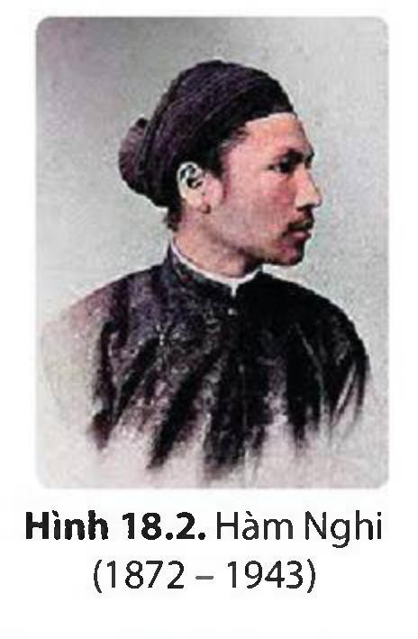
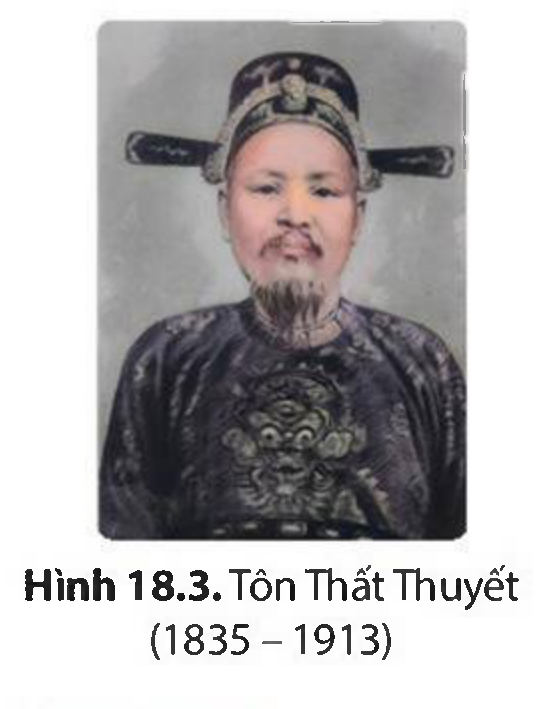
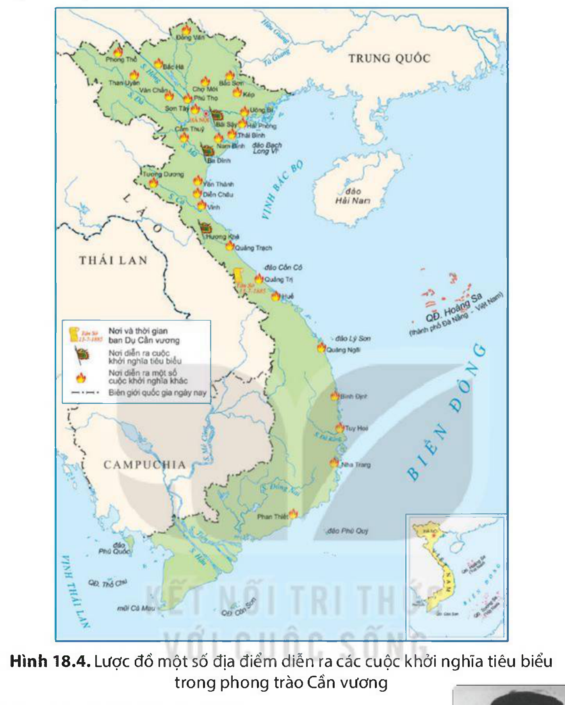
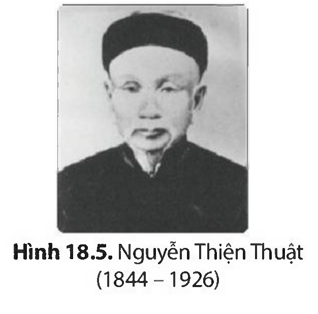
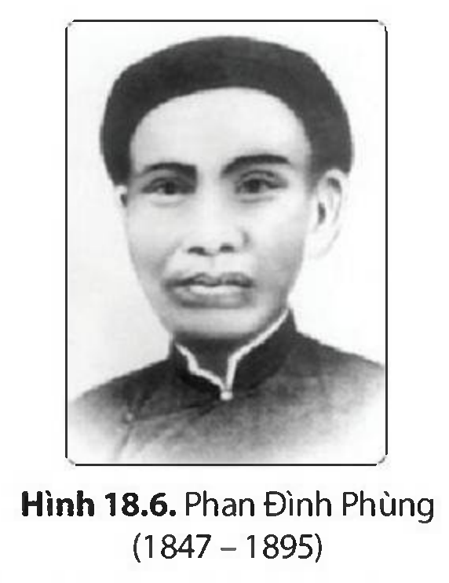
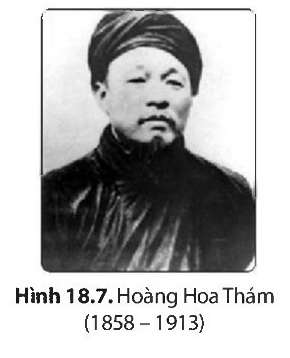
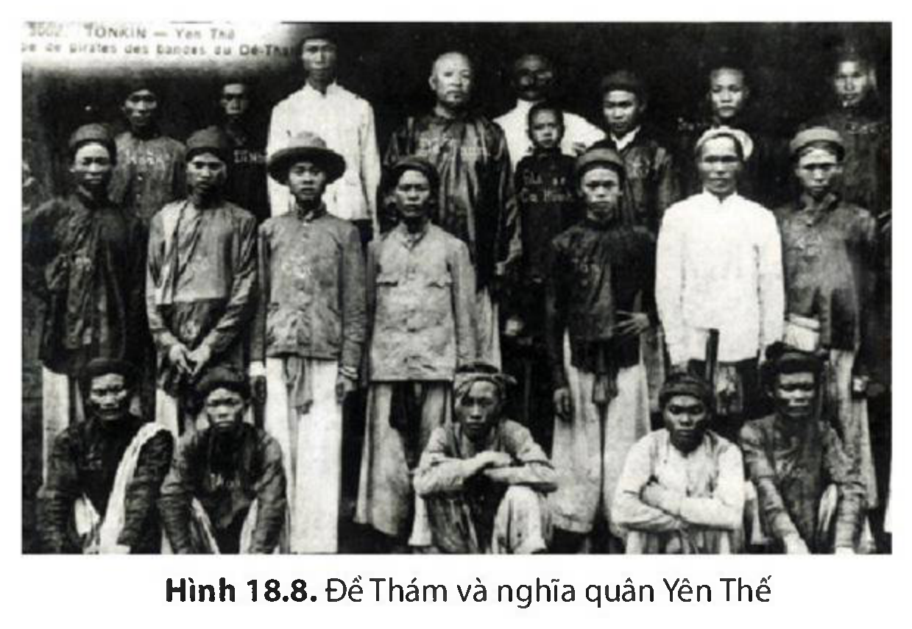

<!-- pdf:84 -->

# BÀI 18: PHONG TRÀO CHỐNG PHÁP TRONG NHỮNG NĂM 1885 – 1896

## 🎯 Học xong bài này, em sẽ:

- Trình bày được một số cuộc khởi nghĩa tiêu biểu trong phong trào Cần vương và cuộc khởi nghĩa Yên Thế.

## 🔴 Mở đầu

Hiện nay có nhiều con đường, trường học, di tích lịch sử gắn liền với tên tuổi của các nhân vật như: Phan Đình Phùng, Hoàng Hoa Thám,... Hãy chia sẻ những điều em biết về các nhân vật lịch sử này, cũng như các sự kiện liên quan.

*Hình 18.1. Phố Phan Đình Phùng (Hà Nội)*

## 1. Một số cuộc khởi nghĩa tiêu biểu trong phong trào Cần vương

### a) Phong trào Cần vương bùng nổ

> 💡 **Em có biết?**
>
> Tôn Thất Thuyết là Thượng thư Bộ Binh, thành viên Hội đồng Phụ chính. Ông ra sức xây dựng lực lượng, tích trữ lương thảo, khí giới, thẳng tay trừng trị những kẻ thân Pháp và đưa Ưng Lịch lên ngôi (vua Hàm Nghi).

<!-- term: Phong trào Cần vương -->
Với Hiệp ước Pa-tơ-nốt, thực dân Pháp về cơ bản đã hoàn thành quá trình xâm lược nước ta. Tuy nhiên, một bộ phận quan lại trong triều đình Huế, đứng đầu là Tôn Thất Thuyết, được sự ủng hộ của đông đảo nhân dân và quan lại các tỉnh thành, vẫn nêu cao ý chí chống Pháp, giành lại độc lập dân tộc.

<!-- term: Dụ Cần vương -->
<!-- term: Phong trào Cần vương -->
Sau cuộc phản công quân Pháp ở kinh thành Huế của phái chủ chiến bất thành (5 – 7 – 1885), Tôn Thất Thuyết đưa vua Hàm Nghi rời khỏi kinh thành ra Tân Sở (Quảng Trị). Lấy danh nghĩa vua Hàm Nghi, Tôn Thất Thuyết ban bố Dụ Cần vương, kêu gọi các văn thân, sĩ phu và nhân dân cả nước giúp vua cứu nước. Phong trào Cần vương bùng nổ, kéo dài đến cuối thế kỉ XIX.

*Hình 18.2. Hàm Nghi (1872 – 1943)*

*Hình 18.3. Tôn Thất Thuyết (1835 – 1913)*

> ❓ Hãy cho biết nguyên nhân bùng nổ của phong trào Cần vương cuối thế kỉ XIX.

<!-- pdf:85 -->

### b) Một số cuộc khởi nghĩa tiêu biểu

*Hình 18.4. Lược đồ một số địa điểm diễn ra các cuộc khởi nghĩa tiêu biểu trong phong trào Cần vương*

- *Khởi nghĩa Bãi Sậy (1883 – 1892)*

<!-- term: Khởi nghĩa Bãi Sậy -->
Địa bàn chính của cuộc khởi nghĩa là vùng Bãi Sậy. Dựa vào vùng đầm lầy với lau sậy um tùm, Nguyễn Thiện Thuật chỉ huy nghĩa quân xây dựng căn cứ, triệt để áp dụng chiến thuật du kích để đánh địch. Sau những trận chống càn liên tiếp, lực lượng nghĩa quân suy yếu dần, bị bao vây, cô lập. Đến cuối năm 1892, khởi nghĩa thất bại.

*Hình 18.5. Nguyễn Thiện Thuật (1844 – 1926)*

- *Khởi nghĩa Hương Khê (1885 – 1896)*

<!-- term: Khởi nghĩa Hương Khê -->
Căn cứ chính của cuộc khởi nghĩa thuộc huyện Hương Khê (Hà Tĩnh). Địa bàn hoạt động của nghĩa quân gồm các huyện miền Tây Thanh Hoá, Nghệ An, Hà Tĩnh, Quảng Bình. Lãnh đạo cao nhất của cuộc khởi nghĩa là Phan Đình Phùng, cùng các tướng lĩnh tài ba, tiêu biểu là Cao Thắng.

<!-- pdf:86 -->

Cuộc khởi nghĩa diễn ra qua hai giai đoạn:

<!-- term: Khởi nghĩa Hương Khê -->
Từ năm 1885 đến năm 1888, là giai đoạn xây dựng lực lượng và căn cứ chiến đấu. Nghĩa quân được tổ chức quy củ, chế tạo thành công súng trường theo mẫu của Pháp.

<!-- term: Khởi nghĩa Hương Khê -->
Từ năm 1888 đến năm 1896, nghĩa quân bước vào giai đoạn chiến đấu quyết liệt với sự chỉ huy thống nhất và tương đối chặt chẽ, đã đẩy lui nhiều cuộc hành quân càn quét của địch.

*Hình 18.6. Phan Đình Phùng (1847 – 1895)*

<!-- term: Khởi nghĩa Hương Khê -->
Thực dân Pháp phải tập trung binh lực nhằm bao vây, cô lập nghĩa quân. Đồng thời, chúng mở nhiều cuộc tấn công quy mô vào Ngàn Trươi, căn cứ chính của cuộc khởi nghĩa. Sau khi chủ tướng Phan Đình Phùng mất (12 – 1895), khởi nghĩa suy yếu dần rồi tan rã. Tuy thất bại nhưng đây là cuộc khởi nghĩa tiêu biểu nhất trong phong trào Cần vương.

- *Khởi nghĩa Ba Đình (1886 – 1887)*

<!-- term: Khởi nghĩa Ba Đình -->
Căn cứ chính của cuộc khởi nghĩa thuộc huyện Nga Sơn (tỉnh Thanh Hoá). Ba làng Mậu Thịnh, Thượng Thọ, Mĩ Khê được xây dựng thành pháo đài chống giặc. Lãnh đạo chủ chốt là Phạm Bành và Đinh Công Tráng. Nghĩa quân gồm cả người Kinh, người Mường, người Thái tham gia.

<!-- term: Khởi nghĩa Ba Đình -->
Tháng 1 – 1887, Pháp mở cuộc tấn công quy mô vào căn cứ. Bị tổn thất nặng, cuối cùng nghĩa quân phải mở đường máu rút lên Mã Cao (miền Tây Thanh Hoá) chiến đấu thêm một thời gian nữa rồi tan rã.

> ❓ 1. Quan sát lược đồ hình 18.4, nêu nhận xét của em về phong trào Cần vương chống Pháp cuối thế kỉ XIX.
>
> 2. Hãy giới thiệu về một số cuộc khởi nghĩa tiêu biểu trong phong trào Cần vương.

## 2. Khởi nghĩa nông dân Yên Thế (1884 – 1913)

<!-- term: Khởi nghĩa Yên Thế -->
Năm 1884, tại Yên Thế (Bắc Giang), một cuộc khởi nghĩa nông dân đã bùng nổ dưới sự lãnh đạo của Đề Nắm, sau đó là Đề Thám (Hoàng Hoa Thám) với mục tiêu chủ yếu là giữ đất, giữ làng, bảo vệ cuộc sống tự do.

Nghĩa quân đã đánh bại nhiều trận càn của quân Pháp vào căn cứ của cuộc khởi nghĩa như ở Cao Thượng (11 – 1890), 3 lần ở Hố Chuối (12 – 1890) và làm chủ hết vùng Yên Thế, mở rộng địa bàn sang cả Phủ Lạng Thương cùng tỉnh Bắc Giang,...

*Hình 18.7. Hoàng Hoa Thám (1858 – 1913)*

<!-- pdf:87 -->

Sau các lần giảng hoà (lần thứ nhất từ tháng 10 – 1894 đến tháng 11 – 1895, lần thứ hai từ tháng 12 – 1897 đến cuối năm 1908), thực dân Pháp lại mở cuộc vây ráp quy mô (từ đầu năm 1909), quyết dập tắt cuộc khởi nghĩa. Nghĩa quân bị thiệt hại nặng. Tháng 2 – 1913, thủ lĩnh Đề Thám bị tay sai Pháp giết hại. Khởi nghĩa suy yếu rồi tan rã.

*Hình 18.8. Đề Thám và nghĩa quân Yên Thế*
<!-- ocr-ok: đã đối chiếu p087.png, chú thích Hình 18.8 đặt sát dưới ảnh bên phải cột chữ nên OCR bỏ sót -->

<!-- term: Khởi nghĩa Yên Thế -->
Khởi nghĩa Yên Thế là cuộc khởi nghĩa nông dân chống xâm lược lớn nhất ở Việt Nam thời kì cận đại.

> ❓ Hãy thể hiện những diễn biến chính của khởi nghĩa nông dân Yên Thế trên trục thời gian và trình bày trước lớp.

## ✏️ Luyện tập – Vận dụng

1. Lập và hoàn thành bảng hệ thống (theo gợi ý dưới đây) về các cuộc khởi nghĩa tiêu biểu trong phong trào Cần vương chống Pháp cuối thế kỉ XIX.

| Tên cuộc khởi nghĩa, thời gian | Người lãnh đạo | Căn cứ/địa bàn | Kết quả | Ý nghĩa |
| --- | --- | --- | --- | --- |
| | | | | |
<!-- ocr-ok: đã đối chiếu p087.png, tiêu đề các cột bảng nhiều dòng trên nền màu có chữ chìm nên OCR đọc sai -->

2. Theo em, cuộc khởi nghĩa nào là tiêu biểu nhất trong phong trào Cần vương? Vì sao?

3. Cuộc khởi nghĩa nông dân Yên Thế có điểm gì giống và khác so với các cuộc khởi nghĩa trong phong trào Cần vương?

### 🚀 Vận dụng

Từ sự thất bại của phong trào Cần vương và khởi nghĩa Yên Thế, có thể rút ra bài học gì cho công cuộc đấu tranh giành độc lập sau đó, cũng như công cuộc xây dựng và bảo vệ Tổ quốc hiện nay?

## 📷 Danh sách hình trong bài

| Mã hình | Trang PDF | Trang sách | Chú thích |
| --- | --- | --- | --- |
| H8-lich_su_va_dia_ly-ls-b18-01 | 84 | 82 | Hình 18.1. Phố Phan Đình Phùng (Hà Nội) |
| H8-lich_su_va_dia_ly-ls-b18-02 | 84 | 82 | Hình 18.2. Hàm Nghi (1872 – 1943) |
| H8-lich_su_va_dia_ly-ls-b18-03 | 84 | 82 | Hình 18.3. Tôn Thất Thuyết (1835 – 1913) |
| H8-lich_su_va_dia_ly-ls-b18-04 | 85 | 83 | Hình 18.4. Lược đồ một số địa điểm diễn ra các cuộc khởi nghĩa tiêu biểu trong phong trào Cần vương |
| H8-lich_su_va_dia_ly-ls-b18-05 | 85 | 83 | Hình 18.5. Nguyễn Thiện Thuật (1844 – 1926) |
| H8-lich_su_va_dia_ly-ls-b18-06 | 86 | 84 | Hình 18.6. Phan Đình Phùng (1847 – 1895) |
| H8-lich_su_va_dia_ly-ls-b18-07 | 86 | 84 | Hình 18.7. Hoàng Hoa Thám (1858 – 1913) |
| H8-lich_su_va_dia_ly-ls-b18-08 | 87 | 85 | Hình 18.8. Đề Thám và nghĩa quân Yên Thế |
