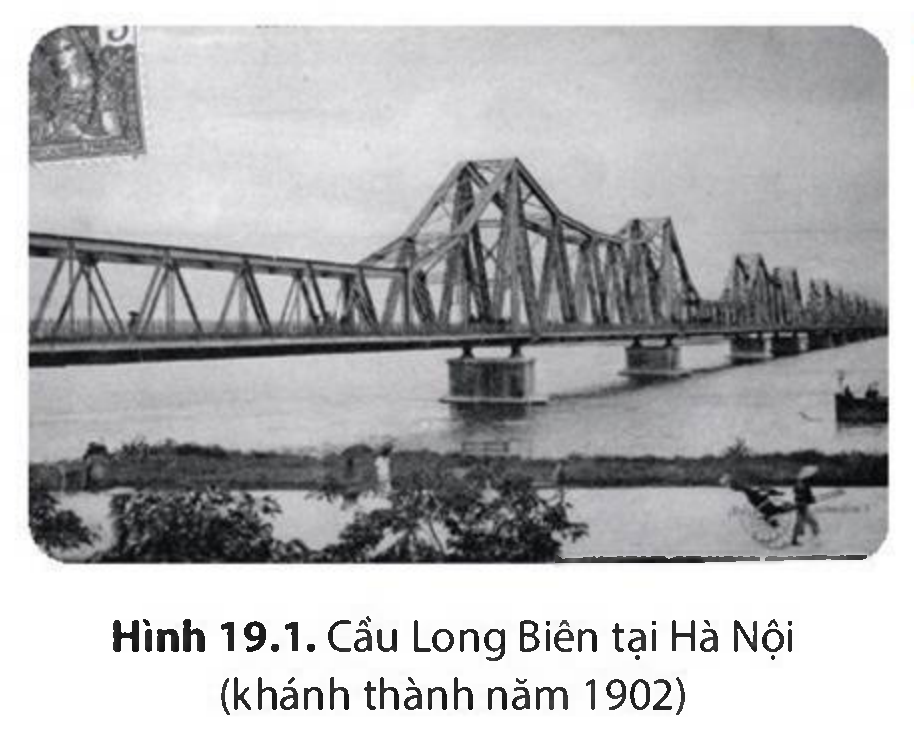
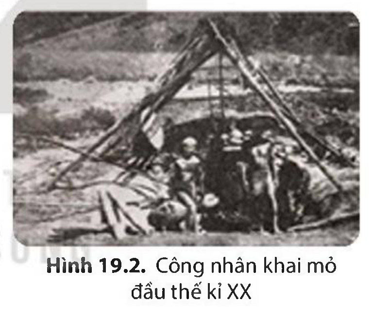
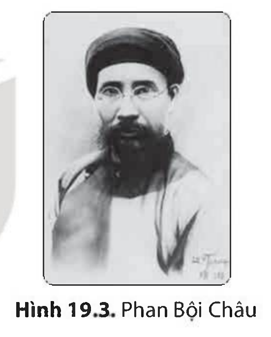
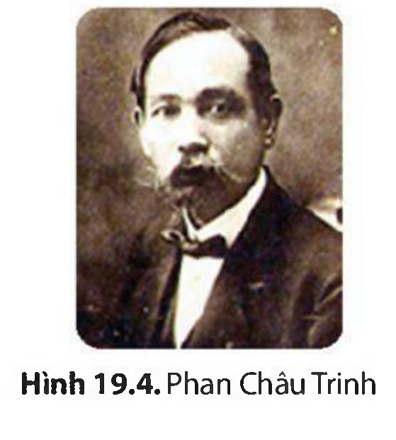
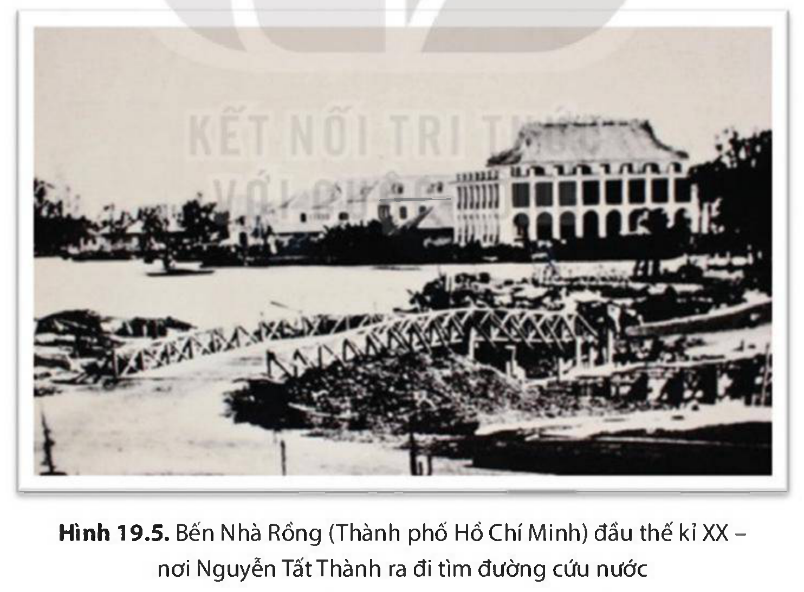

<!-- pdf:88 -->

# BÀI 19: PHONG TRÀO YÊU NƯỚC CHỐNG PHÁP Ở VIỆT NAM TỪ ĐẦU THẾ KỈ XX ĐẾN NĂM 1917

## 🎯 Học xong bài này, em sẽ:

- Nêu được tác động của cuộc khai thác thuộc địa lần thứ nhất của người Pháp đối với xã hội Việt Nam.
- Giới thiệu được những nét chính về hoạt động yêu nước của Phan Bội Châu, Phan Châu Trinh, Nguyễn Tất Thành.

## 🔴 Mở đầu

Năm 1911, người thanh niên yêu nước Nguyễn Tất Thành đã ra đi tìm đường cứu nước. Vậy bối cảnh nào thúc đẩy Người sang phương Tây? Con đường và những hoạt động của Người có gì khác so với các nhà yêu nước tiền bối như Phan Bội Châu, Phan Châu Trinh?

## 1. Tác động của cuộc khai thác thuộc địa lần thứ nhất của thực dân Pháp ở Việt Nam

<!-- term: Cuộc khai thác thuộc địa lần thứ nhất -->
Sau khi căn bản hoàn thành công cuộc bình định Việt Nam bằng quân sự, từ năm 1897 đến năm 1914, thực dân Pháp tiến hành cuộc khai thác thuộc địa lần thứ nhất ở nước ta.

*Bảng chính sách khai thác thuộc địa lần thứ nhất của thực dân Pháp ở Việt Nam*

<!-- term: Cuộc khai thác thuộc địa lần thứ nhất -->
| Lĩnh vực | Chính sách |
| --- | --- |
| Chính trị | Hoàn thiện bộ máy thống trị ở Liên bang Đông Dương, đứng đầu là viên Toàn quyền người Pháp. Việt Nam bị chia thành ba kì với ba chế độ cai trị khác nhau. |
| Kinh tế | – Dùng nhiều thủ đoạn chiếm đoạt ruộng đất, lập đồn điền trồng lúa và cây công nghiệp. – Tập trung khai thác mỏ; xây dựng một số nhà máy, xí nghiệp nhằm phục vụ nhu cầu của chính quyền thực dân như: xi măng, điện nước, xay xát gạo,... – Nắm giữ độc quyền thị trường Việt Nam, tăng cường bóc lột bằng các loại thuế, đặt nhiều thứ thuế mới. – Mở mang một số tuyến đường bộ, đường sắt, đường thuỷ và cảng biển. |
| Văn hoá, giáo dục | – Chú trọng truyền bá văn hoá phương Tây, tìm cách hạn chế ảnh hưởng của văn hoá Trung Quốc. – Đào tạo một lớp người thân Pháp làm chỗ dựa cho công cuộc thống trị và khai thác thuộc địa. Mở một số trường học mới cùng một số cơ sở văn hoá, y tế. |

<!-- pdf:89 -->

*Hình 19.1. Cầu Long Biên tại Hà Nội (khánh thành năm 1902)*

> 💡 **Em có biết?**
>
> Các cây cầu: Long Biên (Hà Nội), Tràng Tiền (Huế), Bình Lợi (Sài Gòn) được xây dựng trong thời gian Pôn Đu-me làm Toàn quyền Đông Dương (1897 – 1902).
>
> Các công trình khác như Ga Hàng Cỏ (nay là Ga Hà Nội), Phủ Toàn quyền Đông Dương tại Hà Nội (nay là Phủ Chủ tịch), Nhà hát Lớn ở Hà Nội, Thành phố Hồ Chí Minh,... do người Pháp xây dựng vẫn còn được bảo tồn đến hiện nay.

<!-- term: Cuộc khai thác thuộc địa lần thứ nhất -->
<!-- term: Xã hội thuộc địa nửa phong kiến -->
Chính sách cai trị, khai thác, bóc lột của thực dân Pháp đã làm cho tình hình Việt Nam có nhiều biến đổi. Việt Nam từ một nước phong kiến độc lập trở thành một nước thuộc địa nửa phong kiến với hai mâu thuẫn cơ bản: mẫu thuẫn giữa toàn thể dân tộc Việt Nam với thực dân Pháp và giữa nông dân với địa chủ phong kiến.

*Về chính trị:* Quyền lực nằm trong tay người Pháp. Một bộ phận địa chủ phong kiến bị biến thành tay sai, công cụ thống trị và bóc lột của chính quyền thực dân.

*Về kinh tế:* Việt Nam trở thành nơi khai thác tài nguyên thiên nhiên, cung cấp sức lao động rẻ mạt và là thị trường tiêu thụ hàng hoá của Pháp. Kinh tế Việt Nam vì thế vẫn phát triển chậm chạp, què quặt, lạc hậu, ngày càng lệ thuộc nặng nề vào nền kinh tế Pháp.

*Về văn hoá, xã hội:* Văn hoá phương Tây du nhập ngày càng mạnh (lối sống, trình độ học thức và tư duy). Đô thị phát triển ở cả ba miền Bắc, Trung, Nam.

*Hình 19.2. Công nhân khai mỏ đầu thế kỉ XX*

Cơ cấu xã hội bắt đầu thay đổi: Chiếm đa số vẫn là nông dân với cuộc sống nghèo khổ; xuất hiện tầng lớp mới (tiểu tư sản, học sinh, sinh viên); số lượng công nhân tăng nhanh, tập trung nhiều trong các cơ sở kinh tế chủ chốt của Pháp.

> • “... là người An Nam, họ bị áp bức; là người nông dân, họ bị người ta ăn cắp, cướp bóc, tước đoạt, làm phá sản. Chính họ là những người phải làm mọi công việc nặng nhọc, mọi thứ lao dịch... hễ mất mùa thì họ chết đói. Đó là vì họ bị ăn cắp khắp mọi phía, bằng mọi cách, do các quan cai trị, do bọn phong kiến tân thời và nhà thờ.”
>
> (Nguyễn Ái Quốc, “Tình cảnh người nông dân An Nam”, trích trong *Hồ Chí Minh, Toàn tập*, Tập 1, NXB Chính trị quốc gia – Sự thật, 2011, tr. 248 – 249)

<!-- pdf:90 -->

> ❓ 1. Quan sát hình 19.2 và khai thác tư liệu trên, em biết được điều gì về tình cảnh người lao động Việt Nam trong cuộc khai thác thuộc địa lần thứ nhất của thực dân Pháp?
>
> 2. Hãy nêu tác động của cuộc khai thác thuộc địa lần thứ nhất của thực dân Pháp đối với tình hình Việt Nam đầu thế kỉ XX.

## 2. Hoạt động yêu nước của Phan Bội Châu, Phan Châu Trinh

Đầu thế kỉ XX, trong bối cảnh xã hội phân hoá sâu sắc thì các tư tưởng dân chủ tư sản ở châu Âu được truyền bá vào Việt Nam. Hơn nữa, tác động của trào lưu duy tân ở nhiều nước phương Đông, trong đó có Nhật Bản, cũng tác động mạnh đến tư tưởng của các nhà yêu nước Việt Nam. Những trí thức Nho học tiến bộ đã hăng hái thực hiện cuộc vận động cứu nước theo khuynh hướng mới, tiêu biểu là Phan Bội Châu, Phan Châu Trinh,...

### a) Phan Bội Châu

Phan Bội Châu (1867 – 1940) quê ở huyện Nam Đàn, tỉnh Nghệ An, từng đỗ đầu kì thi Hương. Cuối thế kỉ XIX, khi phong trào Cần vương bị dập tắt, ông bắt đầu tìm người cùng chí hướng “xuất dương cầu ngoại viện” để “cốt sao khôi phục được nước Việt Nam, lập ra một chính phủ độc lập”.

*Hình 19.3. Phan Bội Châu*

<!-- term: Hội Duy tân -->
<!-- term: Phong trào Đông du -->
Năm 1904, Phan Bội Châu cùng các nhà yêu nước khác thành lập Hội Duy tân, với mục đích đấu tranh để lập nên nước Việt Nam độc lập. Đầu năm 1905, Phan Bội Châu sang Nhật Bản nhờ giúp đỡ về khí giới, tiền bạc để đánh Pháp. Sau đó, Hội Duy tân đã phát động phong trào Đông du, đưa các thanh niên Việt Nam yêu nước sang Nhật Bản học tập. Đến năm 1909, Phan Bội Châu bị trục xuất khỏi Nhật Bản, phong trào tan rã.

<!-- term: Việt Nam Quang phục hội -->
Năm 1912, tại Quảng Đông (Trung Quốc), Phan Bội Châu đã thành lập Việt Nam Quang phục hội, nhằm “Đánh đuổi giặc Pháp, khôi phục Việt Nam, thành lập Cộng hoà Dân quốc Việt Nam”. Đầu năm 1913, Quang phục hội đã đưa người về nước nhằm thực hiện một số cuộc ám sát các tên thực dân đầu sỏ và tay sai, nhưng thất bại. Phan Bội Châu bị bắt và bị tù ở Quảng Đông. Giai đoạn hoạt động cách mạng sôi nổi nhất của ông chấm dứt.

### b) Phan Châu Trinh

Phan Châu Trinh (1872 – 1926) quê ở Tam Kỳ, tỉnh Quảng Nam. Ông từng đỗ Phó bảng và được bổ dụng một chức quan trong triều đình, nhưng sau một thời gian ngắn, ông đã từ quan về quê, dốc lòng hoạt động cứu nước.

*Hình 19.4. Phan Châu Trinh*

<!-- pdf:91 -->

<!-- term: Phong trào Duy tân -->
Năm 1906, Phan Châu Trinh cùng nhóm sĩ phu tiến bộ mở cuộc vận động Duy tân ở Trung Kì với chủ trương dựa vào Pháp để cải cách nhằm “khai dân trí, chấn dân khí, hậu dân sinh”. Cuộc vận động Duy tân diễn ra trên các lĩnh vực kinh tế, văn hoá, xã hội.

Ông chủ trương tuyên truyền mở mang công thương nghiệp, phát triển sản xuất, mở trường học kiểu mới, tổ chức diễn thuyết về các đề tài sinh hoạt xã hội, đả phá hủ tục lạc hậu, hô hào cắt tóc ngắn, mặc áo ngắn, chế giễu bọn quan tham,...

<!-- term: Phong trào Duy tân -->
Cuộc vận động Duy tân đã châm ngòi cho phong trào chống sưu thuế của nhân dân Trung Kì (1908). Thực dân Pháp thẳng tay đàn áp, bắt bớ nhiều nhà yêu nước trong đó có Phan Châu Trinh, phong trào tan rã.

> ❓ Phan Bội Châu và Phan Châu Trinh đã có những hoạt động yêu nước nào trong những năm đầu thế kỉ XX?

## 3. Buổi đầu hoạt động cứu nước của Nguyễn Tất Thành

Nguyễn Tất Thành sinh ngày 19 – 5 – 1890, trong một gia đình nhà nho yêu nước ở huyện Nam Đàn, tỉnh Nghệ An. Trong hoàn cảnh mất nước, các cuộc đấu tranh của nhân dân ta nổ ra liên tục song đều không giành được thắng lợi, Nguyễn Tất Thành mặc dù rất khâm phục các nhà yêu nước và cách mạng tiền bối nhưng không tán thành đường lối đấu tranh của họ mà quyết định tìm con đường cứu nước mới cho dân tộc.

*Hình 19.5. Bến Nhà Rồng (Thành phố Hồ Chí Minh) đầu thế kỉ XX – nơi Nguyễn Tất Thành ra đi tìm đường cứu nước*

Ngày 5 – 6 – 1911, tại cảng Nhà Rồng (Sài Gòn), Nguyễn Tất Thành xin làm phụ bếp trên một chiếc tàu buôn của Pháp, bắt đầu hành trình sang phương Tây và sau đó qua nhiều nước ở châu Âu, châu Phi và châu Mỹ.

<!-- pdf:92 -->

Năm 1917, Nguyễn Tất Thành trở lại Pháp, đã làm nhiều nghề để kiếm sống, tích cực hoạt động trong Hội những người Việt Nam yêu nước và phong trào công nhân Pháp. Thắng lợi của Cách mạng tháng Mười Nga đã ảnh hưởng mạnh mẽ đến tư tưởng của Nguyễn Tất Thành.

Những hoạt động yêu nước trong thời gian này là điều kiện quan trọng để Nguyễn Tất Thành xác định con đường cứu nước đúng đắn cho dân tộc Việt Nam.

> ❓ Hãy tóm tắt những hoạt động yêu nước của Nguyễn Tất Thành từ năm 1911 đến năm 1917. Vì sao Nguyễn Tất Thành chọn hướng đi mới, khác với các nhà yêu nước tiền bối?

## ✏️ Luyện tập – Vận dụng

1. Lập và hoàn thành bảng tóm tắt (theo gợi ý dưới đây) về những tác động của cuộc khai thác thuộc địa lần thứ nhất của thực dân Pháp đối với Việt Nam.

| Lĩnh vực | Tác động |
| --- | --- |
| Chính trị | |
| Kinh tế | |
| Văn hoá, giáo dục | |

2. Chủ trương cứu nước của Phan Bội Châu và Phan Châu Trinh có điểm gì giống và khác nhau?

### 🚀 Vận dụng

Sưu tầm tư liệu (câu chuyện, hình ảnh hoặc con tem, bài thơ, bài hát, câu nói,...) và viết bài thể hiện suy nghĩ của em (khoảng 7 – 10 câu) về một trong ba nhân vật lịch sử trong bài. Em rút ra được bài học gì từ nhân vật đó?

## 📷 Danh sách hình trong bài

| Mã hình | Trang PDF | Trang sách | Chú thích |
| --- | --- | --- | --- |
| H8-lich_su_va_dia_ly-ls-b19-01 | 89 | 87 | Hình 19.1. Cầu Long Biên tại Hà Nội (khánh thành năm 1902) |
| H8-lich_su_va_dia_ly-ls-b19-02 | 89 | 87 | Hình 19.2. Công nhân khai mỏ đầu thế kỉ XX |
| H8-lich_su_va_dia_ly-ls-b19-03 | 90 | 88 | Hình 19.3. Phan Bội Châu |
| H8-lich_su_va_dia_ly-ls-b19-04 | 90 | 88 | Hình 19.4. Phan Châu Trinh |
| H8-lich_su_va_dia_ly-ls-b19-05 | 91 | 89 | Hình 19.5. Bến Nhà Rồng (Thành phố Hồ Chí Minh) đầu thế kỉ XX – nơi Nguyễn Tất Thành ra đi tìm đường cứu nước |
