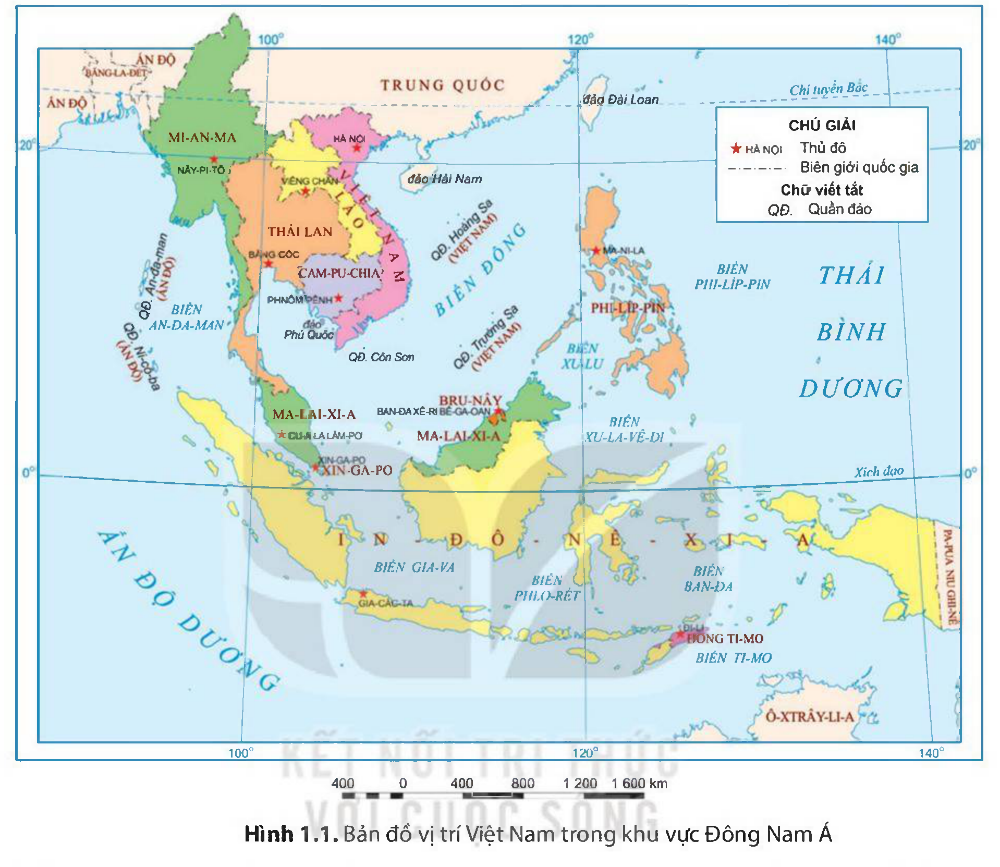

<!-- pdf:95 -->

# BÀI 1: VỊ TRÍ ĐỊA LÍ VÀ PHẠM VI LÃNH THỔ VIỆT NAM

## 🎯 Học xong bài này, em sẽ:

- Trình bày được đặc điểm vị trí địa lí của Việt Nam.
- Phân tích được ảnh hưởng của vị trí địa lí và phạm vi lãnh thổ đối với sự hình thành đặc điểm địa lí tự nhiên Việt Nam.

## 🔴 Mở đầu

Vị trí địa lí và phạm vi lãnh thổ có ảnh hưởng lớn đến sự hình thành đặc điểm tự nhiên của một lãnh thổ. Vị trí địa lí và phạm vi lãnh thổ đã khiến cho thiên nhiên Việt Nam mang những đặc điểm chung của thiên nhiên vùng nhiệt đới, đồng thời cũng có những sắc thái riêng, khác với các nước, các khu vực có cùng vĩ độ.

Hãy chia sẻ những hiểu biết của em về vị trí địa lí và phạm vi lãnh thổ của nước ta.

## 1. Vị trí địa lí

<!-- term: Vị trí địa lí Việt Nam -->
Việt Nam nằm ở rìa phía đông của bán đảo Đông Dương, gần trung tâm của khu vực Đông Nam Á. Trên đất liền, nước ta có chung đường biên giới với ba quốc gia (Trung Quốc, Lào, Cam-pu-chia) và có chung Biển Đông với nhiều nước.

<!-- term: Vị trí địa lí Việt Nam -->
Phần đất liền Việt Nam nằm trải dài từ vĩ độ 23°23'B đến vĩ độ 8°34'B và từ kinh độ 109°24'Đ đến kinh độ 102°09'Đ. Vùng biển kéo dài tới khoảng vĩ độ 6°50'B và từ khoảng kinh độ 101°Đ đến trên 117°20'Đ tại Biển Đông.
<!-- ocr-ok: đã đối chiếu ảnh trang gốc PDF 95 (trang in 93), kí hiệu độ (°), phút (') và chữ Đ bị OCR nhận nhầm thành 9, 6, e, Ð -->

<!-- term: Vị trí địa lí Việt Nam -->
Nước ta nằm ở vị trí nội chí tuyến bán cầu Bắc; trong khu vực châu Á gió mùa; nơi tiếp giáp giữa đất liền và đại dương, liền kề với vành đai sinh khoáng Thái Bình Dương và vành đai sinh khoáng Địa Trung Hải.

<!-- pdf:96 -->

<!-- term: Vị trí địa lí Việt Nam -->
Việt Nam nằm trên ngã tư đường hàng hải và hàng không quốc tế, là cầu nối giữa Đông Nam Á lục địa và Đông Nam Á hải đảo.

*Hình 1.1. Bản đồ vị trí Việt Nam trong khu vực Đông Nam Á*

> ❓ Quan sát hình 1.1 và dựa vào thông tin mục 1, hãy trình bày đặc điểm vị trí địa lí của Việt Nam.

## 2. Phạm vi lãnh thổ

Lãnh thổ Việt Nam là một khối thống nhất và toàn vẹn, bao gồm vùng đất, vùng biển và vùng trời.

<!-- term: Vùng đất Việt Nam -->
- Vùng đất của nước ta bao gồm toàn bộ phần đất liền và các đảo, quần đảo trên Biển Đông, với tổng diện tích đất của các đơn vị hành chính là 331 344 km² (Theo Tổng cục Thống kê năm 2021). Đường biên giới trên đất liền của nước ta dài hơn 4 600 km.

Vùng biển Việt Nam có hàng nghìn hòn đảo lớn nhỏ, trong đó có quần đảo Hoàng Sa (thuộc thành phố Đà Nẵng) và quần đảo Trường Sa (thuộc tỉnh Khánh Hoà) thuộc chủ quyền của Việt Nam.

<!-- pdf:97 -->

<!-- term: Vùng biển Việt Nam -->
- Vùng biển Việt Nam có diện tích khoảng 1 triệu km², gấp hơn 3 lần diện tích đất liền, chiếm gần 30% diện tích Biển Đông. Đường bờ biển của nước ta dài 3 260 km, từ Móng Cái (Quảng Ninh) đến Hà Tiên (Kiên Giang).

<!-- term: Vùng trời Việt Nam -->
- Vùng trời của Việt Nam là khoảng không gian bao trùm trên lãnh thổ nước ta, trên đất liền được xác định bằng các đường biên giới, trên biển là ranh giới bên ngoài của lãnh hải và không gian trên các đảo.

> ❓ Dựa vào thông tin mục 2 và hình 1.1, hãy:
> 1. Cho biết các quốc gia và biển tiếp giáp với phần đất liền của Việt Nam.
> 2. Mô tả hình dạng lãnh thổ phần đất liền của nước ta.

## 3. Ảnh hưởng của vị trí địa lí và phạm vi lãnh thổ đối với sự hình thành đặc điểm địa lí tự nhiên Việt Nam

Vị trí địa lí và phạm vi lãnh thổ đã tạo nên đặc điểm cơ bản của thiên nhiên nước ta, đó là thiên nhiên nhiệt đới ẩm gió mùa, chịu ảnh hưởng sâu sắc của biển và phân hoá đa dạng:

<!-- term: Thiên nhiên nhiệt đới ẩm gió mùa ở Việt Nam -->
- Thiên nhiên nhiệt đới ẩm gió mùa, chịu ảnh hưởng sâu sắc của biển.

<!-- term: Thiên nhiên nhiệt đới ẩm gió mùa ở Việt Nam -->
  + Khí hậu: Nước ta nằm hoàn toàn trong đới nóng của bán cầu Bắc, trong vùng gió mùa châu Á, một năm có hai mùa rõ rệt.

  Phần đất liền của nước ta hẹp ngang lại nằm kề Biển Đông, có nguồn ẩm dồi dào, các khối khí khi di chuyển qua biển vào sâu trong đất liền, đã làm cho thiên nhiên nước ta chịu ảnh hưởng sâu sắc của biển.

  Nước ta nằm trong khu vực chịu nhiều ảnh hưởng của các cơn bão đến từ khu vực biển nhiệt đới Tây Thái Bình Dương.

<!-- term: Thiên nhiên nhiệt đới ẩm gió mùa ở Việt Nam -->
  + Sinh vật và đất: Hệ sinh thái rừng nhiệt đới gió mùa phát triển trên đất feralit là cảnh quan tiêu biểu cho thiên nhiên nước ta.

  Đặc biệt, nước ta là nơi hội tụ của nhiều luồng động, thực vật có nguồn gốc từ Hoa Nam (Trung Quốc) xuống, từ Hi-ma-lay-a tới, từ Ấn Độ – Mi-an-ma sang và từ Ma-lai-xi-a, In-đô-nê-xi-a lên, nên thành phần loài sinh vật của nước ta rất phong phú.

  Biển nước ta nằm trong vùng nhiệt đới, có nhiệt độ nước biển ở tầng mặt cao, các dòng biển di chuyển theo mùa, sinh vật biển phong phú, đa dạng.

- Thiên nhiên phân hoá đa dạng:

  + Khí hậu có sự phân hoá theo chiều bắc – nam, đông – tây.

<!-- pdf:98 -->

  + Sự phân hoá của khí hậu dẫn đến sự phân hoá của sinh vật và đất, làm cho sinh vật và đất ở nước ta phong phú, đa dạng.

*Hình 1.2. Rừng nhiệt đới ở Vườn quốc gia Cúc Phương, Ninh Bình*

> ❓ Dựa vào thông tin mục 3 và hình 1.1, hãy phân tích ảnh hưởng của vị trí địa lí và phạm vi lãnh thổ đối với sự hình thành đặc điểm khí hậu, sinh vật và đất ở nước ta.

## ✏️ Luyện tập – Vận dụng

- Vẽ sơ đồ thể hiện ảnh hưởng của vị trí địa lí và phạm vi lãnh thổ tới đặc điểm tự nhiên Việt Nam.
- Tìm hiểu về những thuận lợi của vị trí địa lí nước ta trong việc giao lưu với các nước trong khu vực và trên thế giới.

## 📷 Danh sách hình trong bài

| Mã hình | Trang PDF | Trang sách | Chú thích |
| --- | :---: | :---: | --- |
| H8-lich_su_va_dia_ly-dl-b01-01 | 96 | 94 | Hình 1.1. Bản đồ vị trí Việt Nam trong khu vực Đông Nam Á |
| H8-lich_su_va_dia_ly-dl-b01-02 | 98 | 96 | Hình 1.2. Rừng nhiệt đới ở Vườn quốc gia Cúc Phương, Ninh Bình |
