<!-- pdf:99 -->

# BÀI 2: ĐỊA HÌNH VIỆT NAM

## 🎯 Học xong bài này, em sẽ:

- Trình bày được một trong những đặc điểm chủ yếu của địa hình Việt Nam.
- Trình bày được đặc điểm của các khu vực địa hình: địa hình đồi núi, địa hình đồng bằng, địa hình bờ biển và thềm lục địa.
- Tìm được ví dụ chứng minh ảnh hưởng của sự phân hoá địa hình đối với sự phân hoá lãnh thổ tự nhiên và khai thác kinh tế.

## 🔴 Mở đầu

Địa hình nước ta là kết quả của các quá trình địa chất lâu dài trong môi trường nhiệt đới ẩm gió mùa nên rất đa dạng và phức tạp.

Hãy kể tên một số đỉnh núi cao, đồng bằng lớn ở nước ta mà em biết.

## 1. Đặc điểm chung của địa hình

### a) Địa hình đồi núi chiếm ưu thế

- Đồi núi chiếm tới 3/4 diện tích phần đất liền, nhưng chủ yếu là đồi núi thấp. Địa hình núi cao trên 2 000 m chỉ chiếm 1% diện tích cả nước.

Đồi núi nước ta chạy dài 1 400 km, từ Tây Bắc tới Đông Nam Bộ. Nhiều vùng núi lan ra sát biển hoặc biển nhấn chìm một phần tạo thành các đảo, quần đảo (như vùng biển Hạ Long, Quảng Ninh trong vịnh Bắc Bộ).

- Địa hình đồng bằng chỉ chiếm 1/4 diện tích phần đất liền và chia thành nhiều khu vực; điển hình là dải đồng bằng duyên hải miền Trung, bị đồi núi ngăn cách thành nhiều đồng bằng nhỏ.

### b) Địa hình có hai hướng chính là tây bắc – đông nam và hướng vòng cung

Địa hình nước ta có hai hướng chính là tây bắc – đông nam và vòng cung.

- Hướng tây bắc – đông nam điển hình là các dãy núi: Con Voi, Hoàng Liên Sơn, Trường Sơn Bắc,...

- Hướng vòng cung thể hiện rõ nét nhất ở vùng núi Đông Bắc.

<!-- pdf:100 -->

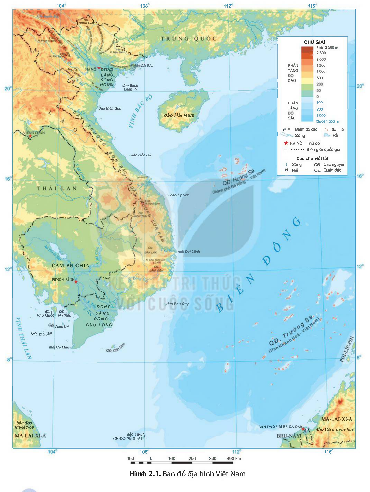

*Hình 2.1. Bản đồ địa hình Việt Nam*

<!-- pdf:101 -->

### c) Địa hình có tính chất phân bậc khá rõ rệt

Lãnh thổ nước ta đã được tạo lập từ cách đây hàng chục triệu năm. Trải qua quá trình địa chất lâu dài, các vùng núi bị ngoại lực bào mòn, phá huỷ tạo nên những bề mặt san bằng, thấp và thoải.

Vận động tạo núi Hi-ma-lay-a đã làm cho địa hình nước ta nâng cao và phân thành nhiều bậc địa hình lớn kế tiếp nhau: núi đồi, đồng bằng, bờ biển, thềm lục địa. Trong đó, lại có các bậc địa hình nhỏ như các bề mặt san bằng, các cao nguyên xếp tầng, các bậc thềm sông, thềm biển,...

### d) Địa hình chịu tác động của khí hậu nhiệt đới ẩm gió mùa và con người

Trong điều kiện khí hậu nhiệt đới ẩm, đá bị phong hoá mạnh mẽ nên bề mặt địa hình được che phủ bởi một lớp vỏ phong hoá dày. Khí hậu nhiệt đới gió mùa với lượng mưa lớn và tập trung theo mùa làm cho địa hình bị xâm thực, xói mòn mạnh, càng khiến địa hình bị chia cắt. Bề mặt địa hình dễ bị biến đổi do hiện tượng trượt lở đất đá khi mưa lớn theo mùa.

<!-- term: Địa hình các-xtơ ở Việt Nam -->
Lượng mưa lớn làm quá trình hoà tan đá vôi mạnh mẽ, tạo nên các dạng địa hình các-xtơ độc đáo, nước ngầm xâm thực sâu vào lòng núi đá hình thành những hang động lớn.

<!-- term: Địa hình nhân tạo -->
Quá trình con người khai thác tài nguyên thiên nhiên, phát triển kinh tế,... làm biến đổi các dạng địa hình tự nhiên, đồng thời tạo ra ngày càng nhiều các dạng địa hình nhân tạo như: đê, đập, hầm mỏ,...

> 💡 **Em có biết?**
>
> Động Phong Nha nằm trong Vườn quốc gia Phong Nha – Kẻ Bàng, dài 7 729 m, cửa động rộng 20 – 25 m, cao khoảng 10 m. Đây là một trong những hang động đẹp nhất thế giới với các tiêu chí: sông ngầm dài nhất; hồ nước ngầm đẹp nhất; các bãi cát, bãi đá ngầm đẹp nhất; hang khô rộng và đẹp nhất,...

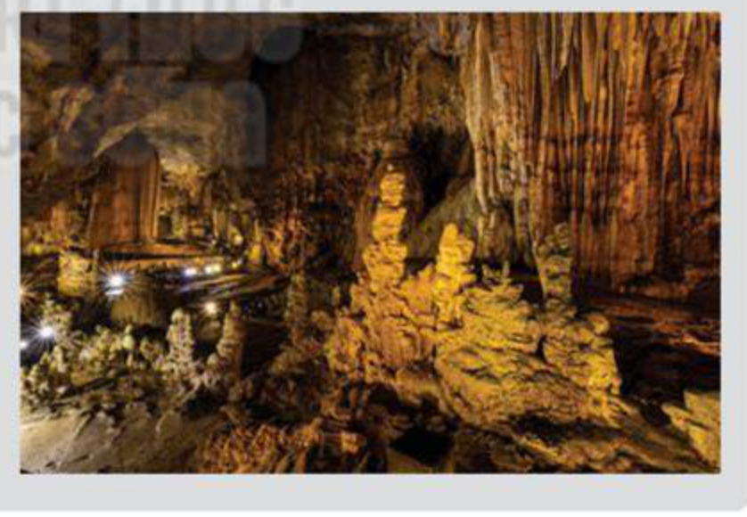

*Hình 2.2. Động Phong Nha, Quảng Bình*
<!-- ocr-ok: đã đối chiếu ảnh trang gốc PDF 101 (trang in 99), chú thích Hình 2.2 trong hộp Em có biết? bị OCR dính chữ không dấu cách -->

> ❓ Dựa vào thông tin mục 1 và hình 2.1, hãy:
> 1. Xác định vị trí một số dãy núi có hướng tây bắc – đông nam và hướng vòng cung trên bản đồ.
> 2. Trình bày một trong những đặc điểm của địa hình Việt Nam.
> 3. Lấy ví dụ thể hiện tác động của con người đến địa hình nước ta.

<!-- pdf:102 -->

## 2. Các khu vực địa hình

### a) Địa hình đồi núi

Địa hình đồi núi nước ta chia thành bốn vùng là Đông Bắc, Tây Bắc, Trường Sơn Bắc và Trường Sơn Nam.

- *Vùng Đông Bắc*

<!-- term: Vùng núi Đông Bắc -->
  + Đây là một vùng đồi núi thấp nằm ở phía bờ trái của sông Hồng, từ dãy núi Con Voi đến vùng đồi núi ven biển Quảng Ninh. Độ cao trung bình phổ biến dưới 1 000 m.

<!-- term: Vùng núi Đông Bắc -->
  + Đặc trưng của vùng núi này là những cánh cung núi lớn (Sông Gâm, Ngân Sơn, Bắc Sơn, Đông Triều) và vùng đồi (trung du) phát triển mở rộng (như ở Phú Thọ, Bắc Giang,...).

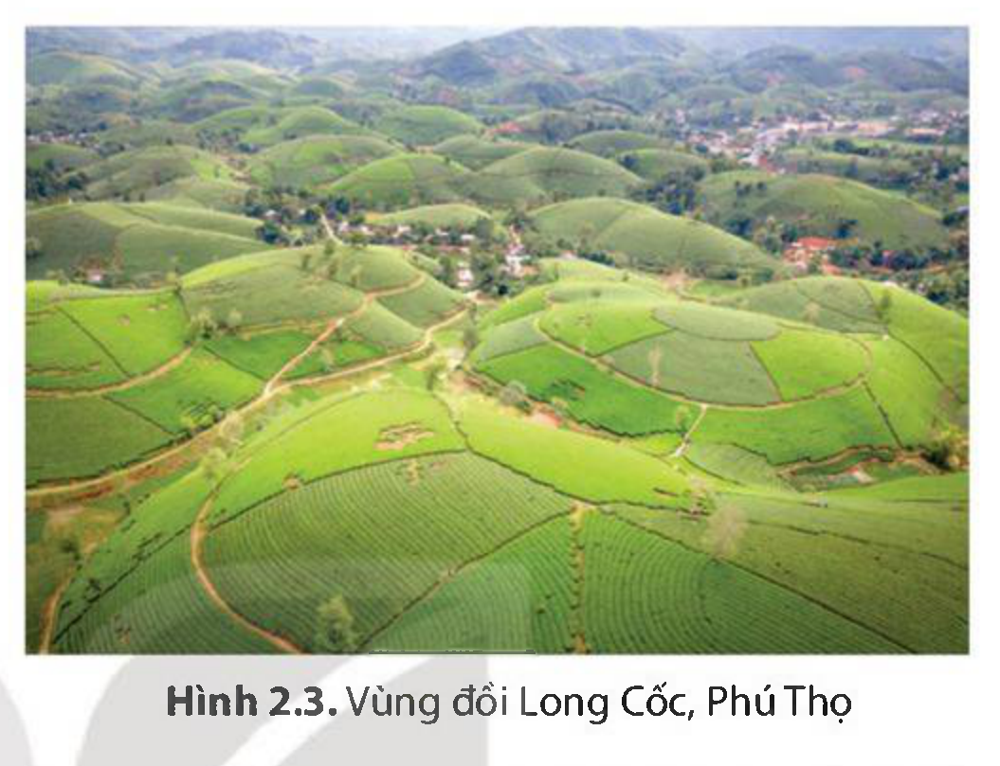

*Hình 2.3. Vùng đồi Long Cốc, Phú Thọ*

  + Địa hình các-xtơ khá phổ biến, tạo nên những cảnh quan đẹp như vùng hồ Ba Bể, vịnh Hạ Long.

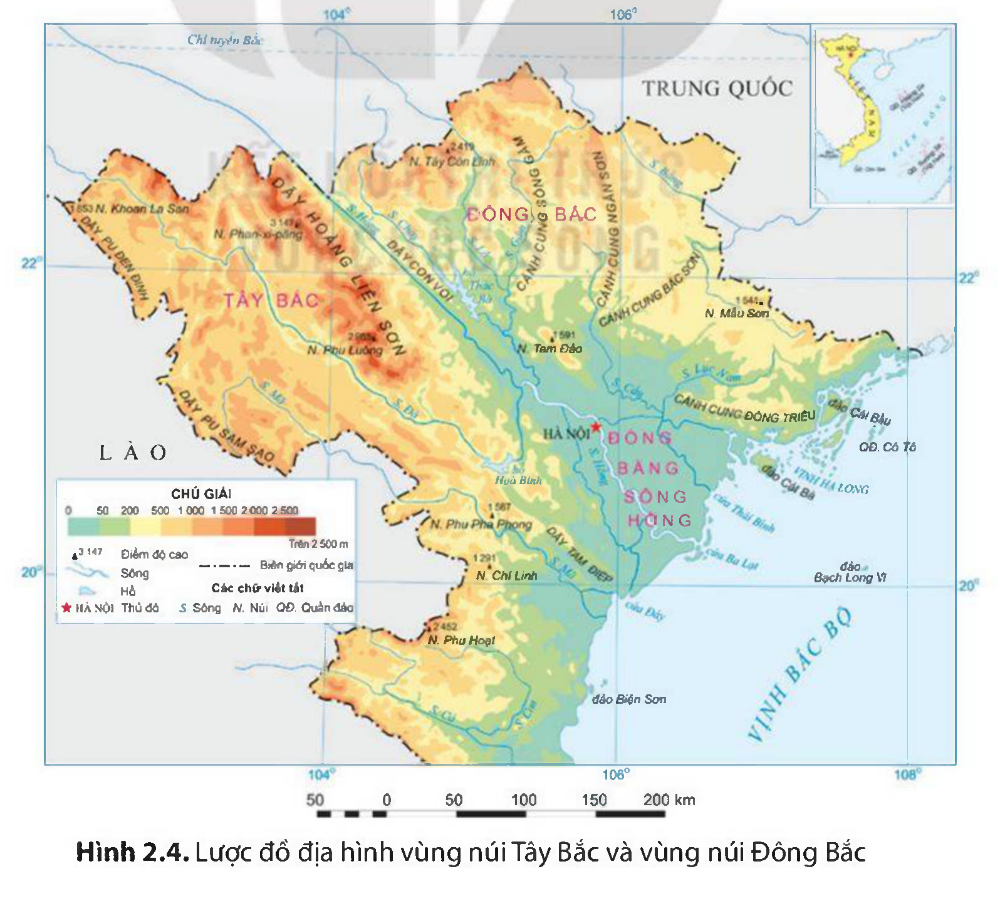

*Hình 2.4. Lược đồ địa hình vùng núi Tây Bắc và vùng núi Đông Bắc*

<!-- pdf:103 -->

- *Vùng Tây Bắc*

<!-- term: Vùng núi Tây Bắc -->
  + Vùng núi Tây Bắc nằm giữa sông Hồng và sông Cả, có địa hình cao nhất nước ta với độ cao trung bình 1 000 – 2 000 m, nhiều đỉnh cao trên 2 000 m. Trong vùng có nhiều dãy núi cao (dãy Hoàng Liên Sơn, dãy Pu Đen Đinh) và những cao nguyên hiểm trở chạy song song, kéo dài theo hướng tây bắc – đông nam.

<!-- term: Vùng núi Tây Bắc -->
  + Đặc trưng của địa hình Tây Bắc là bị chia cắt mạnh. Xen giữa các vùng núi đá vôi là các cánh đồng, thung lũng các-xtơ,...

> 💡 **Em có biết?**
>
> Phan-xi-păng là đỉnh núi cao nhất Việt Nam và được mệnh danh là “Nóc nhà Đông Dương”, thuộc dãy Hoàng Liên Sơn. Độ cao của đỉnh núi đo đạc năm 1909 là 3 143 m, tuy nhiên theo số liệu mới nhất của Cục Đo đạc, Bản đồ và Thông tin địa lí Việt Nam, năm 2019 núi có độ cao 3 147 m.
<!-- ocr-ok: đã đối chiếu ảnh trang gốc PDF 103 (trang in 101), hộp Em có biết? ở cột phải bị OCR trộn dòng với cột trái -->

- *Vùng Trường Sơn Bắc*

<!-- term: Vùng núi Trường Sơn Bắc -->
  + Vùng núi Trường Sơn Bắc kéo dài khoảng 600 km từ phía nam sông Cả tới dãy Bạch Mã. Đây là vùng có độ cao trung bình khoảng 1 000 m, một số ít đỉnh cao trên 2 000 m như: Pu Xai Lai Leng (2 711 m), Rào Cỏ (2 235 m).

<!-- term: Vùng núi Trường Sơn Bắc -->
  + Trường Sơn Bắc chạy theo hướng tây bắc – đông nam, có một số nhánh núi đâm ngang ra biển chia cắt đồng bằng duyên hải miền Trung.

> 💡 **Em có biết?**
>
> Dãy Bạch Mã là một nhánh núi thuộc dãy Trường Sơn, có độ cao trung bình khoảng 1 200 – 1 300 m, chạy theo hướng tây – đông lan ra sát biển. Đây cũng là ranh giới tự nhiên quan trọng nhất tạo nên sự phân hoá sâu sắc về khí hậu theo chiều bắc – nam ở nước ta.

- *Vùng Trường Sơn Nam*

<!-- term: Vùng núi Trường Sơn Nam -->
  + Địa hình chủ yếu là núi và cao nguyên, có độ cao trung bình lớn hơn vùng Trường Sơn Bắc. Địa hình có hướng vòng cung, hai sườn đông và tây Trường Sơn Nam không đối xứng.

<!-- term: Vùng núi Trường Sơn Nam -->
  + Dạng địa hình nổi bật là các cao nguyên rộng lớn, xếp tầng, bề mặt phủ đất đỏ badan.

<!-- term: Vùng núi Trường Sơn Nam -->
  + Các khối núi cao nằm ở phía bắc và nam của vùng có nhiều đỉnh cao trên 2 000 m như: Ngọc Linh (2 598 m), Chư Yang Sin (2 405 m), Lang Biang (2 167 m),...

<!-- term: Vùng núi Trường Sơn Nam -->
  + Chuyển tiếp giữa miền núi, cao nguyên với miền đồng bằng là địa hình bán bình nguyên Đông Nam Bộ với những thềm phù sa cổ, có nơi cao tới 200 m.

> 💡 **Em có biết?**
>
> Cao nguyên Lâm Viên thuộc Tây Nguyên có độ cao trung bình khoảng 1 500 m, diện tích khoảng 1 080 km². Phía nam cao nguyên có thành phố Đà Lạt, phong cảnh đẹp, khí hậu trong lành, đất đỏ badan màu mỡ, tạo lợi thế cho phát triển kinh tế.

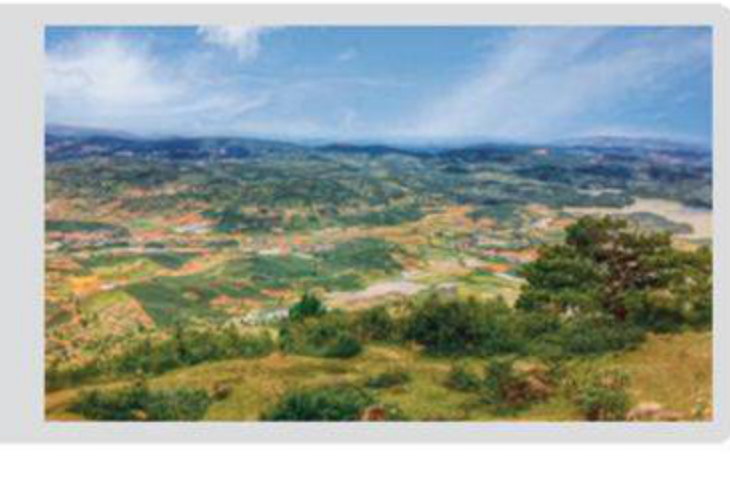

*Hình 2.5. Một phần cao nguyên Lâm Viên*

<!-- pdf:104 -->

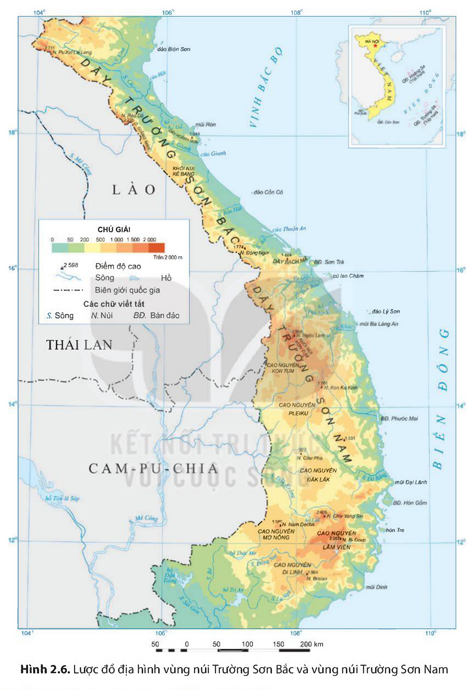

*Hình 2.6. Lược đồ địa hình vùng núi Trường Sơn Bắc và vùng núi Trường Sơn Nam*

> ❓ Đọc thông tin mục a và quan sát hình 2.4, 2.6, hãy:
> 1. Xác định phạm vi của các vùng đồi núi ở nước ta trên bản đồ.
> 2. Trình bày đặc điểm địa hình của các khu vực đồi núi ở nước ta.

<!-- pdf:105 -->

### b) Địa hình đồng bằng

Địa hình đồng bằng nước ta bao gồm đồng bằng châu thổ các sông và các đồng bằng duyên hải miền Trung.

- *Đồng bằng sông Hồng*

<!-- term: Đồng bằng sông Hồng -->
Đồng bằng sông Hồng có diện tích khoảng 15 000 km², lớn thứ hai nước ta, được hình thành chủ yếu do phù sa của hệ thống sông Hồng bồi đắp.

<!-- term: Đồng bằng sông Hồng -->
Dọc theo các bờ sông ở đồng bằng sông Hồng, nhân dân ta đã xây dựng hệ thống đê chống lũ khiến đồng bằng bị chia cắt, tạo thành những ô trũng, khu vực trong đê không còn được bồi đắp tự nhiên.

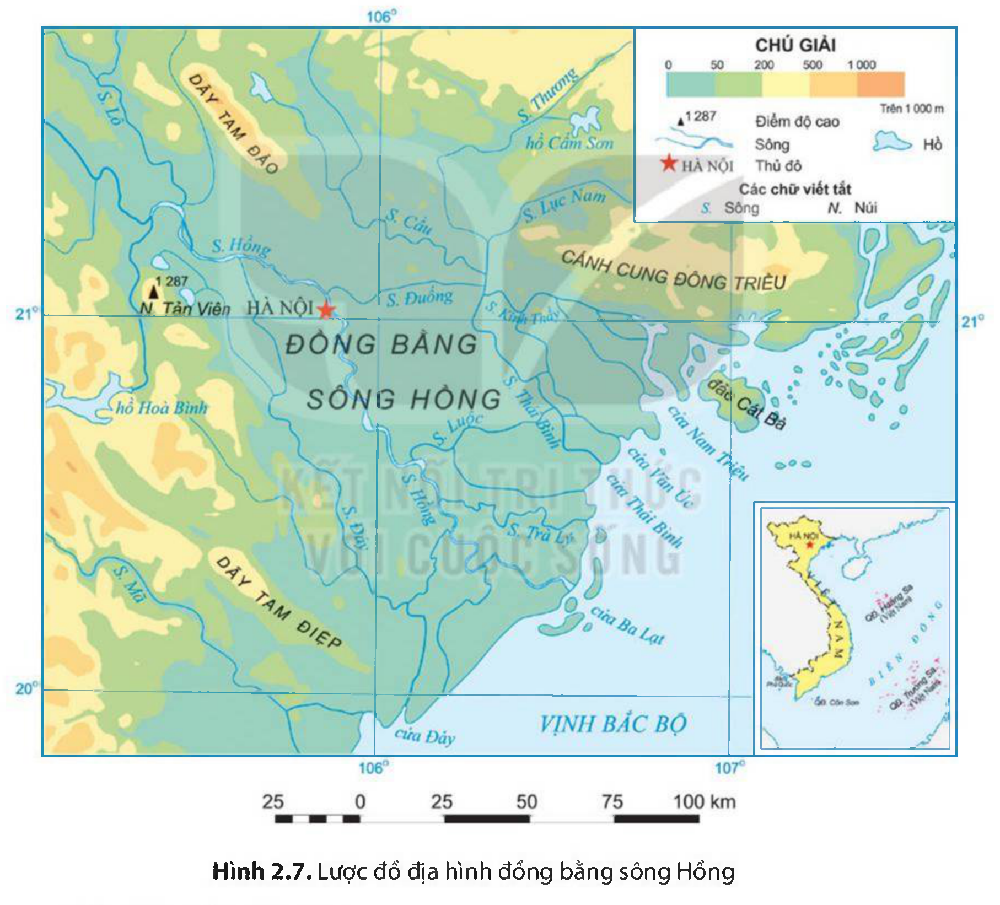

*Hình 2.7. Lược đồ địa hình đồng bằng sông Hồng*

- *Đồng bằng sông Cửu Long*

<!-- term: Đồng bằng sông Cửu Long -->
Đồng bằng sông Cửu Long là đồng bằng lớn nhất nước ta, có diện tích trên 40 000 km², được bồi đắp bởi phù sa của hệ thống sông Mê Công.

<!-- term: Đồng bằng sông Cửu Long -->
Phần thượng châu thổ có địa hình tương đối bằng phẳng với nhiều gờ đất cao (giồng đất), phần hạ châu thổ cao trung bình từ 2 – 3 m so với mực nước biển.

<!-- pdf:106 -->

<!-- term: Đồng bằng sông Cửu Long -->
Trên mặt đồng bằng không có đê lớn để ngăn lũ. Vào mùa lũ, nhiều vùng đất trũng rộng lớn bị ngập úng sâu và khó thoát nước như vùng Đồng Tháp Mười, vùng Tứ giác Long Xuyên. Đồng bằng có hệ thống kênh rạch tự nhiên và nhân tạo dày đặc có tác dụng tiêu nước, thau chua, rửa mặn.

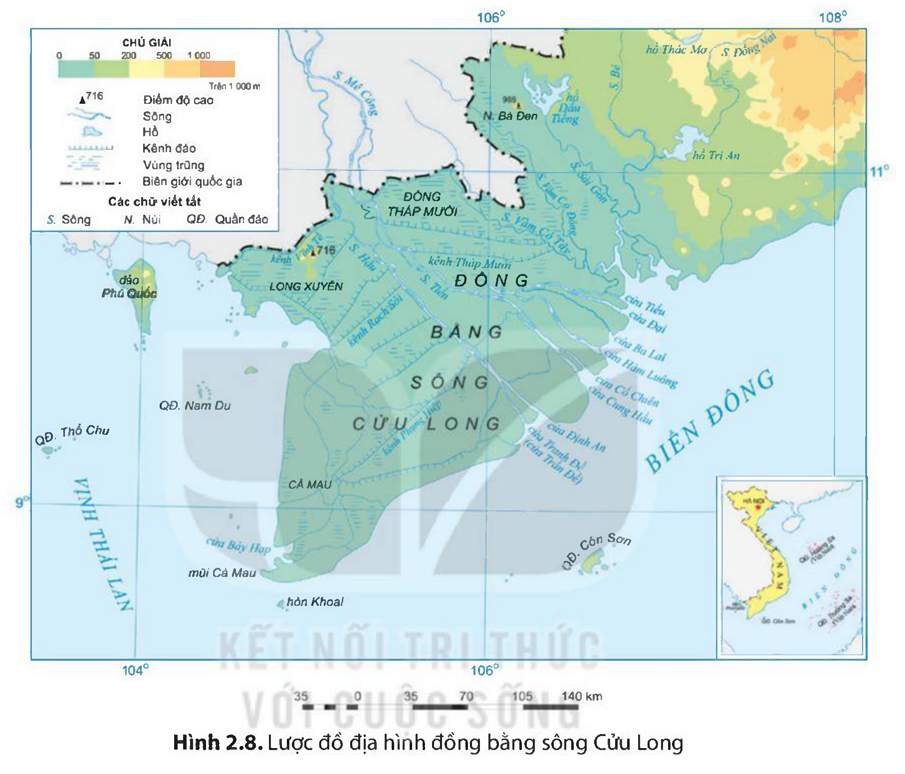

*Hình 2.8. Lược đồ địa hình đồng bằng sông Cửu Long*

- *Các đồng bằng duyên hải miền Trung*

<!-- term: Các đồng bằng duyên hải miền Trung -->
Các đồng bằng duyên hải miền Trung có tổng diện tích khoảng 15 000 km²; bị các nhánh núi đâm ngang và ăn sát ra biển chia cắt thành nhiều đồng bằng nhỏ hẹp, rộng nhất là đồng bằng Thanh Hoá có diện tích 3 100 km².

<!-- term: Các đồng bằng duyên hải miền Trung -->
Các đồng bằng duyên hải ít màu mỡ hơn so với hai đồng bằng châu thổ hạ lưu sông, do đất có nguồn gốc hỗn hợp từ phù sa sông và phù sa biển, trong đồng bằng có nhiều cồn cát.

> ❓ Đọc thông tin mục b và quan sát các hình 2.1 (trang 98), 2.7, 2.8, hãy:
> 1. Xác định vị trí và phạm vi của các khu vực địa hình đồng bằng trên bản đồ.
> 2. Trình bày đặc điểm địa hình của một trong các khu vực đồng bằng ở nước ta.

<!-- pdf:107 -->

### c) Địa hình bờ biển và thềm lục địa

- Bờ biển nước ta dài 3 260 km từ Móng Cái đến Hà Tiên, có hai kiểu là bờ biển bồi tụ và bờ biển mài mòn.

<!-- term: Bờ biển bồi tụ -->
  + Bờ biển bồi tụ (tại các châu thổ sông Hồng, sông Cửu Long) có nhiều bãi bùn rộng, rừng cây ngập mặn phát triển, thuận lợi cho nuôi trồng thuỷ sản.

<!-- term: Bờ biển mài mòn -->
  + Bờ biển mài mòn (tại các vùng chân núi và hải đảo như đoạn bờ biển từ Đà Nẵng đến Vũng Tàu) rất khúc khuỷu, có nhiều vũng, vịnh nước sâu, kín gió và nhiều bãi cát.
<!-- ocr-ok: đã đối chiếu ảnh trang gốc PDF 107 (trang in 105), cột chữ trái bị OCR trộn dòng với chú thích Hình 2.9 bên phải -->

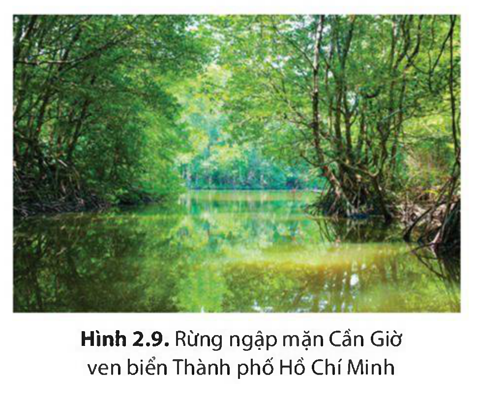

*Hình 2.9. Rừng ngập mặn Cần Giờ ven biển Thành phố Hồ Chí Minh*
<!-- ocr-ok: đã đối chiếu ảnh trang gốc PDF 107 (trang in 105), chú thích Hình 2.9 ở cột phải bị OCR cắt mất dòng đầu -->

<!-- term: Thềm lục địa Việt Nam -->
- Thềm lục địa tại các vùng biển Bắc Bộ và Nam Bộ nông và mở rộng, ở vùng biển miền Trung sâu hơn và thu hẹp.

> ❓ Dựa vào thông tin mục c, hãy:
> 1. Trình bày đặc điểm các kiểu địa hình bờ biển của nước ta.
> 2. Nêu đặc điểm của thềm lục địa nước ta.

## 3. Ảnh hưởng của sự phân hoá địa hình đối với sự phân hoá tự nhiên và khai thác kinh tế

### a) Đối với phân hoá tự nhiên

- Do địa hình nước ta chủ yếu là đồi núi thấp nên tính nhiệt đới của thiên nhiên được bảo toàn trên phần lớn diện tích lãnh thổ.

- Ở các vùng núi, thiên nhiên có sự phân hoá theo đai cao.

  + Đai nhiệt đới gió mùa có hệ sinh thái rừng mưa nhiệt đới và rừng nhiệt đới gió mùa phát triển trên nhóm đất feralit.

  + Đai cận nhiệt đới gió mùa trên núi có hệ sinh thái rừng lá rộng cận nhiệt, nhóm đất điển hình là đất feralit (có hàm lượng mùn lớn hơn).

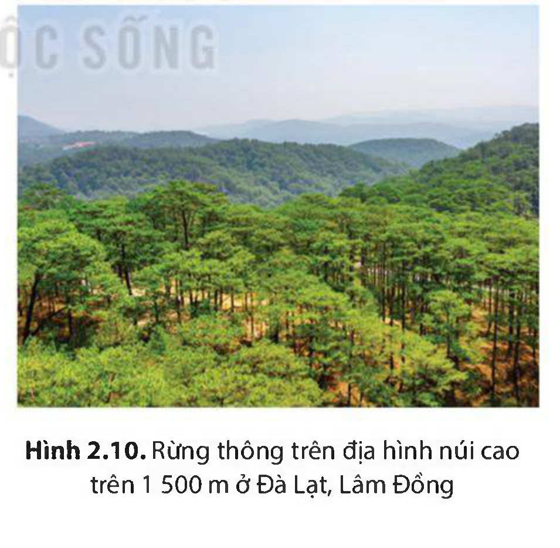

*Hình 2.10. Rừng thông trên địa hình núi cao trên 1 500 m ở Đà Lạt, Lâm Đồng*

  + Đai ôn đới gió mùa trên núi phát triển thực vật ôn đới. Đất ở vùng núi cao chủ yếu là mùn thô.

<!-- pdf:108 -->

<!-- term: Bức chắn địa hình -->
- Một số dãy núi có vai trò là bức chắn địa hình tạo nên sự phân hoá thiên nhiên giữa các sườn núi.

  + Dãy Hoàng Liên Sơn làm suy yếu tác động của gió mùa Đông Bắc khiến mùa đông ở Tây Bắc có thời gian ngắn hơn và nền nhiệt cao hơn ở Đông Bắc.

  + Dãy Trường Sơn gây nên hiệu ứng phơn tạo ra sự khác biệt về thời gian mùa mưa giữa hai sườn núi.

  + Dãy Bạch Mã ngăn ảnh hưởng của gió mùa Đông Bắc vào phía nam nước ta, trở thành ranh giới tự nhiên của hai miền khí hậu (phía bắc có mùa đông lạnh và phía nam nóng quanh năm). Tự nhiên ở hai miền cũng có nhiều nét khác biệt.

### b) Đối với khai thác kinh tế

Mỗi khu vực địa hình (đồi núi, đồng bằng, bờ biển và thềm lục địa) sẽ có phương thức khai thác kinh tế phù hợp để tận dụng những lợi thế và khắc phục những khó khăn, hướng đến sự phát triển bền vững.

- *Khai thác kinh tế ở khu vực đồi núi*

  + Thế mạnh:

  Đối với nông nghiệp, lâm nghiệp: Đây là nơi có nguồn lâm sản phong phú thuận lợi phát triển ngành lâm nghiệp; các đồng cỏ tự nhiên rộng lớn tạo điều kiện phát triển chăn nuôi gia súc lớn; thổ nhưỡng và khí hậu thích hợp cho cây công nghiệp lâu năm, cây ăn quả;... như các vùng Tây Bắc, Đông Bắc, Tây Nguyên,...
<!-- ocr-ok: đã đối chiếu ảnh trang gốc PDF 108 (trang in 106), cột chữ phải bị OCR trộn dòng với hộp Em có biết? bên trái -->

  Đối với công nghiệp: Khu vực đồi núi nước ta thường có nguồn tài nguyên khoáng sản phong phú đa dạng, tạo điều kiện thuận lợi phát triển các ngành công nghiệp khai thác khoáng sản, luyện kim,... Sông ngòi chảy qua địa hình miền núi, nhiều thác ghềnh (sông Đà, sông Sê San, Srê Pốk,...) nên có tiềm năng thuỷ điện rất lớn.
<!-- ocr-ok: đã đối chiếu ảnh trang gốc PDF 108 (trang in 106), cột chữ phải bị OCR trộn dòng với chú thích Hình 2.11 bên trái -->

  Đối với du lịch: Khu vực đồi núi có khí hậu mát mẻ, cảnh quan đa dạng và đặc sắc, là cơ sở để hình thành các địa điểm du lịch có giá trị.

> 💡 **Em có biết?**
>
> Quần thể du lịch nghỉ dưỡng Bà Nà (Đà Nẵng) nằm trên núi Chúa thuộc dãy Trường Sơn, ở độ cao khoảng 1 500 m so với mực nước biển, nên mát mẻ quanh năm, thích hợp cho hoạt động du lịch nghỉ dưỡng.
<!-- ocr-ok: đã đối chiếu ảnh trang gốc PDF 108 (trang in 106), hộp Em có biết? ở cột trái bị OCR trộn dòng với cột phải -->

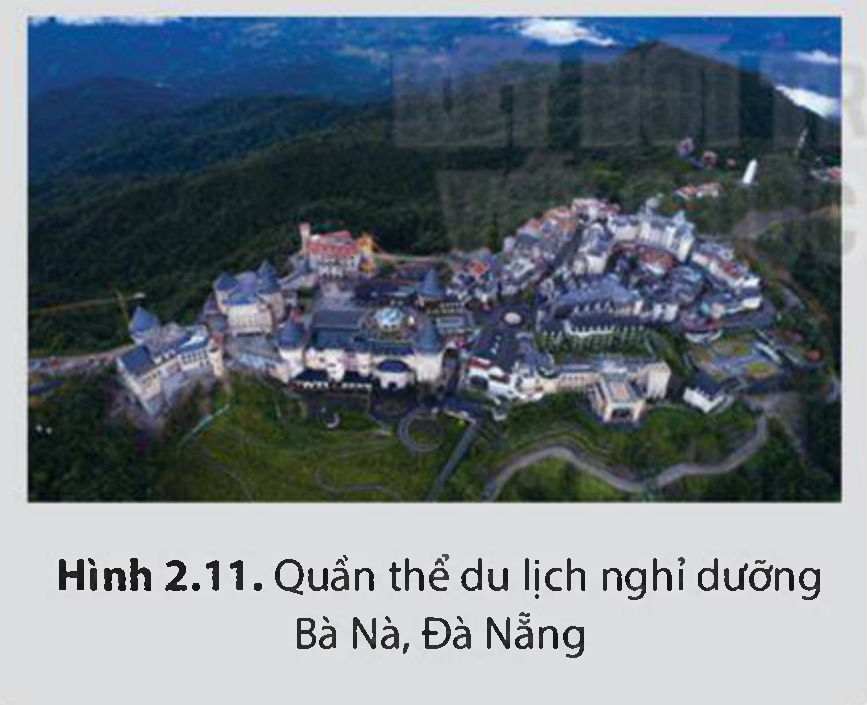

*Hình 2.11. Quần thể du lịch nghỉ dưỡng Bà Nà, Đà Nẵng*
<!-- ocr-ok: đã đối chiếu ảnh trang gốc PDF 108 (trang in 106), chú thích Hình 2.11 ở cột trái bị OCR trộn dòng với cột phải -->

  + Hạn chế: Địa hình bị chia cắt mạnh gây khó khăn cho giao thông và cần chú ý đến công tác phòng chống thiên tai như lũ quét, sạt lở,...

<!-- pdf:109 -->

- *Khai thác kinh tế ở khu vực đồng bằng*

  + Thế mạnh: Khu vực đồng bằng nước ta có địa hình bằng phẳng, đất màu mỡ, nguồn nước dồi dào, dân cư đông đúc nên thuận lợi phát triển các ngành kinh tế.

  Đối với ngành nông nghiệp, thuỷ sản: Khu vực đồng bằng là vùng trồng cây lương thực, thực phẩm, chăn nuôi gia súc nhỏ và gia cầm, đánh bắt và nuôi trồng thuỷ sản,... chủ yếu của cả nước, như ở đồng bằng sông Hồng, đồng bằng sông Cửu Long,...

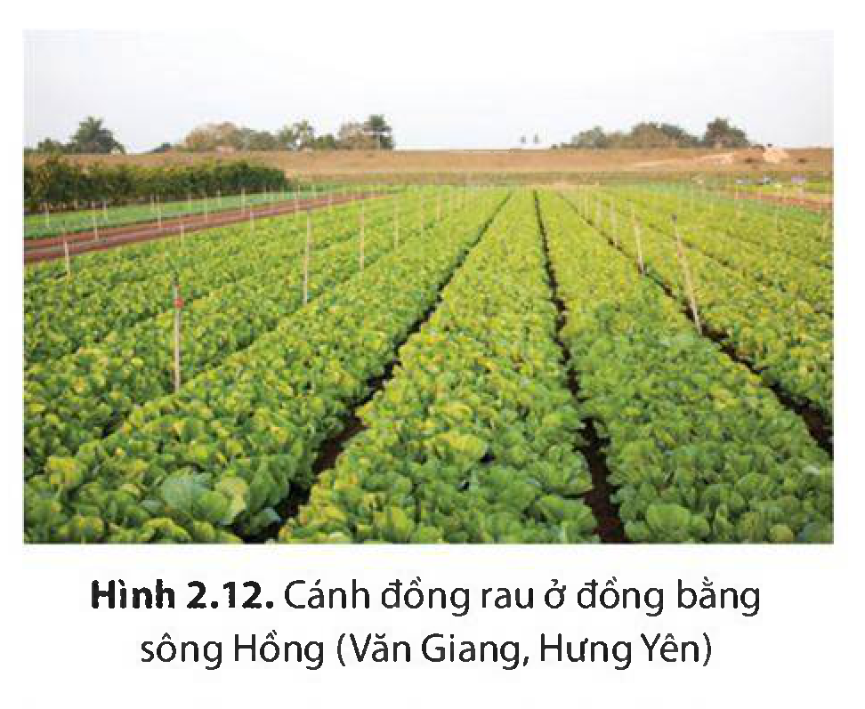

*Hình 2.12. Cánh đồng rau ở đồng bằng sông Hồng (Văn Giang, Hưng Yên)*

  Khu vực đồng bằng thuận lợi cho xây dựng cơ sở hạ tầng và cư trú nên hình thành nhiều trung tâm kinh tế lớn như: Hà Nội, Đà Nẵng, Thành phố Hồ Chí Minh, Cần Thơ,...

  + Hạn chế: Do lịch sử khai thác lâu đời và dân cư tập trung đông đúc nên tài nguyên thiên nhiên bị khai thác quá mức, môi trường một số nơi bị suy thoái,...

- *Khai thác kinh tế ở vùng biển và thềm lục địa*

  + Thế mạnh: Vùng biển và thềm lục địa của nước ta thuận lợi để phát triển các ngành kinh tế biển.

| Hoạt động kinh tế biển | Điều kiện phát triển |
| --- | --- |
| Khai thác, nuôi trồng thuỷ sản và làm muối | Có nhiều loài thuỷ sản có giá trị kinh tế cao, với trữ lượng tương đối lớn (tôm hùm, đồi mồi,...), nghề làm muối có nhiều điều kiện để phát triển, nhất là vùng ven biển Nam Trung Bộ. |
| Giao thông vận tải biển | Có nhiều vũng, vịnh để xây dựng các cảng nước sâu như cảng Cái Lân, cảng Chân Mây, cảng Vân Phong,... |
| Khai thác năng lượng | Có tiềm năng về dầu khí; năng lượng gió, thuỷ triều. |
| Du lịch biển – đảo | Có nhiều bãi tắm đẹp (Sầm Sơn, Thiên Cầm, Mỹ Khê, Nha Trang,...); nhiều đảo có phong cảnh đẹp, không khí trong lành (Cù Lao Chàm, Côn Đảo, Phú Quốc,...). |
<!-- ocr-ok: đã đối chiếu ảnh trang gốc PDF 109 (trang in 107), bảng màu 2 cột bị OCR đọc nhầm tiêu đề và chính tả "đồi mồi" -->

<!-- pdf:110 -->

  + Vùng biển và thềm lục địa chịu tác động bởi các thiên tai như bão, sạt lở bờ biển,... Trong quá trình khai thác cần chú ý đến vấn đề bảo vệ môi trường biển, bảo tồn sự đa dạng sinh học của các hệ sinh thái biển,...

> 💡 **Em có biết?**
>
> Phú Quốc là hòn đảo lớn nhất Việt Nam, được mệnh danh là Đảo Ngọc. Những bãi biển nước trong xanh (Bãi Sao, Bãi Dài), ánh nắng chan hoà, là điều kiện thuận lợi để Phú Quốc trở thành điểm du lịch biển hấp dẫn.

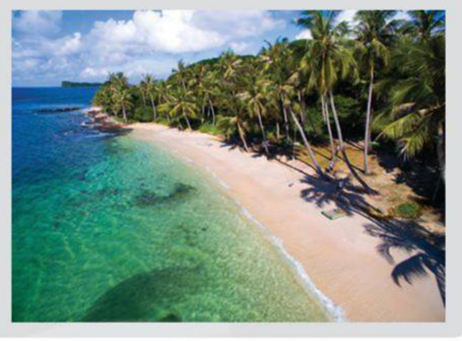

*Hình 2.13. Bờ biển đảo Phú Quốc, Kiên Giang*

> ❓ Đọc thông tin mục b, hãy lấy ví dụ về ảnh hưởng của địa hình đối với khai thác kinh tế ở một trong những khu vực địa hình của nước ta.

## ✏️ Luyện tập – Vận dụng

- Lựa chọn và so sánh đặc điểm địa hình giữa vùng núi Đông Bắc với vùng núi Tây Bắc hoặc đồng bằng sông Hồng với đồng bằng sông Cửu Long.
- Tìm hiểu ảnh hưởng của các dạng địa hình ở địa phương em đến phát triển kinh tế.

## 📷 Danh sách hình trong bài

| Mã hình | Trang PDF | Trang sách | Chú thích |
| --- | :---: | :---: | --- |
| H8-lich_su_va_dia_ly-dl-b02-01 | 100 | 98 | Hình 2.1. Bản đồ địa hình Việt Nam |
| H8-lich_su_va_dia_ly-dl-b02-02 | 101 | 99 | Hình 2.2. Động Phong Nha, Quảng Bình |
| H8-lich_su_va_dia_ly-dl-b02-03 | 102 | 100 | Hình 2.3. Vùng đồi Long Cốc, Phú Thọ |
| H8-lich_su_va_dia_ly-dl-b02-04 | 102 | 100 | Hình 2.4. Lược đồ địa hình vùng núi Tây Bắc và vùng núi Đông Bắc |
| H8-lich_su_va_dia_ly-dl-b02-05 | 103 | 101 | Hình 2.5. Một phần cao nguyên Lâm Viên |
| H8-lich_su_va_dia_ly-dl-b02-06 | 104 | 102 | Hình 2.6. Lược đồ địa hình vùng núi Trường Sơn Bắc và vùng núi Trường Sơn Nam |
| H8-lich_su_va_dia_ly-dl-b02-07 | 105 | 103 | Hình 2.7. Lược đồ địa hình đồng bằng sông Hồng |
| H8-lich_su_va_dia_ly-dl-b02-08 | 106 | 104 | Hình 2.8. Lược đồ địa hình đồng bằng sông Cửu Long |
| H8-lich_su_va_dia_ly-dl-b02-09 | 107 | 105 | Hình 2.9. Rừng ngập mặn Cần Giờ ven biển Thành phố Hồ Chí Minh |
| H8-lich_su_va_dia_ly-dl-b02-10 | 107 | 105 | Hình 2.10. Rừng thông trên địa hình núi cao trên 1 500 m ở Đà Lạt, Lâm Đồng |
| H8-lich_su_va_dia_ly-dl-b02-11 | 108 | 106 | Hình 2.11. Quần thể du lịch nghỉ dưỡng Bà Nà, Đà Nẵng |
| H8-lich_su_va_dia_ly-dl-b02-12 | 109 | 107 | Hình 2.12. Cánh đồng rau ở đồng bằng sông Hồng (Văn Giang, Hưng Yên) |
| H8-lich_su_va_dia_ly-dl-b02-13 | 110 | 108 | Hình 2.13. Bờ biển đảo Phú Quốc, Kiên Giang |
