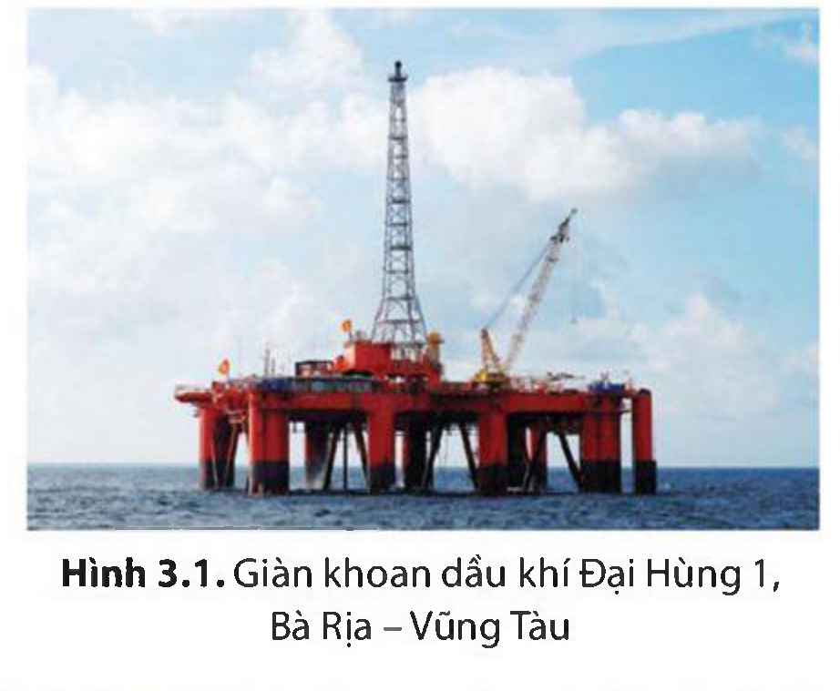
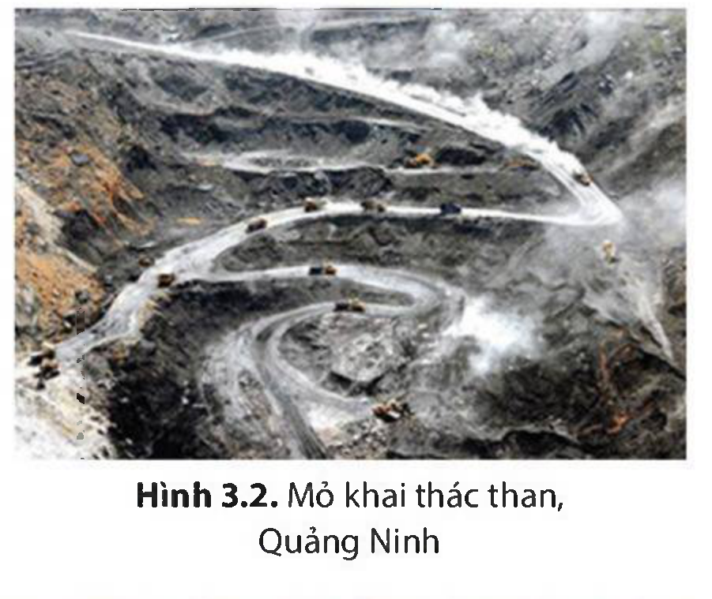
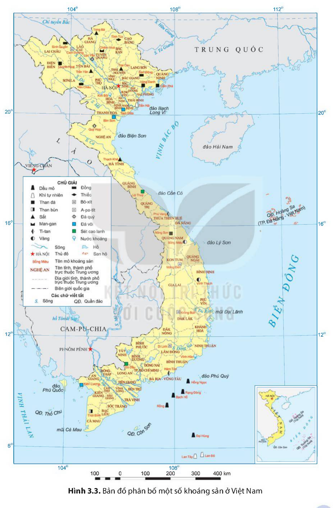

<!-- pdf:111 -->

# BÀI 3: KHOÁNG SẢN VIỆT NAM

## 🎯 Học xong bài này, em sẽ:

- Trình bày và giải thích được đặc điểm chung của tài nguyên khoáng sản Việt Nam.
- Phân tích được đặc điểm phân bố các loại khoáng sản chủ yếu và vấn đề sử dụng hợp lí tài nguyên khoáng sản.

## 🔴 Mở đầu

Việt Nam nằm ở vị trí giao thoa của hai vành đai sinh khoáng Thái Bình Dương và Địa Trung Hải, đồng thời trải qua lịch sử hình thành lãnh thổ lâu dài, nên nước ta có nguồn khoáng sản phong phú và đa dạng. Hãy kể tên một số khoáng sản ở nước ta mà em biết. Các khoáng sản đó phân bố ở đâu trên lãnh thổ nước ta?

## 1. Đặc điểm chung của khoáng sản Việt Nam

Khoáng sản Việt Nam được hình thành do sự tác động của nhiều nhân tố, như vị trí địa lí, địa chất,... nên có một số đặc điểm:

- Cơ cấu: Khoáng sản nước ta khá phong phú và đa dạng.

Trên lãnh thổ Việt Nam đã thăm dò được hơn 60 loại khoáng sản khác nhau như khoáng sản năng lượng (than, dầu mỏ, khí tự nhiên,...), kim loại (sắt, bô-xít,...), phi kim loại (a-pa-tít, đá vôi,...).

- Trữ lượng: Phần lớn các mỏ khoáng sản ở nước ta có trữ lượng trung bình và nhỏ, không thuận lợi cho việc khai thác và quản lí tài nguyên khoáng sản.

> 💡 **Em có biết?**
>
<!-- term: Khoáng sản năng lượng -->
<!-- term: Khoáng sản kim loại -->
<!-- term: Khoáng sản phi kim loại -->
> Dựa vào tính chất công dụng, có thể sắp xếp khoáng sản thành một số nhóm:
> - Khoáng sản năng lượng: than, dầu mỏ, khí tự nhiên,...
> - Khoáng sản kim loại:
>   + Kim loại đen: sắt, man-gan, crôm.
>   + Kim loại màu: đồng, chì, kẽm, ni-ken, bô-xít, thiếc, ti-tan, vàng,...
> - Khoáng sản phi kim loại: đá quý, a-pa-tít, sét, cao lanh, đá vôi, cát sỏi xây dựng, nước khoáng,...
>
> Dựa vào quá trình hình thành, chia thành khoáng sản nội sinh và khoáng sản ngoại sinh.

- Phân bố: Khoáng sản nước ta phân bố ở nhiều nơi, nhưng tập trung chủ yếu ở miền Bắc, miền Trung và Tây Nguyên.

Sự phong phú, đa dạng của khoáng sản do Việt Nam ở vị trí giao nhau giữa các vành đai sinh khoáng, đồng thời có lịch sử phát triển địa chất lâu dài và phức tạp nên có nhiều loại khoáng sản.

<!-- pdf:112 -->

<!-- term: Mỏ khoáng sản nội sinh -->
Các mỏ nội sinh thường hình thành ở các vùng có đứt gãy sâu, uốn nếp mạnh, có hoạt động mac-ma xâm nhập hoặc phun trào, như vùng núi Đông Bắc, vùng núi Tây Bắc, dãy Trường Sơn,...

<!-- term: Mỏ khoáng sản ngoại sinh -->
Các mỏ ngoại sinh hình thành từ quá trình trầm tích tại các vùng biển nông, vùng bờ biển hoặc các vùng trũng được bồi đắp, lắng đọng vật liệu từ các vùng uốn nếp cổ có chứa quặng,...

> ❓ Dựa vào các kiến thức đã học (về vị trí địa lí, địa hình,...), thông tin mục 1 và hình 3.3, hãy trình bày và giải thích đặc điểm chung của tài nguyên khoáng sản ở nước ta.

## 2. Đặc điểm phân bố các loại khoáng sản chủ yếu

- Than đá: Tổng trữ lượng khoảng 7 tỉ tấn, phân bố chủ yếu ở bể than Quảng Ninh.

- Dầu mỏ và khí tự nhiên: Tổng trữ lượng khoảng 10 tỉ tấn dầu quy đổi, phân bố chủ yếu ở vùng thềm lục địa phía đông nam.

- Bô-xít: Tổng trữ lượng khoảng 9,6 tỉ tấn, phân bố tập trung ở Tây Nguyên (Đắk Nông, Lâm Đồng, Gia Lai, Kon Tum,...), ngoài ra còn có ở một số tỉnh phía bắc (Lạng Sơn, Cao Bằng, Hà Giang,...).

- Sắt: Tổng trữ lượng khoảng 1,1 tỉ tấn, phân bố chủ yếu ở khu vực Đông Bắc (Thái Nguyên, Lào Cai, Hà Giang),... và Bắc Trung Bộ (Hà Tĩnh).

- A-pa-tít: Tổng trữ lượng khoảng 2 tỉ tấn, phân bố tập trung ở Lào Cai.

- Ti-tan: Tổng trữ lượng khoảng 663 triệu tấn, phân bố rải rác ở ven biển từ Quảng Ninh đến Bà Rịa – Vũng Tàu.

- Đá vôi: Tổng trữ lượng lên đến 8 tỉ tấn, phân bố chủ yếu ở vùng núi phía Bắc và Bắc Trung Bộ.

*Hình 3.1. Giàn khoan dầu khí Đại Hùng 1, Bà Rịa – Vũng Tàu*
<!-- ocr-ok: đã đối chiếu ảnh trang gốc PDF 112 (trang in 110), chú thích hai ảnh ngang hàng Hình 3.1 và Hình 3.2 bị OCR bỏ sót và trộn dòng -->

*Hình 3.2. Mỏ khai thác than, Quảng Ninh*
<!-- ocr-ok: đã đối chiếu ảnh trang gốc PDF 112 (trang in 110), chú thích hai ảnh ngang hàng Hình 3.1 và Hình 3.2 bị OCR trộn dòng -->

> ❓ Dựa vào thông tin trong mục 2 và hình 3.3, hãy phân tích đặc điểm phân bố các loại khoáng sản chủ yếu của Việt Nam.

<!-- pdf:113 -->

*Hình 3.3. Bản đồ phân bố một số khoáng sản ở Việt Nam*

<!-- pdf:114 -->

## 3. Vấn đề sử dụng hợp lí tài nguyên khoáng sản

- Nước ta có nguồn tài nguyên khoáng sản khá phong phú, đa dạng, gồm cả khoáng sản năng lượng, khoáng sản kim loại và khoáng sản phi kim loại. Trong đó, nhiều loại khoáng sản có trữ lượng lớn, chất lượng tốt như than đá, dầu mỏ, khí tự nhiên, sắt, bô-xít,... là nguồn cung cấp nguyên liệu, nhiên liệu cho nhiều ngành công nghiệp cũng như đảm bảo an ninh năng lượng cho quốc gia.

- Nhiều mỏ khoáng sản đã được phát hiện và đưa vào khai thác phục vụ cho phát triển kinh tế và đời sống. Tuy nhiên, khai thác và sử dụng khoáng sản còn chưa hợp lí, nhiều nơi công nghệ khai thác còn lạc hậu,... gây lãng phí, ảnh hưởng xấu đến môi trường và phát triển bền vững. Một số loại khoáng sản bị khai thác quá mức dẫn tới nguy cơ cạn kiệt, vì vậy cần phải sử dụng hợp lí tài nguyên khoáng sản.

<!-- term: Sử dụng hợp lí tài nguyên khoáng sản ở Việt Nam -->
- Một số giải pháp nhằm sử dụng hợp lí tài nguyên khoáng sản:
  + Phát triển các hoạt động điều tra, thăm dò; khai thác, chế biến; giảm thiểu tác động tiêu cực đến môi trường sinh thái và cảnh quan.
  + Đẩy mạnh đầu tư, hình thành ngành khai thác, chế biến đồng bộ, hiệu quả với công nghệ tiên tiến, thiết bị hiện đại.
  + Phát triển công nghiệp chế biến các loại khoáng sản, hạn chế xuất khẩu khoáng sản thô.
  + Bảo vệ khoáng sản chưa khai thác và sử dụng tiết kiệm tài nguyên khoáng sản.
  + Tăng cường tổ chức tuyên truyền, phổ biến, giáo dục pháp luật trong hoạt động khai thác và sử dụng khoáng sản.

> ❓ Dựa vào thông tin mục 3, hãy phân tích vấn đề sử dụng hợp lí tài nguyên khoáng sản ở Việt Nam.

## ✏️ Luyện tập – Vận dụng

- Hãy vẽ sơ đồ thể hiện sự đa dạng của tài nguyên khoáng sản Việt Nam.
- Tìm hiểu về một loại khoáng sản chủ yếu ở Việt Nam (ý nghĩa, trữ lượng, phân bố, tình hình khai thác, sử dụng,...).

## 📷 Danh sách hình trong bài

| Mã hình | Trang PDF | Trang sách | Chú thích |
| --- | :---: | :---: | --- |
| H8-lich_su_va_dia_ly-dl-b03-01 | 112 | 110 | Hình 3.1. Giàn khoan dầu khí Đại Hùng 1, Bà Rịa – Vũng Tàu |
| H8-lich_su_va_dia_ly-dl-b03-02 | 112 | 110 | Hình 3.2. Mỏ khai thác than, Quảng Ninh |
| H8-lich_su_va_dia_ly-dl-b03-03 | 113 | 111 | Hình 3.3. Bản đồ phân bố một số khoáng sản ở Việt Nam |
